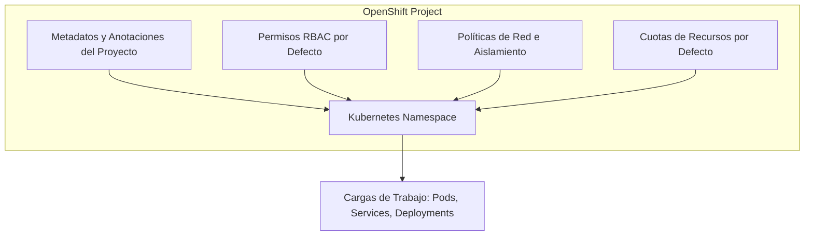
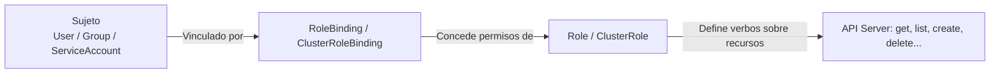
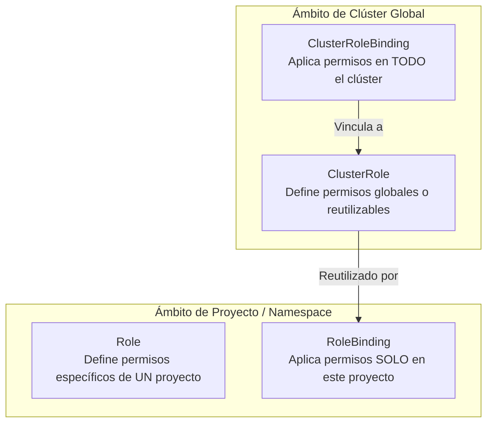
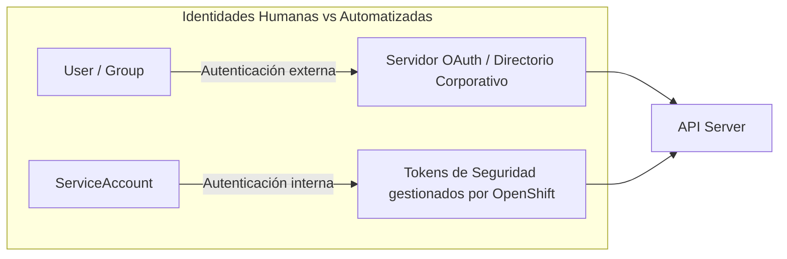
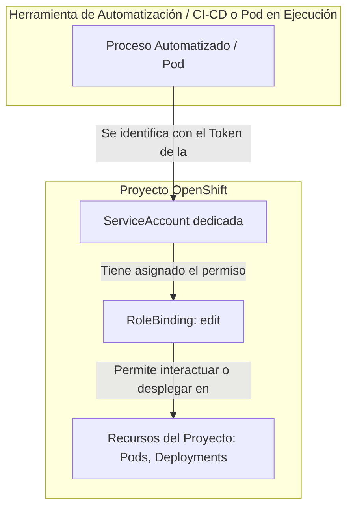
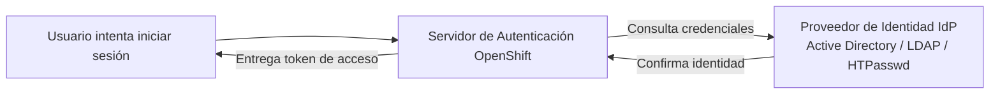
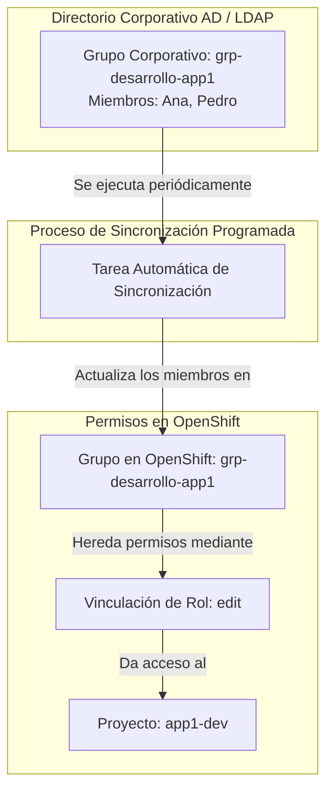

# 4.1 Proyectos y permisos

## Objetivos de aprendizaje

Al finalizar este apartado serás capaz de:

- Comprender la arquitectura de seguridad y control de acceso basado en roles (RBAC) en OpenShift.
- Diferenciar entre el recurso estándar de Kubernetes (`Namespace`) y la abstracción extendida de OpenShift (`Project`).
- Comprender el propósito de los roles predefinidos del sistema (`admin`, `edit`, `view`).
- Entender el concepto de asignación de autorizaciones mediante `Roles`, `ClusterRoles`, `RoleBindings` y `ClusterRoleBindings`.
- Distinguir entre identidades humanas (`Users`) y cuentas de servicio automatizadas (`ServiceAccounts`), conectando con su uso previo en la ejecución de Pods.
- Comprender el doble papel operativo de la `ServiceAccount` como identidad de ejecución para contenedores y como identidad de despliegue para procesos automatizados.
- Entender el flujo de integración de Proveedores de Identidad (IdP), incluyendo opciones corporativas y métodos locales como HTPasswd para entornos de prueba.
- Aplicar la buena práctica de asignación de permisos por **grupos**, comprendiendo el impacto operativo de la sincronización programada con el directorio corporativo.

---

## Proyectos frente a Namespaces: El aislamiento en OpenShift

En Kubernetes estándar, el mecanismo fundamental para dividir un clúster físico en parcelas lógicas aisladas es el **Namespace**. Sin embargo, un `Namespace` por sí solo no proporciona mecanismos nativos de autoprovisión ni gestión organizativa simplificada.

OpenShift extiende este concepto introduciendo el recurso **Project** (Proyecto).

Un **Proyecto** en OpenShift es una capa envolvente sobre el `Namespace` de Kubernetes que añade:

- **Autoprovisión controlada:** Permite a usuarios no administradores solicitar sus propios espacios de trabajo (mediante la CLI o la consola web), asignándoles automáticamente los permisos necesarios.
- **Aislamiento multinavegador (*Multi-tenancy*):** Asocia automáticamente límites de seguridad, cuotas de recursos y aislamiento de red.
- **Gestión organizativa:** Permite asignar descripciones, etiquetas de centro de coste y responsables del proyecto de manera sencilla.

!!! note "Relación 1 a 1"
    Técnicamente, cada `Project` en OpenShift se corresponde exactamente con un `Namespace` subyacente en Kubernetes. Un Proyecto es simplemente un Namespace enriquecido con la capa de gobierno de OpenShift.

---

## Control de Acceso Basado en Roles (RBAC)

Para garantizar la seguridad en un entorno corporativo donde coexisten múltiples equipos, OpenShift implementa **RBAC** (*Role-Based Access Control*). El principio de RBAC establece que nadie tiene acceso a nada por defecto; cada acción sobre la plataforma debe estar explícitamente autorizada.

El control de acceso basado en roles es un modelo formal de autorización que responde a una pregunta fundamental: **¿Quién puede hacer qué sobre qué objetos?**

El modelo se compone de cuatro elementos principales:

1. **Sujeto (*Subject*):** La identidad que realiza la petición. Puede ser un usuario humano (`User`), un grupo de usuarios (`Group`) o una cuenta automatizada (`ServiceAccount`).
2. **Rol (*Role* / *ClusterRole*):** El conjunto de permisos configurados. Un rol define qué operaciones (verbos) se permiten realizar sobre qué objetos (recursos) de la plataforma.
   - **Recursos (*Resources*):** Los objetos sobre los que se actúa (por ejemplo: `pods`, `services`, `deployments`, `routes`, `secrets`).
   - **Verbos (*Verbs*):** Las acciones permitidas sobre dichos recursos (por ejemplo: consultar/leer, crear, modificar, eliminar).
3. **Vinculación (*RoleBinding* / *ClusterRoleBinding*):** El puente que conecta a uno o varios **Sujetos** con un **Rol** concreto.
4. **API Server:** El componente central de OpenShift que recibe la petición y verifica si existe un vínculo válido para autorizar o denegar la acción.

---

## Roles predefinidos del sistema: `admin`, `edit` y `view`

Para evitar que los administradores tengan que definir manualmente reglas de permisos para cada situación, OpenShift incluye roles globales preconfigurados listos para usar de serie.

Estos roles predefinidos actúan como plantillas estándar para las necesidades operativas más habituales:

| Rol predefinido | Ámbito de actuación | Capacidades principales | Limitaciones clave |
| :--- | :--- | :--- | :--- |
| **`admin`** | Proyecto concreto | Control total sobre los recursos del proyecto. Puede dar acceso a otros usuarios dentro de su proyecto, gestionar cuotas y configurar secretos. | No puede modificar la infraestructura global del clúster ni gestionar otros proyectos. |
| **`edit`** | Proyecto concreto | Permite crear, modificar y eliminar aplicaciones y cargas de trabajo (Deployments, Pods, Services, Routes, ConfigMaps). Diseñado para desarrolladores. | **No puede gestionar permisos de acceso** (no puede añadir ni quitar usuarios) ni cambiar cuotas. |
| **`view`** | Proyecto concreto | Acceso de solo lectura para revisar el estado del proyecto (ver gráficos, consultar Pods y configuraciones). | No puede modificar ningún objeto, no puede ver información sensible como `Secrets` ni acceder a la consola interactiva de los contenedores. |

!!! tip "Uso habitual"
    En el día a día, la gestión de permisos en un proyecto suele reducirse a asignar el rol `edit` a los desarrolladores del equipo y el rol `view` a los perfiles de auditoría o monitorización.

---

## Roles y RoleBindings frente a ClusterRoles y ClusterRoleBindings

En el modelo de seguridad de OpenShift existe una distinción clara entre lo que aplica a un único proyecto y lo que aplica a todo el clúster.

### 1. Definición de Permisos (`Role` vs `ClusterRole`)
- **`Role`:** Define permisos que aplican **únicamente dentro de un proyecto específico**.
- **`ClusterRole`:** Define permisos a nivel global de todo el clúster (por ejemplo, para gestionar nodos o almacenamiento) o sirve como plantilla reutilizable entre proyectos.

### 2. Aplicación de Permisos (`RoleBinding` vs `ClusterRoleBinding`)
- **`RoleBinding`:** Asigna un Rol (local o global) a un usuario o grupo **solo dentro de un proyecto concreto**.
- **`ClusterRoleBinding`:** Asigna un Rol global a un usuario o grupo en **todos los proyectos del clúster** de forma simultánea.

!!! warning "Uso restringido de permisos globales"
    Otorgar vinculaciones a nivel de clúster (`ClusterRoleBinding`) concede alcance sobre toda la plataforma. Por seguridad, esta capacidad está reservada únicamente al equipo de administración del clúster.

---

## Usuarios frente a ServiceAccounts

En OpenShift existen dos tipos de identidades para interactuar con la plataforma:

### 1. Usuarios (`Users`)
Representan a **personas físicas** (desarrolladores, administradores, operadores).
- Su identidad no se crea dentro de OpenShift, sino que proviene del sistema de identidad de la organización.
- Inician sesión mediante la consola web o la CLI (`oc login`).

### 2. Cuentas de Servicio (`ServiceAccounts`)
Representan a **procesos automatizados, herramientas o aplicaciones** que necesitan comunicarse con OpenShift sin intervención humana.
- Se crean dentro de un proyecto concreto.
- Utilizan tokens de seguridad gestionados automáticamente por la plataforma.

---

## El doble papel operativo de la ServiceAccount: Ejecución y Despliegue

Como ya introdujimos en la Sesión 2 (apartado 2.6) al estudiar las políticas de seguridad y restricciones de contenedores, una `ServiceAccount` es el objeto de Kubernetes/OpenShift que proporciona una **identidad propia a los Pods y aplicaciones**. 

En este punto del curso, ampliamos esa perspectiva para comprender que la `ServiceAccount` cumple un **doble papel operativo fundamental** dentro de la plataforma:

1. **Como identidad de ejecución del Pod (enfoque de cargas de trabajo):** Tal y como vimos al gestionar las SCCs, los Pods ejecutan sus procesos bajo una `ServiceAccount` (como la cuenta por defecto o una dedicada), evitando que la aplicación actúe con privilegios de usuario humano y permitiendo aislar sus permisos de seguridad frente al clúster.
2. **Como identidad de despliegue y automatización (enfoque de CI/CD):** Se utiliza como credencial técnica (mediante tokens JWT) para que sistemas externos, herramientas de integración continua o pipelines se conecten de forma segura a OpenShift, permitiendo automatizar despliegues sin depender de cuentas personales.

---

## Proveedores de Identidad (IdP) y altas de usuarios externos

OpenShift no almacena las contraseñas de los usuarios en su base de datos interna por defecto. La gestión de credenciales se delega normalmente en los **Proveedores de Identidad (IdP)** de la organización.

### Integraciones y mecanismos habituales:
- **Active Directory / LDAP:** Para la validación centralizada de credenciales corporativas contra el directorio de la organización.
- **OpenID Connect (OIDC) / SAML:** Para integración con gestores de identidad empresariales modernos (ej. Keycloak, Okta, Azure AD / Entra ID).
- **HTPasswd:** Mecanismo basado en un archivo local plano que almacena nombres de usuario y contraseñas cifradas (*hashes*). Se utiliza habitualmente en entornos de laboratorio, pruebas locales, demostraciones o despliegues iniciales donde no se requiere o no se dispone de un directorio corporativo externo.

### El flujo de alta de un usuario:
1. El usuario es dado de alta en el sistema de identidad configurado (por ejemplo, en el directorio corporativo o mediante el fichero de HTPasswd).
2. La primera vez que entra en OpenShift, la plataforma valida sus credenciales con el IdP y crea su ficha de usuario local.
3. Por defecto, **un usuario recién autenticado no tiene acceso a ningún proyecto** hasta que se le asignen permisos explícitos mediante roles y grupos.

---

## Grupos y sincronización con el directorio

En entornos corporativos, gestionar accesos asignando permisos usuario por usuario resulta ineficiente y propenso a errores.

!!! warning "Regla de oro en la gestión de accesos"
    **Los permisos deben asignarse siempre a Grupos, no a personas individuales.**
    
    Las personas cambian de equipo o dejan la organización. Si los permisos se asignan a grupos, la gestión de accesos se mantiene limpia y centralizada en el directorio corporativo.

### La ventana de sincronización y su impacto operativo

OpenShift se conecta con el directorio corporativo para sincronizar la lista de usuarios que pertenecen a cada grupo.

Es muy importante entender que **esta sincronización no ocurre en tiempo real**, sino de forma **programada** (por ejemplo, una vez cada hora o de forma nocturna):

- **Impacto en Altas:** Si se añade un nuevo miembro a un grupo en Active Directory a las 10:00 AM, **no podrá acceder al proyecto en OpenShift inmediatamente**. Deberá esperar a que se ejecute el proceso de sincronización programado (o a que un administrador la lance manualmente).
- **Impacto en Bajas:** Si se retira a un usuario del grupo corporativo, sus accesos en OpenShift **seguirán activos** hasta que la siguiente ejecución de la sincronización actualice la lista de miembros dentro de la plataforma.

---

## Ideas clave para recordar

!!! tip "Resumen"
    - Un **`Project`** en OpenShift es un `Namespace` de Kubernetes enriquecido con autoprovisión, cuotas y políticas de aislamiento.
    - **RBAC** controla el acceso evaluando Sujetos (quién), Verbos (qué acción) y Recursos (sobre qué objeto).
    - Los roles predefinidos **`admin`**, **`edit`** y **`view`** cubren la inmensa mayoría de necesidades de permisos en un proyecto.
    - Los **`Roles`** aplican a nivel de un único proyecto; los **`ClusterRoles`** definen permisos globales o plantillas reutilizables.
    - Las **`ServiceAccounts`** conectan directamente con lo visto en la Sesión 2.6: actúan como identidad interna para aislar privilegios en los Pods y se extienden como identidad segura para automatizaciones y pipelines de CI/CD.
    - La autenticación de usuarios se delega en **Proveedores de Identidad (IdP)**, soportando soluciones corporativas (Active Directory, OIDC) o métodos locales basados en archivos como **HTPasswd** para entornos de pruebas.
    - **Asigna siempre los permisos a Grupos**, nunca a usuarios individuales.
    - La sincronización de grupos con el directorio corporativo es **programada**, por lo que los cambios de alta o baja no son inmediatos hasta que se ejecuta el proceso de sincronización.