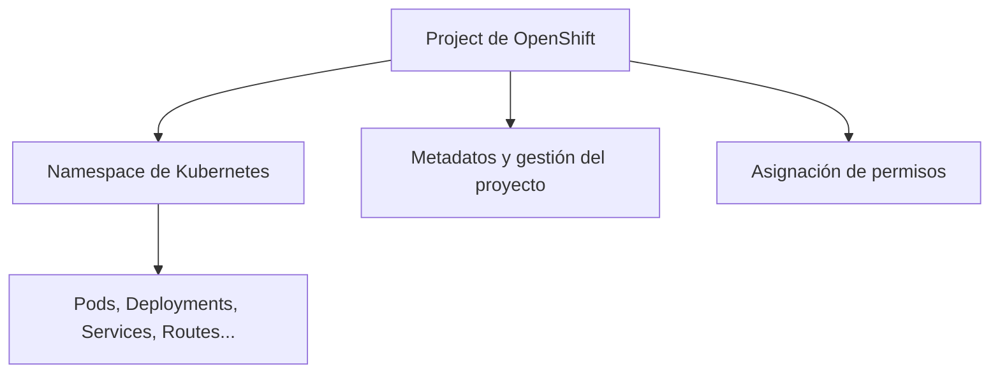
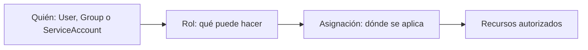
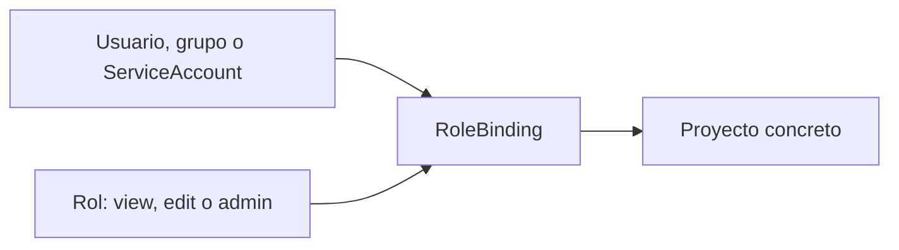
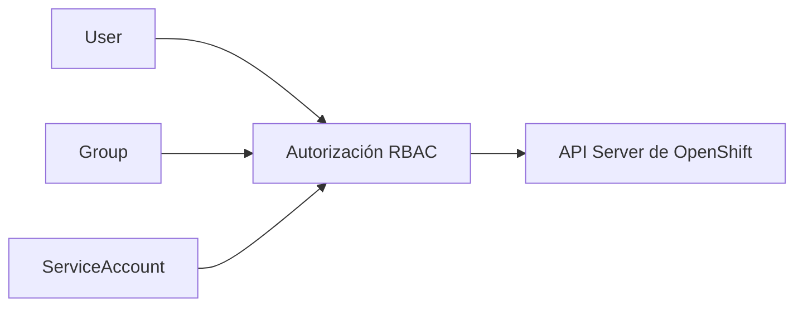
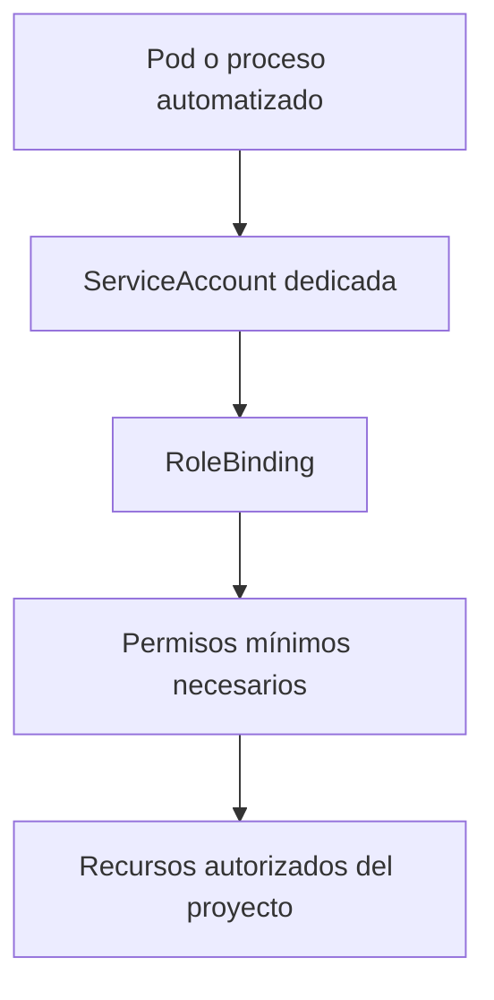
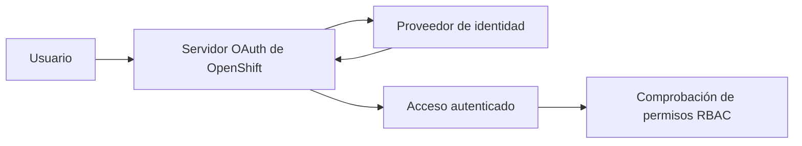
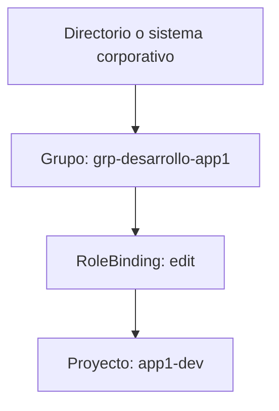

## 4.1 Proyectos y permisos

### Objetivos de aprendizaje

Al finalizar este apartado serás capaz de:

- Recordar la relación entre un **Project** de OpenShift y un **Namespace** de Kubernetes.
- Comprender de forma sencilla cómo RBAC determina **quién puede hacer qué y dónde**.
- Diferenciar los roles predefinidos **admin**, **edit** y **view**.
- Distinguir entre identidades humanas (**Users**), grupos (**Groups**) y cuentas de servicio (**ServiceAccounts**).
- Entender cómo OpenShift se integra con proveedores de identidad corporativos y locales.
- Aplicar la buena práctica de asignar permisos mediante **grupos**.

### De operar aplicaciones a controlar el acceso

En las sesiones anteriores hemos trabajado con aplicaciones desplegadas dentro de proyectos ya preparados. Hemos utilizado objetos como _Deployments_, _Services_, _Routes_, _ConfigMaps_, _Secrets_ y _PersistentVolumeClaims_, y también hemos comprobado que las opciones disponibles en la consola y en la línea de comandos dependen de los permisos de la identidad con la que trabajamos.

En la Sesión 1 vimos este efecto desde la consola web: OpenShift muestra o permite utilizar únicamente los recursos y acciones para los que el usuario tiene autorización. Más adelante, al estudiar las restricciones de seguridad de los contenedores, también apareció la **ServiceAccount** como identidad asociada a los Pods.

Ahora reuniremos esas ideas para responder a tres preguntas:

- **¿Quién** intenta realizar la operación?
- **¿Qué** operación puede realizar?
- **¿Dónde** puede realizarla?

### Project y Namespace: un recordatorio

Como vimos anteriormente, Kubernetes utiliza los **Namespaces** para agrupar y separar lógicamente los recursos de un clúster. OpenShift se apoya en ese mismo mecanismo y presenta el **Project** como la unidad de trabajo habitual para usuarios y equipos.

Técnicamente, cada Project se corresponde con un Namespace de Kubernetes. OpenShift añade sobre él una experiencia de gestión orientada a proyectos, con metadatos, mecanismos de solicitud y una gestión integrada de permisos.



La creación de un Project no implica por sí sola que se apliquen automáticamente cuotas, políticas de red o cualquier otra regla concreta. Esas medidas dependerán de la configuración y de las políticas definidas por el equipo administrador del clúster.

!!! note "Relación entre Project y Namespace"
    En el uso cotidiano de OpenShift hablaremos normalmente de **proyectos**. Cuando consultemos documentación general de Kubernetes encontraremos con más frecuencia el término **Namespace**. Ambos hacen referencia al mismo espacio lógico subyacente, aunque OpenShift incorpora capacidades adicionales de gestión alrededor del proyecto.

Tener proyectos separados permite organizar las aplicaciones y los equipos, pero todavía falta responder a una pregunta fundamental: **¿quién puede trabajar en cada proyecto y qué puede hacer dentro de él?**

### Control de acceso basado en roles (RBAC)

Para controlar el acceso en entornos donde conviven diferentes equipos y aplicaciones, OpenShift utiliza **RBAC** (_Role-Based Access Control_ o control de acceso basado en roles).

RBAC determina si una identidad está autorizada para realizar una operación sobre un recurso. Para comprenderlo en este curso basta con pensar en tres elementos:

- **Quién:** un usuario, un grupo o una ServiceAccount.
- **Qué puede hacer:** consultar, crear, modificar o eliminar recursos.
- **Dónde:** en un proyecto concreto o, en casos administrativos, en el conjunto del clúster.



Cuando una identidad solicita una operación, el API Server comprueba los permisos aplicables y autoriza o deniega la petición. Una identidad solo puede realizar las operaciones que le hayan sido concedidas mediante los roles y vinculaciones correspondientes.

No es necesario que el alumno aprenda a diseñar políticas RBAC personalizadas. Lo importante en este punto es comprender el modelo general y reconocer las asignaciones de permisos más habituales.

### Roles predefinidos del sistema: admin, edit y view

Para evitar que los administradores tengan que definir manualmente reglas de permisos para cada situación, OpenShift incluye roles preconfigurados que cubren las necesidades más habituales dentro de un proyecto.

| Rol predefinido | Ámbito habitual | Capacidades principales | Limitaciones principales |
|---|---|---|---|
| **admin** | Proyecto concreto | Administra los recursos del proyecto y puede gestionar el acceso de otros usuarios o grupos dentro de ese proyecto. | No administra la infraestructura global del clúster ni otros proyectos. |
| **edit** | Proyecto concreto | Permite crear, modificar y eliminar la mayoría de los recursos de una aplicación, como Deployments, Services, Routes y ConfigMaps. | No permite gestionar los permisos del proyecto ni modificar recursos reservados para la administración. |
| **view** | Proyecto concreto | Permite consultar el estado y la configuración general de los recursos del proyecto. | No permite modificar recursos y no concede acceso de lectura a determinados contenidos sensibles, como los valores de los Secrets. |

!!! tip "Uso habitual"
    En el trabajo diario es frecuente asignar **edit** a los grupos responsables de desplegar y mantener aplicaciones, y **view** a perfiles que solo necesitan consultar su estado. El rol **admin** debe reservarse para quienes realmente necesitan administrar el proyecto y sus accesos.

### Cómo se asigna un rol

Un rol describe un conjunto de permisos, pero esos permisos no se aplican hasta que el rol se vincula con una identidad.

Dentro de un proyecto, un **RoleBinding** relaciona:

- una identidad, que puede ser un usuario, un grupo o una ServiceAccount;
- un rol, como `view`, `edit` o `admin`;
- y el proyecto en el que se aplica la autorización.



Por ejemplo, el siguiente comando concede el rol `edit` al grupo `grp-desarrollo-app1` dentro del proyecto activo:

```bash
oc adm policy add-role-to-group edit grp-desarrollo-app1
```

De esta forma, los miembros del grupo pueden trabajar con las aplicaciones del proyecto sin recibir permisos administrativos sobre todo el clúster.

Los objetos **ClusterRole** y **ClusterRoleBinding** permiten definir o asignar permisos con alcance de clúster. También es habitual reutilizar un ClusterRole, como `view`, `edit` o `admin`, mediante un RoleBinding limitado a un proyecto. Para este curso es suficiente saber que los permisos globales tienen un alcance mucho mayor y su gestión corresponde al equipo administrador de la plataforma.

!!! warning "Uso restringido de permisos globales"
    Una vinculación con alcance de clúster puede afectar a todos los proyectos o a recursos globales de la plataforma. Por seguridad, estas asignaciones deben reservarse para necesidades administrativas justificadas.

### Usuarios, grupos y ServiceAccounts

RBAC puede conceder permisos a distintos tipos de identidades. La diferencia principal no está en el mecanismo de autorización, sino en quién o qué representa cada identidad.

| Identidad | Representa | Ejemplo habitual |
|---|---|---|
| **User** | Una persona que accede a OpenShift | Un operador o desarrollador que utiliza la consola web o la CLI `oc`. |
| **Group** | Un conjunto de usuarios | El equipo responsable de una aplicación, al que se asigna el rol `edit`. |
| **ServiceAccount** | Una carga de trabajo o un proceso automatizado | Un Pod que consulta la API o una automatización que despliega recursos. |



#### Usuarios y grupos

Los usuarios representan personas físicas, como desarrolladores, administradores u operadores. Normalmente su identidad procede del sistema de identidad de la organización y acceden mediante la consola web o la CLI con `oc login`.

Los grupos permiten gestionar conjuntamente los permisos de varias personas. En lugar de asignar el rol `edit` individualmente a cada miembro de un equipo, se asigna el rol al grupo y se gestiona su pertenencia desde el sistema correspondiente.

#### ServiceAccounts: identidad para aplicaciones y automatizaciones

Como vimos en la Sesión 2, al estudiar las SCC, una **ServiceAccount** proporciona una identidad no humana que puede ser utilizada por los Pods y por otros procesos automatizados.

Todos los Pods se ejecutan asociados a una ServiceAccount. Si no se especifica otra, normalmente utilizan la ServiceAccount `default` de su proyecto. Cuando una aplicación necesita interactuar con la API de OpenShift, puede utilizarse una ServiceAccount dedicada y concederle únicamente los permisos que necesite.

Del mismo modo, una herramienta de automatización o un pipeline puede utilizar una identidad técnica para desplegar o modificar recursos sin depender de las credenciales personales de un usuario. No se trata de un segundo tipo de ServiceAccount: es la misma identidad técnica utilizada en otro contexto operativo.



Es importante distinguir dos planos relacionados, pero diferentes:

- Las **SCC** condicionan las características de seguridad con las que puede ejecutarse un Pod.
- **RBAC** determina qué operaciones puede realizar una identidad sobre la API de OpenShift.

Una ServiceAccount puede intervenir en ambos mecanismos, pero SCC y RBAC no controlan lo mismo.

!!! tip "Principio de mínimo privilegio"
    Utiliza una ServiceAccount dedicada cuando una aplicación o automatización necesite permisos específicos y concédele solo las operaciones imprescindibles para su función.

### Proveedores de identidad (IdP)

OpenShift no suele gestionar directamente las contraseñas corporativas. La autenticación se delega normalmente en uno o varios **proveedores de identidad** (_Identity Providers_ o IdP).

Conviene diferenciar dos conceptos:

- **Autenticación:** comprueba quién es la persona o sistema que intenta acceder.
- **Autorización:** determina qué puede hacer esa identidad una vez autenticada. En OpenShift, esta decisión se controla mediante RBAC.



#### Integraciones y mecanismos habituales

- **Active Directory / LDAP:** se utilizan para validar las credenciales contra el directorio corporativo de la organización. LDAP es el protocolo de acceso al directorio, mientras que Active Directory es una solución de directorio de Microsoft que puede integrarse mediante LDAP u otros mecanismos compatibles.
- **OpenID Connect (OIDC):** protocolo moderno basado en OAuth 2.0 que permite integrar OpenShift con plataformas de identidad como Keycloak, Okta o Microsoft Entra ID.
- **SAML:** estándar de federación de identidad todavía presente en numerosos entornos corporativos. Dependiendo de la arquitectura, puede integrarse mediante una solución de identidad que actúe como intermediaria y exponga a OpenShift un mecanismo compatible.
- **HTPasswd:** mecanismo basado en un archivo local que almacena nombres de usuario y hashes de contraseña. Se utiliza habitualmente en laboratorios, demostraciones, pruebas o entornos iniciales donde no se dispone de un directorio corporativo.

!!! note "HTPasswd no sustituye al directorio corporativo"
    HTPasswd resulta sencillo para un entorno de formación como el del curso, pero en producción normalmente se prefiere integrar OpenShift con el sistema corporativo de identidad para centralizar las altas, bajas y políticas de acceso.

### Grupos y sincronización con el directorio

En entornos corporativos, gestionar los accesos usuario por usuario resulta ineficiente y propenso a errores. Por ello, la práctica recomendada es asignar los roles a grupos que representen equipos o funciones.



Por ejemplo, un grupo corporativo denominado `grp-desarrollo-app1` puede vincularse al rol `edit` en el proyecto `app1-dev`. Cuando cambia la composición del equipo, se actualiza la pertenencia al grupo sin modificar cada RoleBinding individualmente.

La forma en que los grupos corporativos se reflejan en OpenShift depende de la arquitectura de identidad configurada. Algunas organizaciones utilizan procesos de sincronización periódica, otras emplean automatizaciones propias y otras integraciones obtienen o transforman la información durante el acceso. Por tanto, no debe asumirse que todas las integraciones funcionan en tiempo real ni que todas utilizan una tarea programada.

Si existe sincronización periódica, las altas y bajas pueden no reflejarse en OpenShift hasta la siguiente ejecución del proceso. Este comportamiento debe tenerse en cuenta especialmente en las revocaciones de acceso.

!!! warning "Regla general para la gestión de accesos"
    Siempre que la organización y el caso de uso lo permitan, asigna los permisos a **grupos** y evita mantener autorizaciones individuales difíciles de revisar y retirar.

### Ideas clave para recordar

!!! tip "Resumen"
    - Un **Project** de OpenShift se apoya en un **Namespace** de Kubernetes y añade una experiencia de gestión orientada a proyectos.
    - **RBAC** responde a tres preguntas: quién solicita la operación, qué puede hacer y dónde puede hacerlo.
    - Los roles predefinidos **admin**, **edit** y **view** cubren las necesidades más habituales dentro de un proyecto.
    - Un **RoleBinding** asigna un rol a un usuario, grupo o ServiceAccount dentro de un ámbito determinado.
    - RBAC se aplica tanto a identidades humanas como a **ServiceAccounts**.
    - Las **SCC** controlan condiciones de ejecución de los Pods, mientras que **RBAC** controla operaciones sobre la API.
    - La autenticación puede delegarse en proveedores como Active Directory, LDAP, OIDC, SAML o HTPasswd; la autorización posterior se controla mediante RBAC.
    - Los permisos deben asignarse preferentemente a **grupos**, teniendo en cuenta cómo se actualiza su pertenencia en cada arquitectura de identidad.
