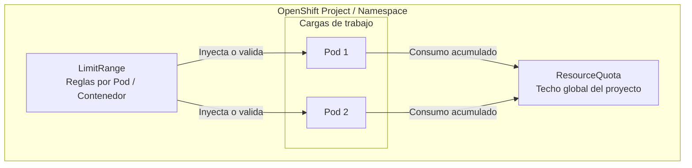
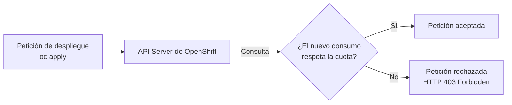
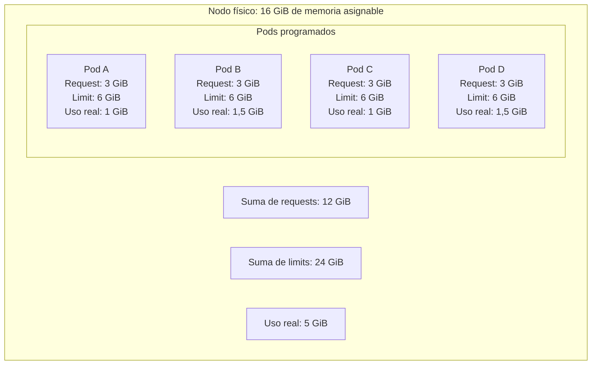
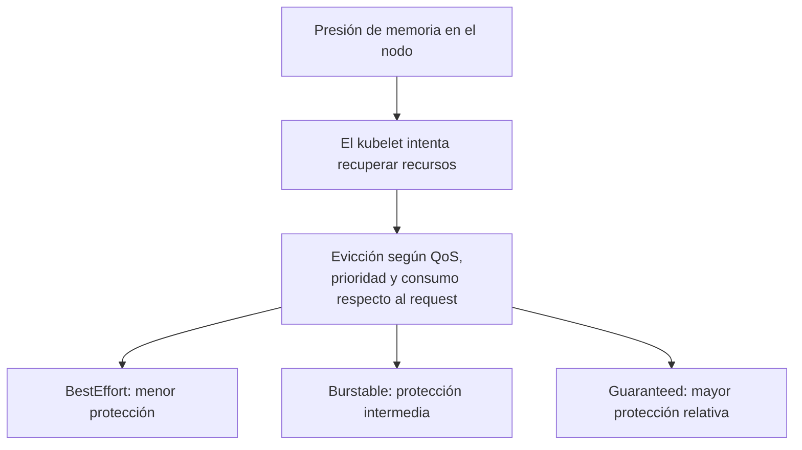
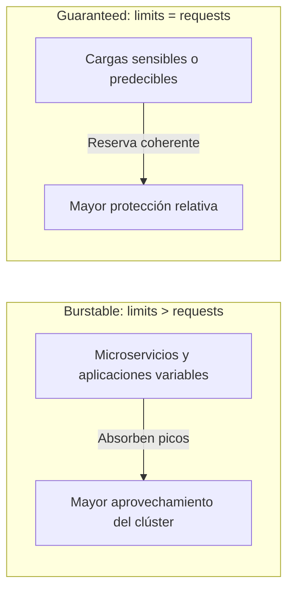
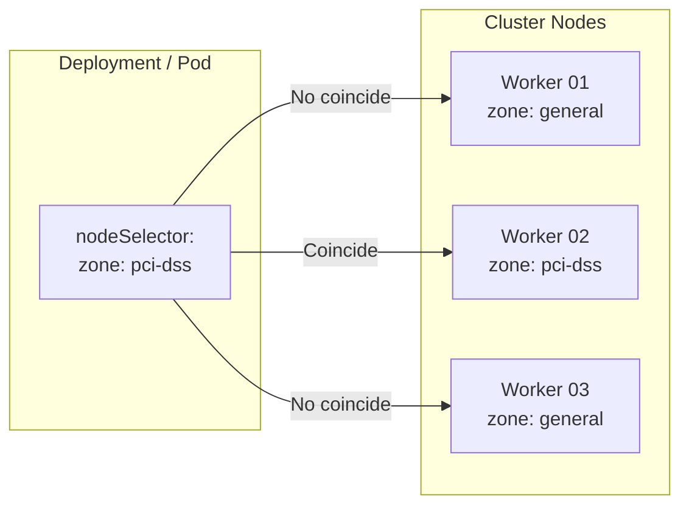
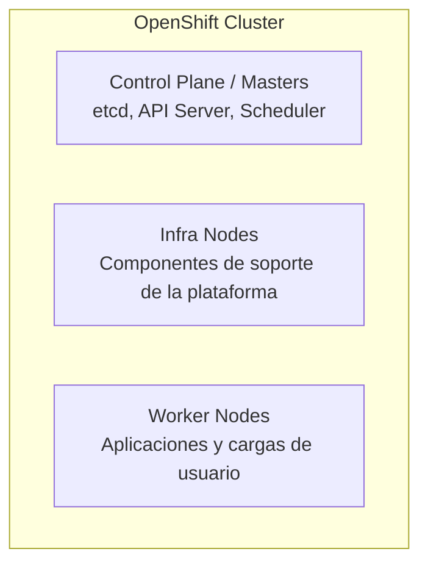

# 4.2 Recursos, cuotas y ubicación: ResourceQuota, LimitRange y el overcommit —reservas altas con uso real bajo—, y cómo se manda un pod a unos nodos concretos (`nodeSelector`, nodos de infraestructura) ★

## Objetivos de aprendizaje

Al finalizar este apartado serás capaz de:

- Comprender el modelo de gobierno de recursos en OpenShift y cómo la plataforma favorece la convivencia segura de múltiples equipos (*multi-tenancy*).
- Configurar y aplicar objetos **ResourceQuota** para restringir el consumo máximo total de cómputo, almacenamiento y objetos en un proyecto.
- Definir políticas por defecto mediante objetos **LimitRange** para evitar que los contenedores carezcan de valores de recursos o utilicen valores desproporcionados.
- Comprender el concepto de **overcommit** (sobreasignación), analizando los riesgos y oportunidades operativas del desfase entre reservas (*requests*), límites (*limits*) y uso real.
- Entender el concepto de **Calidad de Servicio (QoS)**, evaluando las estrategias de diseño (`limits > requests` frente a `limits = requests`) y el comportamiento del sistema ante la presión de memoria.
- Utilizar **`nodeSelector`** para gobernar el posicionamiento de las cargas de trabajo en el clúster.
- Comprender la función de los **nodos de infraestructura** (*Infra Nodes*), distinguiendo qué componentes pueden ejecutarse en ellos y sus implicaciones operativas y de suscripción.

---

## Gobernanza de recursos en entornos compartidos (*multi-tenancy*)

En el apartado anterior vimos una primera dimensión del gobierno de la plataforma: controlar **quién puede acceder a un proyecto y qué operaciones puede realizar** mediante RBAC.

Pero gobernar una plataforma compartida no consiste únicamente en controlar permisos. También necesitamos evitar que un proyecto consuma de forma desproporcionada los recursos disponibles para todos.

En la Sesión 2 estudiamos cómo definir las peticiones (*requests*) y los límites (*limits*) de cada contenedor dentro del manifiesto de un `Deployment` o un `Pod`. Sin embargo, en una plataforma corporativa compartida por múltiples proyectos y equipos, confiar exclusivamente en que cada desarrollador dimensione correctamente sus aplicaciones no es una estrategia de gobierno suficiente.

Un equipo podría, por ejemplo, desplegar demasiadas réplicas o solicitar una cantidad excesiva de CPU, memoria o almacenamiento, reduciendo los recursos disponibles para el resto de las aplicaciones del clúster.

Para establecer políticas comunes a nivel de proyecto, OpenShift proporciona dos objetos fundamentales: **ResourceQuota** y **LimitRange**.



- **LimitRange, a nivel de Pod o contenedor:** actúa como un regulador individual. Puede definir valores mínimos, máximos y valores por defecto para los contenedores que se creen dentro del proyecto.
- **ResourceQuota, a nivel de proyecto:** actúa como un techo global. Limita la suma total de recursos, almacenamiento u objetos que puede consumir el conjunto del proyecto.

---

## Restricción del consumo global: `ResourceQuota`

El objeto **ResourceQuota** limita el consumo acumulado de los recursos que residen dentro de un mismo proyecto. Cuando se crea un `ResourceQuota`, el servidor de la API de OpenShift rechaza cualquier nueva petición que provoque que el proyecto supere alguno de los máximos configurados.



### Tipos de recursos que se pueden limitar

1. **Recursos de cómputo:** suma total de `requests.cpu`, `requests.memory`, `limits.cpu` y `limits.memory`.
2. **Recursos de almacenamiento:** suma total de peticiones de almacenamiento (`requests.storage`), número total de PVC (`persistentvolumeclaims`) o restricciones específicas por clase de almacenamiento.
3. **Conteo de objetos:** cantidad máxima de recursos concretos dentro del proyecto, por ejemplo `pods`, `services`, `secrets`, `configmaps` o `services.loadbalancers`.

### Manifiesto de ejemplo: `resourcequota.yaml`

```yaml
apiVersion: v1
kind: ResourceQuota
metadata:
  name: cuota-proyecto-dev
  namespace: angel-cuaresma-alons-dev
spec:
  hard:
    # Cómputo acumulado
    requests.cpu: "4"
    requests.memory: "8Gi"
    limits.cpu: "8"
    limits.memory: "16Gi"

    # Almacenamiento acumulado
    requests.storage: "100Gi"
    persistentvolumeclaims: "5"

    # Conteo de objetos
    pods: "20"
    services: "10"
```

Aplicamos la cuota sobre el proyecto:

```bash
oc apply -f resourcequota.yaml
```

Y comprobamos que está activa y qué consumo contabiliza:

```bash
oc describe resourcequota cuota-proyecto-dev
```

!!! warning "La cuota necesita datos que pueda contabilizar"
    En este ejemplo, el `ResourceQuota` controla tanto `requests.cpu` y `requests.memory` como `limits.cpu` y `limits.memory`. Por ello, los Pods del proyecto necesitan disponer de esos valores para que OpenShift pueda contabilizarlos frente a la cuota.

    Esta exigencia depende de los recursos concretos incluidos en el `ResourceQuota`. No todos los tipos de cuota obligan por sí mismos a declarar CPU y memoria.

---

## Políticas por defecto y fronteras: `LimitRange`

Para evitar que los despliegues fallen porque un desarrollador olvidó especificar la sección `resources`, OpenShift permite configurar un **LimitRange**.

Un `LimitRange` puede cumplir tres funciones principales:

1. **Valores por defecto:** si un contenedor no especifica `requests` o `limits`, la plataforma puede incorporar automáticamente los valores definidos en el `LimitRange`.
2. **Valores mínimos y máximos:** evita peticiones demasiado pequeñas o desproporcionadas para un contenedor individual.
3. **Relación máxima entre límite y petición:** mediante `maxLimitRequestRatio`, puede impedir que la diferencia entre un `limit` y su `request` supere una proporción determinada.

### Manifiesto de ejemplo: `limitrange.yaml`

```yaml
apiVersion: v1
kind: LimitRange
metadata:
  name: limites-por-defecto
  namespace: angel-cuaresma-alons-dev
spec:
  limits:
    - type: Container

      # Valores asignados automáticamente si no se especifican
      default:
        cpu: "500m"
        memory: "512Mi"
      defaultRequest:
        cpu: "200m"
        memory: "256Mi"

      # Rango permitido para cada contenedor
      max:
        cpu: "2"
        memory: "4Gi"
      min:
        cpu: "50m"
        memory: "64Mi"
```

---

## Demostración: observar las políticas de recursos del Sandbox

En Red Hat OpenShift Sandbox, las políticas `ResourceQuota` y `LimitRange` ya están configuradas en el proyecto. Como usuarios del proyecto no necesitamos crear ni modificar estos objetos: vamos a descubrirlos, interpretar sus valores y comprobar cómo afectan a nuestras cargas.

La práctica seguirá esta secuencia:

1. Consultar las políticas existentes en el proyecto.
2. Comprobar cómo un `LimitRange` incorpora valores por defecto a un Pod.
3. Observar cómo esos valores se contabilizan en el `ResourceQuota`.
4. Intentar desplegar una carga que supere la cuota y diagnosticar el rechazo.

### 1. Descubrir las políticas existentes

Consultamos los objetos `ResourceQuota` y `LimitRange` disponibles en el proyecto:

```bash
oc get resourcequota
oc get limitrange
```

En el Sandbox podemos encontrar varias cuotas, separadas según el tipo de recurso o carga. Para esta demostración nos interesan especialmente:

- `compute-deploy`, que contabiliza CPU y memoria de los Pods de larga duración, como los creados por un `Deployment`.
- `resource-limits`, que define los valores por defecto aplicables a cada contenedor.

Consultamos sus detalles:

```bash
oc describe resourcequota compute-deploy
oc describe limitrange resource-limits
```

La cuota `compute-deploy` presenta los valores mediante dos columnas:

- **Used:** recursos que ya están contabilizados por las cargas actuales.
- **Hard:** máximo acumulado permitido por la política.

El `LimitRange` del Sandbox define los siguientes valores por defecto:

| Recurso | Request por defecto | Limit por defecto |
| :--- | :--- | :--- |
| CPU | `10m` | `1` |
| Memoria | `64Mi` | `1000Mi` |

### 2. Comprobar cómo actúa el `LimitRange`

Creamos un Deployment temporal sin declarar `requests` ni `limits`:

```bash
oc create deployment demo-recursos \
  --image=docker.io/ieftraining/demo-formacion:v3
```

Comprobamos los recursos declarados en la plantilla del Deployment:

```bash
oc get deployment demo-recursos \
  -o jsonpath='{.spec.template.spec.containers[0].resources}{"\n"}'
```

El resultado es un objeto vacío:

```json
{}
```

Esto confirma que el Deployment creado por nosotros no contiene una sección `resources`.

Consultamos ahora los recursos del Pod generado a partir de ese Deployment:

```bash
oc get pod -l app=demo-recursos \
  -o jsonpath='{.items[0].spec.containers[0].resources}{"\n"}'
```

El Pod sí contiene valores de recursos:

```json
{
  "limits": {
    "cpu": "1",
    "memory": "1000Mi"
  },
  "requests": {
    "cpu": "10m",
    "memory": "64Mi"
  }
}
```

!!! note "¿De dónde han salido estos valores?"
    Los valores no estaban incluidos en el Deployment. El `LimitRange resource-limits` los ha incorporado durante la admisión del Pod, antes de que este fuera creado.

    El `LimitRange` no modifica la plantilla almacenada en el Deployment. Los valores aparecen en el Pod resultante.

### 3. Comprobar cómo lo contabiliza el `ResourceQuota`

Volvemos a consultar la cuota:

```bash
oc describe resourcequota compute-deploy
```

Los valores por defecto incorporados al Pod pasan a formar parte del consumo acumulado del proyecto. En la prueba realizada en el Sandbox, tras crear `demo-recursos`, se observó el siguiente incremento:

| Recurso | Antes | Después | Incremento |
| :--- | ---: | ---: | ---: |
| `requests.cpu` | `300m` | `310m` | `10m` |
| `requests.memory` | `768Mi` | `832Mi` | `64Mi` |
| `limits.cpu` | `1300m` | `2300m` | `1` CPU |
| `limits.memory` | `4736Mi` | `5736Mi` | `1000Mi` |

Así se relacionan ambos mecanismos:

1. El `LimitRange` incorpora valores por defecto al contenedor del Pod.
2. El `ResourceQuota` contabiliza esos valores dentro del consumo global del proyecto.

Los valores exactos de la columna **Used** pueden variar según las cargas que existan en el proyecto cuando se realice la práctica.

### 4. Intentar superar la cuota

En nuestra prueba, `compute-deploy` permite un máximo acumulado de `3` CPU en `requests`, mientras que el proyecto ya utiliza `310m`.

Creamos el fichero `prueba-cuota.yaml` con un Deployment cuyo Pod solicita `3` CPU adicionales:

```yaml
apiVersion: apps/v1
kind: Deployment
metadata:
  name: prueba-cuota
spec:
  replicas: 1
  selector:
    matchLabels:
      app: prueba-cuota
  template:
    metadata:
      labels:
        app: prueba-cuota
    spec:
      containers:
        - name: demo
          image: docker.io/ieftraining/demo-formacion:v3
          resources:
            requests:
              cpu: "3"
              memory: "64Mi"
            limits:
              cpu: "3"
              memory: "128Mi"
```

Aplicamos el manifiesto:

```bash
oc apply -f prueba-cuota.yaml
```

El `Deployment` y su `ReplicaSet` pueden crearse, pero el controlador no consigue crear el Pod porque su petición haría que el proyecto superase la cuota.

Podemos comprobarlo mediante:

```bash
oc get deployment prueba-cuota
oc get pods -l app=prueba-cuota
oc describe deployment prueba-cuota
```

También podemos consultar los eventos del `ReplicaSet` asociado desde la consola web o mediante `oc describe`. El mensaje observado en el Sandbox es equivalente a:

```text
Error creating: pods "prueba-cuota-..." is forbidden:
exceeded quota: compute-deploy,
requested: requests.cpu=3,
used: requests.cpu=310m,
limited: requests.cpu=3
```

La lectura del error es directa:

- `requested: requests.cpu=3`: el nuevo Pod solicita `3` CPU.
- `used: requests.cpu=310m`: el proyecto ya tiene `310m` contabilizados.
- `limited: requests.cpu=3`: la cuota permite un máximo total de `3` CPU.

Por tanto:

```text
310m + 3000m = 3310m > 3000m
```

OpenShift rechaza la creación del Pod porque el consumo acumulado superaría el máximo permitido.

!!! note "El Deployment puede existir aunque el Pod sea rechazado"
    `ResourceQuota` no impide necesariamente que se almacene el objeto `Deployment`. La restricción se manifiesta cuando el controlador intenta crear el Pod sujeto a la cuota. Por eso debemos revisar los Pods, los eventos y el estado del Deployment, no únicamente el resultado de `oc apply`.

### 5. Limpiar los recursos de la práctica

Eliminamos los Deployments temporales:

```bash
oc delete deployment demo-recursos prueba-cuota
```

Al desaparecer sus Pods, los recursos que contabilizaban dejan de aparecer en la columna **Used** del `ResourceQuota`.

---

## El overcommit: límites superiores a las reservas

En la arquitectura de plataformas existe una diferencia importante entre los recursos **reservados**, los recursos **permitidos** y los recursos **consumidos realmente**:

- **Requests:** cantidad que el Scheduler utiliza para decidir si un nodo tiene capacidad para alojar un Pod.
- **Limits:** consumo máximo permitido para el contenedor cuando existe capacidad disponible.
- **Uso real:** consumo instantáneo medido por el sistema operativo y las herramientas de monitorización.

El **overcommit** o sobreasignación consiste en permitir que la suma de los `limits` sea superior a la capacidad física del nodo, confiando en que no todas las aplicaciones alcanzarán simultáneamente su consumo máximo.

Los `requests`, en cambio, son la referencia utilizada por el Scheduler para colocar los Pods. Por ello, en condiciones normales, no se programarán nuevos Pods si la suma de sus reservas no cabe en la capacidad asignable del nodo.



### ¿Por qué se utiliza el overcommit?

Muchas aplicaciones se dimensionan para soportar picos puntuales, pero durante gran parte del tiempo consumen menos recursos. Si todos los `limits` tuvieran que estar físicamente reservados en todo momento, el clúster quedaría infrautilizado.

El overcommit permite aumentar la densidad de cargas, aunque introduce un riesgo: si muchas aplicaciones intentan alcanzar simultáneamente sus límites de memoria, el nodo puede quedarse sin memoria física.

!!! note "CPU y memoria no se comportan igual"
    Cuando un contenedor alcanza su límite de CPU, normalmente su ejecución se ralentiza mediante *throttling*. Cuando supera su límite de memoria, puede ser terminado con estado `OOMKilled`.

---

## Calidad de Servicio (QoS) y presión de memoria

En el apartado 2.3 estudiamos `requests` y `limits`, pero dejamos pendiente la clasificación de Calidad de Servicio. Kubernetes y OpenShift asignan automáticamente a cada Pod una clase de **QoS** según cómo estén definidos los recursos de todos sus contenedores.

Esta clasificación influye en las decisiones del nodo cuando existe presión de memoria.

| Clase de QoS | Regla de configuración | Protección relativa |
| :--- | :--- | :--- |
| **Guaranteed** | Todos los contenedores definen `requests` y `limits` de CPU y memoria, y para cada recurso `request = limit`. | Mayor protección relativa ante una evicción por presión de recursos. |
| **Burstable** | El Pod no cumple las condiciones de `Guaranteed`, pero al menos un contenedor define algún `request` o `limit`. | Protección intermedia. Los Pods que consumen por encima de sus `requests` son candidatos preferentes cuando existe presión de memoria. |
| **BestEffort** | Ningún contenedor define `requests` ni `limits` de CPU o memoria. | Menor protección. Son los primeros candidatos a la evicción. |



!!! warning "QoS no es una garantía absoluta"
    Un Pod `Guaranteed` no es invulnerable. La QoS es uno de los factores utilizados ante la presión de recursos, junto con la prioridad del Pod y el consumo real respecto a sus `requests`.

### Criterio de diseño: `limits > requests` o `limits = requests`

No existe una única regla válida para todas las aplicaciones. La decisión depende de la naturaleza de la carga y del equilibrio deseado entre protección y aprovechamiento del clúster.



#### 1. Aplicaciones con consumo variable: `limits > requests` (*Burstable*)

- Es un patrón habitual para aplicaciones web y microservicios con tráfico variable.
- El `request` representa la reserva necesaria para el funcionamiento normal.
- El `limit` proporciona margen para absorber picos cuando el nodo dispone de recursos.
- Permite mayor densidad y overcommit, pero aumenta el riesgo bajo presión de memoria.

#### 2. Cargas sensibles o predecibles: `limits = requests` (*Guaranteed*)

- Puede ser adecuado para cargas con necesidades previsibles o especialmente sensibles a la falta de recursos.
- La igualdad debe cumplirse para CPU y memoria en todos los contenedores del Pod para obtener QoS `Guaranteed`.
- Reduce el margen de overcommit y puede disminuir la densidad de cargas del clúster.

No debe asumirse que todas las bases de datos o aplicaciones críticas necesitan automáticamente QoS `Guaranteed`. El dimensionamiento debe basarse en mediciones, requisitos de servicio y comportamiento real de cada aplicación.

### ¿Qué ocurre cuando se agota la memoria?

Conviene distinguir dos situaciones relacionadas, pero diferentes:

- **Presión de memoria en el nodo:** el kubelet puede expulsar Pods para recuperar recursos. El Pod aparece como `Evicted`.
- **El contenedor supera su límite de memoria:** el kernel puede terminar su proceso y Kubernetes muestra el estado `OOMKilled`, normalmente con código de salida `137`.

La QoS influye en las decisiones de evicción del nodo, pero no evita que un contenedor sea terminado si supera su propio límite de memoria.

---

## Cómo mandar un Pod a nodos concretos: `nodeSelector`

Por defecto, el Scheduler de OpenShift decide en qué nodo de trabajo debe ejecutarse cada Pod, basándose, entre otros factores, en la capacidad disponible y las restricciones de programación.

Sin embargo, existen escenarios en los que necesitamos dirigir una carga hacia nodos con características concretas:

- nodos con hardware especializado, como GPU;
- nodos ubicados en una zona determinada;
- cumplimiento de requisitos organizativos o de licenciamiento;
- separación de determinados tipos de carga.

El mecanismo más sencillo para hacerlo es combinar **etiquetas** en los nodos y un **`nodeSelector`** en la plantilla del Pod.



### Paso 1: etiquetar los nodos

El equipo de plataforma asigna etiquetas clave-valor a los nodos correspondientes:

```bash
oc label node worker-02.example.com zone=pci-dss hardware=gpu
```

Esta operación requiere permisos de administración del clúster. En un entorno de formación o en Red Hat OpenShift Sandbox puede que el alumno no disponga de permisos para ejecutarla, pero sí debe comprender el mecanismo.

### Paso 2: definir el selector en el Deployment

Dentro de `spec.template.spec` se añade la sección `nodeSelector`:

```yaml
apiVersion: apps/v1
kind: Deployment
metadata:
  name: procesamiento-seguro
  namespace: angel-cuaresma-alons-dev
spec:
  replicas: 2
  selector:
    matchLabels:
      app: procesamiento-seguro
  template:
    metadata:
      labels:
        app: procesamiento-seguro
    spec:
      nodeSelector:
        zone: pci-dss
        hardware: gpu
      containers:
        - name: worker-app
          image: registry.example.com/app/worker:v1.0
          resources:
            requests:
              cpu: "500m"
              memory: "1Gi"
```

Cuando se especifican varias etiquetas, el nodo debe cumplirlas todas.

!!! note "Selectores estrictos"
    Si el `nodeSelector` no coincide con ningún nodo, o los nodos coincidentes no disponen de capacidad, el Pod permanece en estado `Pending`.

    Al ejecutar `oc describe pod <nombre-del-pod>`, los eventos indicarán que ningún nodo cumple el selector, por ejemplo: `0/N nodes are available: node(s) didn't match Pod's node selector`.

`nodeSelector` es un mecanismo sencillo y estricto. Kubernetes dispone de opciones más avanzadas, como afinidad y antiafinidad, pero no son necesarias para comprender el objetivo de este apartado.

---

## Nodos de infraestructura (*Infra Nodes*)

En la arquitectura de un clúster de producción de OpenShift, introducida en el apartado 1.5, los nodos pueden especializarse según su función:



1. **Nodos de control o Control Plane:** ejecutan los servicios centrales del clúster, como la API, el Scheduler y `etcd`. Normalmente no ejecutan cargas de usuario.
2. **Worker Nodes:** están destinados a las aplicaciones y cargas de trabajo de los usuarios.
3. **Infra Nodes:** son nodos de trabajo dedicados a determinados componentes de infraestructura de la plataforma, con el fin de aislarlos de las aplicaciones de usuario.

### ¿Qué puede ejecutarse en un Infra Node?

No existe una prohibición técnica universal que impida programar cualquier otro Pod en un nodo marcado como `infra`. La separación se consigue mediante etiquetas, taints, tolerations y selectores, y debe respetar la arquitectura y las condiciones de suscripción definidas para el clúster.

Entre los componentes que habitualmente pueden ubicarse en nodos de infraestructura se encuentran:

- routers de Ingress;
- registro interno de imágenes;
- componentes de monitorización de la plataforma;
- componentes de agregación de logs;
- otros componentes de infraestructura admitidos por Red Hat para este tipo de nodo.

Las aplicaciones de negocio y cargas generales de usuario deben mantenerse en los Worker Nodes. Ejecutarlas en nodos contabilizados como infraestructura puede romper el aislamiento previsto y afectar a las condiciones de suscripción.

### Beneficios del aislamiento

- **Aislamiento de rendimiento:** evita que una carga de usuario afecte a componentes críticos como los routers o la monitorización.
- **Previsibilidad operativa:** reserva capacidad para servicios necesarios para el funcionamiento de la plataforma.
- **Separación de responsabilidades:** facilita aplicar políticas de programación diferentes a los componentes de plataforma y a las aplicaciones.
- **Optimización de suscripciones:** determinados componentes de infraestructura pueden ejecutarse en nodos designados como `infra` sin consumir suscripciones de cómputo de la misma forma que los nodos destinados a aplicaciones, siempre que se respeten las condiciones vigentes de Red Hat.

!!! warning "La etiqueta no cambia por sí sola las condiciones de suscripción"
    Añadir la etiqueta `node-role.kubernetes.io/infra` no basta por sí mismo. Debe verificarse que el nodo ejecuta únicamente componentes admitidos para ese uso y que la arquitectura cumple las condiciones de la suscripción contratada.

### Cómo se envían los componentes de infraestructura a sus nodos

El equipo administrador combina varios mecanismos:

1. **Etiquetado del nodo:** los servidores de infraestructura reciben la etiqueta correspondiente.

```bash
oc label node infra-worker-01.example.com node-role.kubernetes.io/infra=""
```

2. **Configuración de los operadores:** los operadores que gestionan Ingress, monitorización u otros componentes se configuran para utilizar el selector adecuado.

```yaml
nodeSelector:
  node-role.kubernetes.io/infra: ""
```

3. **Taints y tolerations, cuando proceda:** pueden utilizarse para impedir que cargas no autorizadas terminen en esos nodos. Las tolerations permiten que los componentes de infraestructura aceptados superen esa restricción.

De esta forma, el Scheduler coloca los Pods gestionados por los operadores en los nodos de infraestructura seleccionados y evita mezclar indiscriminadamente componentes de plataforma con aplicaciones de negocio.

---

## Continuidad del gobierno de la plataforma

A lo largo de estos dos primeros apartados de la sesión hemos visto dos dimensiones complementarias del gobierno:

- En el **apartado 4.1**, quién puede actuar sobre un proyecto y qué operaciones puede realizar.
- En el **apartado 4.2**, cuánto puede consumir un proyecto y dónde pueden ejecutarse sus cargas.

El siguiente paso será controlar una tercera dimensión: **qué comunicaciones de red están permitidas entre las cargas**, mediante `NetworkPolicy`.

---

## Ideas clave para recordar

!!! tip "Resumen"
    - **ResourceQuota** limita el consumo máximo acumulado de CPU, memoria, almacenamiento u objetos del conjunto de un proyecto.
    - La necesidad de declarar `requests` y `limits` depende de los recursos que controle la cuota. En nuestro ejemplo se requieren porque la cuota contabiliza los cuatro valores de CPU y memoria.
    - **LimitRange** puede establecer valores por defecto y restricciones mínimas o máximas para cada contenedor.
    - El **overcommit** permite que la suma de los `limits` sea superior a la capacidad física, mientras que el Scheduler utiliza los `requests` para decidir si un Pod puede ubicarse en un nodo.
    - La **QoS** clasifica los Pods como `Guaranteed`, `Burstable` o `BestEffort` según la definición de recursos de todos sus contenedores.
    - Un Pod puede ser expulsado por presión de memoria del nodo o un contenedor puede terminar como `OOMKilled` al superar su propio límite. Son situaciones relacionadas, pero no equivalentes.
    - **`nodeSelector`** dirige un Pod hacia nodos que contienen etiquetas concretas. Si ningún nodo coincide, el Pod queda en `Pending`.
    - Los **Infra Nodes** aíslan componentes de soporte de la plataforma de las aplicaciones de usuario. Su uso debe respetar la arquitectura y las condiciones de suscripción aplicables.
    - El gobierno de OpenShift combina permisos, recursos, ubicación y, como veremos a continuación, aislamiento de red.
