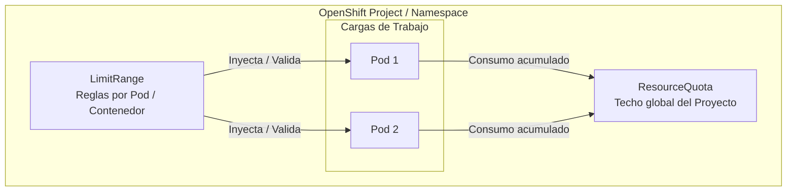
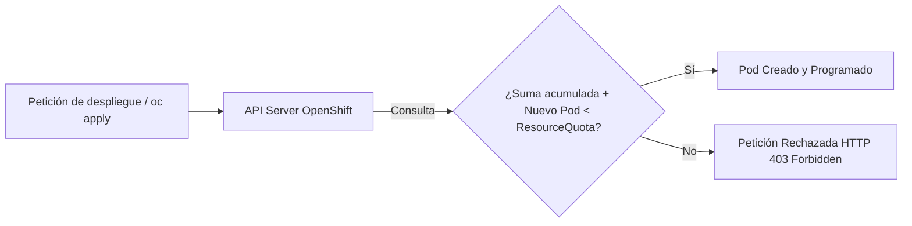
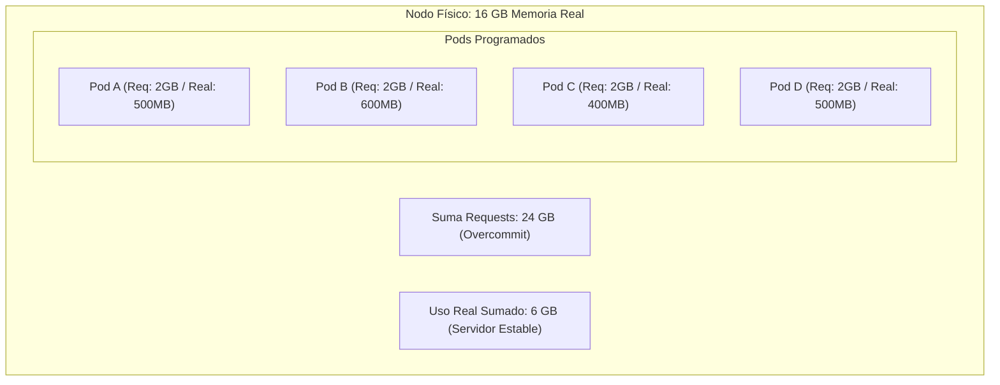
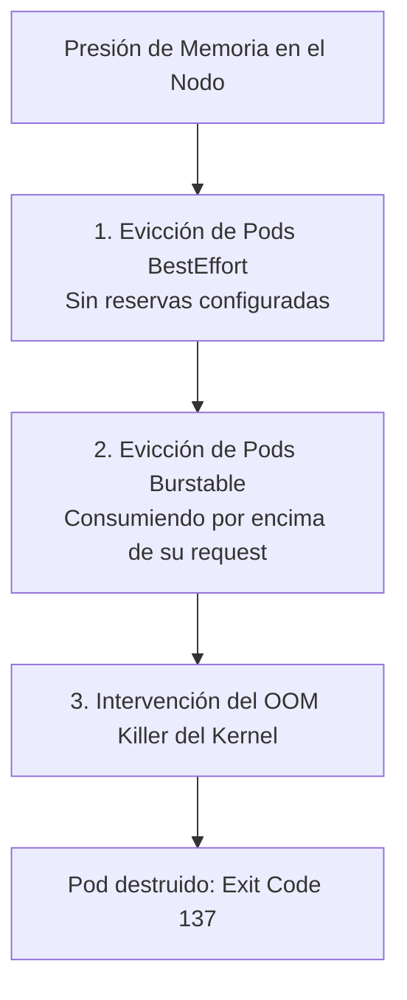
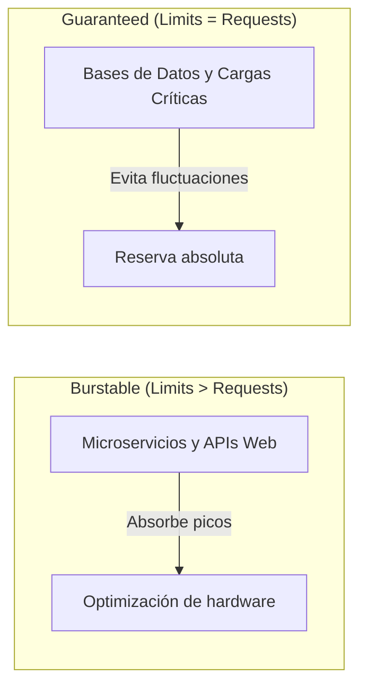
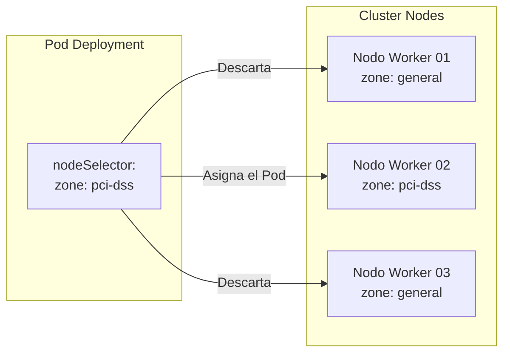
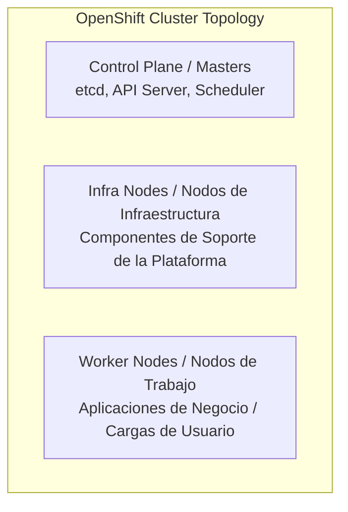
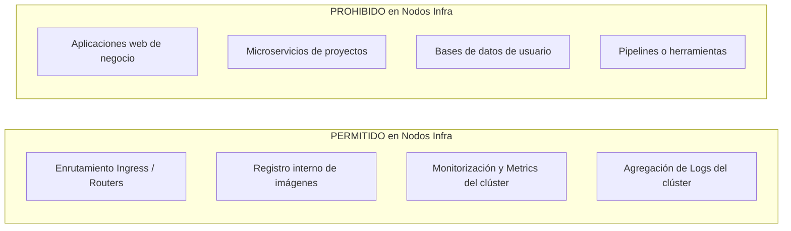

# 4.2 Recursos, cuotas y ubicación: ResourceQuota, LimitRange y el overcommit —reservas altas con uso real bajo—, y cómo se manda un pod a unos nodos concretos (`nodeSelector`, nodos de infraestructura) ★

## Objetivos de aprendizaje

Al finalizar este apartado serás capaz de:

- Comprender el modelo de gobernanza de recursos en OpenShift y cómo la plataforma garantiza la convivencia segura de múltiples equipos (*Multi-tenancy*).
- Configurar y aplicar objetos **ResourceQuota** para restringir el consumo máximo total de cómputo, almacenamiento y objetos en un proyecto.
- Definir políticas por defecto mediante objetos **LimitRange** para asegurar que ningún contenedor carezca de restricciones implícitas.
- Comprender el concepto de **Overcommit** (sobreasignación), analizando los riesgos y oportunidades operativas del desfase entre reservas (*requests*) y uso real.
- Entender el concepto de **Calidad de Servicio (QoS)**, evaluando las estrategias de diseño (`Limits > Requests` frente a `Limits = Requests`) y el comportamiento del sistema ante la evacuación por *OOMKilled*.
- Utilizar **`nodeSelector`** para gobernar el posicionamiento de las cargas de trabajo en el clúster.
- Comprender la función de los **nodos de infraestructura** (*Infra Nodes*), distinguiendo con claridad qué componentes se pueden desplegar en ellos y cuáles no, así como sus implicaciones operativas y de licenciamiento.

---

## Gobernanza de recursos en entornos compartidos (*Multi-tenancy*)

En la Sesión 2 estudiamos cómo gestionar las peticiones (*requests*) y los límites (*limits*) a nivel individual dentro del manifiesto de un `Deployment` o un `Pod`. Sin embargo, en una plataforma corporativa compartida por decenas de proyectos y equipos, confiar de forma exclusiva en que los desarrolladores dimensionen correctamente sus aplicaciones no es una estrategia de gobierno suficiente.

Un único equipo podría desplegar cientos de réplicas sin límites configurados, agotando la memoria de los nodos y provocando una denegación de servicio que afecte al resto de aplicaciones del clúster.

Para resolver este reto, OpenShift proporciona dos primitivas fundamentales de administración: **ResourceQuota** y **LimitRange**.



- **LimitRange (A nivel de Pod/Contenedor):** Actúa como un regulador individual. Define los valores mínimos, máximos y por defecto que debe tener cualquier Pod que intente crearse dentro del proyecto.
- **ResourceQuota (A nivel de Proyecto):** Actúa como un "techo de gasto global". Define la suma máxima total de recursos (CPU, memoria, almacenamiento, número de Pods, etc.) que la totalidad del proyecto puede reservar simultáneamente.

---

## Restricción de consumo global: `ResourceQuota`

El objeto **ResourceQuota** limita el consumo acumulado de todos los objetos que residen dentro de un mismo proyecto.

Cuando se crea un `ResourceQuota` en un espacio de trabajo, el servidor de la API (*API Server*) de OpenShift rechazará cualquier intento de crear un nuevo objeto (Pod, PVC, Service) si su puesta en marcha provoca que el proyecto supere las métricas permitidas.



### Tipos de recursos que se pueden limitar:

1. **Recursos de Cómputo:** Suma total de `requests.cpu`, `requests.memory`, `limits.cpu` y `limits.memory`.
2. **Recursos de Almacenamiento:** Suma total de peticiones de almacenamiento (`requests.storage`), número total de PVCs (`persistentvolumeclaims`), o restricciones específicas por clase de almacenamiento (`fast-storage.storageclass.storage.k8s.io/requests.storage`).
3. **Conteo de Objetos:** Cantidad máxima de recursos concretos dentro del proyecto (ejemplo: número máximo de `pods`, `services`, `secrets`, `configmaps` o `services.loadbalancers`).

### Manifiesto de ejemplo: `resourcequota.yaml`

```yaml
apiVersion: v1
kind: ResourceQuota
metadata:
  name: cuota-proyecto-dev
  namespace: angel-cuaresma-alons-dev
spec:
  hard:
    # Cómputo acumulado
    requests.cpu: "4"
    requests.memory: "8Gi"
    limits.cpu: "8"
    limits.memory: "16Gi"
    # Almacenamiento acumulado
    requests.storage: "100Gi"
    persistentvolumeclaims: "5"
    # Conteo de objetos
    pods: "20"
    services: "10"
```

!!! warning "El requisito estricto de las cuotas"
    Si un proyecto tiene activado un `ResourceQuota` que limita la CPU o la memoria, **todos los Pods creados en ese proyecto deben definir obligatoriamente sus `requests` y `limits`**.
    
    Si intentas desplegar un Pod sin estos valores en un proyecto con cuota activa, la API de OpenShift rechazará la creación de inmediato con un error de validación.

---

## Políticas por defecto y fronteras: `LimitRange`

Para evitar que los despliegues fallen sistemáticamente porque un desarrollador olvidó especificar la sección `resources` en su manifiesto, OpenShift permite configurar un **LimitRange**.

Un `LimitRange` cumple tres funciones principales:

1. **Inyección por defecto:** Si un contenedor no especifica `requests` o `limits`, la plataforma le inyecta automáticamente los valores definidos en el `LimitRange`.
2. **Límites de escala:** Establece los valores mínimos y máximos permitidos para un contenedor individual (por ejemplo, evitar que alguien pida un Pod de 64 GB de memoria en un proyecto compartido).
3. **Ratio de overcommit:** Garantiza que el desfase entre el *limit* y el *request* no supere un factor determinado.

### Manifiesto de ejemplo: `limitrange.yaml`

```yaml
apiVersion: "v1"
kind: "LimitRange"
metadata:
  name: limites-por-defecto
  namespace: angel-cuaresma-alons-dev
spec:
  limits:
    - type: "Container"
      # Valores asignados automáticamente si el desarrollador no los especifica
      default:
        cpu: "500m"
        memory: "512Mi"
      defaultRequest:
        cpu: "200m"
        memory: "256Mi"
      # Rango permitido para cualquier contenedor en este proyecto
      max:
        cpu: "2"
        memory: "4Gi"
      min:
        cpu: "50m"
        memory: "64Mi"
```

---

## Demostración práctica: Aplicando cuotas y límites con nuestra aplicación

Para ver el comportamiento de estos objetos en un entorno real, utilizaremos nuestra aplicación de la Sesión 2 (`demo-formacion-yaml`) desplegada en el namespace `angel-cuaresma-alons-dev`.

### 1. El impacto de un `ResourceQuota` sin límites definidos

Tomemos el manifiesto completo de nuestro Deployment actual, pero eliminemos deliberadamente la sección `resources` del contenedor:

```yaml
apiVersion: apps/v1
kind: Deployment
metadata:
  name: demo-formacion-yaml
  namespace: angel-cuaresma-alons-dev
spec:
  replicas: 1
  selector:
    matchLabels:
      app: demo-formacion-yaml
  template:
    metadata:
      labels:
        app: demo-formacion-yaml
    spec:
      containers:
        - name: demo-formacion
          image: 'docker.io/ieftraining/demo-formacion:v3'
          imagePullPolicy: Always
          ports:
            - containerPort: 8080
              protocol: TCP
          # AVISO: Se ha eliminado intencionadamente la sección 'resources'
```

Si aplicamos este manifiesto en nuestro proyecto mediante la línea de comandos:

```bash
oc apply -f deployment-sin-recursos.yaml
```

La API de OpenShift interceptará la petición y devolverá un error de rechazo inmediato debido a la presencia del `ResourceQuota`:

```text
Error from server (Forbidden): error when creating "deployment-sin-recursos.yaml": 
pods "demo-formacion-yaml-xxxx" is forbidden: minimum cpu usage per container is required, but its request is nil
```

### 2. Cómo el `LimitRange` resuelve la fricción mediante inyección automática

Para evitar que los despliegues de los desarrolladores fallen por esta regla estricta cuando olvidan declarar los recursos, configuramos y aplicamos nuestro objeto `LimitRange` (`limites-por-defecto`) en el namespace:

```bash
oc apply -f limitrange.yaml
```

Si ahora volvemos a enviar el mismo Deployment **sin la sección `resources`**, OpenShift aceptará el manifiesto y **les inyectará de forma transparente los valores por defecto** (`200m` de CPU y `256Mi` de memoria como *request*). 

Podemos comprobarlo verificando la especificación del pod resultante:

```bash
oc get pod -l app=demo-formacion-yaml -o jsonpath='{.items[0].spec.containers[0].resources}'
```

---

## El Overcommit: Reservas altas con uso real bajo

En la arquitectura de plataformas en la nube existe una diferencia crucial entre los recursos **reservados** (*requests*) y los recursos **consumidos realmente** por los procesos:

- **Resource Requests (Reservas):** Es la cantidad de CPU y memoria que el *Scheduler* garantiza de forma reservada en un nodo para poder ubicar el Pod. Es el valor que se usa para calcular el espacio disponible en los servidores.
- **Uso Real (Consumo instantáneo):** Es el consumo medido en tiempo real por el sistema operativo y Prometheus (estudiado en el apartado 3.1).

El **Overcommit** (sobreasignación) es la capacidad de la plataforma para permitir que la suma total de los `limits` (o incluso de los `requests`) de todos los Pods programados en un nodo supere la capacidad física real del servidor.



### ¿Por qué se utiliza el Overcommit?

En entornos corporativos grandes, las aplicaciones se dimensionan habitualmente para soportar su pico máximo de tráfico anual (por ejemplo, el cierre de mes o el Black Friday). Esto provoca que, durante el 95% del tiempo restante, las aplicaciones consuman apenas un 10% de la memoria y CPU que tienen reservadas.

Si OpenShift no permitiese sobreasignación:
- El hardware estaría profundamente infrautilizado (eficiencia económica muy baja).
- Los nodos rechazarían programar más Pods porque sus `requests` teóricos suman el 100%, aunque la CPU física esté al 5% de uso.

---

## La Calidad de Servicio (QoS) y la gestión de la presión de memoria

Para comprender qué ocurre cuando el clúster se sobreasigna (*overcommit*) y la memoria física del nodo se agota, es necesario introducir el concepto de **Calidad de Servicio (QoS)** de Kubernetes.

La **Calidad de Servicio (QoS)** es una clasificación que OpenShift asigna de forma **automática** a cada Pod en el momento de su creación, calculada únicamente en función de cómo se han definido sus `requests` y `limits`. Esta etiqueta determina la prioridad del Pod si el servidor físico se queda sin memoria.

Existen tres clases de QoS (ordenadas de mayor a menor protección):

| Clase de QoS | Regla de configuración | Nivel de protección y comportamiento |
| :--- | :--- | :--- |
| **Guaranteed** | Todos los contenedores del Pod definen `requests` y `limits`, y **sus valores son exactamente iguales** para CPU y memoria. | **Máxima prioridad.** Son los últimos Pods que la plataforma intentará expulsar si el nodo se satura. |
| **Burstable** | Al menos un contenedor define `requests`, pero **los `limits` son superiores a los `requests`** (o no se definen `limits`). | **Prioridad media.** La plataforma les permite crecer en consumo, pero si superan su `request` inicial bajo saturación del nodo, son candidatos a la expulsión. |
| **BestEffort** | El Pod **no define ni `requests` ni `limits`** de ningún tipo. | **Sin protección.** Son los primeros Pods que el nodo eliminará (*evicted*) en cuanto exista el menor síntoma de falta de recursos. |



---

### Criterio de diseño: ¿Es mejor poner `Limits > Requests` o `Limits = Requests`?

A la vista de las clases de QoS, surge una duda muy habitual: *¿Si la clase Guaranteed ofrece la máxima protección, no deberíamos configurar siempre los límites iguales a las peticiones?*

La respuesta operativa es que **no existe una única regla obligatoria, sino que depende de la naturaleza de la aplicación**:



#### 1. Microservicios y aplicaciones estándar: `Limits > Requests` (Clase *Burstable*)
- **Es el patrón más habitual.** La mayoría de aplicaciones tienen un tráfico variable a lo largo del día.
- **Ventaja:** El `request` garantiza la memoria base indispensable para funcionar en régimen normal, mientras que el `limit` le otorga margen para absorber picos puntuales sin fallar. Permite un alto grado de *overcommit* y aprovecha mejor el clúster.
- **Riesgo:** Si el nodo sufre una falta de memoria extrema, las aplicaciones que se encuentren consumiendo muy por encima de su `request` base pueden ser candidatas a la evacuación.

#### 2. Cargas críticas y bases de datos: `Limits = Requests` (Clase *Guaranteed*)
- **Es el patrón recomendado para sistemas críticos** (por ejemplo, bases de datos como PostgreSQL, plataformas financieras o servicios con requisitos estrictos de latencia).
- **Ventaja:** Asigna de forma dedicada el 100% de los recursos asignados. El nodo no permitirá que otros Pods utilicen esa memoria y garantiza que estos procesos sean los últimos en verse afectados ante problemas de infraestructura.
- **Inconveniente:** Invalida la sobreasignación para ese volumen de recursos, bloqueando la memoria completa incluso cuando la aplicación se encuentra inactiva.

---

### ¿Qué ocurre si la memoria física se agota por completo?

Si la sobreasignación provoca que el consumo de memoria real de todos los Pods sumados alcance el límite del nodo físico de forma repentina (sin dar tiempo a expulsar Pods ordenadamente), el sistema operativo del nodo activa el **Out-Of-Memory (OOM) Killer**.

El **OOM Killer** es un proceso del kernel de Linux que interviene en situaciones de emergencia para evitar que el servidor completo colapse:

- Revisa la clase de QoS de los Pods y el uso de memoria actual.
- Selecciona el contenedor que esté sobrepasando en mayor medida su `request` asignado.
- Cancela inmediatamente dicho proceso, provocando la caída del Pod con el código de salida **`Exit Code 137`** (`OOMKilled`).

---

## Cómo mandar un pod a nodos concretos: `nodeSelector`

Por defecto, el programador (*Scheduler*) de OpenShift decide de manera autónoma en qué nodo de trabajo (*worker*) se debe ejecutar cada Pod, basándose en la disponibilidad de recursos y la distribución de carga.

Sin embargo, existen escenarios donde necesitamos dirigir explícitamente una carga de trabajo hacia nodos específicos:
- Nodos con hardware especializado (GPUs, discos NVMe ultrarrápidos).
- Cumplimiento normativo o de licencias (nodos asignados a una zona geográfica o departamento concreto).
- Aislamiento de cargas (separar aplicaciones de procesamiento intensivo de las APIs de cara al cliente).

Mapear cargas hacia nodos se realiza en Kubernetes mediante **etiquetas (*labels*)** y **selectores (*selectors*)**.



### Paso 1: Etiquetar los nodos (Operación de Administración)

El equipo de plataforma asigna etiquetas clave-valor a los nodos deseados:

```bash
oc label node worker-02.example.com zone=pci-dss hardware=gpu
```

### Paso 2: Especificar el selector en el Pod o Deployment

Dentro de la especificación de la plantilla del Pod (`spec.template.spec`), se añade la sección `nodeSelector`:

```yaml
apiVersion: apps/v1
kind: Deployment
metadata:
  name: procesamiento-seguro
  namespace: angel-cuaresma-alons-dev
spec:
  replicas: 2
  selector:
    matchLabels:
      app: procesamiento-seguro
  template:
    metadata:
      labels:
        app: procesamiento-seguro
    spec:
      # Directiva de ubicación exacta
      nodeSelector:
        zone: pci-dss
        hardware: gpu
      containers:
        - name: worker-app
          image: [registry.example.com/app/worker:v1.0](https://registry.example.com/app/worker:v1.0)
          resources:
            requests:
              cpu: "500m"
              memory: "1Gi"
```

!!! note "Selectores estrictos"
    Si especificas un `nodeSelector` cuyas etiquetas no coinciden con ningún nodo del clúster (o los nodos coincidentes no tienen capacidad libre), el Pod se quedará indefinidamente en estado **`Pending`**.
    
    Al ejecutar `oc describe pod <nombre-pod>`, la sección de eventos mostrará un mensaje indicando que ningún nodo cumple con los criterios del selector (*0/N nodes available: 1 node(s) didn't match Pod's node selector*).

---

## Nodos de infraestructura (*Infra Nodes*)

En la arquitectura de un clúster de producción de OpenShift (introducida en el apartado 1.5), los servidores se dividen lógicamente según su función dentro del clúster:



1. **Master / Control Plane Nodes:** Ejecutan los servicios centrales de control del clúster y la base de datos `etcd`. No ejecutan cargas de usuario.
2. **Worker Nodes:** Servidores destinados a ejecutar las aplicaciones de negocio y los desarrollos de los usuarios del clúster.
3. **Infra Nodes (Nodos de Infraestructura):** Servidores dedicados exclusivamente a alojar los componentes auxiliares de gestión propia de OpenShift, aislándolos de los nodos de aplicaciones.

### Regla clara: ¿Qué se puede y qué NO se puede desplegar en los Infra Nodes?

Para mantener la estabilidad y cumplir con los términos de soporte de la plataforma, existe una separación estricta sobre qué servicios pueden residir en estos servidores:



- **SÍ se puede desplegar:** Únicamente los servicios internos de soporte propio del clúster (los routers de entrada de tráfico, el registro de imágenes interno, los recolectores de métricas de plataforma y el sistema de agregación de logs).
- **NO se puede desplegar:** Ninguna aplicación de negocio, microservicio, base de datos de usuario ni herramienta de desarrollo. Todo lo que pertenezca a un proyecto de usuario debe ejecutarse obligatoriamente en los *Worker Nodes*.

### Beneficios del aislamiento en Nodos Infra

- **Aislamiento de rendimiento:** Evita que un consumo masivo de CPU o memoria provocado por una aplicación de usuario afecte a servicios críticos como el enrutamiento de red o la recogida de métricas.
- **Optimización de licencias (Red Hat Subscriptions):** Red Hat no cobra licencias de suscripción de trabajo por los núcleos de CPU de los servidores etiquetados como `infra`, siempre y cuando ejecuten **exclusivamente** componentes de plataforma autorizados.

---

### ¿Cómo se envían los componentes de infraestructura a sus nodos?

Para conseguir que un componente de la plataforma se ejecute en los nodos de infraestructura y no en los de trabajo, se combinan dos mecanismos que hemos estudiado:

1. **Etiquetado del Nodo:** Los administradores marcan los servidores de infraestructura asignándoles una etiqueta estándar:
   ```bash
   oc label node infra-worker-01.example.com node-role.kubernetes.io/infra=""
   ```
2. **Uso de `nodeSelector` por parte de los Operadores:** Los operadores del clúster (como el operador de Ingress o el de Monitorización) se configuran para añadir la directiva `nodeSelector` en los pods que gestionan:
   ```yaml
   nodeSelector:
     node-role.kubernetes.io/infra: ""
   ```

De este modo, el programador (*Scheduler*) lee el `nodeSelector` de los Pods del Router o de Prometheus y los coloca automáticamente en los servidores de infraestructura etiquetados para tal fin.

---

## Ideas clave para recordar

!!! tip "Resumen"
    - **ResourceQuota** limita el consumo máximo acumulado (CPU, memoria, almacenamiento, objetos) de la totalidad de un proyecto.
    - Si un proyecto tiene un `ResourceQuota` activo, es obligatorio definir `requests` y `limits` en todos los Pods.
    - **LimitRange** establece restricciones por defecto a nivel de contenedor/Pod e impide la creación de Pods con recursos desproporcionados.
    - El **Overcommit** permite asignar más recursos teóricos (*limits*) de los que físicamente existen, optimizando el uso del hardware pero introduciendo riesgos ante picos de carga.
    - La **Calidad de Servicio (QoS)** clasifica los Pods en `Guaranteed`, `Burstable` y `BestEffort` según la definición de sus recursos.
    - Usar `Limits > Requests` (*Burstable*) es la norma en microservicios para optimizar densidad y absorber picos, mientras que `Limits = Requests` (*Guaranteed*) se reserva para bases de datos y aplicaciones altamente críticas.
    - En situaciones de saturación de memoria, los Pods de menor protección son eliminados por el **OOM Killer** del sistema (Código de salida 137).
    - **`nodeSelector`** permite dirigir la programación de un Pod hacia nodos que contengan etiquetas (*labels*) específicas.
    - Los **Nodos de Infraestructura (*Infra Nodes*)** alojan exclusivamente componentes de soporte de la plataforma (Routers, Registro, Monitorización), garantizando estabilidad y optimización de licencias.