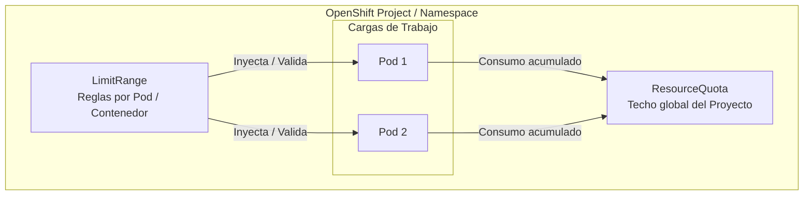
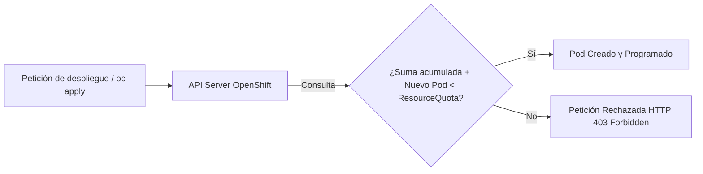
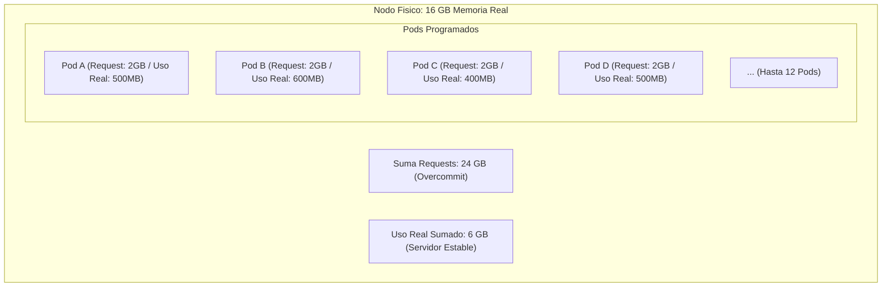
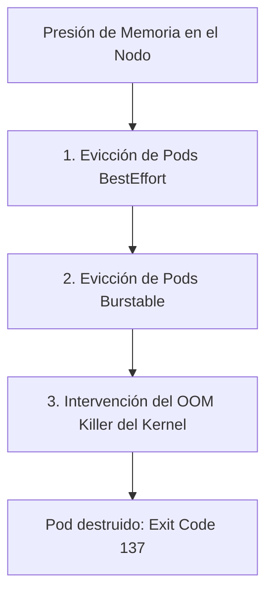
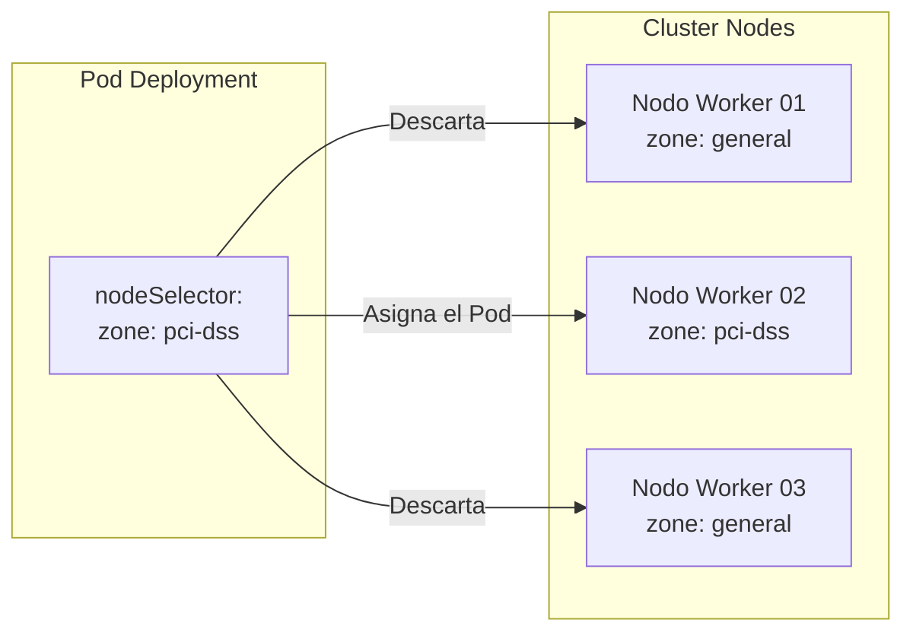
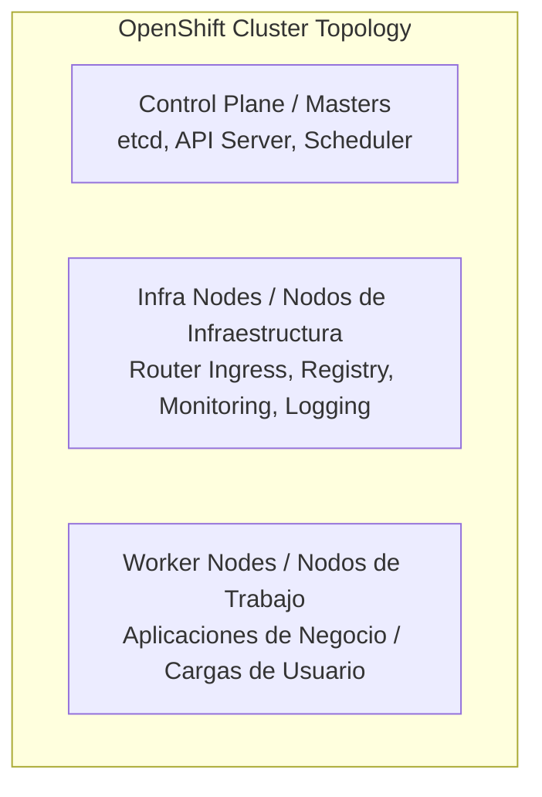

# 4.2 Recursos, cuotas y ubicación: ResourceQuota, LimitRange y el overcommit —reservas altas con uso real bajo—, y cómo se manda un pod a unos nodos concretos (`nodeSelector`, nodos de infraestructura)

## Objetivos de aprendizaje

Al finalizar este apartado serás capaz de:

- Comprender el modelo de gobernanza de recursos en OpenShift y cómo la plataforma garantiza la convivencia segura de múltiples equipos (*Multi-tenancy*).
- Configurar y aplicar objetos **ResourceQuota** para restringir el consumo máximo total de cómputo, almacenamiento y objetos en un proyecto.
- Definir políticas por defecto mediante objetos **LimitRange** para asegurar que ningún contenedor carezca de restricciones implícitas.
- Comprender el concepto de **Overcommit** (sobreasignación), analizando los riesgos y oportunidades operativas del desfase entre reservas (*requests*) y uso real.
- Analizar el comportamiento del programador (*Scheduler*) ante situaciones de presión de memoria y evacuación por *OOMKilled*.
- Utilizar **`nodeSelector`** para gobernar el posicionamiento de las cargas de trabajo en el clúster.
- Comprender el rol de los **nodos de infraestructura** (*Infra Nodes*) y las implicaciones operativas y de licenciamiento al aislar componentes de la plataforma.

---

## Gobernanza de recursos en entornos compartidos (*Multi-tenancy*)

En la Sesión 2 estudiamos cómo gestionar las peticiones (*requests*) y los límites (*limits*) a nivel individual dentro del manifiesto de un `Deployment` o un `Pod`. Sin embargo, en una plataforma corporativa compartida por decenas de proyectos y equipos, confiar de forma exclusiva en que los desarrolladores dimensionen correctamente sus aplicaciones no es una estrategia de gobierno suficiente.

Un único equipo podría desplegar cientos de réplicas sin límites configurados, agotando la memoria de los nodos y provocando una denegación de servicio que afecte al resto de aplicaciones del clúster.

Para resolver este reto, OpenShift proporciona dos primitivas fundamentales de administración: **ResourceQuota** y **LimitRange**.



- **LimitRange (A nivel de Pod/Contenedor):** Actúa como un regulador individual. Define los valores mínimos, máximos y por defecto que debe tener cualquier Pod que intente crearse dentro del proyecto.
- **ResourceQuota (A nivel de Proyecto):** Actúa como un "techo de gasto global". Define la suma máxima total de recursos (CPU, memoria, almacenamiento, número de Pods, etc.) que la totalidad del proyecto puede reservar simultáneamente.

---

## Restricción de consumo global: `ResourceQuota`

El objeto **ResourceQuota** limita el consumo acumulado de todos los objetos que residen dentro de un mismo proyecto.

Cuando se crea un `ResourceQuota` en un espacio de trabajo, el servidor de la API (*API Server*) de OpenShift rechazará cualquier intento de crear un nuevo objeto (Pod, PVC, Service) si su puesta en marcha provoca que el proyecto supere las métricas permitidas.



### Tipos de recursos que se pueden limitar:

1. **Recursos de Cómputo:** Suma total de `requests.cpu`, `requests.memory`, `limits.cpu` y `limits.memory`.
2. **Recursos de Almacenamiento:** Suma total de peticiones de almacenamiento (`requests.storage`), número total de PVCs (`persistentvolumeclaims`), o restricciones específicas por clase de almacenamiento (`fast-storage.storageclass.storage.k8s.io/requests.storage`).
3. **Conteo de Objetos:** Cantidad máxima de recursos concretos dentro del proyecto (ejemplo: número máximo de `pods`, `services`, `secrets`, `configmaps` o `services.loadbalancers`).

### Manifiesto de ejemplo: `resourcequota.yaml`

```yaml
apiVersion: v1
kind: ResourceQuota
metadata:
  name: cuota-proyecto-dev
  namespace: app1-dev
spec:
  hard:
    # Cómputo acumulado
    requests.cpu: "4"
    requests.memory: "8Gi"
    limits.cpu: "8"
    limits.memory: "16Gi"
    # Almacenamiento acumulado
    requests.storage: "100Gi"
    persistentvolumeclaims: "5"
    # Conteo de objetos
    pods: "20"
    services: "10"
```

!!! warning "El requisito estricto de las cuotas"
    Si un proyecto tiene activado un `ResourceQuota` que limita la CPU o la memoria, **todos los Pods creados en ese proyecto deben definir obligatoriamente sus `requests` y `limits`**.
    
    Si intentas desplegar un Pod sin estos valores en un proyecto con cuota activa, la API de OpenShift rechazará la creación de inmediato con un error de validación.

---

## Políticas por defecto y fronteras: `LimitRange`

Para evitar que los despliegues fallen sistemáticamente porque un desarrollador olvidó especificar la sección `resources` en su manifiesto, OpenShift permite configurar un **LimitRange**.

Un `LimitRange` cumple tres funciones principales:

1. **Inyección por defecto:** Si un contenedor no especifica `requests` o `limits`, la plataforma le inyecta automáticamente los valores definidos en el `LimitRange`.
2. **Límites de escala:** Establece los valores mínimos y máximos permitidos para un contenedor individual (por ejemplo, evitar que alguien pida un Pod de 64 GB de memoria en un proyecto compartido).
3. **Ratio de overcommit:** Garantiza que el desfase entre el *limit* y el *request* no supere un factor determinado.

### Manifiesto de ejemplo: `limitrange.yaml`

```yaml
apiVersion: "v1"
kind: "LimitRange"
metadata:
  name: limites-por-defecto
  namespace: app1-dev
spec:
  limits:
    - type: "Container"
      # Valores asignados automáticamente si el desarrollador no los especifica
      default:
        cpu: "500m"
        memory: "512Mi"
      defaultRequest:
        cpu: "200m"
        memory: "256Mi"
      # Rango permitido para cualquier contenedor en este proyecto
      max:
        cpu: "2"
        memory: "4Gi"
      min:
        cpu: "50m"
        memory: "64Mi"
```

---

## El Overcommit: Reservas altas con uso real bajo

En la arquitectura de plataformas en la nube existe una diferencia crucial entre los recursos **reservados** (*requests*) y los recursos **consumidos realmente** por los procesos:

- **Resource Requests (Reservas):** Es la cantidad de CPU y memoria que el *Scheduler* garantiza de forma reservada en un nodo para poder ubicar el Pod. Es el valor que se usa para calcular el espacio disponible en los servidores.
- **Uso Real (Consumo instantáneo):** Es el consumo medido en tiempo real por el sistema operativo y Prometheus (estudiado en el apartado 3.1).

El **Overcommit** (sobreasignación) es la capacidad de la plataforma para permitir que la suma total de los `limits` (o incluso de los `requests`) de todos los Pods programados en un nodo supere la capacidad física real del servidor.



### ¿Por qué se utiliza el Overcommit?

En entornos corporativos grandes, las aplicaciones se dimensionan habitualmente para soportar su pico máximo de tráfico anual (por ejemplo, el cierre de mes o el Black Friday). Esto provoca que, durante el 95% del tiempo restante, las aplicaciones consuman apenas un 10% de la memoria y CPU que tienen reservadas.

Si OpenShift no permitiese sobreasignación:
- El hardware estaría profundamente infrautilizado (eficiencia económica muy baja).
- Los nodos rechazarían programar más Pods porque sus `requests` teóricos suman el 100%, aunque la CPU física esté al 5% de uso.

### Riesgos y comportamiento del sistema bajo presión

El Overcommit ofrece una eficiencia de costes muy alta, pero introduce un riesgo operativo directo: **¿Qué ocurre si de pronto todas las aplicaciones sufren un pico de tráfico simultáneo e intentan consumir su `limit` real al mismo tiempo?**

Dado que la memoria física no se puede comprimir mágicamente, el nodo entrará en presión de memoria (*MemoryPressure*). Kubernetes y el kernel de Linux responderán en orden de severidad:



1. **Clases de Calidad de Servicio (QoS):**
   - **Guaranteed:** Pods cuyos `requests` son exactamente iguales a sus `limits` para CPU y memoria. Tienen la máxima prioridad de supervivencia.
   - **Burstable:** Pods cuyos `requests` son menores que sus `limits`. Prioridad media.
   - **BestEffort:** Pods que no definen ni `requests` ni `limits`. Son los primeros en ser eliminados (*evicted*) por el nodo ante el menor síntoma de saturación.
2. **Ejecución por OOMKilled:** Si la memoria física se agota por completo de forma repentina, el controlador *Out-Of-Memory Killer* del kernel del nodo eliminará los procesos de los contenedores que estén sobrepasando su `request` inicial de manera desproporcionada.

---

## Cómo mandar un pod a nodos concretos: `nodeSelector`

Por defecto, el programador (*Scheduler*) de OpenShift decide de manera autónoma en qué nodo de trabajo (*worker*) se debe ejecutar cada Pod, basándose en la disponibilidad de recursos y la distribución de carga.

Sin embargo, existen escenarios donde necesitamos dirigir explícitamente una carga de trabajo hacia nodos específicos:
- Nodos con hardware especializado (GPUs, discos NVMe ultrarrápidos).
- Cumplimiento normativo o de licencias (nodos asignados a una zona geográfica o departamento concreto).
- Aislamiento de cargas (separar aplicaciones de procesamiento intensivo de las APIs de cara al cliente).

Mapear cargas hacia nodos se realiza en Kubernetes mediante **etiquetas (*labels*)** y **selectores (*selectors*)**.



### Paso 1: Etiquetar los nodos (Operación de Administración)

El equipo de plataforma asigna etiquetas clave-valor a los nodos deseados:

```bash
oc label node worker-02.example.com zone=pci-dss hardware=gpu
```

### Paso 2: Especificar el selector en el Pod o Deployment

Dentro de la especificación de la plantilla del Pod (`spec.template.spec`), se añade la sección `nodeSelector`:

```yaml
apiVersion: apps/v1
kind: Deployment
metadata:
  name: procesamiento-seguro
  namespace: app1-dev
spec:
  replicas: 2
  selector:
    matchLabels:
      app: procesamiento-seguro
  template:
    metadata:
      labels:
        app: procesamiento-seguro
    spec:
      # Directiva de ubicación exacta
      nodeSelector:
        zone: pci-dss
        hardware: gpu
      containers:
        - name: worker-app
          image: [registry.example.com/app/worker:v1.0](https://registry.example.com/app/worker:v1.0)
          resources:
            requests:
              cpu: "500m"
              memory: "1Gi"
```

!!! note "Selectores estrictos"
    Si especificas un `nodeSelector` cuyas etiquetas no coinciden con ningún nodo del clúster (o los nodos coincidentes no tienen capacidad libre), el Pod se quedará indefinidamente en estado **`Pending`**.
    
    Al ejecutar `oc describe pod <nombre-pod>`, la sección de eventos mostrará un mensaje indicando que ningún nodo cumple con los criterios del selector (*0/N nodes available: 1 node(s) didn't match Pod's node selector*).

---

## Nodos de infraestructura (*Infra Nodes*)

En la arquitectura de un clúster de producción de OpenShift (introducida en el apartado 1.5), los servidores se dividen lógicamente según su función dentro del clúster:



1. **Master / Control Plane Nodes:** Ejecutan los servicios centrales de control del clúster y la base de datos `etcd`. No ejecutan cargas de usuario.
2. **Worker Nodes:** Servidores donde residen los proyectos y las aplicaciones de negocio de los usuarios.
3. **Infra Nodes (Nodos de Infraestructura):** Servidores dedicados exclusivamente a ejecutar los componentes auxiliares y de soporte de la propia plataforma OpenShift:
   - **Ingress Routers** (HAProxy / Routers de entrada).
   - **Internal Image Registry** (Registro de imágenes del clúster).
   - **Cluster Monitoring** (Prometheus, Thanos, Alertmanager).
   - **Cluster Logging** (Vector, OpenSearch).

### ¿Por qué se aíslan los componentes en Nodos de Infraestructura?

- **Aislamiento de rendimiento:** Evita que un consumo masivo de CPU o memoria provocado por una aplicación de usuario ralentice la consola web, el enrutamiento de tráfico (*Routers*) o la recolección de métricas.
- **Optimización de costes y licencias (Red Hat Subscriptions):** Las cargas de infraestructura oficiales de OpenShift que corren en nodos etiquetados expresamente como `infra` **no consumen licencias de suscripción de trabajo de OpenShift (Red Hat CoreOS / RHEL Cores)**. Asignar correctamente estos componentes a nodos dedicados reduce significativamente el coste económico del clúster.

### ¿Cómo se dirigen los componentes de infraestructura a sus nodos?

Los operadores de la plataforma utilzan internamente configuraciones de `nodeSelector` y tolerancias (*tolerations*) combinadas con etiquetas estándar de nodo:

```bash
node-role.kubernetes.io/infra: ""
```

---

## Ideas clave para recordar

!!! tip "Resumen"
    - **ResourceQuota** limita el consumo máximo acumulado (CPU, memoria, almacenamiento, objetos) de la totalidad de un proyecto.
    - Si un proyecto tiene un `ResourceQuota` activo, es obligatorio definir `requests` y `limits` en todos los Pods.
    - **LimitRange** establece restricciones por defecto a nivel de contenedor/Pod e impide la creación de Pods con recursos desproporcionados.
    - El **Overcommit** permite asignar más recursos teóricos (*limits*) de los que físicamente existen, optimizando el uso del hardware pero introduciendo riesgos ante picos de carga.
    - En situaciones de presión extrema de memoria, los Pods de menor prioridad (`BestEffort` y `Burstable`) son eliminados mediante el proceso de **OOMKilled** (Código de salida 137).
    - **`nodeSelector`** permite dirigir la programación de un Pod hacia nodos con etiquetas (*labels*) específicas.
    - Los **Nodos de Infraestructura (*Infra Nodes*)** separan los componentes internos de OpenShift (Router, Registro, Monitorización) de las aplicaciones de usuario, aportando estabilidad y optimización de licencias.