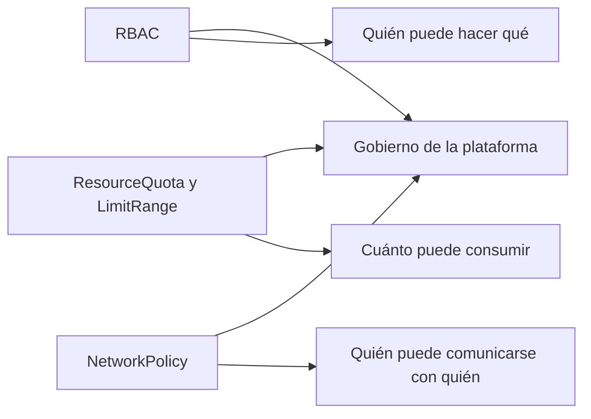
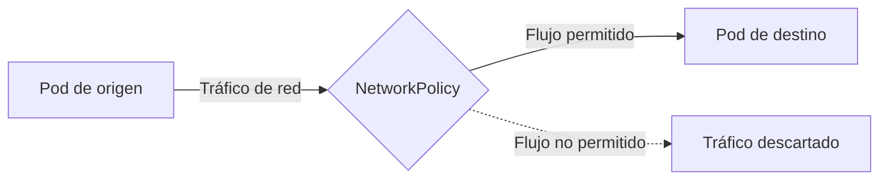
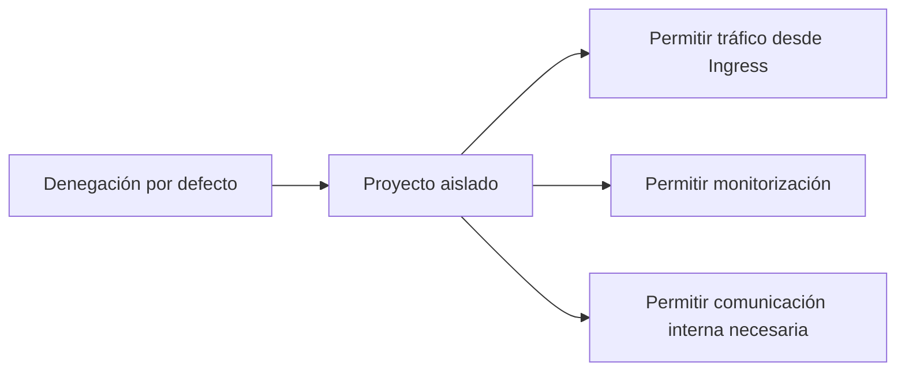
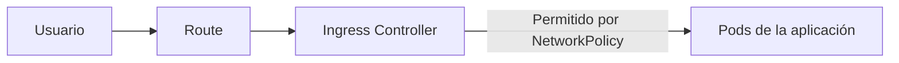

# 4.3 Aislamiento de red: NetworkPolicy

## Objetivos de aprendizaje

Al finalizar este apartado serás capaz de:

- Comprender por qué el aislamiento de red forma parte del gobierno de una plataforma OpenShift compartida.
- Entender el concepto de **NetworkPolicy** como mecanismo declarativo para controlar el tráfico entre Pods y proyectos.
- Interpretar los elementos principales de una política de red.
- Diferenciar entre el control del tráfico de entrada (`Ingress`) y el tráfico de salida (`Egress`).
- Comprender el patrón de denegación por defecto o **Default Deny**.
- Reconocer algunas de las políticas de red que proporciona el entorno Sandbox, sin necesidad de modificarlas.

---

## El aislamiento de red como parte del gobierno

En los apartados anteriores hemos visto dos dimensiones del gobierno de una plataforma OpenShift compartida:

- **RBAC** establece quién puede realizar cada acción.
- **ResourceQuota** y **LimitRange** controlan cuánto puede consumir cada proyecto y cada contenedor.

Las **NetworkPolicies** incorporan una tercera dimensión: **quién puede comunicarse con quién dentro del clúster**.



Kubernetes parte de un modelo de conectividad plano en el que, por defecto, los Pods pueden comunicarse entre sí.

Sin embargo, esto no significa que todos los clústeres permitan siempre cualquier comunicación. En una plataforma corporativa, los administradores pueden aplicar políticas de red para segmentar proyectos, proteger cargas de trabajo y permitir únicamente los flujos necesarios.

Este aislamiento ayuda a reducir riesgos como:

- el acceso innecesario entre aplicaciones;
- la comunicación entre proyectos que no deberían estar relacionados;
- el movimiento lateral desde una carga comprometida;
- la exposición de servicios internos;
- el incumplimiento del principio de mínimo privilegio.

!!! note "El caso del Sandbox"
    El Sandbox utilizado en el curso ya incorpora varias `NetworkPolicy` administradas por la plataforma. Por tanto, no debemos asumir que nuestro proyecto parte de una red completamente abierta ni modificar estas políticas para realizar pruebas.

    En este apartado las utilizaremos como ejemplos reales para aprender a interpretar cómo se gobierna la conectividad de un proyecto.

---

## ¿Qué es una NetworkPolicy?

Una **NetworkPolicy** es un objeto de Kubernetes, disponible también en OpenShift, que declara qué tráfico de red está permitido para determinados Pods.

Las políticas pueden controlar:

- qué Pods pueden recibir tráfico;
- desde qué Pods o proyectos puede llegar ese tráfico;
- hacia qué Pods, proyectos o redes pueden realizarse conexiones;
- qué protocolos y puertos están permitidos.



Las NetworkPolicy actúan principalmente sobre información de red de capa 3 y capa 4:

- direcciones IP;
- protocolos;
- puertos.

No analizan el contenido funcional de una petición HTTP ni sustituyen a mecanismos como:

- la autenticación;
- la autorización de la aplicación;
- el cifrado TLS;
- la validación de datos.

!!! important "Las políticas necesitan soporte del clúster"
    Kubernetes define el objeto `NetworkPolicy`, pero su aplicación efectiva depende del plugin de red utilizado por el clúster. OpenShift utiliza una implementación de red compatible con estas políticas, habitualmente **OVN-Kubernetes** en las versiones actuales de la plataforma.

---

## Principios fundamentales

Antes de analizar un manifiesto, debemos comprender varias características importantes.

### Modelo declarativo
Las políticas se definen mediante recursos YAML, igual que el resto de objetos de Kubernetes y OpenShift. En ellas describimos el comportamiento deseado:

- qué Pods quedan seleccionados;
- qué dirección del tráfico se controla;
- qué comunicaciones deben permitirse.

La plataforma se encarga de convertir esa declaración en reglas efectivas de conectividad.

### Selección mediante etiquetas
Las políticas utilizan etiquetas (*labels*) para identificar Pods y proyectos. Esto permite evitar la dependencia de las direcciones IP de los Pods, que pueden cambiar cuando estos se eliminan y vuelven a crearse.

### Control de entrada y salida
Una política puede controlar:

- **Ingress:** tráfico que llega a los Pods seleccionados;
- **Egress:** tráfico iniciado desde los Pods seleccionados;
- **Ambos sentidos.**

### Naturaleza aditiva
Las NetworkPolicy tienen un comportamiento aditivo. Cuando varias políticas se aplican a un mismo Pod, los flujos permitidos por ellas se combinan. Una política no se utiliza para revocar directamente un permiso concedido por otra política aplicable.

!!! example "Ejemplo conceptual"
    Si una política permite tráfico desde el frontend y otra permite tráfico desde el sistema de monitorización, el Pod podrá recibir tráfico desde ambos orígenes.

---

## ¿Cuándo queda aislado un Pod?

La existencia de una NetworkPolicy en un proyecto no implica automáticamente que todos sus Pods queden aislados.

Un Pod queda aislado en una dirección cuando existe al menos una política que:

1. selecciona ese Pod;
2. incluye esa dirección en `policyTypes`.

Por ejemplo, si una política selecciona un Pod para tráfico `Ingress`, desde ese momento el Pod solo podrá recibir los flujos de entrada autorizados por el conjunto de políticas aplicables.

El tráfico de salida podría seguir sin estar aislado si ninguna política lo selecciona para `Egress`.

!!! important "Aislamiento por dirección"
    Un Pod puede estar aislado para tráfico de entrada y no estarlo para tráfico de salida, o al contrario. Por eso siempre debemos comprobar si la política controla `Ingress`, `Egress` o ambos.

---

## Anatomía de una NetworkPolicy

El siguiente ejemplo protege los Pods de una base de datos y permite que reciban tráfico únicamente desde el frontend, por el puerto TCP `5432`:

```yaml
apiVersion: networking.k8s.io/v1
kind: NetworkPolicy
metadata:
  name: permitir-frontend-a-bd
spec:
  podSelector:
    matchLabels:
      role: db
  policyTypes:
    - Ingress
  ingress:
    - from:
        - podSelector:
            matchLabels:
              app: frontend
      ports:
        - protocol: TCP
          port: 5432
```

Para interpretar una política de red conviene responder, en este orden, a cuatro preguntas:

1. ¿A qué Pods se aplica?
2. ¿Controla tráfico entrante, saliente o ambos?
3. ¿Qué orígenes o destinos permite?
4. ¿Qué protocolos y puertos autoriza?

### `podSelector`: Pods a los que se aplica

El campo `spec.podSelector` identifica los Pods del mismo proyecto a los que se aplica la política. En el ejemplo:

```yaml
podSelector:
  matchLabels:
    role: db
```

La política selecciona los Pods que tengan la etiqueta `role=db`. Podemos consultar los Pods que cumplen esa condición con:

```bash
oc get pods -l role=db
```

#### Selector vacío
Un selector vacío tiene un significado especial:

```yaml
podSelector: {}
```

En este caso, la política selecciona **todos los Pods del proyecto**.

!!! note "El valor mostrado por oc"
    En la salida de `oc get networkpolicy`, el valor `<none>` en la columna `POD-SELECTOR` suele corresponder a un selector vacío (`podSelector: {}`). No significa que la política no seleccione ningún Pod; significa que no exige etiquetas concretas y, por tanto, selecciona todos los Pods del proyecto.

### `policyTypes`: dirección del tráfico

El campo `policyTypes` indica qué dirección del tráfico controla la política.

- **Tráfico de entrada:**
  ```yaml
  policyTypes:
    - Ingress
  ```
  Controla el tráfico que llega a los Pods seleccionados. En el ejemplo anterior, la política regula las conexiones dirigidas hacia los Pods con la etiqueta `role: db`.

- **Tráfico de salida:**
  ```yaml
  policyTypes:
    - Egress
  ```
  Controla las conexiones iniciadas desde los Pods seleccionados hacia otros destinos.

- **Entrada y salida:**
  ```yaml
  policyTypes:
    - Ingress
    - Egress
  ```
  La política controla ambos sentidos.

### `from` y `to`: orígenes y destinos permitidos

Dentro de las reglas:

- `ingress.from` define los orígenes permitidos para el tráfico entrante.
- `egress.to` define los destinos permitidos para el tráfico saliente.

Los selectores más habituales son:

- `podSelector`: selecciona Pods por sus etiquetas.
- `namespaceSelector`: selecciona namespaces o proyectos por sus etiquetas.
- `ipBlock`: identifica rangos de direcciones IP mediante notación CIDR.

#### Seleccionar Pods
El siguiente fragmento permite tráfico desde Pods que tengan la etiqueta `app: frontend`:

```yaml
from:
  - podSelector:
      matchLabels:
        app: frontend
```

Cuando se utiliza de esta forma, el `podSelector` busca Pods dentro del mismo namespace en el que se encuentra la `NetworkPolicy`.

#### Seleccionar proyectos
También podemos permitir tráfico desde namespaces que tengan determinadas etiquetas:

```yaml
from:
  - namespaceSelector:
      matchLabels:
        entorno: compartido
```

En este caso, se permite tráfico desde los Pods de los namespaces que cumplan el selector indicado.

#### Combinar `namespaceSelector` y `podSelector`
Podemos seleccionar Pods concretos dentro de determinados namespaces:

```yaml
from:
  - namespaceSelector:
      matchLabels:
        entorno: produccion
    podSelector:
      matchLabels:
        app: frontend
```

En este caso deben cumplirse ambas condiciones:
- El namespace debe tener la etiqueta `entorno: produccion`.
- El Pod debe tener la etiqueta `app: frontend`.

!!! warning "La estructura YAML cambia el significado"
    Si `podSelector` y `namespaceSelector` aparecen dentro del mismo elemento de la lista `from`, ambas condiciones deben cumplirse (**AND**). Si aparecen como elementos separados de la lista (cada uno con su propio guión `-`), representan orígenes alternativos (**OR**). Por ello, la indentación y los guiones deben revisarse con especial cuidado.

### `ports`: protocolos y puertos permitidos

El bloque `ports` permite limitar una regla a los puertos y protocolos necesarios:

```yaml
ports:
  - protocol: TCP
    port: 5432
```

En este caso, el flujo definido por la regla se autoriza únicamente hacia el puerto TCP `5432` de los Pods seleccionados. Si una regla no incluye `ports`, permite todos los puertos para los orígenes o destinos definidos en ella.

!!! tip "Principio de mínimo privilegio"
    Siempre que resulte viable, una política debería permitir únicamente los protocolos y puertos que la aplicación necesita.

---

## Patrón de gobierno: denegación por defecto

Una estrategia habitual en entornos corporativos consiste en partir de una política de denegación por defecto (**Default Deny**) y añadir después las autorizaciones necesarias para el funcionamiento de las aplicaciones y de la propia plataforma.



El siguiente manifiesto selecciona todos los Pods del proyecto para tráfico de entrada, pero no incluye ninguna regla permitida:

```yaml
apiVersion: networking.k8s.io/v1
kind: NetworkPolicy
metadata:
  name: default-deny-ingress
spec:
  podSelector: {}
  policyTypes:
    - Ingress
  ingress: []
```

La interpretación de esta estructura es:

1. `podSelector: {}` selecciona todos los Pods del proyecto.
2. `policyTypes: [Ingress]` controla el tráfico entrante.
3. `ingress: []` no define ningún flujo de entrada permitido.

Mientras no exista otra política que autorice un flujo, los Pods seleccionados no podrán recibir tráfico entrante.

Después se incorporan políticas adicionales para permitir únicamente las comunicaciones necesarias, por ejemplo:

- tráfico desde el Ingress Controller hacia una aplicación publicada mediante una Route;
- comunicación entre componentes de una misma aplicación;
- acceso desde los servicios de monitorización;
- acceso a una base de datos únicamente desde el backend autorizado.

!!! warning "No aplicar este ejemplo en el Sandbox"
    Este manifiesto es ilustrativo. En el Sandbox del curso ya existen políticas de red administradas por la plataforma. Aplicar una denegación adicional podría interrumpir Routes, herramientas del entorno u otros servicios necesarios. Por este motivo, en el curso nos limitaremos a observar e interpretar las políticas existentes.

---

## Observación guiada de las políticas del Sandbox

En lugar de crear o modificar políticas, consultaremos las `NetworkPolicy` que el Sandbox ya incorpora en nuestro proyecto mediante la CLI:

```bash
oc get networkpolicy
```

En el entorno utilizado durante el curso aparecen políticas similares a las siguientes:

```text
NAME                                             POD-SELECTOR
allow-from-codeready-workspaces-operator         <none>
allow-from-console-namespaces                    <none>
allow-from-dev-sandbox-managed-ns                <none>
allow-from-olm-namespaces                        <none>
allow-from-openshift-ingress                     <none>
allow-from-openshift-monitoring                  <none>
allow-from-openshift-virtualization-namespaces   <none>
allow-from-redhat-ods-app-to-mariadb             app=mariadb-dspa
allow-from-redhat-ods-app-to-mm                  modelmesh-service=modelmesh-serving
allow-same-namespace                             <none>
```

Esta salida ya permite extraer varias conclusiones:

- el proyecto está gobernado por políticas creadas previamente por la plataforma;
- algunas políticas se aplican a todos los Pods (`<none>`);
- otras seleccionan cargas concretas mediante etiquetas (como `app=mariadb-dspa`);
- existen políticas asociadas con componentes de plataforma como Ingress, monitorización, consola, operadores o virtualización;
- no necesitamos crear nuestras propias políticas para comprender el modelo.

!!! note "No deducir el comportamiento únicamente por el nombre"
    El nombre de una política aporta una pista sobre su finalidad, pero no demuestra exactamente qué tráfico permite. Para conocer su comportamiento debemos consultar el manifiesto YAML.

### Política `allow-same-namespace`

La política `allow-same-namespace` está orientada a permitir comunicaciones entre cargas del mismo proyecto.

Esto resulta especialmente importante cuando los Pods ya se encuentran aislados para tráfico de entrada. En ese escenario, dos Pods no quedan necesariamente autorizados a comunicarse por el simple hecho de pertenecer al mismo namespace.

Consultamos la política con:

```bash
oc get networkpolicy allow-same-namespace -o yaml
```

Al interpretar el manifiesto debemos buscar:

1. **Los Pods seleccionados:** Comprobaremos si aparece `podSelector: {}`. En ese caso, la política se aplica a todos los Pods del proyecto.
2. **La dirección controlada:** Comprobaremos si la política incluye `policyTypes: [Ingress]`.
3. **El origen permitido:** Revisaremos el bloque `ingress.from` y el selector utilizado para identificar el propio namespace.
4. **Los puertos:** Comprobaremos si la regla limita determinados puertos o permite cualquier puerto desde el origen seleccionado.

El objetivo no es memorizar el YAML concreto proporcionado por el Sandbox, sino aprender a reconocer la intención de gobierno: **permitir la comunicación interna necesaria entre las cargas del proyecto sin abrir el acceso desde cualquier otro proyecto**.

### Política `allow-from-openshift-ingress`

La política `allow-from-openshift-ingress` permite relacionar el aislamiento de red con las Routes estudiadas anteriormente.

Cuando una aplicación se publica mediante una Route, el Ingress Controller de OpenShift necesita poder alcanzar los Pods que atienden la aplicación. Si el proyecto aplica aislamiento de entrada y no existe una autorización para este flujo, la Route podría existir correctamente, pero el tráfico no llegaría a los Pods de destino.

Consultamos la política con:

```bash
oc get networkpolicy allow-from-openshift-ingress -o yaml
```

Al leer el manifiesto comprobaremos:

1. qué Pods del proyecto selecciona;
2. si controla tráfico `Ingress`;
3. qué `namespaceSelector` o etiquetas identifican al componente de Ingress como origen permitido;
4. si la política limita puertos concretos.



Este ejemplo muestra que una política de red no consiste únicamente en bloquear tráfico. Su objetivo es: **bloquear lo innecesario y permitir explícitamente los flujos que la aplicación y la plataforma necesitan**.

### Otras políticas proporcionadas por la plataforma

El Sandbox también incorpora otras políticas, por ejemplo:

- `allow-from-openshift-monitoring`;
- `allow-from-console-namespaces`;
- `allow-from-olm-namespaces`;
- `allow-from-codeready-workspaces-operator`;
- `allow-from-openshift-virtualization-namespaces`;
- políticas relacionadas con servicios de datos e inteligencia artificial.

No es necesario estudiar todas ellas en este curso. Lo importante es comprender que responden a necesidades concretas de la plataforma:

- obtener métricas;
- acceder desde la consola;
- permitir la actuación de operadores;
- proporcionar herramientas de desarrollo;
- integrar componentes adicionales;
- mantener servicios administrados por el Sandbox.

!!! tip "Método para leer cualquier NetworkPolicy"
    Ante una política desconocida, no intentes deducir todo su comportamiento únicamente por el nombre. Obtén el YAML y responde siempre a estas cuatro preguntas:

    1. ¿Qué Pods selecciona `spec.podSelector`?
    2. ¿Controla `Ingress`, `Egress` o ambos?
    3. ¿Qué orígenes (`from`) o destinos (`to`) permite?
    4. ¿Restringe protocolos o puertos?

---

## Qué hemos comprobado en el Sandbox

En este apartado no hemos creado ni modificado NetworkPolicy. Hemos utilizado las políticas existentes para comprobar que:

- el Sandbox es un entorno administrado;
- el proyecto ya incorpora decisiones de aislamiento y conectividad;
- algunas comunicaciones necesarias están autorizadas explícitamente;
- la plataforma permite el tráfico desde componentes como Ingress o monitorización;
- las políticas pueden aplicarse a todos los Pods o seleccionar cargas concretas;
- el análisis de una política debe realizarse a partir de su YAML, no solo de su nombre.

Este enfoque refleja mejor el funcionamiento de una plataforma OpenShift corporativa, en la que determinadas políticas pueden ser definidas y gestionadas de forma centralizada por los administradores.

---

## Ideas clave para recordar

!!! tip "Resumen"
    - Las **NetworkPolicy** completan el gobierno de la plataforma definiendo quién puede comunicarse con quién.
    - Kubernetes proporciona conectividad entre Pods, pero un clúster OpenShift administrado puede restringir esa comunicación.
    - `podSelector` identifica los Pods a los que se aplica la política.
    - Un selector vacío (`podSelector: {}`) selecciona **todos los Pods del proyecto**.
    - `Ingress` controla el tráfico entrante y `Egress` controla el tráfico saliente.
    - `from` y `to` definen los orígenes y destinos permitidos.
    - Las políticas aplicables a un Pod son **aditivas**: sus permisos se combinan.
    - El patrón **Default Deny** aísla inicialmente las cargas y obliga a autorizar después los flujos necesarios.
    - Las Routes necesitan que el Ingress Controller pueda alcanzar los Pods de la aplicación.
    - El Sandbox ya contiene políticas gestionadas por la plataforma. En el curso las observamos e interpretamos, pero no las modificamos.