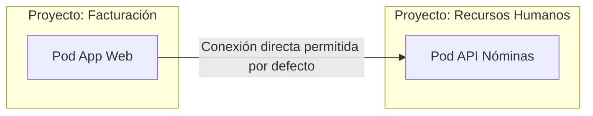
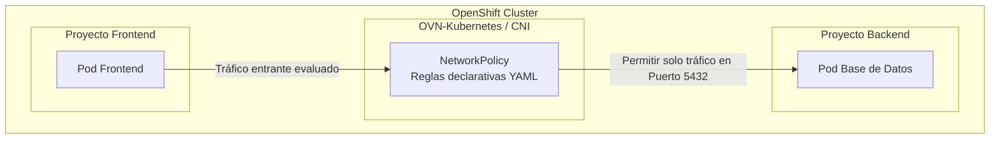
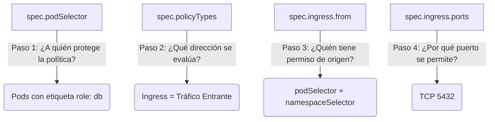
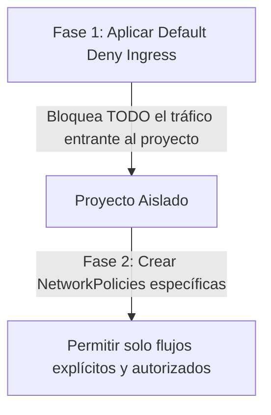

# 4.3 Aislamiento de red: qué es una NetworkPolicy y qué resuelve. Solo concepto y cómo se lee un manifiesto

## Objetivos de aprendizaje

Al finalizar este apartado serás capaz de:

- Comprender el modelo de red plano por defecto en Kubernetes/OpenShift y la necesidad del aislamiento de red en entornos corporativos (*Multi-tenancy*).
- Entender el concepto de **NetworkPolicy** como el mecanismo declarativo para controlar el tráfico entre Pods y espacios de nombres.
- Identificar el papel del CNI (Plugin de Red de OpenShift) en la interpretación y aplicación efectiva de las políticas de red.
- Analizar la anatomía de un manifiesto de `NetworkPolicy` e interpretar con precisión sus bloques de dirección (`ingress`/`egress`), selectores de Pods (`podSelector`), selectores de proyectos (`namespaceSelector`) y bloques de direcciones IP (`ipBlock`).
- Evaluar el comportamiento de una política por defecto de denegación total (*Default Deny*) y cómo estructurar reglas explícitas de acceso.

---

## El problema del modelo de red plano por defecto

Por defecto, Kubernetes y OpenShift implementan un modelo de red conocido como **red plana de Pod a Pod** (*flat network*).

Bajo este modelo inicial de diseño:

- Cualquier Pod en cualquier proyecto puede comunicarse directamente por IP con cualquier otro Pod de cualquier otro proyecto dentro del clúster.
- No existen barreras de red ni cortafuegos por defecto entre los distintos espacios de nombres (*namespaces*).



En entornos corporativos compartidos (*multi-tenant*), esta comunicación abierta sin restricciones representa un riesgo de seguridad crítico:

1. **Falta de segmentación:** Si un atacante compromete un contenedor en un proyecto de desarrollo o de acceso público (por ejemplo, mediante una vulnerabilidad en un frontal web), podría explorar y conectarse a servicios internos o bases de datos alojadas en proyectos de producción dentro del mismo clúster.
2. **Incumplimiento normativo:** Regulaciones como PCI-DSS, ENS (Esquema Nacional de Seguridad) o GDPR exigen un aislamiento estricto entre entornos de distintas sensibilidades y el principio de mínimo privilegio en las comunicaciones de red.

Para resolver este problema sin necesidad de desplegar cortafuegos físicos externos o complejas VLANs, OpenShift proporciona el recurso **NetworkPolicy**.

---

## ¿Qué es una NetworkPolicy y qué resuelve?

Una **NetworkPolicy** es un objeto nativo de Kubernetes y OpenShift que actúa como un **cortafuegos de red definido por software** (*Software-Defined Networking* - SDN) para controlar el tráfico a nivel de capa 3 y capa 4 (IP y puertos TCP/UDP).



### Principios clave de una NetworkPolicy:

- **Modelo Declarativo:** Al igual que el resto de objetos de OpenShift, se define mediante un fichero YAML. Declaras qué tráfico está permitido y la plataforma se encarga de aplicar las reglas subyacentes.
- **Basado en Etiquetas (*Labels*):** En lugar de gestionar direcciones IP estáticas (las cuales son efímeras en entornos de contenedores), las NetworkPolicies utilizan **selectores de etiquetas** para identificar el origen y el destino del tráfico.
- **Lista Blanca (*Allowlist*):** Las políticas de red funcionan por defecto como listas de autorización explícita. Si no existe una regla que permita expresamente una conexión, el tráfico es bloqueado.
- **Aplicado por el CNI:** El encargado de traducir los manifiestos YAML en reglas reales de filtrado en el kernel de los nodos (mediante Open vSwitch / OpenFlow o eBPF) es el plugin de red del clúster (**OVN-Kubernetes** en versiones modernas de OpenShift).

---

## Anatomía y lectura de un manifiesto de NetworkPolicy

Para auditar o diseñar el aislamiento de red en un proyecto, es fundamental saber leer la estructura de su manifiesto YAML.

A continuación se muestra un manifiesto representativo de una `NetworkPolicy` para proteger una base de datos:

```yaml
apiVersion: networking.k8s.io/v1
kind: NetworkPolicy
metadata:
  name: permitir-frontend-a-bd
  namespace: angel-cuaresma-alons-prod
spec:
  # 1. A qué Pods de ESTE proyecto se aplica esta política
  podSelector:
    matchLabels:
      role: db

  # 2. Qué tipo de tráfico vamos a gobernar (Ingress, Egress o ambos)
  policyTypes:
    - Ingress

  # 3. Reglas de entrada (tráfico que llega HACIA los Pods seleccionados)
  ingress:
    - from:
        # Opción A: Permitir solo si el Pod origen tiene esta etiqueta
        - podSelector:
            matchLabels:
              app: frontend
          # Opción B: Y además debe venir de un proyecto con esta etiqueta
          namespaceSelector:
            matchLabels:
              environment: production
      ports:
        - protocol: TCP
          port: 5432
```

---

## Desglose paso a paso de las secciones clave

Para interpretar correctamente cualquier manifiesto de `NetworkPolicy`, debemos analizar sus cuatro bloques principales:



### 1. `podSelector` (El destino o la "diana" de la política)
Indica los Pods **dentro del propio namespace** que quedarán bajo el control de esta política.
- Si se especifica `matchLabels: role: db`, la política regulará el tráfico que intenta llegar a los Pods etiquetados como `role: db`.
- Si se deja vacío (`podSelector: {}`), la política se aplicará a **todos los Pods** que existan en ese proyecto.

### 2. `policyTypes` (El sentido del tráfico)
Define la dirección del flujo de red que se va a filtrar:
- **`Ingress`:** Controla el tráfico **entrante** (peticiones que reciben los Pods seleccionados).
- **`Egress`:** Controla el tráfico **saliente** (peticiones que los Pods seleccionados inician hacia fuera).

### 3. `from` / `to` (Los orígenes o destinos permitidos)
Especifica quién tiene autorización para comunicarse. Se pueden combinar tres tipos de selectores:

- **`podSelector`:** Permite el tráfico procedente de Pods que tengan etiquetas específicas dentro del **mismo proyecto**.
- **`namespaceSelector`:** Permite el tráfico procedente de **otros proyectos** que contengan etiquetas específicas a nivel de namespace.
- **`ipBlock`:** Permite o deniega el tráfico procedente de un rango de direcciones IP o subred externa mediante notación CIDR (por ejemplo, `10.0.0.0/16`).

!!! warning "Cuidado con la sintaxis de listas en `from` (Unión vs Intersección)"
    En la sección `ingress.from`, la forma en que se escriben los guiones (`-`) cambia drásticamente el comportamiento de la regla:

    **Opción 1: Intersección / AND (Mismo elemento de lista)**
    ```yaml
    from:
      - podSelector:
          matchLabels:
            app: frontend
        namespaceSelector:
          matchLabels:
            environment: production
    ```
    *Significado:* El tráfico solo se permite si proviene de un Pod con la etiqueta `app: frontend` **Y ADEMÁS** ese Pod reside en un proyecto con la etiqueta `environment: production`.

    **Opción 2: Unión / OR (Elementos de lista independientes)**
    ```yaml
    from:
      - podSelector:
          matchLabels:
            app: frontend
      - namespaceSelector:
          matchLabels:
            environment: production
    ```
    *Significado:* Se permite el tráfico si el Pod origen tiene la etiqueta `app: frontend` (en el mismo proyecto) **O BIEN** si proviene de cualquier Pod que esté en un proyecto con la etiqueta `environment: production`.

### 4. `ports` (Puertos y protocolos)
Restringe el acceso exclusivamente a los puertos de red necesarios (por ejemplo, puerto `5432` con protocolo `TCP` para PostgreSQL o `8080` para una API web). Todo intento de conexión por cualquier otro puerto no listado será bloqueado inmediatamente.

---

## Patrón de arquitectura: Denegación Por Defecto (*Default Deny*)

En arquitecturas corporativas con altos requisitos de seguridad, la buena práctica recomendada para gobernar el aislamiento de red consiste en aplicar el patrón **Default Deny** (Denegación por defecto).

Este patrón se implementa en dos fases:



### 1. Bloqueo total por defecto (`default-deny-all.yaml`)
Se despliega una política inicial en el proyecto que selecciona todos los Pods (`podSelector: {}`) pero no define ninguna regla de entrada en `ingress`:

```yaml
apiVersion: networking.k8s.io/v1
kind: NetworkPolicy
metadata:
  name: denegar-todo-el-trafico-entrante
  namespace: angel-cuaresma-alons-prod
spec:
  podSelector: {}
  policyTypes:
    - Ingress
```

A partir del momento en que este manifiesto se aplica en un namespace, **ningún Pod del proyecto aceptará conexiones entrantes** de ningún origen (ni siquiera de otros Pods dentro del mismo proyecto).

### 2. Apertura Selectiva (*Mínimo Privilegio*)
Una vez aislado el proyecto por completo, el equipo de desarrollo u operaciones añade manifiestos de `NetworkPolicy` adicionales para abrir **únicamente los flujos legítimos de la aplicación** (por ejemplo, permitir que el Ingress/Router entregue tráfico al frontend, y que el frontend consulte a la base de datos por su puerto específico).

---

## Ideas clave para recordar

!!! tip "Resumen"
    - Por defecto, la red de Kubernetes/OpenShift es **plana**: cualquier Pod puede comunicarse con cualquier otro Pod de cualquier proyecto.
    - Una **NetworkPolicy** es un cortafuegos definido por software que aplica el principio de mínimo privilegio en la red a nivel de L3/L4.
    - El plugin de red del clúster (**OVN-Kubernetes**) es el responsable de interpretar y aplicar el filtrado configurado en las NetworkPolicies.
    - Las políticas de red utilizan **selectores de etiquetas (*labels*)** en lugar de direcciones IP estáticas para identificar orígenes y destinos.
    - La sección **`podSelector`** especifica los Pods protegidos; **`ingress`** y **`egress`** controlan el sentido del tráfico; y **`from` / `to`** definen las fuentes y destinos permitidos.
    - Presta atención a la sintaxis del bloque `from`: incluir o no el guión (`-`) define si las condiciones actúan como un **AND** (intersección) o como un **OR** (unión).
    - La estrategia de seguridad recomendada es implementar primero una política de **Default Deny** y añadir posteriormente excepciones explícitas para los flujos autorizados.