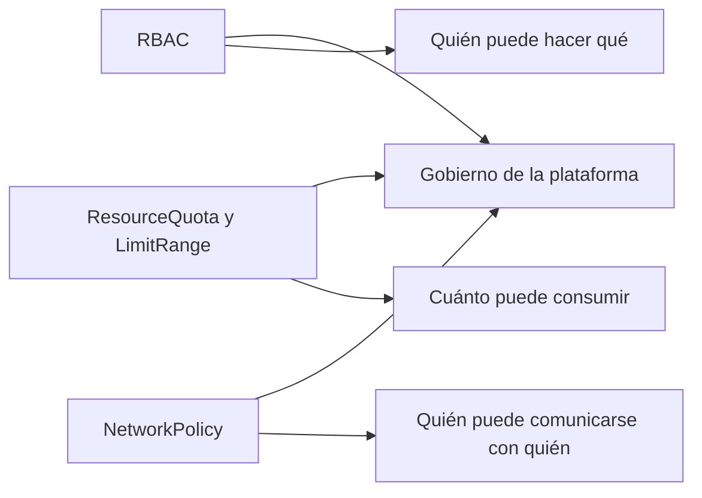
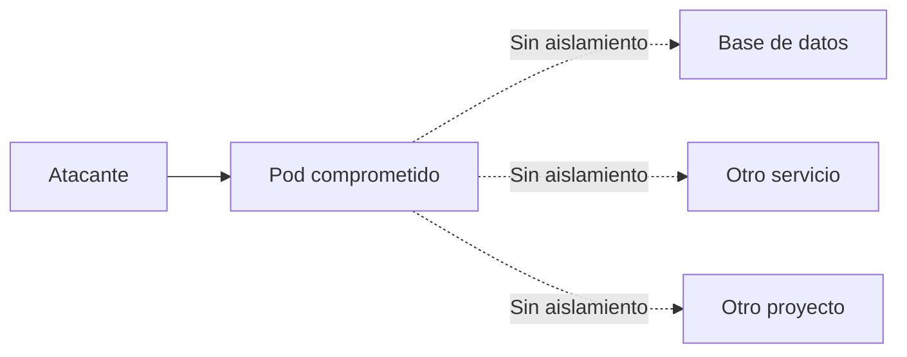
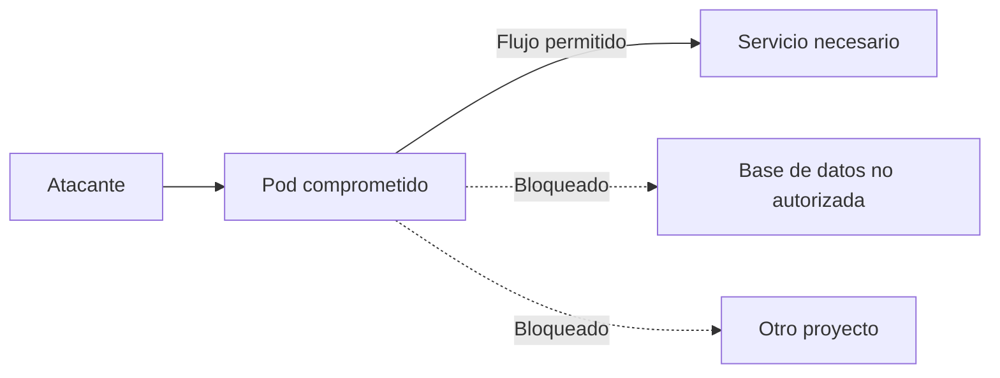
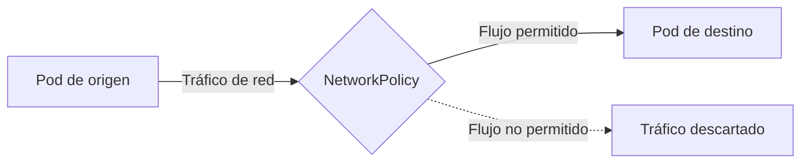
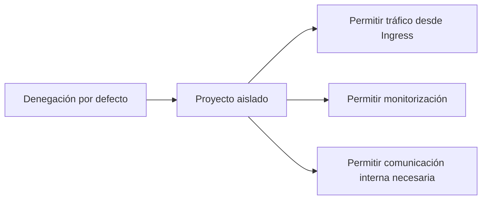
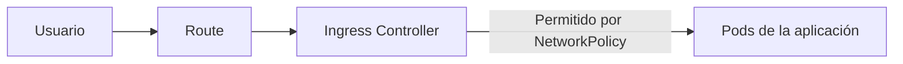

## 4.3 Aislamiento de red: NetworkPolicy

### Objetivos de aprendizaje

Al finalizar este apartado serás capaz de:

- Comprender por qué el aislamiento de red forma parte del gobierno de una plataforma OpenShift compartida.
- Entender el concepto de **NetworkPolicy** como mecanismo declarativo para controlar las comunicaciones entre Pods.
- Comprender cómo el aislamiento de red ayuda a limitar el movimiento lateral si una carga resulta comprometida.
- Interpretar los elementos principales de una política de red.
- Diferenciar entre el control del tráfico de entrada (`Ingress`) y el tráfico de salida (`Egress`).
- Comprender el patrón de denegación por defecto o _Default Deny_.
- Reconocer algunas de las políticas de red existentes en el entorno disponible, sin necesidad de modificarlas.

---

### El aislamiento de red como parte del gobierno

En los apartados anteriores hemos visto dos dimensiones del gobierno de una plataforma OpenShift compartida:

- **RBAC** establece quién puede realizar cada acción.
- **ResourceQuota** y **LimitRange** controlan cuánto puede consumir cada proyecto y cada contenedor.

Las **NetworkPolicy** incorporan una tercera dimensión:

> **Quién puede comunicarse con quién dentro del clúster.**



Kubernetes parte de un modelo de conectividad en el que los Pods pueden comunicarse entre sí.

Sin embargo, esto no significa que todos los clústeres permitan siempre cualquier comunicación. En una plataforma corporativa, los administradores pueden aplicar políticas de red para segmentar proyectos, proteger cargas de trabajo y permitir únicamente los flujos necesarios.

El objetivo no es impedir todas las comunicaciones, sino evitar que una carga pueda comunicarse con sistemas a los que no necesita acceder.

### ¿Por qué necesitamos aislamiento de red?

Supongamos que una aplicación presenta una vulnerabilidad y un atacante consigue comprometer uno de sus Pods.

El acceso inicial podría afectar únicamente a ese componente. Sin embargo, si el Pod dispone de conectividad indiscriminada hacia otras cargas del clúster, el atacante podría utilizarlo como punto de partida para:

- intentar acceder a otros Pods de la aplicación;
- localizar servicios internos;
- conectarse con bases de datos;
- explorar otros proyectos;
- intentar comprometer nuevas cargas.

Este desplazamiento desde un sistema comprometido hacia otros sistemas se denomina habitualmente **movimiento lateral**.



Las políticas de red permiten limitar ese riesgo restringiendo las comunicaciones a los flujos que realmente necesita la aplicación.



El aislamiento de red ayuda, por tanto, a:

- reducir la superficie de exposición;
- limitar comunicaciones innecesarias;
- dificultar el movimiento lateral;
- proteger servicios internos;
- aplicar el principio de mínimo privilegio también a la red.

- contribuir a implantar medidas de seguridad requeridas o recomendadas por distintos marcos normativos y estándares. En el ámbito de las Administraciones Públicas, la segmentación de red y el principio de mínimo privilegio están alineados con requisitos del **Esquema Nacional de Seguridad (ENS)**, como el mínimo privilegio y la existencia de líneas de defensa.

!!! note "Defensa en profundidad"
    Una `NetworkPolicy` no evita por sí misma que una aplicación tenga una vulnerabilidad.

    Su función es añadir una capa adicional de protección. Si una carga resulta comprometida, la política puede limitar los sistemas con los que esa carga puede comunicarse.

### ¿Qué es una NetworkPolicy?

Una **NetworkPolicy** es un objeto de Kubernetes, disponible también en OpenShift, que declara qué tráfico de red está permitido para determinados Pods.

Las políticas pueden controlar:

- qué Pods pueden recibir tráfico;
- desde qué Pods o proyectos puede llegar ese tráfico;
- hacia qué Pods, proyectos o redes pueden realizarse conexiones;
- qué protocolos y puertos están permitidos.



Las `NetworkPolicy` actúan principalmente sobre información de red de capa 3 y capa 4: direcciones IP, protocolos y puertos.

No analizan el contenido funcional de una petición HTTP ni sustituyen a otros mecanismos de seguridad, como la autenticación, la autorización de la aplicación, el cifrado TLS, la gestión segura de credenciales o la corrección de vulnerabilidades.

!!! important "Las políticas necesitan soporte del clúster"
    Kubernetes define el objeto `NetworkPolicy`, pero su aplicación efectiva depende del plugin de red utilizado por el clúster.

    OpenShift utiliza una implementación de red compatible con estas políticas, habitualmente OVN-Kubernetes en las versiones actuales de la plataforma.

### Principios fundamentales

#### Modelo declarativo

Las políticas se definen mediante recursos YAML, igual que el resto de objetos de Kubernetes y OpenShift.

En ellas describimos qué Pods quedan seleccionados, qué dirección del tráfico se controla y qué comunicaciones deben permitirse. La plataforma se encarga de convertir esa declaración en reglas efectivas de conectividad.

#### Selección mediante etiquetas

Las políticas utilizan etiquetas para identificar Pods y proyectos. Esto permite evitar la dependencia de las direcciones IP de los Pods, que pueden cambiar cuando estos se eliminan y vuelven a crearse.

#### Control de entrada y salida

Una política puede controlar:

- **`Ingress`**: tráfico que llega a los Pods seleccionados;
- **`Egress`**: tráfico iniciado desde los Pods seleccionados;
- ambos sentidos.

#### Naturaleza aditiva

Las `NetworkPolicy` tienen un comportamiento aditivo. Cuando varias políticas se aplican a un mismo Pod, los flujos permitidos por ellas se combinan.

!!! example "Ejemplo conceptual"
    Si una política permite tráfico desde el frontend y otra permite tráfico desde el sistema de monitorización, el Pod podrá recibir tráfico desde ambos orígenes.

### ¿Cuándo queda aislado un Pod?

La existencia de una `NetworkPolicy` en un proyecto no implica automáticamente que todos sus Pods queden aislados.

Un Pod queda aislado en una dirección cuando existe al menos una política que lo selecciona e incluye esa dirección en `policyTypes`.

Por ejemplo, si una política selecciona un Pod para tráfico `Ingress`, desde ese momento el Pod solo podrá recibir los flujos de entrada autorizados por el conjunto de políticas aplicables. El tráfico de salida podría seguir sin estar aislado si ninguna política selecciona el Pod para `Egress`.

!!! important "Aislamiento por dirección"
    Un Pod puede estar aislado para tráfico de entrada y no estarlo para tráfico de salida, o al contrario.

    Por eso siempre debemos comprobar si la política controla `Ingress`, `Egress` o ambos.

### Anatomía de una NetworkPolicy

El siguiente ejemplo protege los Pods de una base de datos y permite que reciban tráfico únicamente desde el frontend, por el puerto TCP 5432:

```yaml
apiVersion: networking.k8s.io/v1
kind: NetworkPolicy
metadata:
  name: permitir-frontend-a-bd
spec:
  podSelector:
    matchLabels:
      role: db
  policyTypes:
    - Ingress
  ingress:
    - from:
        - podSelector:
            matchLabels:
              app: frontend
      ports:
        - protocol: TCP
          port: 5432
```

Para interpretar una política de red conviene responder, en este orden, a cuatro preguntas:

1. **¿A qué Pods se aplica?**
2. **¿Controla tráfico entrante, saliente o ambos?**
3. **¿Qué orígenes o destinos permite?**
4. **¿Qué protocolos y puertos autoriza?**

### `podSelector`: Pods a los que se aplica

El campo `spec.podSelector` identifica los Pods del mismo proyecto a los que se aplica la política.

```yaml
podSelector:
  matchLabels:
    role: db
```

Un selector vacío selecciona todos los Pods del proyecto:

```yaml
podSelector: {}
```

!!! note "El valor <none> mostrado por oc"
    En la salida de `oc get networkpolicy`, el valor `<none>` en la columna `POD-SELECTOR` suele corresponder a `podSelector: {}`.

    No significa que la política no seleccione ningún Pod, sino que selecciona todos los Pods del proyecto.

### `policyTypes`: dirección del tráfico

```yaml
policyTypes:
  - Ingress
```

Controla el tráfico que llega a los Pods seleccionados.

```yaml
policyTypes:
  - Egress
```

Controla las conexiones iniciadas desde los Pods seleccionados.

```yaml
policyTypes:
  - Ingress
  - Egress
```

Controla ambos sentidos.

### `from` y `to`: orígenes y destinos permitidos

- `ingress.from` define los **orígenes permitidos** para el tráfico entrante.
- `egress.to` define los **destinos permitidos** para el tráfico saliente.

Los selectores más habituales son `podSelector`, `namespaceSelector` e `ipBlock`.

```yaml
from:
  - podSelector:
      matchLabels:
        app: frontend
```

Cuando se utiliza de esta forma, el `podSelector` busca Pods dentro del mismo namespace en el que se encuentra la política.

También podemos seleccionar namespaces por sus etiquetas:

```yaml
from:
  - namespaceSelector:
      matchLabels:
        entorno: compartido
```

O combinar ambos selectores:

```yaml
from:
  - namespaceSelector:
      matchLabels:
        entorno: produccion
    podSelector:
      matchLabels:
        app: frontend
```

!!! warning "La estructura YAML cambia el significado"
    Si `podSelector` y `namespaceSelector` aparecen dentro del mismo elemento de `from`, ambas condiciones deben cumplirse.

    Si aparecen como elementos separados, representan orígenes alternativos. Por ello, la indentación y los guiones deben revisarse con especial cuidado.

### `ports`: protocolos y puertos permitidos

```yaml
ports:
  - protocol: TCP
    port: 5432
```

Si una regla no incluye `ports`, permite todos los puertos para los orígenes o destinos definidos en ella.

!!! tip "Principio de mínimo privilegio"
    Siempre que resulte viable, una política debería permitir únicamente los protocolos y puertos que la aplicación necesita.

### Patrón de gobierno: denegación por defecto

Una estrategia habitual consiste en partir de una política de **denegación por defecto** y añadir después las autorizaciones necesarias para el funcionamiento de las aplicaciones y de la propia plataforma.

Este patrón se conoce habitualmente como _Default Deny_.



El siguiente manifiesto selecciona todos los Pods del proyecto para tráfico de entrada, pero no incluye ninguna regla permitida:

```yaml
apiVersion: networking.k8s.io/v1
kind: NetworkPolicy
metadata:
  name: default-deny-ingress
spec:
  podSelector: {}
  policyTypes:
    - Ingress
  ingress: []
```

La interpretación sería:

1. `podSelector: {}` selecciona todos los Pods del proyecto.
2. `policyTypes: Ingress` controla el tráfico entrante.
3. `ingress: []` no define ningún flujo de entrada permitido.

Mientras no exista otra política que autorice un determinado flujo, los Pods seleccionados no podrán recibir ese tráfico.

Después se incorporan políticas adicionales para permitir únicamente las comunicaciones necesarias, por ejemplo:

- tráfico desde el Ingress Controller hacia una aplicación publicada mediante una Route;
- comunicación entre componentes de una misma aplicación;
- acceso desde los servicios de monitorización;
- acceso a una base de datos únicamente desde el backend autorizado.

!!! warning "Manifiesto ilustrativo"
    Este manifiesto se incluye para comprender el patrón _Default Deny_.

    En el entorno disponible ya existen políticas de red administradas por la plataforma. Aplicar una denegación adicional podría interrumpir Routes, herramientas del entorno u otros servicios necesarios.

    Por este motivo, en este apartado observaremos las políticas existentes, pero no las modificaremos.

### Las políticas de red en nuestro entorno

En el entorno disponible ya existen varias `NetworkPolicy`. En lugar de crear políticas nuevas, utilizaremos dos de las políticas existentes para comprobar cómo se aplican estos conceptos en una plataforma OpenShift real.

Podemos consultar la lista mediante:

```bash
oc get networkpolicy
```

La salida obtenida incluye:

```text
NAME                                             POD-SELECTOR
allow-from-codeready-workspaces-operator         <none>
allow-from-console-namespaces                    <none>
allow-from-dev-sandbox-managed-ns                <none>
allow-from-olm-namespaces                        <none>
allow-from-openshift-ingress                     <none>
allow-from-openshift-monitoring                  <none>
allow-from-openshift-virtualization-namespaces   <none>
allow-from-redhat-ods-app-to-mariadb             app=mariadb-dspa
allow-from-redhat-ods-app-to-mm                  modelmesh-service=modelmesh-serving
allow-same-namespace                             <none>
```

La lista muestra que la plataforma ya ha definido distintas reglas de conectividad. Algunas se aplican a todos los Pods del proyecto, mientras que otras seleccionan cargas concretas mediante etiquetas.

!!! note "No deducir el comportamiento únicamente por el nombre"
    El nombre de una política aporta una pista sobre su finalidad, pero no demuestra exactamente qué tráfico permite. Para conocer su comportamiento debemos consultar el manifiesto YAML.

#### Política `allow-same-namespace`

La política `allow-same-namespace` está orientada a permitir comunicaciones entre cargas del mismo proyecto.

Podemos consultar su definición con:

```bash
oc get networkpolicy allow-same-namespace -o yaml
```

La salida completa contiene metadatos generados por la plataforma que no necesitamos para comprender la política. Si nos centramos en su definición funcional, encontramos:

```yaml
apiVersion: networking.k8s.io/v1
kind: NetworkPolicy
metadata:
  name: allow-same-namespace
spec:
  ingress:
    - from:
        - podSelector: {}
  podSelector: {}
  policyTypes:
    - Ingress
```

Podemos leer la política paso a paso:

1. El `podSelector: {}` situado directamente bajo `spec` selecciona **todos los Pods del proyecto**.
2. `policyTypes: Ingress` indica que la política controla **el tráfico que reciben esos Pods**.
3. Dentro de `ingress.from`, el segundo `podSelector: {}` selecciona **todos los Pods del mismo namespace**. Al no estar acompañado de un `namespaceSelector`, se refiere al namespace de la propia política.
4. La regla no incluye `ports`, por lo que **no restringe la comunicación a puertos concretos**.

En otras palabras, esta política permite que los Pods del proyecto puedan comunicarse entre sí, incluso cuando existen políticas que aíslan el tráfico de entrada.

#### Política `allow-from-openshift-ingress`

La política `allow-from-openshift-ingress` permite relacionar el aislamiento de red con las **Routes** estudiadas anteriormente.

Podemos consultar su definición con:

```bash
oc get networkpolicy allow-from-openshift-ingress -o yaml
```

Si nos centramos nuevamente en la definición funcional, encontramos:

```yaml
apiVersion: networking.k8s.io/v1
kind: NetworkPolicy
metadata:
  name: allow-from-openshift-ingress
spec:
  ingress:
    - from:
        - namespaceSelector:
            matchLabels:
              network.openshift.io/policy-group: ingress
  podSelector: {}
  policyTypes:
    - Ingress
```

La lectura de esta política es la siguiente:

1. `podSelector: {}` selecciona **todos los Pods del proyecto**.
2. `policyTypes: Ingress` indica que controla **el tráfico que reciben esos Pods**.
3. `namespaceSelector` permite como origen los namespaces que tengan la etiqueta `network.openshift.io/policy-group: ingress`.
4. La regla no incluye `ports`, por lo que **no limita el tráfico permitido a puertos concretos**.

Esta política permite que los componentes de Ingress de OpenShift puedan alcanzar los Pods del proyecto. De esta forma, una aplicación puede seguir siendo accesible mediante una Route aunque el proyecto tenga políticas que restrinjan el tráfico de entrada.



Este ejemplo muestra que una política de red no consiste únicamente en bloquear tráfico, sino en **bloquear lo innecesario y permitir explícitamente los flujos que la aplicación y la plataforma necesitan**.

### Ideas clave para recordar

!!! tip "Resumen"
    - Las `NetworkPolicy` completan el gobierno de la plataforma definiendo **quién puede comunicarse con quién**.
    - El aislamiento de red ayuda a limitar el movimiento lateral si un Pod resulta comprometido.
    - Kubernetes proporciona conectividad entre Pods, pero un clúster OpenShift administrado puede restringir esa comunicación.
    - `podSelector` identifica los Pods a los que se aplica la política.
    - `podSelector: {}` selecciona todos los Pods del proyecto.
    - `Ingress` controla el tráfico entrante y `Egress` el saliente.
    - `from` y `to` definen los orígenes y destinos permitidos.
    - Las políticas aplicables a un Pod son aditivas.
    - El patrón _Default Deny_ obliga a autorizar después los flujos necesarios.
    - `allow-same-namespace` permite la comunicación entre los Pods del mismo proyecto.
    - `allow-from-openshift-ingress` permite que el Ingress Controller alcance los Pods publicados mediante una Route.
