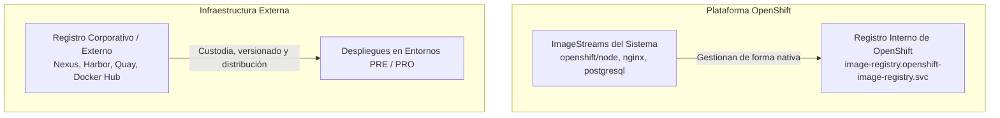
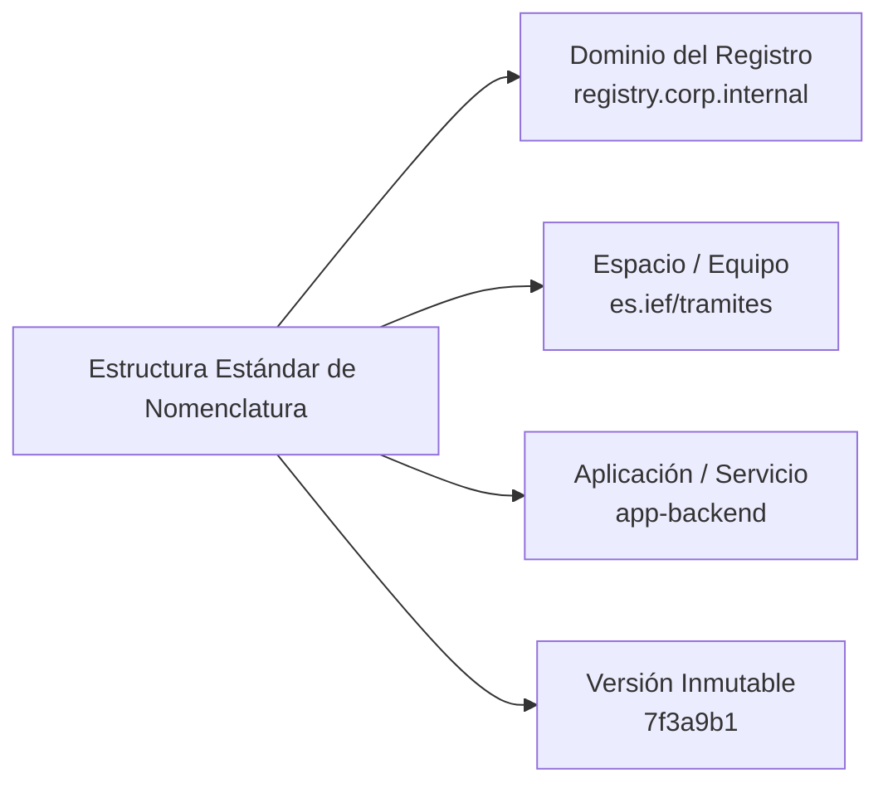
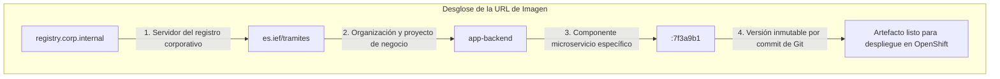
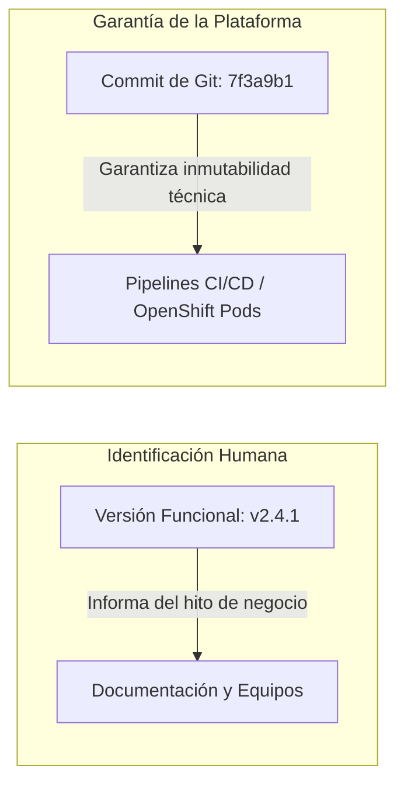
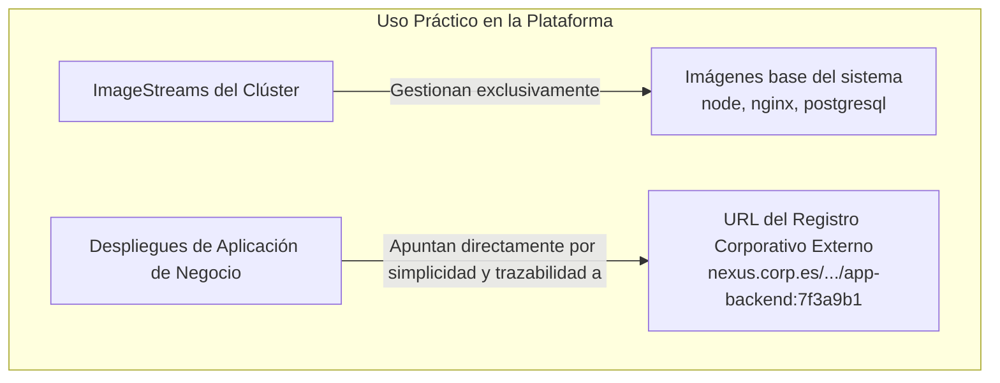
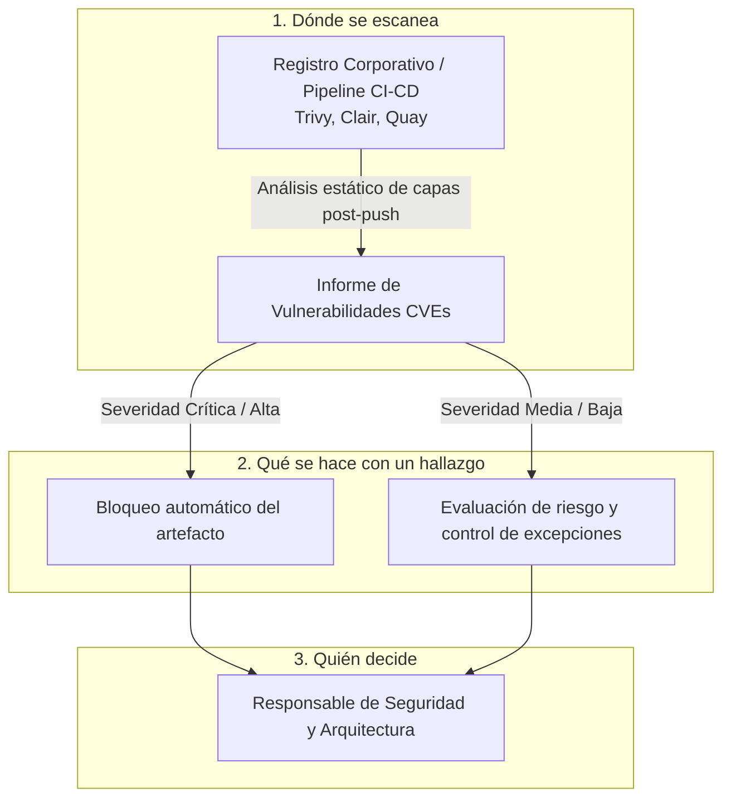

# 4.4 Registro, gestión y seguridad de imágenes

## Objetivos de aprendizaje

Al finalizar este apartado serás capaz de:

- Comprender la diferencia operativa entre el registro interno de OpenShift y un registro corporativo o público externo.
- Diseñar y aplicar una nomenclatura estándar de imágenes basada en el equipo, el proyecto y el servicio.
- Justificar técnicamente por qué el etiquetado por commit (SHA de Git) es un requisito indispensable en producción frente al uso del tag dinámico `latest`.
- Entender el papel conceptual de los `ImageStreams` nativos en OpenShift limitados exclusivamente a la gestión de imágenes base del clúster.
- Conocer el ciclo de vida del escaneo de vulnerabilidades post-push, analizando el impacto de los hallazgos de seguridad (CVEs) en la plataforma.

---

## Registro interno de OpenShift frente a registro corporativo externo

En una arquitectura basada en OpenShift, la gestión de las imágenes de contenedores se apoya habitualmente en dos tipos de repositorios diferenciados según su cometido operativo.



### 1. El registro interno de OpenShift

OpenShift incluye por defecto un registro de contenedores integrado dentro del propio clúster.

- **Propósito principal:** Alojar las imágenes base del sistema aprovisionadas por la plataforma (como las imágenes de soporte `node`, `nginx` o bases de datos auxiliares) y servir de soporte para compilaciones nativas de desarrollo.
- **Integración nativa:** Permite a los objetos de OpenShift interactuar de manera transparente mediante punteros internos sin depender de credenciales externas.
- **Alcance operativo:** Aunque resuelve con agilidad las necesidades internas de desarrollo y pruebas dentro del clúster, las organizaciones centralizan la custodia de sus aplicaciones de negocio en repositorios corporativos dedicados.

### 2. El registro corporativo o público externo

Las arquitecturas de producción externalizan la custodia de los artefactos compilados hacia registros corporativos centralizados o catálogos públicos.

- **Gobernanza y control:** Centralizan el control de acceso, la auditoría y las políticas de seguridad de toda la organización de forma independiente al ciclo de vida de los clústeres de ejecución.
- **Distribución de artefactos:** Permiten que los entornos de preproducción y producción descarguen de manera segura las imágenes estables previamente validadas.

---

## Nomenclatura estándar de imágenes por equipo y proyecto

Para evitar colisiones de nombres, sobrescrituras accidentales y problemas graves de trazabilidad en entornos compartidos, las imágenes deben seguir una estructura de nomenclatura clara y predecible.



### Reglas recomendadas para la nomenclatura:

1. **Dominio del Registro:** Identifica el servidor centralizado de almacenamiento (ej. `registry.corp.internal` o `nexus-registry.corp.es`).
2. **Espacio de nombres o equipo:** Delimita la unidad organizativa y el proyecto de negocio (ej. `es.ief/tramites` o `es.ief/hacienda`).
3. **Nombre del componente:** Define de manera concisa el microservicio concreto (ej. `app-backend` o `portal-frontend`).
4. **Etiqueta o Tag:** Sella la versión inmutable de la compilación.

#### Ejemplo completo de referencia:
```text
registry.corp.internal/es.ief/tramites/app-backend:7f3a9b1
```

---

## Estructura detallada de la ruta de una imagen

Desglosando una ruta completa de almacenamiento corporativo (`registry.corp.internal/es.ief/tramites/app-backend:7f3a9b1`), cada segmento cumple una función específica dentro del modelo de gobierno:



1. **`registry.corp.internal`**: La dirección web o URL del servidor centralizado donde se custodian de forma segura las imágenes de la organización.
2. **`es.ief/tramites`**: La ruta lógica dentro del registro que agrupa los artefactos pertenecientes a la organización IEF y al proyecto de negocio *tramites*.
3. **`app-backend`**: El nombre específico del microservicio o componente de software que se está empaquetando.
4. **`:7f3a9b1`**: La etiqueta (*tag*) o identificador único del commit de control de versiones, garantizando la inmutabilidad del código empaquetado.

---

## Etiquetado de imágenes: `latest` frente al identificador por Commit (SHA)

Uno de los errores más críticos en entornos de producción es el uso de etiquetas dinámicas como `latest`.


### 1. Los riesgos operativos de la etiqueta `latest`

- **Falta absoluta de determinismo:** La etiqueta `latest` no garantiza que el software sea la versión más avanzada probada, sino simplemente **la última imagen que se subió al registro**. Dos despliegues idénticos en momentos distintos pueden ejecutar códigos completamente diferentes.
- **Imposibilidad de auditoría y rollbacks:** Si se produce un fallo crítico en producción, el uso de `latest` impide auditar con precisión qué código fuente exacto está corriendo, inutilizando los mecanismos de reversión (*rollbacks*).
- **Inconsistencia de caché en los nodos:** Si un nodo del clúster mantiene una versión anterior en su caché local bajo el mismo tag, distintos Pods de un mismo Deployment pueden terminar ejecutando binarios diferentes.

---

### 2. Versión Semántica vs. Identificador de Commit (SHA)

Para garantizar la estabilidad en preproducción y producción, se combinan dos dimensiones complementarias:

| Concepto | Ejemplo | Propósito principal | Ámbito de uso |
| :--- | :--- | :--- | :--- |
| **Versión Semántica (*SemVer*)** | `v1.2.0`, `v2.4.1` | **Identificación comercial y de negocio.** Ayuda a los equipos y a la documentación a identificar hitos funcionales del software. | Personas, analistas y manuales de release. |
| **Identificador por Commit (SHA)** | `7f3a9b1`, `sha256:a1b2...` | **Garantía técnica e inmutabilidad.** Código único generado al compilar el control de versiones. Asegura que el artefacto es 100% inalterable. | Servidores, pipelines de CI/CD y OpenShift. |



### 3. Trazabilidad entre versión funcional e identificador técnico

Para conectar la versión funcional con el hash inmutable almacenado en el registro:
- **En el control de versiones:** Se crea una etiqueta (*Tag*) de versión (ej. `v2.4.1`) sobre el commit exacto (ej. `7f3a9b1`), vinculando formalmente el hito de negocio con el código fuente.
- **En los pipelines de compilación:** El registro de ejecución documenta qué commit ha generado la imagen subida al registro corporativo.
- **En el orquestador:** OpenShift despliega explícitamente el tag basado en el identificador de commit inmutable, aplicando el principio de **"construir una sola vez y desplegar exactamente el mismo artefacto en todos los entornos"**.

---

## ImageStreams: El papel nativo limitado a las imágenes base

En OpenShift existe el concepto de **ImageStream** (`is`) y **ImageStreamTag** (`istag`), que actúa como un puntero lógico dentro de la plataforma.



- **¿Dónde se utilizan realmente?** A nivel operativo, su uso principal en entornos corporativos integrados con registros externos (como Nexus) se restringe a gestionar y abstraer las **imágenes base del sistema proporcionadas por la plataforma** (como los runtimes de desarrollo preinstalados).
- **Operativa de aplicaciones:** Para las aplicaciones de negocio, la práctica más limpia, directa y extendida en entornos con pipelines externos consiste en **apuntar explícitamente a la URL completa del registro corporativo** utilizando el tag de commit SHA, evitando sobrecargar el clúster con abstracciones innecesarias.

---

## Escaneo de vulnerabilidades: Dónde, qué y quién

La seguridad en la cadena de suministro de software (*Supply Chain Security*) exige auditar las imágenes en busca de vulnerabilidades antes de permitir su paso a los entornos de ejecución.



### 1. ¿Dónde se escanea?
- El escaneo **nunca se realiza por primera vez en caliente dentro del clúster de producción**.
- Se ejecuta de manera automatizada en el registro corporativo o durante el pipeline de integración continua (**análisis post-push**), examinando cada capa en busca de vulnerabilidades conocidas registradas en bases de datos CVE (*Common Vulnerabilities and Exposures*).

### 2. ¿Qué se hace con un hallazgo?
- **Vulnerabilidades Críticas / Altas:** Provocan el **bloqueo automático** del artefacto, impidiendo su promoción y rechazando su despliegue en preproducción o producción.
- **Vulnerabilidades Moderadas / Bajas:** Generan alertas de aviso que permiten evaluar si el paquete afectado participa activamente en la ejecución de la aplicación.

### 3. ¿Quién decide? ★
- La automatización detecta y frena la propagación del riesgo.
- Corresponde al **equipo de desarrollo actualizar las dependencias** o la imagen base para corregir el fallo.
- Ante falsos positivos o bloqueos en servicios críticos sin parche disponible, **la decisión de autorizar una excepción formal recae de forma exclusiva en los responsables de seguridad y arquitectura**, nunca de manera individual en los desarrolladores.

---

## Ideas clave para recordar

!!! tip "Resumen"
    - El **registro interno de OpenShift** gestiona fundamentalmente las imágenes base del sistema, mientras que los **registros corporativos externos** centralizan la custodia de las aplicaciones de negocio.
    - Una nomenclatura estructurada por dominio, espacio de equipo, microservicio y tag inmutable garantiza la trazabilidad corporativa.
    - **Nunca utilices la etiqueta `latest` en producción**: destruye el determinismo y bloquea los mecanismos de auditoría y *rollback*.
    - Los **ImageStreams** se reservan principalmente para la gestión nativa de imágenes base del clúster, operando en las aplicaciones de negocio directamente con las URLs del registro corporativo.
    - El **escaneo de vulnerabilidades** debe integrarse de forma temprana (post-push en el pipeline o registro), aplicando bloqueos automáticos ante CVEs críticos y requiriendo validación formal de seguridad para cualquier excepción.