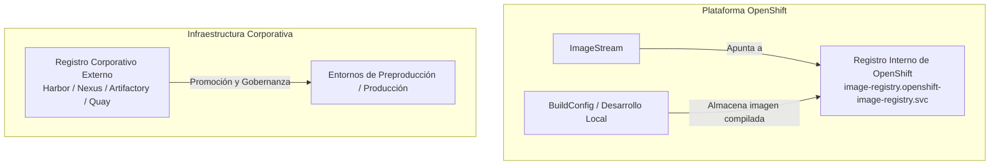
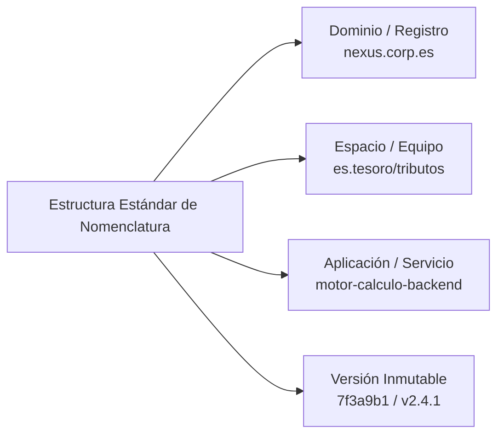
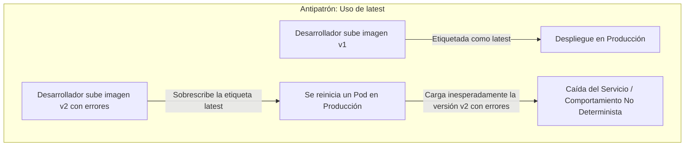
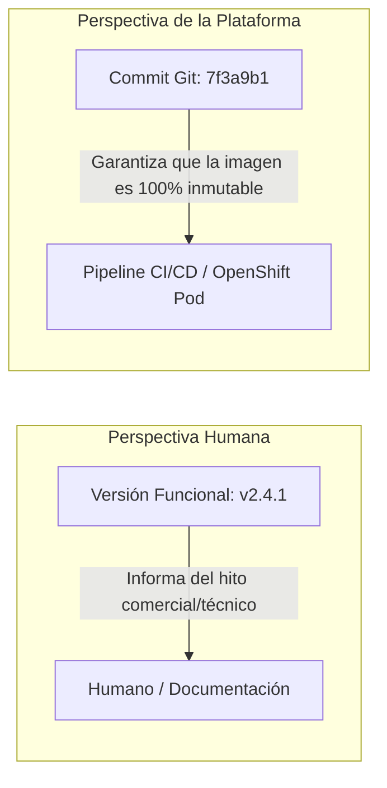
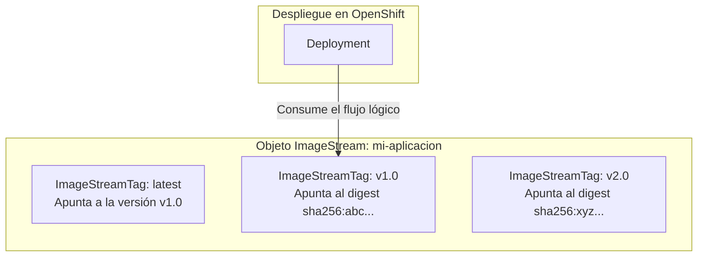
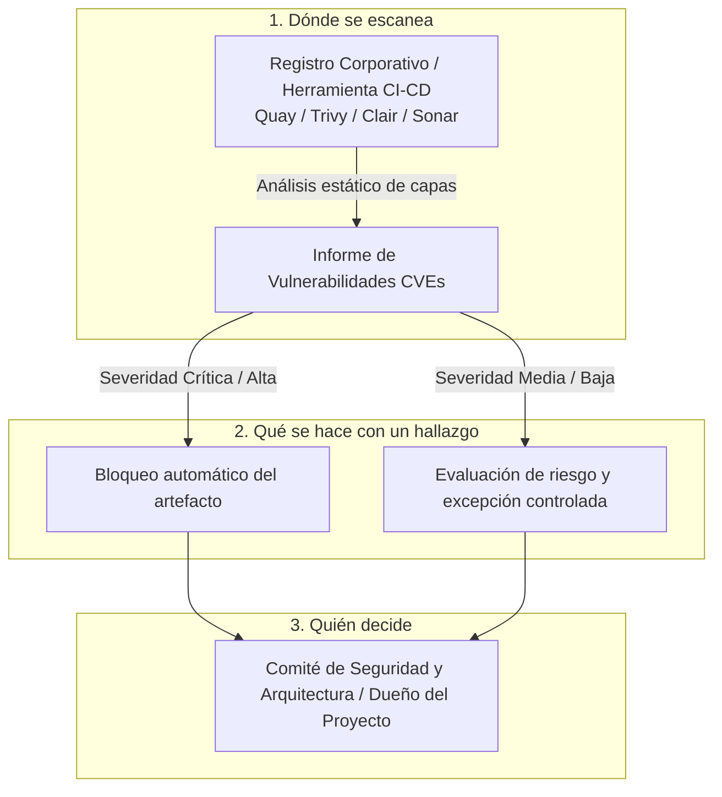

# 4.4 Registro, gestión y seguridad de imágenes

## Objetivos de aprendizaje

Al finalizar este apartado serás capaz de:

- Comprender la diferencia arquitectónica y operativa entre el registro interno de imágenes de OpenShift y un registro corporativo externo.
- Diseñar e implementar una estrategia de nomenclatura y estructuración de imágenes por equipo, proyecto y aplicación.
- Justificar por qué el etiquetado por commit (*sha256* o identificador de versión inmutable) es un requisito de producción indispensable frente al uso dinámico de la etiqueta `latest`.
- Comprender el funcionamiento avanzado de los objetos **ImageStream** e **ImageStreamTag** como abstracciones de control sobre los repositorios de contenedores.
- Entender el ciclo de vida del **escaneo de vulnerabilidades** en la plataforma: dónde se ejecuta, qué hacer ante un hallazgo crítico y quién asume la responsabilidad de la decisión final de despliegue.

---

## Registro interno frente a registro corporativo externo

En una plataforma de OpenShift, la gestión y almacenamiento de las imágenes de contenedores puede abordarse desde dos perspectivas complementarias: el **registro interno** de la plataforma y los **registros corporativos externos**.



### 1. El registro interno de OpenShift

OpenShift incluye de serie un registro de contenedores altamente integrado (*Integrated Container Registry*) desplegado como un componente del propio clúster.

- **Propósito principal:** Servir como repositorio ágil para los ciclos de desarrollo locales, compilaciones nativas (*BuildConfigs*, que estudiaremos en el apartado 4.5) y despliegues rápidos dentro del clúster.
- **Integración nativa:** Se comunica de forma transparente con los objetos `ImageStream` y es accesible directamente por los servicios internos mediante rutas internas de Kubernetes sin necesidad de configurar credenciales externas complejas.
- **Limitación operativa:** Aunque es plenamente válido para entornos de desarrollo y pruebas, en arquitecturas corporativas complejas suele requerir mecanismos adicionales de replicación si se comparten imágenes entre clústeres heterogéneos.

### 2. El registro corporativo externo

Las organizaciones maduras centralizan la custodia de sus artefactos en repositorios corporativos dedicados (como Red Hat Quay, JFrog Artifactory, Sonatype Nexus o Harbor).

- **Gobernanza y seguridad centralizada:** Permite aplicar políticas globales de escaneo de vulnerabilidades, firmas digitales y control de acceso corporativo independiente del clúster de ejecución.
- **Promoción de artefactos:** Las imágenes validadas se descargan (*pull*) desde el registro corporativo externo hacia los distintos entornos o clústeres de despliegue, garantizando que el código ejecutado ha pasado por los controles de calidad exigidos por la organización.

---

## Nomenclatura de imágenes por equipo y proyecto

En un entorno corporativo donde coexisten decenas de equipos y cientos de aplicaciones, una nomenclatura desorganizada en las imágenes de contenedores provoca fallos de trazabilidad, colisiones de nombres y conflictos de versiones.

Una estrategia de nomenclatura robusta debe reflejar claramente el dominio, el equipo responsable y el propósito del artefacto.



### Reglas recomendadas para la nomenclatura:

1. **Dominio del Registro:** Identifica claramente la procedencia (ej. `registry.corp.internal` o `nexus-registry.corp.es`).
2. **Espacio de nombres o equipo:** Delimita el departamento, proyecto o célula responsable (ej. `gobierno-digital`, `sanidad`, `es.tesoro/tributos`).
3. **Nombre del componente:** Define de manera concisa el microservicio (ej. `gestor-tramites-frontend`, `motor-calculo-backend`).
4. **Etiqueta o Tag:** Asigna la versión exacta o el identificador inmutable.

#### Ejemplo completo de referencia:
```text
registry.corp.internal/es.tesoro/vacaciones/vacaciones-backend:7f3a9b1
```

---

## Etiquetado de imágenes: `latest` frente a Versión Semántica e Identificador por Commit

Para comprender cómo se etiquetan las imágenes en producción, es muy importante aclarar una duda muy común cuando se empieza con contenedores: **¿Qué diferencia hay entre la versión del software (`v2.4.1`), el hash del commit (`7f3a9b1`) y la etiqueta `latest`?**

No son conceptos contradictorios, sino que responden a dos necesidades distintas: **la identificación para humanos** y **la garantía técnica para las máquinas**.



### 1. El riesgo de la etiqueta `latest` (Por qué NUNCA usarla en producción)

- **Falta de determinismo:** La etiqueta `latest` no indica la versión funcional del programa, sino simplemente **la última imagen subida al registro**.
- **Imposibilidad de auditoría y rollback:** Si un despliegue falla, la etiqueta `latest` impide saber qué código fuente exacto está corriendo en ese momento. Los rollbacks se vuelven impredecibles.
- **Inconsistencia de caché en los nodos:** Si un nodo tiene guardada la etiqueta `latest` en su memoria local, podría no descargar la nueva versión subida al registro, provocando que unos Pods ejecuten el código nuevo y otros el antiguo.

---

### 2. Versión Semántica vs. Hash del Commit: ¿Son contradictorios?

Para evitar los problemas de `latest`, en entornos corporativos combinamos dos formas de nombrar la imagen según quién la consulte:

| Concepto | Ejemplo | Propósito principal | ¿Quién lo utiliza? |
| :--- | :--- | :--- | :--- |
| **Versión Semántica (*SemVer*)** | `v1.2.0`, `v2.4.1` | **Identificación humana y de negocio.** Ayuda a los equipos, usuarios y documentación a saber qué versión o hito del software se ha publicado. | Personas, analistas y responsables de negocio. |
| **Identificador por Commit / SHA** | `7f3a9b1`, `sha256:a1b2...` | **Garantía técnica e inmutabilidad.** Es el código único generado por Git o el motor de contenedores al compilar. Garantiza que **esa imagen es única y nadie la puede modificar**. | Servidores, pipelines de CI/CD y OpenShift. |



!!! note "El principio de 'Construir una sola vez' (Build Once, Deploy Anywhere)"
    En un flujo de trabajo profesional, el código se compila **una única vez** en el entorno de desarrollo y se le asigna el tag del commit (ej. `7f3a9b1`). 
    
    Esa misma imagen etiquetada con su hash se promociona por los entornos de preproducción y producción. Aunque para el negocio esa entrega sea la release `v2.4.1`, los pipelines de automatización despliegan internamente el tag `7f3a9b1`. Esto garantiza matemáticamente que **lo que se probó y validó en pruebas es exactamente lo mismo que se ejecuta en producción**.

---

## ImageStreams e ImageStreamTags: La abstracción en OpenShift

En los apartados anteriores hemos empleado referencias directas a imágenes mediante URLs completas de registros externos. OpenShift introduce una abstracción nativa para desacoplar el origen de la imagen de su uso en los despliegues: el **ImageStream**.



### ¿Qué es un ImageStream?

Un **ImageStream** (`is`) no almacena físicamente los binarios de la imagen de contenedor (esa labor la realiza el registro de imágenes). Un ImageStream actúa como una **abstracción de control y puntero lógico** que rastrea una o múltiples versiones de imágenes distribuidas en uno o varios registros externos o internos.

### ¿Qué es un ImageStreamTag?

Un **ImageStreamTag** (`istag`) es la referencia específica a un punto concreto dentro del ImageStream (por ejemplo, `mi-aplicacion:v1.0` o `mi-aplicacion:7f3a9b1`).

### ¿Qué aporta frente al uso directo de registros de imágenes?

1. **Desacoplamiento y simplificación:** Permite que tus manifiestos de `Deployment` apunten a un nombre local dentro del proyecto (ej. `demo-formacion:v1`) en lugar de depender de URLs largas de registros externos. Si el registro externo cambia de ubicación o dominio, solo es necesario actualizar el ImageStream, sin necesidad de modificar los manifiestos de las aplicaciones.
2. **Activación de Despliegues Automáticos (*Image Change Triggers*):** El ImageStream actúa como un vigilante. En el momento en que una nueva versión de la imagen es subida o actualizada en el registro de origen, el ImageStream detecta la nueva suma de control (*digest*) e **inicia de manera automática un nuevo rollout** del `Deployment` vinculado, sin intervención humana.
3. **Abstracción para S2I y BuildConfigs:** Como veremos en el apartado 4.5, las herramientas de construcción nativas de OpenShift entregan sus artefactos directamente sobre un `ImageStreamTag`, simplificando la automatización de la integración continua.

---

## Escaneo de vulnerabilidades: Dónde, qué y quién

La seguridad de la cadena de suministro de software (*Software Supply Chain Security*) exige que ninguna imagen se despliegue en un entorno productivo sin haber sido auditada en busca de vulnerabilidades conocidas en sus paquetes y dependencias del sistema operativo.



### 1. ¿Dónde se escanea?

El escaneo de vulnerabilidades **nunca debe realizarse por primera vez dentro del clúster de producción**.

- El lugar idóneo es el **registro corporativo externo** (como Red Hat Quay con Clair, o Harbor con Trivy) o **durante el pipeline de CI/CD** mediante herramientas de análisis estático.
- El escaneo analiza recursivamente cada capa del contenedor, identificando paquetes del sistema operativo (RPMs, paquetes Debian) y librerías de lenguajes de programación (Java, Node.js, Python, Go) que contengan vulnerabilidades públicas registradas en bases de datos CVE (*Common Vulnerabilities and Exposures*).

### 2. ¿Qué se hace con un hallazgo?

Ante un informe de vulnerabilidades, se establece una política basada en umbrales de severidad:

- **Vulnerabilidades Críticas o Altas (CVEs con código de explotación público):** Provocan el **bloqueo automático e inmediato** de la imagen. El registro o la herramienta de CI/CD impide que la imagen sea promovida, y la plataforma rechaza su despliegue.
- **Vulnerabilidades Moderadas o Bajas:** Generan una advertencia (*warning*). Se analiza si el paquete afectado es realmente ejecutado por la aplicación o si forma parte de una capa inactiva del sistema base.

### 3. Quién decide ★

La decisión de qué hacer ante un hallazgo crítico no recae exclusivamente en una herramienta automatizada ni en el equipo de desarrollo de forma aislada:

- **La herramienta detecta y bloquea:** La automatización actúa como primera línea de defensa según las reglas preconfiguradas.
- **El equipo de desarrollo corrige:** La primera acción ante un bloqueo debe ser actualizar la imagen base o las dependencias para corregir el CVE reportado.
- **Seguridad y Arquitectura deciden ante excepciones:** En situaciones excepcionales (por ejemplo, un falso positivo confirmado, o cuando el fabricante aún no ha publicado un parche para una vulnerabilidad de severidad alta pero el servicio es crítico), **la decisión de autorizar una excepción de despliegue recae explícitamente en el responsable del proyecto junto con el departamento de seguridad**. Ningún desarrollador ni administrador debe puentear individualmente un bloqueo de seguridad sin el correspondiente registro de aprobación y mitigación del riesgo.

---

## Ideas clave para recordar

!!! tip "Resumen"
    - El **registro interno de OpenShift** facilita el desarrollo local y las construcciones nativas, mientras que los **registros corporativos externos** centralizan la gobernanza, firma y distribución de artefactos en producción.
    - Una nomenclatura de imágenes estructurada por dominio, equipo, proyecto y versión inmutable garantiza la trazabilidad en entornos compartidos.
    - **No hay contradicción entre la versión del software y el hash del commit**: la versión semántica (`v2.4.1`) sirve para que las personas identifiquen el hito de negocio, mientras que el hash (`7f3a9b1`) es el identificador técnico inmutable que usan la plataforma y los pipelines para asegurar que la imagen probada es exactamente la que se despliega.
    - **Nunca utilices la etiqueta `latest` en producción**: destruye el determinismo y hace imposibles las auditorías y los rollbacks fiables.
    - Los **ImageStreams** son objetos nativos de OpenShift que abstraen las imágenes de contenedor, permitiendo desacoplar los despliegues de los registros externos y automatizar rollouts mediante *triggers*.
    - El **escaneo de vulnerabilidades** debe integrarse de forma temprana en el registro o en el pipeline de CI/CD (*shift-left security*).
    - Ante hallazgos críticos de seguridad, la plataforma aplica bloqueos automáticos, y cualquier excepción o autorización temporal debe ser formalmente asumida por los responsables de seguridad y arquitectura.