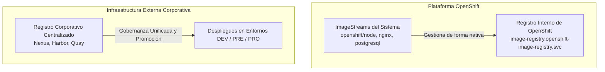
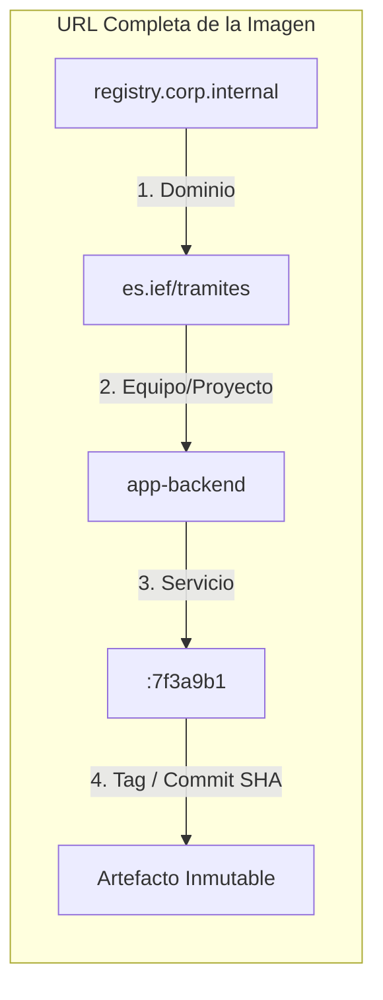
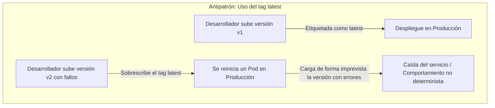
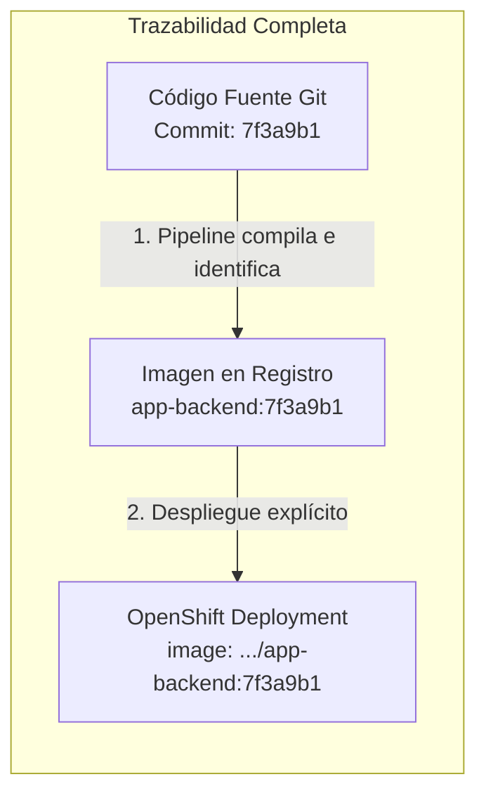
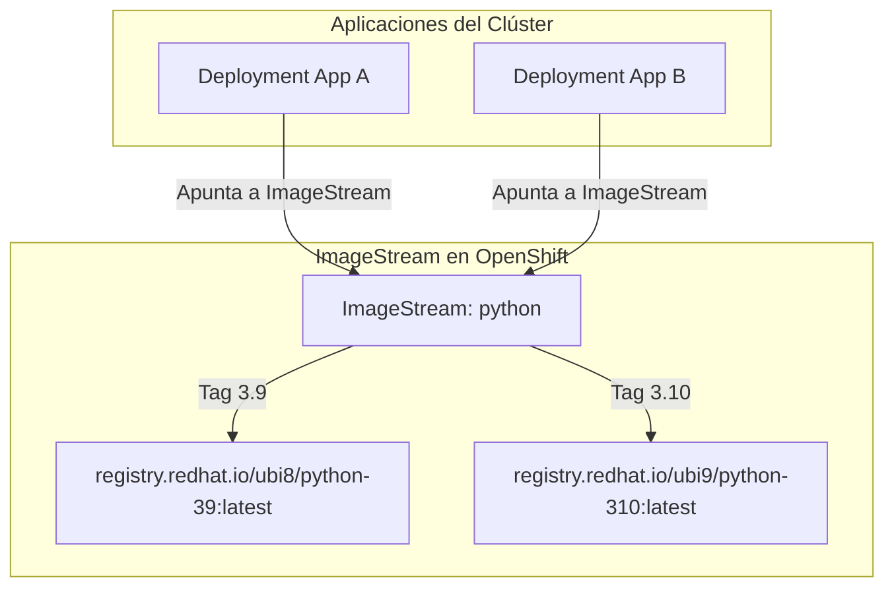
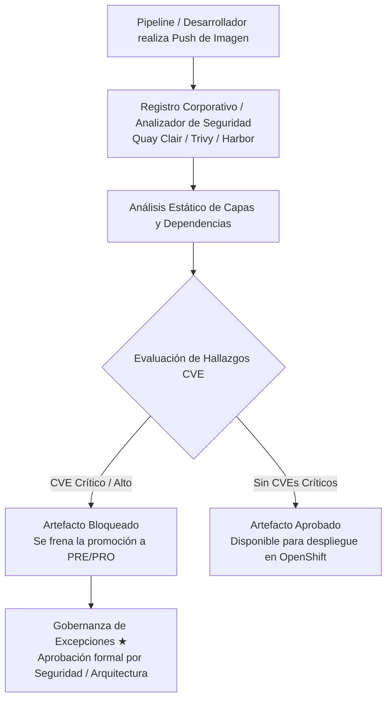

# 4.4 Registro, gestión y seguridad de imágenes

## Objetivos de aprendizaje

Al finalizar este apartado serás capaz de:

- Comprender la diferencia operativa entre el registro interno de OpenShift y un registro corporativo o público externo.
- Diseñar y aplicar una nomenclatura estándar de imágenes basada en el equipo, el proyecto y el servicio en un único formato unificado.
- Justificar técnicamente por qué el etiquetado por commit (SHA de Git) es un requisito indispensable en producción frente al uso del tag dinámico `latest`.
- Entender el papel de los **ImageStreams** como abstracción nativa de OpenShift para gestionar imágenes base del clúster y su convivencia con registros corporativos externos.
- Conocer el ciclo de vida del escaneo de vulnerabilidades post-push, analizando la gestión de hallazgos (CVEs) y el reparto de responsabilidades organizativas ante bloqueos de seguridad.

---

## Registro interno de OpenShift frente a registro corporativo externo

En una arquitectura basada en OpenShift, la gestión de las imágenes de contenedores se apoya en dos tipos de repositorios diferenciados según su cometido operativo dentro de la infraestructura corporativa.



### 1. El registro interno de OpenShift

OpenShift incluye de serie un registro de contenedores integrado y altamente optimizado dentro del propio clúster (`image-registry.openshift-image-registry.svc`).

- **Propósito principal:** Alojar las imágenes base del sistema aprovisionadas por la plataforma (como los entornos de ejecución para S2I, controladores internos o bases de datos auxiliares) y servir de almacenamiento temporal para las compilaciones nativas de desarrollo dentro del clúster.
- **Integración nativa:** Permite a los objetos de OpenShift interactuar de manera transparente mediante punteros internos, resolviendo autenticaciones y permisos mediante cuentas de servicio (`ServiceAccounts`) sin depender de credenciales de registros externos.
- **Alcance local:** Resuelve con agilidad las necesidades de compilación interna, pero su ámbito se limita al clúster donde reside.

### 2. El registro corporativo externo

Para la gestión de las aplicaciones de negocio en arquitecturas empresariales, la custodia de los artefactos se centraliza en registros corporativos dedicados (como Nexus, Harbor o Red Hat Quay).

- **Única fuente de la verdad multi-entorno:** Evita tener registros aislados en cada clúster. Un único registro corporativo almacena el artefacto validado para que pueda ser desplegado sucesivamente en los clústeres de **Desarrollo, Preproducción y Producción**.
- **Gobernanza unificada:** Permite aplicar políticas de retención, auditoría de accesos y escaneo de seguridad centralizado para toda la organización, de forma independiente al ciclo de vida de los clústeres de OpenShift.
- **Distribución segura:** Garantiza que los entornos de producción descarguen únicamente imágenes que han superado todas las fases previas de homologación.

---

## Nomenclatura estándar de imágenes y estructura de rutas

Para evitar colisiones de nombres, sobrescrituras accidentales y problemas graves de trazabilidad en entornos corporativos compartidos, las imágenes deben seguir una estructura de nomenclatura estricta, clara y predecible.



### Desglose de la nomenclatura recomendada

Toda imagen corporativa debe identificarse mediante una URL jerárquica compuesta por cuatro segmentos fundamentales:

1. **Dominio del Registro (`registry.corp.internal`):** Servidor o punto de entrada centralizado del registro de imágenes de la organización (ej. `nexus-registry.corp.es` o `quay.apps.cluster.internal`).
2. **Espacio de nombres o grupo (`es.ief/tramites`):** Delimita la organización y el área de negocio o proyecto al que pertenece la aplicación. Evita que dos equipos diferentes utilicen el mismo espacio de nombres.
3. **Nombre del servicio (`app-backend`):** Define de manera concisa el microservicio o componente de software que se empaqueta (ej. `portal-frontend`, `api-tramites`, `worker-batch`).
4. **Etiqueta o Tag (`:7f3a9b1`):** Sella la versión concreta e inmutable del artefacto.

#### Ejemplo completo de referencia:
```text
registry.corp.internal/es.ief/tramites/app-backend:7f3a9b1
```

!!! note "Buenas prácticas de nombrado"
    Utiliza siempre caracteres en minúsculas, guiones simples (`-`) para separar palabras y evita nombres genéricos como `app`, `test` o `backend` sin el contexto del proyecto organizativo.

---

## Etiquetado de imágenes: `latest` frente al identificador por Commit (SHA)

El etiquetado de las imágenes es una decisión técnica con enorme impacto en la estabilidad de los entornos. El uso de etiquetas dinámicas en producción representa uno de los antipatrones más graves en la gestión de contenedores.



### 1. Los riesgos operativos de la etiqueta `latest`

- **Falta de determinismo:** La etiqueta `latest` no es más que un puntero flotante que apunta a la **última imagen subida al registro**. Dos ejecuciones del mismo manifiesto en momentos o nodos diferentes pueden descargar códigos completamente distintos.
- **Inconsistencia de caché en los nodos:** Si un nodo del clúster ya tiene en su memoria caché local una imagen con la etiqueta `latest`, no descargará la nueva versión a menos que la política de descarga esté configurada como `imagePullPolicy: Always`. Esto provoca que unos Pods ejecuten el código nuevo y otros el código antiguo dentro del mismo Deployment.
- **Incapacidad de auditoría y *rollback*:** Si surge una incidencia crítica en producción, es imposible saber qué versión exacta del código fuente está ejecutándose. Además, la orden `oc rollout undo` no podrá restaurar el estado anterior porque la etiqueta `latest` habrá sido sobrescrita en el registro.

---

### 2. Versión Semántica frente a Identificador por Commit (SHA)

Para conciliar la trazabilidad funcional con la estabilidad técnica, las organizaciones combinan dos niveles de etiquetado:

| Concepto | Ejemplo | Propósito principal | Ámbito de uso |
| :--- | :--- | :--- | :--- |
| **Versión Semántica (*SemVer*)** | `v1.2.0`, `v2.4.1` | **Identificación comercial y de negocio.** Describe el alcance funcional de la versión (cambios mayores, menores o parches). | Manuales de usuario, notas de versión y comunicación entre equipos. |
| **Identificador por Commit (SHA)** | `7f3a9b1`, `a1b2c3d` | **Inmutabilidad técnica.** Hash único generado por Git al realizar el *commit* del código fuente. | Pipelines de CI/CD, despliegues en OpenShift y auditorías de seguridad. |



### 3. El principio del artefacto único

En un flujo industrializado, la imagen se construye **una sola vez** etiquetada con el hash del commit (`7f3a9b1`). Ese mismo artefacto inmutable es el que se promociona y despliega secuencialmente en Desarrollo, Preproducción y Producción sin volver a compilar el código.

---

## Uso conceptual de ImageStreams para imágenes base del clúster

OpenShift introduce un objeto nativo denominado **ImageStream** (`is`) que actúa como una capa de abstracción o catálogo de punteros hacia imágenes reales de contenedores.



### 1. Propósito de los ImageStreams

Un `ImageStream` no almacena las capas físicas del contenedor; únicamente guarda una tabla de metadatos que referencia a imágenes alojadas en el registro interno de OpenShift o en registros externos.

Sus funciones principales son:

- **Proporcionar un catálogo de entornos de ejecución (*Runtimes*):** Permite a la plataforma ofrecer a los desarrolladores imágenes base estandarizadas y actualizadas de lenguajes y servicios (Node.js, Python, Java, PostgreSQL, Nginx).
- **Abstracción de rutas:** Permite que las plantillas y aplicaciones apunten a un nombre simbólico dentro del clúster sin necesidad de acoplar la URL completa del registro en cada manifiesto.
- **Disparadores automáticos (*Image Change Triggers*):** Permite configurar OpenShift para que detecte cuándo se ha actualizado la referencia de una imagen base y lance automáticamente un re-despliegue de las aplicaciones dependientes.

### 2. Convivencia con la gobernanza corporativa

Cuando la organización utiliza un pipeline de CI/CD externo (como GitLab CI o Jenkins) y un registro centralizado (como Nexus):

- **Imágenes de aplicación:** El pipeline externo compila la imagen, la sube al registro corporativo etiquetada por el commit SHA y actualiza el `Deployment` de OpenShift especificando directamente la URL de la imagen en el registro corporativo. En este flujo no es estrictamente necesario crear un ImageStream por cada microservicio de negocio.
- **Imágenes base del clúster:** Se mantiene el uso de `ImageStreams` administrados por la plataforma para catalogar las imágenes base homologadas y asegurar que los desarrolladores construyan sus aplicaciones sobre componentes seguros y soportados.

---

## Escaneo de vulnerabilidades: Análisis post-push y gestión de hallazgos (CVEs)

La seguridad de las imágenes se enmarca en la protección de la cadena de suministro de software (*Supply Chain Security*). Ninguna imagen debe ejecutarse en el clúster sin haber sido analizada en busca de vulnerabilidades conocidas (*Common Vulnerabilities and Exposures* - CVE).



### 1. El ciclo del análisis de seguridad post-push

1. **Análisis Automático:** En cuanto la imagen aterriza en el registro corporativo (evento *post-push*), un motor de seguridad inspecciona todas las capas del SO base y los paquetes de lenguajes (npm, maven, pip) comparándolos con las bases de datos públicas de vulnerabilidades.
2. **Generación de Informes de Seguridad:** El escáner emite un informe detallado clasificando los hallazgos según su nivel de severidad (*Low*, *Medium*, *High*, *Critical*).

### 2. Gestión de hallazgos y criterio de bloqueo

- **Bloqueo Automático:** Los pipelines de CI/CD se configuran con umbrales estrictos (*Quality Gates*). Si se detecta un CVE de severidad **Crítica** o **Alta** con parche disponible, la promoción de la imagen se bloquea de forma automática, impidiendo su despliegue en entornos superiores.
- **Subsanación:** La primera acción debe ser siempre **actualizar la imagen base o las dependencias** en el código fuente y generar un nuevo commit para compilar una imagen limpia.

---

### 3. Gobierno de excepciones y toma de decisiones ★

En la operativa real de un entorno corporativo, surgen situaciones complejas donde un escáner bloquea un despliegue crítico por un hallazgo que no dispone de parche inmediato o que representa un falso positivo en el contexto de uso de la aplicación.

!!! warning "Regla de gobernanza ante bloqueos de seguridad"
    **Un desarrollador o equipo de proyecto NUNCA debe tener permisos para saltarse un bloqueo de seguridad de forma unilateral.**

    Cuando un hallazgo de seguridad impide un despliegue crítico, el procedimiento formal exige:

    1. **Análisis de impacto:** El equipo de desarrollo justifica técnicamente si la vulnerabilidad es explotable en su arquitectura (por ejemplo, una librería vulnerable que la aplicación no llega a invocar).
    2. **Evaluación de riesgos:** El **Equipo de Seguridad Corporativa / Arquitectura** evalúa la justificación y los controles compensatorios existentes a nivel de plataforma (como NetworkPolicies o SCCs).
    3. **Excepción temporal:** Si procede, el responsable de seguridad concede una **excepción formal temporal** firmada con fecha de caducidad para permitir el despliegue mientras el fabricante publica el parche definitivo.

---

## Ideas clave para recordar

!!! tip "Resumen"
    - El **registro interno de OpenShift** atiende necesidades locales del clúster e imágenes base, mientras que el **registro corporativo externo (Nexus/Quay)** centraliza la gobernanza y la promoción de imágenes entre clústeres (Dev, Pre, Pro).
    - La **nomenclatura estándar** debe estructurarse jerárquicamente: `Dominio / Equipo-Proyecto / Servicio : Tag`.
    - **Prohibido usar `latest` en producción**: destruye el determinismo, rompe la caché de los nodos y deshabilita la capacidad de auditar o realizar *rollbacks*.
    - Las imágenes de producción deben etiquetarse siempre con el **identificador de commit de Git (SHA)** para garantizar la inmutabilidad del artefacto.
    - Los **ImageStreams** son abstracciones nativas para catalogar imágenes base e integrar componentes del clúster; para las aplicaciones de negocio gestionadas por pipelines externos es habitual apuntar directamente a la URL del registro corporativo.
    - El **escaneo de vulnerabilidades (CVEs)** analiza las capas post-push y frena de forma automática artefactos inseguros.
    - La autorización de **excepciones de seguridad ★** ante bloqueos de despliegue es responsabilidad exclusiva del equipo de Seguridad y Arquitectura, nunca de los equipos de desarrollo.