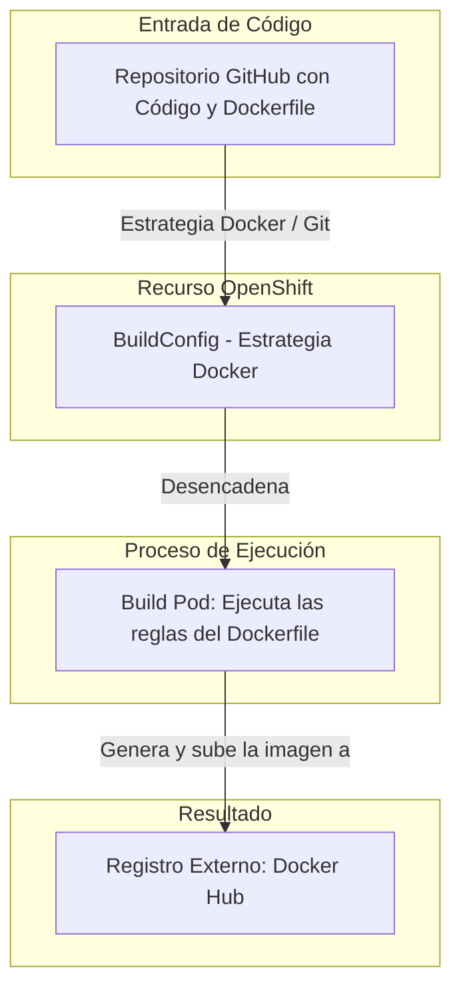
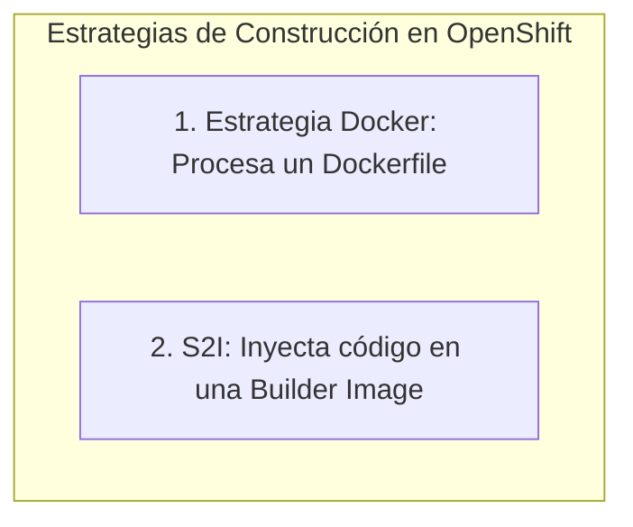
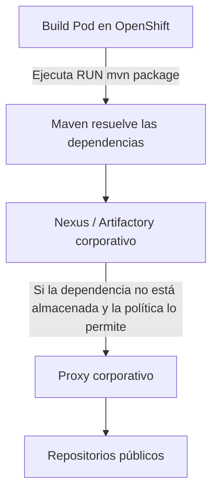
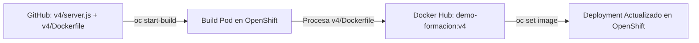

# 4.5 Construir en la plataforma: estrategias de BuildConfig

## Objetivos de aprendizaje

Al finalizar este apartado serás capaz de:

- Comprender el propósito del recurso nativo `BuildConfig` (BC) en OpenShift como abstracción para la automatización de construcciones de imágenes.
- Conocer las principales estrategias de construcción que nos interesa abordar en este curso (Docker y S2I), comprendiendo las razones técnicas para adoptar la **Estrategia Docker**.
- Comprender el flujo de resolución y descarga de dependencias durante la fase de compilación en el clúster.
- Ejecutar una práctica guiada basada en nuestra aplicación de la Sesión 1.8, utilizando un `BuildConfig` con **Estrategia Docker** conectado a un repositorio de GitHub (especificando `contextDir`) para automatizar la construcción, publicar en **Docker Hub** y actualizar el despliegue existente mediante `oc set image`.

---

## Evolución de nuestra perspectiva: De la construcción artesanal en local a la automatización en el clúster

Para comprender el verdadero salto cualitativo que supone `BuildConfig`, debemos conectar este apartado con el flujo de trabajo que realizamos en la **Sesión 1.8**:

```mermaid
flowchart TD
    subgraph Sesion1 ["Sesión 1.8: Construcción Manual en el Puesto del Desarrollador"]
        A1[Código Fuente + Dockerfile Local] -->|1. podman build| A2[Imagen Local en Estación de Trabajo]
        A2 -->|2. podman push| A3[Registro Público Externo: Docker Hub]
        A3 -->|3. oc new-app| A4[Despliegue en OpenShift]
    end

    subgraph Sesion4 ["Sesión 4.5: Construcción Delegada en la Plataforma (Estrategia Docker)"]
        B1[Repositorio GitHub con Código + Dockerfile] -->|1. Webhook / oc start-build| B2[Build Pod Efímero en OpenShift]
        B2 -->|2. Compila el Dockerfile dentro| B3[Registro Externo: Docker Hub]
        B3 -->|3. Despliegue automatizado| B4[Despliegue en OpenShift]
    end
```



### Comparativa de flujos de trabajo

- **El enfoque de la Sesión 1.8 (Construcción Manual en Local):** 
  En la primera sesión aprendimos a leer un `Dockerfile` y construimos una imagen ejecutando comandos manuales en nuestra máquina cliente con Podman (`podman build`), le asignamos una etiqueta y la subimos nosotros mismos a un registro externo (`podman push docker.io/...`) antes de decirle a OpenShift que la desplegara[cite: 1].
  
  *Limitaciones de este modelo:* Depende de que el desarrollador tenga Podman/Docker instalado en su equipo, requiere ancho de banda local para subir imágenes pesadas a Internet, no escala en equipo y dificulta auditar exactamente qué código generó esa imagen.

- En este apartado **delegamos la responsabilidad de la construcción a OpenShift manteniendo nuestro `Dockerfile`**. El desarrollador ya no compila ni empaqueta la imagen en su portátil; simplemente conecta su repositorio de código a la plataforma, y el propio clúster ejecuta las instrucciones del `Dockerfile` en un **Build Pod**, deposita la imagen resultante en el **registro de Docker Hub** e inicia el despliegue de forma trazable.

---

## La abstracción de construcción en OpenShift: `BuildConfig`

En la Sesión 1.8 mostramos el efecto visual de desplegar código fuente directamente en la plataforma. En este apartado explicamos el mecanismo técnico que lo hace posible.

OpenShift extiende las capacidades nativas de Kubernetes introduciendo el objeto **BuildConfig** (`bc`). Un `BuildConfig` es la definición declarativa del proceso mediante el cual el código fuente o un contexto de compilación con su `Dockerfile` se transforman en una imagen de contenedor lista para ejecutarse en el clúster.



Cuando un `BuildConfig` se ejecuta (de forma manual, mediante un *webhook* de Git o mediante comandos de CLI), OpenShift no compila el código dentro de los nodos del control plane. En su lugar, el sistema crea un **Build Pod** efímero dedicado exclusivamente a ejecutar la tarea de compilación y empaquetado del `Dockerfile`, aislando el consumo de recursos.

---

## Estrategias de construcción en OpenShift

OpenShift dispone de distintas estrategias de construcción. Las principales que nos interesa conocer en este curso son **Docker** y **Source-to-Image (S2I)**.



### Contexto sobre las estrategias de OpenShift

1. **Estrategia Docker:** OpenShift procesa directamente un archivo `Dockerfile` presente en el repositorio de código fuente.
2. **Source-to-Image (S2I):** Un mecanismo nativo de OpenShift donde el clúster toma código fuente sin `Dockerfile` (Node.js, Java, Python, etc.) y lo combina con una imagen constructora (*Builder Image*) oficial para generar la imagen final.

### Justificación técnica de la Estrategia Docker

- **Control total y explícito:** El desarrollador y el equipo de arquitectura definen con precisión la imagen base (`FROM`), la versión del runtime, las dependencias del sistema y las directivas de seguridad (como los permisos de usuario), evitando comportamientos opacos.
- **Portabilidad universal:** Un `Dockerfile` es un estándar abierto e independiente de la plataforma. La misma definición se puede construir en OpenShift, en un motor local (Podman/Docker), en cualquier otro clúster de Kubernetes o en cualquier herramienta de CI/CD (GitHub Actions, GitLab CI, Jenkins).

### Cuadro comparativo de estrategias

| Criterio | Estrategia Docker (Estándar recomendado) | Source-to-Image (S2I) |
| :--- | :--- | :--- |
| **Origen del código** | Repositorio Git remoto | Repositorio Git remoto |
| **Requiere Dockerfile** | **Sí (obligatorio)** | No |
| **Lugar de compilación** | Dentro del clúster (Build Pod) | Dentro del clúster (Build Pod) |
| **Control sobre el SO base** | **Total (definido en el `FROM`)** | Bajo (definido por la Builder Image) |
| **Uso en CI/CD Industrial** | **Muy alto (Estándar corporativo)** | Fase inicial / prototipado |

---

## De dónde salen y cómo se resuelven las dependencias

Durante la ejecución de un `BuildConfig`, el *Build Pod* procesa las instrucciones del `Dockerfile`. Algunas de esas instrucciones pueden necesitar acceder a recursos externos.

En el `Dockerfile` de nuestra aplicación, por ejemplo, la instrucción `FROM` requiere obtener la imagen base `ubi9/nodejs-20`. En otras aplicaciones, la construcción también puede ejecutar herramientas que necesitan descargar dependencias. Una aplicación Java podría incluir una instrucción como esta:

```dockerfile
RUN mvn package
```

En este caso, el `Dockerfile` no determina si OpenShift tiene o no salida a Internet. Lo que hace es ejecutar Maven y Maven necesita localizar las dependencias declaradas por la aplicación para poder compilarla.



### 1. El reto del acceso a Internet en clústeres corporativos

En entornos corporativos, los procesos de construcción pueden no disponer de acceso directo a Internet. Si una instrucción como `RUN mvn package` necesita descargar dependencias y no existe una vía autorizada para obtenerlas, la construcción fallará.

Además de las dependencias de la aplicación, el proceso puede necesitar obtener otros recursos externos, como la imagen base indicada mediante `FROM`.

### 2. Puntos de resolución de dependencias

En un entorno gobernado, es habitual que las dependencias se resuelvan a través de un **repositorio corporativo de artefactos**, como Nexus o Artifactory, en lugar de que cada construcción acceda directamente a repositorios públicos.

El repositorio corporativo actúa como punto central de control: entrega las dependencias que ya tiene almacenadas y, si necesita obtener una nueva desde un repositorio externo, lo hace de acuerdo con las políticas de la organización. Esto mejora la seguridad, la trazabilidad, la disponibilidad y el rendimiento de las construcciones.

El acceso a recursos externos también puede canalizarse mediante un **proxy corporativo**. Son funciones diferentes: Nexus o Artifactory gestionan los artefactos y dependencias, mientras que el proxy controla o canaliza la conectividad hacia el exterior.

---

## Práctica guiada: Llevando nuestra app de la Sesión 1.8 a un BuildConfig con GitHub y Docker Hub

En esta práctica vamos a reutilizar la aplicación Node.js de la **Sesión 1.8** (`server.js`, `demo-formacion.html` y su `Dockerfile`) organizada por versiones dentro de un repositorio de **GitHub**, automatizaremos su construcción con un `BuildConfig` usando **Estrategia Docker** e indicando la subcarpeta `v4` (`contextDir`), publicaremos el resultado en **Docker Hub** y actualizaremos nuestro despliegue existente usando `oc set image`.



### Paso 1: Estructura del código en GitHub

Asegúrate de que en tu repositorio público de **GitHub** (por ejemplo, `https://github.com/ieftraining/demo-formacion`) tienes organizada la versión `v4` en su respectiva subcarpeta[cite: 4]:

```text
demo-formacion/
├── v1/
├── v2/
├── v3/
└── v4/
    ├── Dockerfile
    ├── demo-formacion.html
    └── server.js
```

El `v4/Dockerfile` contiene:

```dockerfile
FROM registry.access.redhat.com/ubi9/nodejs-20

WORKDIR /opt/app-root/src

COPY server.js .
COPY demo-formacion.html index.html

EXPOSE 8080

CMD ["node", "server.js"]
```

### Paso 2: Crear un Secret de autenticación para Docker Hub en OpenShift

Para que OpenShift pueda realizar el `push` de la nueva imagen al repositorio de Docker Hub preparado para la formación, creamos un Secret con la credencial temporal facilitada por el profesor. No utilizaremos una contraseña personal. El Secret se crea en el proyecto activo, por lo que no es necesario indicar el namespace:

```bash
oc create secret docker-registry dockerhub-secret \
  --docker-server=docker.io \
  --docker-username=ieftraining \
  --docker-password=TOKEN_FORMACION \
  --docker-email=CORREO_FORMACION
```

### Paso 3: Crear el objeto BuildConfig conectado a GitHub (Subcarpeta v4) y Docker Hub

Creamos un fichero de manifiesto llamado `buildconfig-github.yaml`. Todos utilizaremos el mismo repositorio, pero cada alumno debe sustituir `alumno01` por su identificador para publicar una etiqueta distinta, por ejemplo `v4-alumno01`, `v4-alumno02`, etc.:

```yaml
apiVersion: build.openshift.io/v1
kind: BuildConfig
metadata:
  name: demo-formacion-bc
spec:
  # Origen: Repositorio Git apuntando al directorio de contexto de la versión v4
  source:
    type: Git
    git:
      uri: "https://github.com/ieftraining/demo-formacion.git"
      ref: "main"
    contextDir: "v4"
  # Estrategia: Procesar el Dockerfile localizado en v4/
  strategy:
    type: Docker
    dockerStrategy:
      dockerfilePath: Dockerfile
  # Salida: Registro externo de Docker Hub con etiqueta v4
  output:
    to:
      kind: DockerImage
      name: "docker.io/ieftraining/demo-formacion:v4-alumno01"
    pushSecret:
      name: dockerhub-secret
  successfulBuildsHistoryLimit: 3
  failedBuildsHistoryLimit: 3
```

#### Explicación del manifiesto `BuildConfig`:

- **`spec.source`:** Declara la fuente del código. Usamos `type: Git` indicando la URI del repositorio y, mediante **`contextDir: "v4"`**, instruimos a OpenShift para que acceda exclusivamente a la subcarpeta `v4` en busca del código y del `Dockerfile`[cite: 4].
- **`spec.strategy`:** Define la estrategia de construcción. En este caso `type: Docker`, por lo que OpenShift usará el motor de empaquetado estándar leyendo las instrucciones de `dockerfilePath`.
- **`spec.output`:** Especifica el destino del artefacto final generado por el *Build Pod*. Apunta a una etiqueta individual, por ejemplo `demo-formacion:v4-alumno01`, en Docker Hub mediante la autenticación segura del `pushSecret`.
- **`historyLimit`:** Limita la cantidad de registros e historiales de construcciones pasadas que se conservan en el clúster para optimizar el almacenamiento.

Aplicamos el manifiesto en nuestro espacio de nombres:

```bash
oc apply -f buildconfig-github.yaml
```

### Paso 4: Disparar y monitorizar la construcción en el clúster

Disparamos la construcción manualmente mediante la CLI:

```bash
oc start-build demo-formacion-bc --follow
```

El parámetro `--follow` nos mostrará en tiempo real los logs del *Build Pod*, el cual clonará el repositorio, entrará en la subcarpeta `v4`, ejecutará el `Dockerfile` de Node.js y subirá la imagen resultante a Docker Hub con la etiqueta individual configurada en el BuildConfig.

### Paso 5: Actualizar el despliegue existente mediante `oc set image` y registrar la causa del cambio

En lugar de crear un recurso nuevo con `oc new-app`, actualizamos nuestro `Deployment` existente (desplegado previamente con la `v3`) para que pase a utilizar de forma transparente la nueva imagen `v4` construida por la plataforma:

```bash
oc set image deployment/demo-formacion-yaml *=docker.io/ieftraining/demo-formacion:v4-alumno01
```

A continuación, anotamos en Kubernetes la causa del cambio para mantener la trazabilidad e historial de revisiones del despliegue:

```bash
oc annotate deployment/demo-formacion-yaml \
  kubernetes.io/change-cause="Actualizacion a v4. Construcción automatizada en clúster mediante BuildConfig con Estrategia Docker." \
  --overwrite
```

Comprobamos que el despliegue está realizando el *rolling update* y verificamos la ruta existente:

```bash
oc rollout status deployment/demo-formacion-yaml
```

```bash
oc get route
```

---

## Ideas clave para recordar

!!! tip "Resumen"
    - **Evolución natural frente a la Sesión 1.8:** Pasamos de la construcción manual con Podman[cite: 1] a la automatización delegada en la plataforma mediante un `BuildConfig`.
    - **Estrategia Docker:** Permite seguir utilizando exactamente nuestro `Dockerfile` clásico basado en UBI (`ubi9/nodejs-20`), reutilizando los conocimientos adquiridos en la Sesión 1[cite: 1].
    - **Soporte para estructuras con `contextDir`:** Mediante el campo `contextDir`, OpenShift puede localizar el `Dockerfile` y el código fuente incluso si se encuentran dentro de una subcarpeta (como `v4/`)[cite: 4].
    - **Publicación y actualización continua:** Con un `pushSecret` la imagen aterriza en **Docker Hub**, y utilizando `oc set image` junto con `oc annotate`, actualizamos la aplicación en producción garantizando la trazabilidad de los cambios.