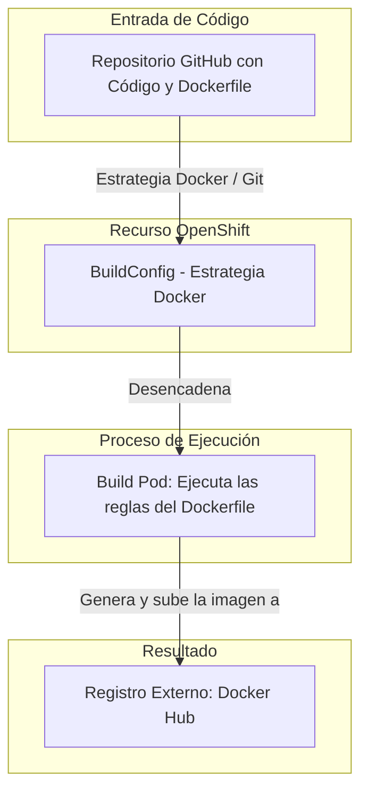
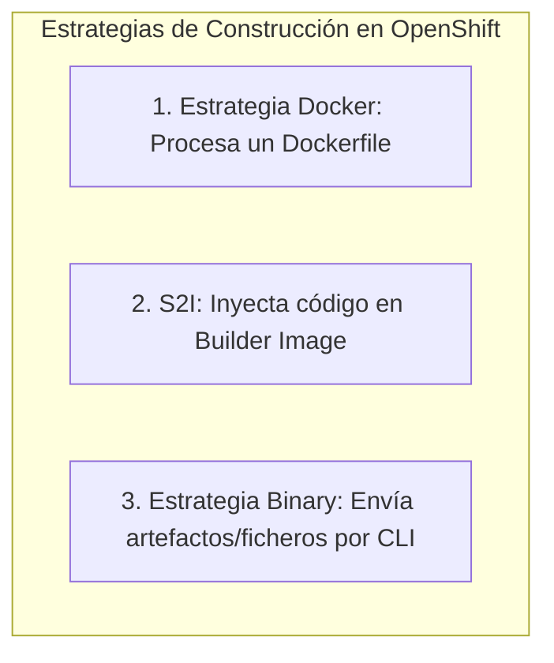
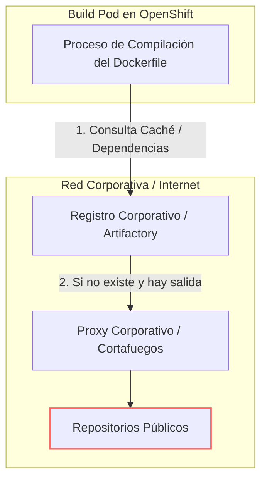
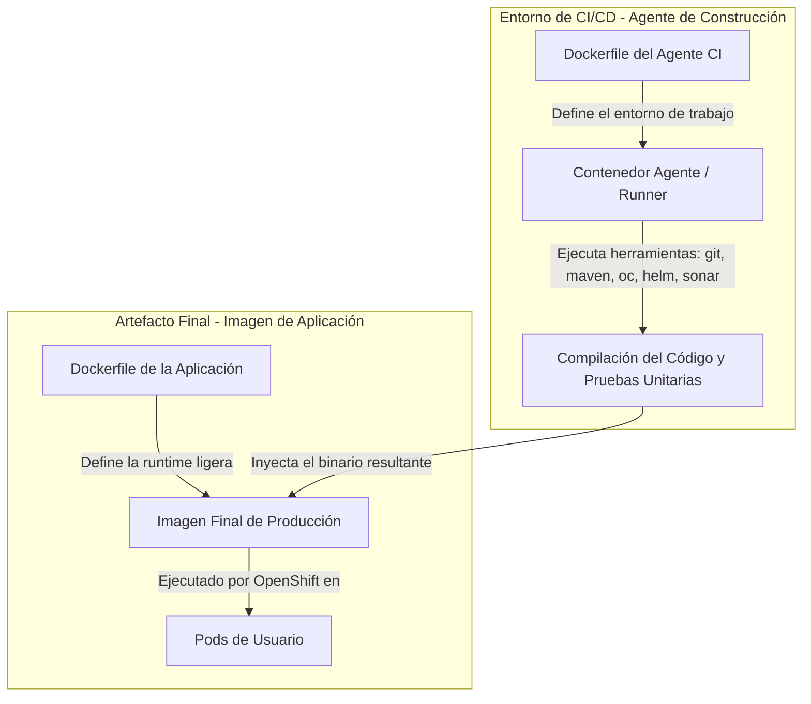
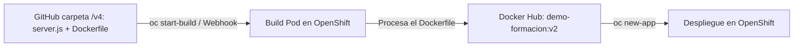

# 4.5 Construir en la plataforma: estrategias de BuildConfig

## Objetivos de aprendizaje

Al finalizar este apartado serás capaz de:

- Comprender el propósito del recurso nativo `BuildConfig` (BC) en OpenShift como abstracción para la automatización de construcciones de imágenes.
- Analizar y diferenciar las tres estrategias de construcción de OpenShift (Docker, S2I y Binary), comprendiendo las razones técnicas para adoptar la **Estrategia Docker**.
- Comprender el flujo de resolución y descarga de dependencias durante la fase de compilación en el clúster.
- Distinguir claramente la responsabilidad y arquitectura de los **dos Dockerfile**: el entorno del agente de construcción CI frente al Dockerfile de la aplicación final.
- Ejecutar una práctica guiada basada en nuestra aplicación de la Sesión 1.8, utilizando un `BuildConfig` con **Estrategia Docker** conectado a un repositorio de GitHub (especificando la carpeta `v4`) para automatizar la construcción y publicación hacia **Docker Hub**.

---

## Evolución de nuestra perspectiva: De la construcción artesanal en local a la automatización en el clúster

Para comprender el verdadero salto cualitativo que supone `BuildConfig`, debemos conectar este apartado con el flujo de trabajo que realizamos en la **Sesión 1.8**:

```mermaid
flowchart TD
    subgraph Sesion1 ["Sesión 1.8: Construcción Manual en el Puesto del Desarrollador"]
        A1[Código Fuente + Dockerfile Local] -->|1. podman build| A2[Imagen Local en Estación de Trabajo]
        A2 -->|2. podman push| A3[Registro Público Externo: Docker Hub]
        A3 -->|3. oc new-app| A4[Despliegue en OpenShift]
    end

    subgraph Sesion4 ["Sesión 4.5: Construcción Delegada en la Plataforma (Estrategia Docker)"]
        B1[Repositorio GitHub con Código + Dockerfile] -->|1. Webhook / oc start-build| B2[Build Pod Efímero en OpenShift]
        B2 -->|2. Compila el Dockerfile dentro| B3[Registro Externo: Docker Hub]
        B3 -->|3. Despliegue automatizado| B4[Despliegue en OpenShift]
    end
```



### Comparativa de flujos de trabajo

- **El enfoque de la Sesión 1.8 (Construcción Manual en Local):** 
  En la primera sesión aprendimos a leer un `Dockerfile` y construimos una imagen ejecutando comandos manuales en nuestra máquina cliente con Podman (`podman build`), le asignamos una etiqueta y la subimos nosotros mismos a un registro externo (`podman push docker.io/...`) antes de decirle a OpenShift que la desplegara.
  
  *Limitaciones de este modelo:* Depende de que el desarrollador tenga Podman/Docker instalado en su equipo, requiere ancho de banda local para subir imágenes pesadas a Internet, no escala en equipo y dificulta auditar exactamente qué código generó esa imagen.

- **El enfoque de la Sesión 4.5 (Construcción Automatizada en la Plataforma):**
  En este apartado **delegamos la responsabilidad de la construcción a OpenShift manteniendo nuestro `Dockerfile`**. El desarrollador ya no compila ni empaqueta la imagen en su portátil; simplemente conecta su repositorio de código a la plataforma, y el propio clúster ejecuta las instrucciones del `Dockerfile` en un **Build Pod**, deposita la imagen resultante en el **registro de Docker Hub** e inicia el despliegue de forma trazable.

---

## La abstracción de construcción en OpenShift: `BuildConfig`

En la Sesión 1.7 mostramos el efecto visual de desplegar código fuente directamente en la plataforma. En este apartado explicamos el mecanismo técnico que lo hace posible.

OpenShift extiende las capacidades nativas de Kubernetes introduciendo el objeto **BuildConfig** (`bc`). Un `BuildConfig` es la definición declarativa del proceso mediante el cual el código fuente, artefactos binarios o un contexto de compilación con su `Dockerfile` se transforman en una imagen de contenedor lista para ejecutarse en el clúster.



Cuando un `BuildConfig` se ejecuta (de forma manual, mediante un *webhook* de Git o mediante comandos de CLI), OpenShift no compila el código dentro de los nodos del control plane. En su lugar, el sistema crea un **Build Pod** efímero dedicado exclusivamente a ejecutar la tarea de compilación y empaquetado del `Dockerfile`, aislando el consumo de recursos.

---

## Estrategias de construcción en OpenShift

OpenShift soporta distintas estrategias para transformar código en imágenes de contenedor. Aunque existen alternativas orientadas a abstraer la creación de contenedores, la **Estrategia Docker** representa el estándar de la industria en entornos corporativos.



### Contexto sobre las estrategias de OpenShift

Para entender el panorama completo de la plataforma, conviene distinguir las tres estrategias principales disponibles en OpenShift:

1. **Estrategia Docker:** OpenShift procesa directamente un archivo `Dockerfile` presente en el repositorio de código fuente.
2. **Source-to-Image (S2I):** Un mecanismo nativo de OpenShift donde el clúster toma código fuente sin `Dockerfile` (Node.js, Java, Python, etc.) y lo combina con una imagen constructora (*Builder Image*) oficial para generar la imagen final.
3. **Estrategia Binary:** Una variante donde la compilación o preparación del código se realiza fuera del clúster y el resultado bruto (ficheros comprimidos o binarios) se envía mediante la CLI (`oc start-build --from-file=...`).

### Justificación técnica de la Estrategia Docker

- **Control total y explícito:** El desarrollador y el equipo de arquitectura definen con precisión la imagen base (`FROM`), la versión del runtime, las dependencias del sistema y las directivas de seguridad (como los permisos de usuario), evitando comportamientos opacos.
- **Portabilidad universal:** Un `Dockerfile` es un estándar abierto e independiente de la plataforma. La misma definición se puede construir en OpenShift, en un motor local (Podman/Docker), en cualquier otro clúster de Kubernetes o en cualquier herramienta de CI/CD (GitHub Actions, GitLab CI, Jenkins).

### Cuadro comparativo de estrategias

| Criterio | Estrategia Docker (Estándar recomendado) | Source-to-Image (S2I) | Estrategia Binary con Dockerfile |
| :--- | :--- | :--- | :--- |
| **Origen del código** | Repositorio Git remoto | Repositorio Git remoto | Puesto local / Pipeline de CI/CD |
| **Requiere Dockerfile** | **Sí (obligatorio)** | No | **Sí (para empaquetado)** |
| **Lugar de compilación** | Dentro del clúster (Build Pod) | Dentro del clúster (Build Pod) | Mixto (Compilación fuera, empaquetado en clúster) |
| **Control sobre el SO base** | **Total (definido en el `FROM`)** | Bajo (definido por la Builder Image) | **Total (definido en el `FROM`)** |
| **Uso en CI/CD Industrial** | **Muy alto (Estándar corporativo)** | Fase inicial / prototipado | **Muy alto en integraciones con artefactos** |

---

## De dónde salen y cómo se resuelven las dependencias

Un punto crítico en la arquitectura de construcción dentro de OpenShift es entender cómo las instrucciones de nuestro `Dockerfile` descargan y gestionan las librerías externas durante la ejecución del `BuildConfig`.



### 1. El reto del acceso a Internet en clústeres corporativos

En entornos de producción o redes restringidas (DMZ), los nodos del clúster de OpenShift **no tienen acceso directo a Internet público**. Si las instrucciones de un `Dockerfile` intentan conectar directamente a los repositorios públicos, la compilación fallará por un error de tiempo de espera (*timeout*).

### 2. Puntos de resolución de dependencias

Para resolver esta limitación en entornos empresariales, la infraestructura ofrece dos soluciones:

1. **Gestores de Artefactos Corporativos (Nexus / Artifactory):** Las instrucciones dentro del `Dockerfile` o sus archivos asociados deben apuntar explícitamente a las URLs del registro interno corporativo. Este servidor actúa como caché de dependencias aprobadas y autorizadas por la organización.
2. **Inyección de Proxies de Plataforma:** OpenShift permite configurar variables de entorno globales (`HTTP_PROXY`, `HTTPS_PROXY`, `NO_PROXY`) en el objeto `BuildConfig`. El *Build Pod* hereda automáticamente estas variables para dirigir el tráfico de descarga de librerías a través del proxy corporativo permitido durante el proceso de construcción.

---

## Los dos Dockerfile: Agente de construcción CI frente al Dockerfile de aplicación

Conectando de nuevo con la Sesión 1, es fundamental entender que en un ciclo de vida profesional conviven dos tipos de `Dockerfile` con propósitos completamente distintos.



### 1. El Dockerfile del Agente de Construcción (CI Runner)

- **Propósito:** Definir el entorno del sistema operativo donde se ejecutan los scripts del pipeline de integración continua (Jenkins Agent, GitLab Runner, GitHub Actions Runner).
- **Contenido:** Incluye utilidades del sistema, compiladores, clientes de CLI (`oc`, `kubectl`), herramientas de análisis estático de código y motores de ejecución.
- **Vida útil:** Se utiliza **únicamente durante la ejecución del job de CI/CD**. Nunca se despliega en los proyectos de producción de OpenShift.

### 2. El Dockerfile de la Aplicación (Runtime)

- **Propósito:** Definir el paquete inmutable que albergará exclusivamente el código ejecutable de la aplicación de negocio y sus dependencias de tiempo de ejecución.
- **Contenido:** Utiliza imágenes base minimalistas y endurecidas (por ejemplo, Red Hat Universal Base Image - UBI Minimal o UBI Node.js), incorpora los binarios necesarios y expone los puertos de servicio.
- **Vida útil:** Es la imagen que se cataloga en el registro externo o corporativo de imágenes y se despliega como Pod en el clúster de OpenShift.

---

## Práctica guiada: Llevando nuestra app de la Sesión 1.8 a un BuildConfig con GitHub y Docker Hub

En esta práctica vamos a reutilizar la aplicación Node.js de la **Sesión 1.8** (`server.js`, `demo-formacion.html` y su `Dockerfile`) ubicada en la carpeta `v4` de nuestro repositorio público de **GitHub**, y automatizaremos su construcción en OpenShift utilizando un `BuildConfig` con **Estrategia Docker** para publicar el resultado directamente en **Docker Hub**.



### Paso 1: Verificar el código en GitHub (Estructura de subcarpetas)

Asegúrate de tener subidos a tu repositorio público de **GitHub** (`demo-formacion`) los archivos dentro del directorio `/v4`:

1. `v4/server.js`
2. `v4/demo-formacion.html`
3. `v4/Dockerfile` basado en UBI:

```dockerfile
FROM registry.access.redhat.com/ubi9/nodejs-20

WORKDIR /opt/app-root/src

COPY server.js .
COPY demo-formacion.html index.html

EXPOSE 8080

CMD ["node", "server.js"]
```

### Paso 2: Crear un Secret de autenticación para Docker Hub en OpenShift

Aunque el repositorio de Docker Hub sea público para descargas, **subir (*push*) una nueva versión de la imagen siempre requiere autenticación**. Creamos el secreto de registro en el clúster:

```bash
oc create secret docker-registry dockerhub-secret \
  --docker-server=docker.io \
  --docker-username=tu-usuario-dockerhub \
  --docker-password=tu-token-o-password \
  --docker-email=tu-correo@dominio.com \
  --namespace=angel-cuaresma-alons-dev
```

### Paso 3: Crear el objeto BuildConfig conectado a GitHub y Docker Hub

Creamos el fichero de manifiesto `buildconfig-github.yaml` indicando el directorio de contexto `contextDir: "v4"`:

```yaml
apiVersion: build.openshift.io/v1
kind: BuildConfig
metadata:
  name: demo-formacion-bc
  namespace: angel-cuaresma-alons-dev
spec:
  # 1. Origen del Código Fuente
  source:
    type: Git
    git:
      uri: "https://github.com/tu-usuario/demo-formacion.git"
      ref: "main"
    contextDir: "v4" # <-- Subcarpeta del repositorio donde reside el Dockerfile y código
  # 2. Estrategia de Construcción
  strategy:
    type: Docker
    dockerStrategy:
      dockerfilePath: Dockerfile
  # 3. Destino de la Imagen Generada
  output:
    to:
      kind: DockerImage
      name: "docker.io/tu-usuario-dockerhub/demo-formacion:v2"
    pushSecret:
      name: dockerhub-secret
  successfulBuildsHistoryLimit: 3
  failedBuildsHistoryLimit: 3
```

#### Explicación rápida de las partes principales del YAML:

- **`source` (Origen):** Especifica la URL del repositorio Git remoto (`uri`), la rama (`ref: "main"`) y el directorio raíz de la aplicación (`contextDir: "v4"`). Al incluir `contextDir`, OpenShift entra directamente en esa subcarpeta para ejecutar el proceso.
- **`strategy` (Estrategia):** Define la regla de empaquetado (`type: Docker`). Indica a OpenShift que busque un archivo `Dockerfile` en el directorio de contexto para construir la imagen.
- **`output` (Destino):** Especifica la ubicación donde se subirá la imagen construida. Usa `kind: DockerImage` para enviar la imagen a Docker Hub (`docker.io/...`) vinculando el `pushSecret` generado en el Paso 2 para autenticarse.
- **`historyLimit`:** Limita el número de ejecuciones pasadas (éxitos y fallos) que OpenShift conservará guardadas en el proyecto para no saturar la plataforma con historial antiguo.

Aplicamos el manifiesto en nuestro espacio de nombres:

```bash
oc apply -f buildconfig-github.yaml
```

### Paso 4: Disparar y monitorizar la construcción en el clúster

Lanzamos la construcción manualmente mediante la CLI para comprobar que OpenShift clona de GitHub, entra en la carpeta `v4` y procesa nuestro `Dockerfile`:

```bash
oc start-build demo-formacion-bc --follow
```

El parámetro `--follow` muestra en tiempo real los logs del *Build Pod*, el cual descargará el código, interpretará las instrucciones del `Dockerfile` de Node.js y realizará el `push` final hacia Docker Hub.

### Paso 5: Desplegar la aplicación en OpenShift desde Docker Hub

Una vez alojada la imagen en vuestro Docker Hub gracias a la automatización del clúster, desplegamos la aplicación en OpenShift:

```bash
oc new-app docker.io/tu-usuario-dockerhub/demo-formacion:v2 --name=demo-formacion
```

Exponemos el servicio para generar la ruta web de acceso:

```bash
oc expose service demo-formacion
```

Verificamos el estado y obtenemos la URL pública:

```bash
oc get route
```

---

## Ideas clave para recordar

!!! tip "Resumen"
    - **Evolución natural frente a la Sesión 1.8:** Pasamos de la construcción manual con Podman a la automatización delegada en la plataforma mediante un `BuildConfig`.
    - **Soporte para monorepos/carpetas (`contextDir`):** La propiedad `contextDir` permite organizar distintas versiones (`/v1`, `/v2`, `/v4`) en un mismo repositorio y decirle a OpenShift exactamente en cuál trabajar.
    - **Autenticación para Push:** Aunque una imagen sea pública para descarga, subirla a Docker Hub requiere autenticarse mediante un `pushSecret` en el bloque `output`.
    - **Estrategia Docker:** Permite seguir utilizando exactamente nuestro `Dockerfile` clásico basado en UBI (`ubi9/nodejs-20`), garantizando la máxima portabilidad entre plataformas.