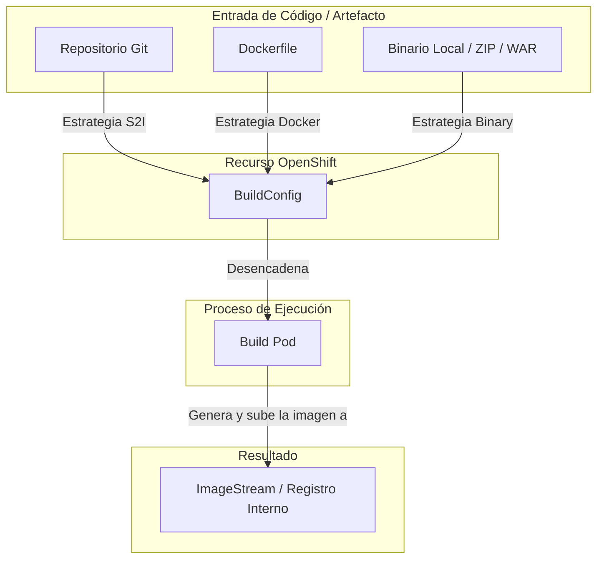
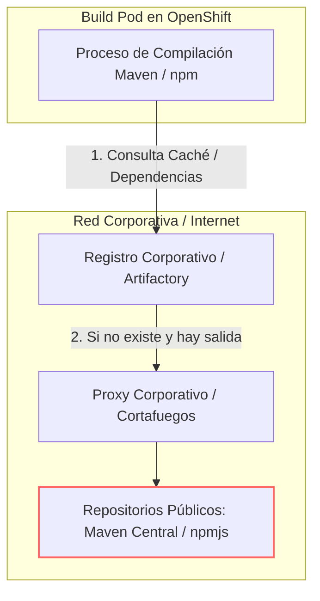
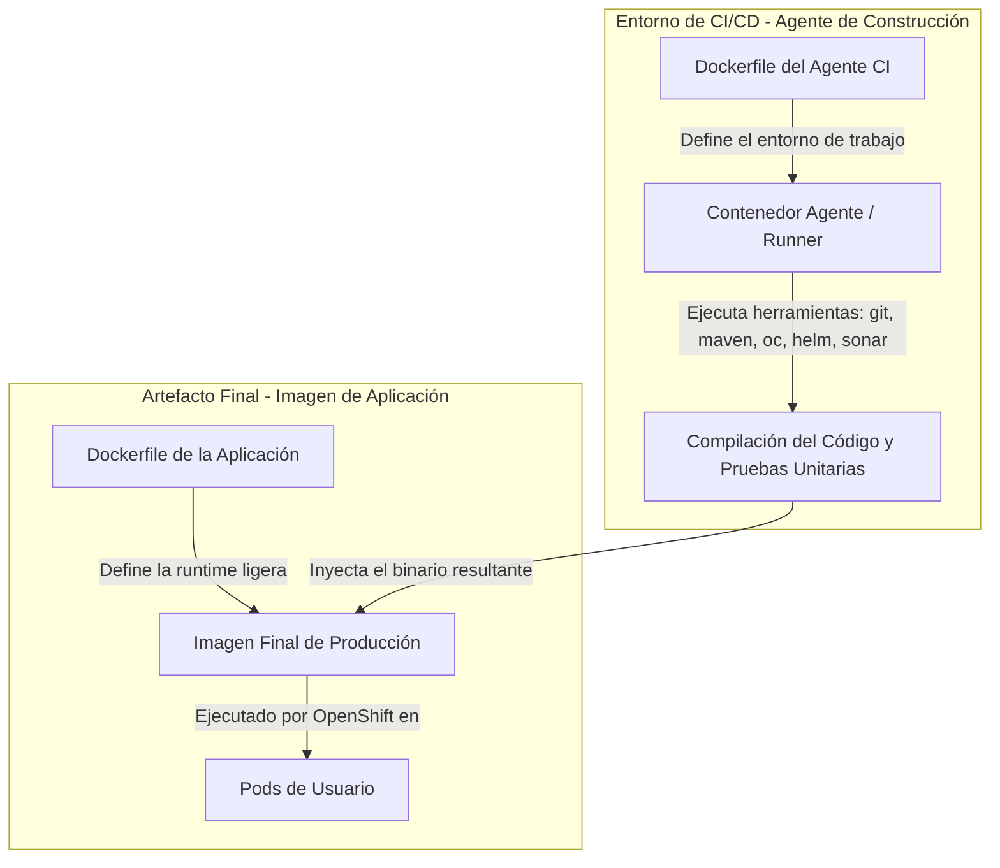
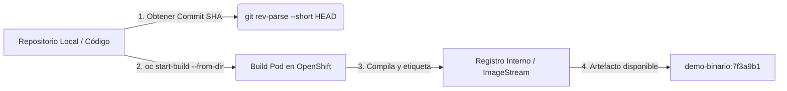

# 4.5 Construir en la plataforma: estrategias de BuildConfig

## Objetivos de aprendizaje

Al finalizar este apartado serás capaz de:

- Comprender el propósito del recurso nativo `BuildConfig` (BC) en OpenShift como abstracción para la automatización de construcciones de imágenes.
- Analizar y diferenciar las tres estrategias principales de construcción: **Source-to-Image (S2I)**, **Docker** y **Binary** (con `oc start-build`).
- Comprender el flujo de resolución y descarga de dependencias (Maven, npm, pip) durante la fase de compilación en el clúster.
- Distinguir claramente la responsabilidad y arquitectura de los **dos Dockerfile**: el entorno del agente de construcción CI frente al Dockerfile de la aplicación final.
- Ejecutar una práctica guiada para construir una imagen de contenedor mediante un `BuildConfig` binario local, logrando que el artefacto aterrice en el registro interno catalogado por su commit SHA de Git.

---

## Evolución de nuestra perspectiva: De la construcción artesanal en local a la automatización en el clúster

Para comprender el verdadero salto cualitativo que supone `BuildConfig`, debemos conectar este apartado con el flujo de trabajo que realizamos en la **Sesión 1.8**:

```mermaid
flowchart TD
    subgraph Sesion1 ["Sesión 1.8: Construcción Manual en el Puesto del Desarrollador"]
        A1[Código Fuente Local] -->|1. podman build| A2[Imagen Local en Estación de Trabajo]
        A2 -->|2. podman push| A3[Registro Público Externo: Docker Hub]
        A3 -->|3. oc new-app| A4[Despliegue en OpenShift]
    end

    subgraph Sesion4 ["Sesión 4.5: Construcción Delegada en la Plataforma"]
        B1[Código Fuente / Binario] -->|1. oc start-build / Webhook| B2[Build Pod Efímero en OpenShift]
        B2 -->|2. Compila y empaqueta dentro| B3[Registro Interno de OpenShift / ImageStream]
        B3 -->|3. Despliegue automatizado| B4[Deployment con Commit SHA]
    end
```



### Comparativa de flujos de trabajo

- **El enfoque de la Sesión 1.8 (Construcción Manual en Local):** 
  En la primera sesión construimos una imagen ejecutando comandos manuales en nuestra máquina cliente con Podman (`podman build`), le asignamos una etiqueta y la subimos nosotros mismos a un registro externo (`podman push docker.io/...`) antes de decirle a OpenShift que la desplegara con `oc new-app`.
  
  *Limitaciones de este modelo:* Depende de que el desarrollador tenga Podman/Docker instalado en su equipo, requiere ancho de banda local para subir imágenes pesadas a Internet, no escala en equipo y dificulta auditar exactamente qué código generó esa imagen.

- **El enfoque de la Sesión 4.5 (Construcción Automatizada en la Plataforma):**
  En este apartado **delegamos la responsabilidad de la construcción a OpenShift**. El desarrollador ya no compila ni empaqueta la imagen en su portátil; simplemente entrega el código fuente o el binario resultante a la plataforma, y el propio clúster genera la imagen en un **Build Pod**, la deposita en el registro interno e inicia el despliegue de forma trazable.

---

## La abstracción de construcción en OpenShift: `BuildConfig`

En la Sesión 1.7 mostramos el efecto visual de desplegar código fuente directamente en la plataforma. En este apartado explicamos el mecanismo técnico que lo hace posible.

OpenShift extiende las capacidades nativas de Kubernetes introduciendo el objeto **BuildConfig** (`bc`). Un `BuildConfig` es la definición declarativa del proceso mediante el cual el código fuente, artefactos binarios o un contexto de compilación se transforman en una imagen de contenedor lista para ejecutarse en el clúster.



Cuando un `BuildConfig` se ejecuta (de forma manual, mediante un *webhook* de Git o mediante comandos de CLI), OpenShift no compila el código dentro de los nodos del control plane. En su lugar, el sistema crea un **Build Pod** efímero dedicado exclusivamente a ejecutar la tarea de compilación y empaquetado, aislando el consumo de recursos.

---

## Estrategias de construcción: S2I, Docker y Binary

OpenShift soporta tres estrategias principales para transformar código en imágenes de contenedor. La elección de una u otra depende de la madurez del equipo, el grado de control requerido sobre el sistema operativo base y el modelo de integración continua (CI) adoptado.

```mermaid
flowchart LR
    subgraph Estrategia S2I
        S1[Código Fuente] + S2[Imagen Builder Base] --> S3[Imagen Final]
    end

    subgraph Estrategia Docker
        D1[Código Fuente] + D2[Dockerfile del Dev] --> D3[Imagen Final]
    end

    subgraph Estrategia Binary
        B1[Artefacto ya Compilado localmente / CI] -->|oc start-build --from-dir| B2[Imagen Final]
    end
```

### 1. Source-to-Image (S2I)

**S2I** es un marco de trabajo (*framework*) nativo de OpenShift que toma código fuente no compilado (Java, Python, Node.js, Go) e inyecta ese código dentro de una **imagen constructora base** (*Builder Image*) previamente homologada.

- **Cómo funciona:** La imagen builder contiene el entorno de ejecución, los compiladores y los scripts de ensamblado (`assemble` y `run`). S2I descarga el código fuente del repositorio Git, ejecuta el script de compilación dentro del contenedor e inyecta el resultado en una nueva capa de imagen inmutable.
- **Cuándo usarlo:** Entornos de desarrollo rápido o equipos que no desean gestionar y mantener Dockerfiles individuales para cada microservicio.
- **Ventaja clave:** Seguridad centralizada. Si el equipo de plataforma actualiza la imagen builder base (por ejemplo, para parchear una vulnerabilidad en el JDK), todas las aplicaciones que usen S2I heredan la corrección al reconstruirse.

### 2. Estrategia Docker

La estrategia **Docker** utiliza un fichero `Dockerfile` estándar ubicado en la raíz del repositorio de código fuente para construir la imagen.

- **Cómo funciona:** OpenShift lee las instrucciones del `Dockerfile` (`FROM`, `RUN`, `COPY`, `CMD`) y ejecuta el proceso de compilación dentro del *Build Pod* utilizando los motores de construcción del motor de contenedores de la plataforma.
- **Cuándo usarlo:** Cuando la aplicación requiere dependencias personalizadas del sistema operativo, configuraciones complejas de bajo nivel o binarios que la imagen S2I estándar no incluye.
- **Ventaja clave:** Portabilidad total y compatibilidad con el estándar de la industria.

### 3. Estrategia Binary (Construcción desde Binario)

La estrategia **Binary** modifica el origen de los datos (*Build Source*). En lugar de que el clúster clone un repositorio Git remoto, el `BuildConfig` espera que el cliente envíe directamente un archivo local, un archivo comprimido (`.tar.gz`, `.zip`) o un artefacto previamente compilado (`.jar`, `.war`).

- **Cómo funciona:** El comando de la CLI `oc start-build --from-file` o `--from-dir` empaqueta el contenido local de la máquina del desarrollador (o del agente de CI/CD) y lo transmite mediante un flujo de datos HTTP hacia el *Build Pod* en OpenShift.
- **Cuándo usarlo:** En pipelines corporativos industrializados de CI/CD (Jenkins, GitLab CI, GitHub Actions) donde la fase de compilación pesada del código se realiza fuera del clúster y solo se envía al registro de OpenShift el artefacto final inmutable.

### Cuadro comparativo de estrategias

| Criterio | Source-to-Image (S2I) | Estrategia Docker | Estrategia Binary (`oc start-build`) |
| :--- | :--- | :--- | :--- |
| **Origen del código** | Repositorio Git remoto | Repositorio Git remoto | Puesto local / Pipeline de CI/CD |
| **Requiere Dockerfile** | No | Sí (obligatorio) | Opcional (según si usa Dockerfile o S2I) |
| **Lugar de compilación** | Dentro del clúster (Build Pod) | Dentro del clúster (Build Pod) | Mixto (Compilación fuera, empaquetado dentro) |
| **Control sobre el SO base** | Bajo (definido por la Builder Image) | Total (definido en el `FROM`) | Total / Depende de la imagen base elegida |
| **Uso en CI/CD Industrial** | Fase inicial / prototipado | Despliegues estándar con GitOps | **Muy alto** en integraciones corporativas |

---

## De dónde salen y cómo se resuelven las dependencias

Un punto crítico en la arquitectura de construcción dentro de OpenShift es entender cómo se descargan y gestionan las librerías externas (paquetes npm, artefactos Maven/Gradle, módulos pip de Python) durante la ejecución de un `BuildConfig`.



### 1. El reto del acceso a Internet en clústeres corporativos

En entornos de producción o redes restringidas (DMZ), los nodos del clúster de OpenShift **no tienen acceso directo a Internet público**. Si un `BuildConfig` intenta ejecutar `npm install` o `mvn clean package` conectando directamente a los repositorios públicos (`npmjs.org` o `repo.maven.org`), la compilación fallará por un error de tiempo de espera (*timeout*).

### 2. Puntos de resolución de dependencias

Para resolver esta limitación en entornos empresariales, la infraestructura ofrece dos soluciones:

1. **Gestores de Artefactos Corporativos (Nexus / Artifactory):** El `BuildConfig` o la configuración del proyecto (`pom.xml`, `.npmrc`) debe apuntar explícitamente a las URLs del registro interno corporativo. Este servidor actúa como caché de dependencias aprobadas y autorizadas por la organización.
2. **Inyección de Proxies de Plataforma:** OpenShift permite configurar variables de entorno globales (`HTTP_PROXY`, `HTTPS_PROXY`, `NO_PROXY`) en el objeto `BuildConfig`. El *Build Pod* hereda automáticamente estas variables para dirigir el tráfico de descarga de librerías a través del proxy corporativo permitido.

!!! warning "Inmutabilidad y tiempos de compilación"
    Si cada ejecución de un `BuildConfig` tuviese que descargar de nuevo cientos de megabytes de dependencias desde Internet, los tiempos de construcción se elevarían exponencialmente. 
    
    S2I y los BuildPods de OpenShift permiten reutilizar volúmenes de caché de dependencias entre ejecuciones consecutivas para optimizar la velocidad de compilación.

---

## Los dos Dockerfile: Agente de construcción CI frente al Dockerfile de aplicación

Uno de los errores conceptuales más frecuentes al abordar la integración continua y la construcción de contenedores es confundir la responsabilidad de **los dos Dockerfile** que intervienen en el ciclo de vida de la ingeniería de software.



### 1. El Dockerfile del Agente de Construcción (CI Runner)

- **Propósito:** Definir el entorno del sistema operativo donde se ejecutan los scripts del pipeline de integración continua (Jenkins Agent, GitLab Runner, GitHub Actions Runner).
- **Contenido:** Incluye utilidades del sistema, compiladores, clientes de CLI (`oc`, `kubectl`), herramientas de análisis estático de código (SonarScanner) y motores de ejecución.
- **Vida útil:** Se utiliza **únicamente durante la ejecución del job de CI/CD**. Nunca se despliega en los proyectos de producción de OpenShift.

### 2. El Dockerfile de la Aplicación (Runtime)

- **Propósito:** Definir el paquete inmutable que albergará exclusivamente el código ejecutable de la aplicación de negocio y sus dependencias de tiempo de ejecución.
- **Contenido:** Utiliza imágenes base minimalistas y endurecidas (por ejemplo, Red Hat Universal Base Image - UBI Minimal), incorpora los binarios ya compilados y expone los puertos de servicio.
- **Vida útil:** Es la imagen que se cataloga en el registro de imágenes y se despliega como Pod en el clúster de OpenShift.

### El patrón de compilación en varias etapas (*Multi-stage Build*)

Para evitar incluir compiladores y herramientas innecesarias en la imagen final de producción, se utiliza la técnica de **Multi-stage Build** en el Dockerfile de la aplicación:

```dockerfile
# ETAPA 1: Compilación (Utiliza una imagen pesada con JDK y Maven)
FROM [registry.access.redhat.com/ubi8/openjdk-17:1.18](https://registry.access.redhat.com/ubi8/openjdk-17:1.18) AS builder
WORKDIR /usr/src/app
COPY . .
RUN mvn clean package -DskipTests

# ETAPA 2: Runtime de Producción (Utiliza una imagen minimalista ligera)
FROM [registry.access.redhat.com/ubi8/ubi-minimal:8.9](https://registry.access.redhat.com/ubi8/ubi-minimal:8.9)
WORKDIR /deployments
# Copiamos ÚNICAMENTE el binario resultante de la etapa 1
COPY --from=builder /usr/src/app/target/mi-aplicacion.jar /deployments/app.jar
EXPOSE 8080
USER 1001
CMD ["java", "-jar", "/deployments/app.jar"]
```

---

## Práctica guiada N1: Construcción con BuildConfig binario y catalogación por commit SHA

En esta práctica daremos un paso más allá respecto a la práctica 1.8: en lugar de construir con `podman build` y subir la imagen a un registro público de forma manual, crearemos un objeto `BuildConfig` de tipo **Binary** en OpenShift. 

Extraeremos el identificador único del commit (`Commit SHA`) de nuestro código local y enviaremos el contexto a la plataforma para que sea OpenShift quien construya, etiquete y deposite la imagen inmutable en su registro interno.



### Paso 1: Inspeccionar y preparar el entorno de trabajo

Asegúrate de estar autenticado en la CLI `oc` y posicionado en tu espacio de nombres asignado:

```bash
oc project angel-cuaresma-alons-dev
```

Crearemos un directorio de trabajo local con un `Dockerfile` sencillo y un archivo de aplicación simulado:

```bash
mkdir -p /tmp/practica-bc-binario && cd /tmp/practica-bc-binario

# Inicializamos un repositorio Git local para simular la trazabilidad
git init
echo "<h1>Aplicacion Demo - Version Binaria</h1>" > index.html

# Creamos un Dockerfile minimalista
cat << 'EOF' > Dockerfile
FROM [registry.access.redhat.com/ubi8/nginx-120:1-116](https://registry.access.redhat.com/ubi8/nginx-120:1-116)
COPY index.html /tmp/src/index.html
RUN /usr/libexec/s2i/assemble
CMD /usr/libexec/s2i/run
EOF

# Registramos los cambios en Git
git add .
git commit -m "Commit inicial para construccion binaria"
```

### Paso 2: Crear el ImageStream y el BuildConfig Binario

Declaramos el objeto `ImageStream` que actuará como destino y el objeto `BuildConfig` con la estrategia `Docker` e ingreso `Binary`.

Crearemos el archivo de manifiesto `buildconfig-binario.yaml`:

```yaml
apiVersion: image.openshift.io/v1
kind: ImageStream
metadata:
  name: demo-binario
  namespace: angel-cuaresma-alons-dev
---
apiVersion: build.openshift.io/v1
kind: BuildConfig
metadata:
  name: demo-binario-bc
  namespace: angel-cuaresma-alons-dev
spec:
  # Estrategia de origen binario (no clona un Git remoto)
  source:
    type: Binary
  strategy:
    type: Docker
    dockerStrategy:
      dockerfilePath: Dockerfile
  output:
    to:
      kind: ImageStreamTag
      name: 'demo-binario:latest'
```

Aplicamos el manifiesto en el clúster:

```bash
oc apply -f buildconfig-binario.yaml
```

### Paso 3: Obtener el Commit SHA e iniciar la construcción binaria

Para garantizar la trazabilidad inmutable descrita en el apartado 4.4, obtenemos el hash del commit de Git en una variable de entorno y disparamos la construcción enviando el contexto local mediante el parámetro `--from-dir`:

```bash
# 1. Obtenemos el SHA corto del último commit
COMMIT_SHA=$(git rev-parse --short HEAD)
echo "El commit SHA identificado es: ${COMMIT_SHA}"

# 2. Iniciamos la construcción enviando el directorio local y sobrescribiendo la etiqueta de salida
oc start-build demo-binario-bc \
  --from-dir=. \
  --to="demo-binario:${COMMIT_SHA}" \
  --follow
```

El parámetro `--follow` adjunta la consola de comandos a los logs en tiempo real del *Build Pod* que se ejecuta en el clúster.

### Paso 4: Verificar el aterrizaje de la imagen etiquetada en el registro

Una vez completada con éxito la construcción, verificamos que el objeto `ImageStream` en OpenShift ha registrado la nueva imagen catalogada exactamente por la etiqueta de nuestro commit SHA:

```bash
oc get imagestreamtag
```

*Salida esperada:*

```text
NAME                     IMAGE REFERENCE                                                                                    CREATED
demo-binario:7f3a9b1     image-registry.openshift-image-registry.svc:5000/angel-cuaresma-alons-dev/demo-binario@sha256...   10 seconds ago
```

Comprobamos los metadatos detallados de la etiqueta catalogada:

```bash
oc describe istag demo-binario:${COMMIT_SHA}
```

La imagen ha aterrizado en el registro interno de OpenShift, inmutable y trazable frente al código fuente que la originó, sin haber necesitado Podman local ni credenciales de registros externos.

---

## Ideas clave para recordar

!!! tip "Resumen"
    - **Cambio de modelo frente a la Sesión 1.8:** En la primera sesión construíamos imágenes localmente con Podman y las subíamos manualmente a registros públicos. Con `BuildConfig`, el propio clúster asume la compilación y empaquetado de forma automatizada y centralizada.
    - El **`BuildConfig` (BC)** es el recurso nativo de OpenShift que automatiza la creación de imágenes de contenedor mediante **Build Pods** efímeros.
    - **S2I (Source-to-Image)** combina código fuente con una imagen builder base; **Docker** utiliza un `Dockerfile` estándar; **Binary** recibe el artefacto compilado desde el exterior.
    - La estrategia **Binary (`oc start-build --from-dir`)** es la más utilizada en pipelines de CI/CD industrializados corporativos.
    - La **resolución de dependencias** en entornos corporativos requiere configurar proxies o apuntar a gestores de artefactos internos (Nexus/Artifactory).
    - Es fundamental diferenciar los **dos Dockerfile**: el del **agente CI** (entorno de herramientas del pipeline) frente al **Dockerfile de la aplicación** (runtime de producción).
    - El uso de **Multi-stage Builds** permite separar la etapa de compilación pesada del empaquetado final de producción.
    - Etiquetar la imagen resultante del `BuildConfig` con el **Commit SHA de Git** garantiza la inmutabilidad y la trazabilidad del artefacto en el registro.