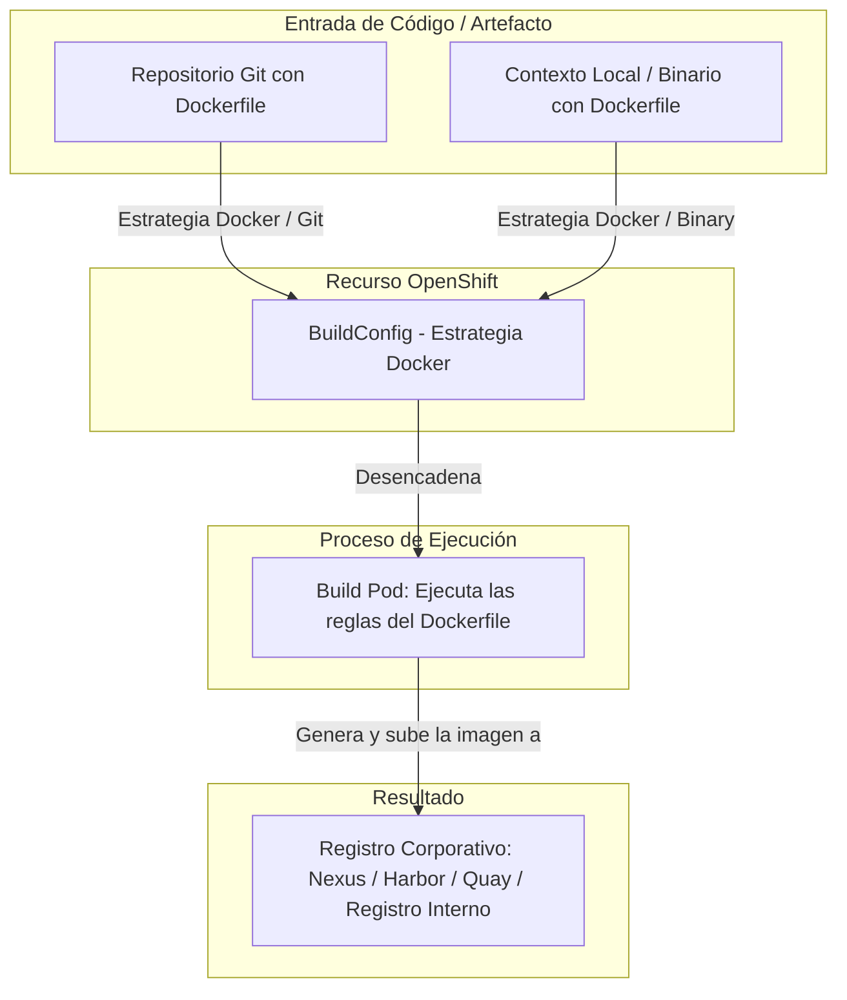
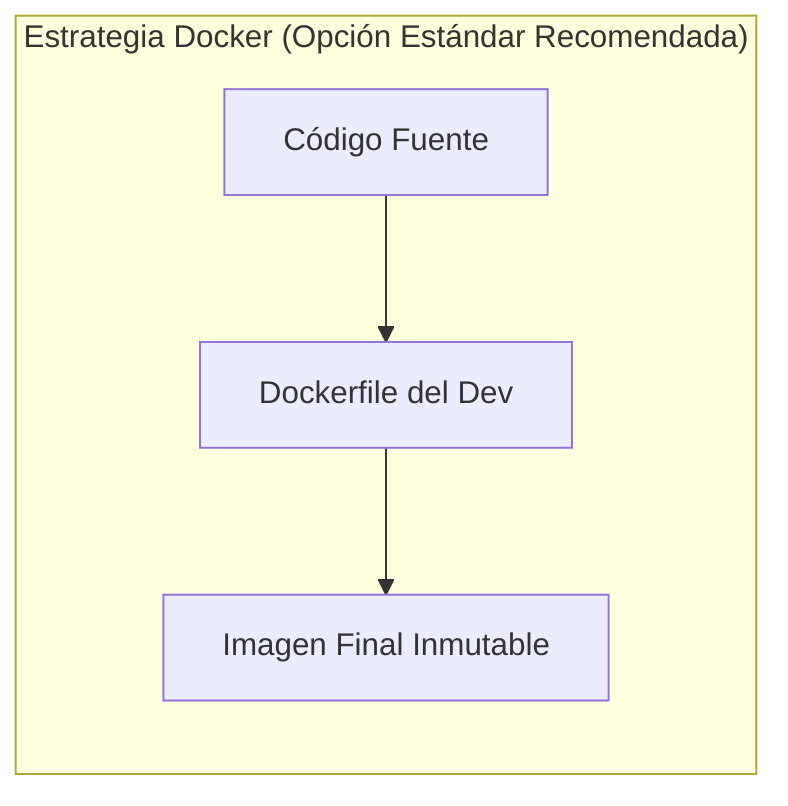
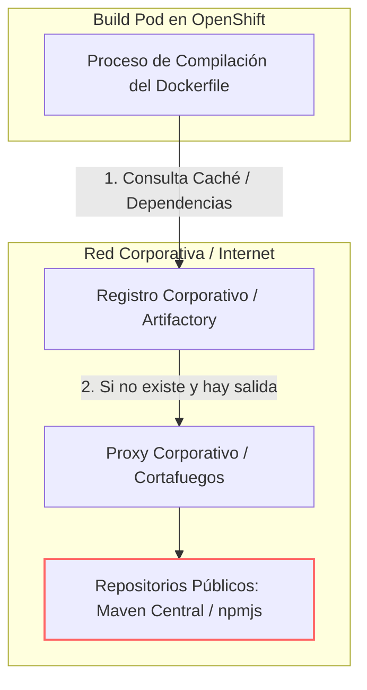
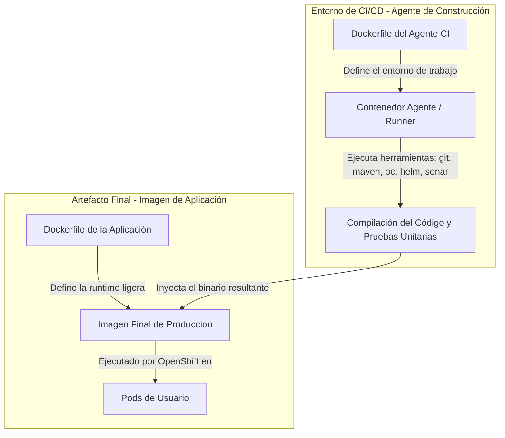
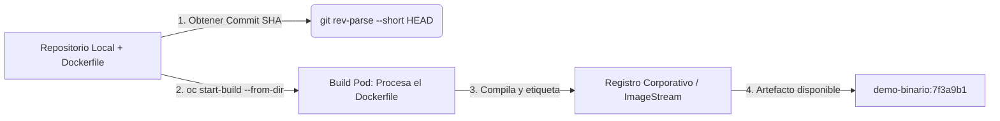

# 4.5 Construir en la plataforma: estrategias de BuildConfig

## Objetivos de aprendizaje

Al finalizar este apartado serás capaz de:

- Comprender el propósito del recurso nativo `BuildConfig` (BC) en OpenShift como abstracción para la automatización de construcciones de imágenes.
- Analizar y diferenciar las tres estrategias de construcción, identificando por qué la **Estrategia Docker** es la opción estándar y recomendada.
- Comprender el flujo de resolución y descarga de dependencias (Maven, npm, pip) durante la fase de compilación en el clúster.
- Distinguir claramente la responsabilidad y arquitectura de los **dos Dockerfile**: el entorno del agente de construcción CI frente al Dockerfile de la aplicación final.
- Ejecutar una práctica guiada para construir una imagen de contenedor mediante un `BuildConfig` basado en **Dockerfile** (usando origen Binary con `oc start-build`), logrando que el artefacto aterrice catalogado por su commit SHA de Git en un registro corporativo o interno.

---

## Evolución de nuestra perspectiva: De la construcción artesanal en local a la automatización en el clúster

Para comprender el verdadero salto cualitativo que supone `BuildConfig`, debemos conectar este apartado con el flujo de trabajo que realizamos en la **Sesión 1.8**:

```mermaid
flowchart TD
    subgraph Sesion1 ["Sesión 1.8: Construcción Manual en el Puesto del Desarrollador"]
        A1[Código Fuente + Dockerfile Local] -->|1. podman build| A2[Imagen Local en Estación de Trabajo]
        A2 -->|2. podman push| A3[Registro Público Externo: Docker Hub]
        A3 -->|3. oc new-app| A4[Despliegue en OpenShift]
    end

    subgraph Sesion4 ["Sesión 4.5: Construcción Delegada en la Plataforma (Estrategia Docker)"]
        B1[Código Fuente + Dockerfile] -->|1. oc start-build / Webhook| B2[Build Pod Efímero en OpenShift]
        B2 -->|2. Compila el Dockerfile dentro| B3[Registro Corporativo / Nexus / Quay / Harbor]
        B3 -->|3. Despliegue automatizado| B4[Deployment con Commit SHA]
    end
```



### Comparativa de flujos de trabajo

- **El enfoque de la Sesión 1.8 (Construcción Manual en Local):** 
  En la primera sesión aprendimos a leer un `Dockerfile` y construimos una imagen ejecutando comandos manuales en nuestra máquina cliente con Podman (`podman build`), le asignamos una etiqueta y la subimos nosotros mismos a un registro externo (`podman push docker.io/...`) antes de decirle a OpenShift que la desplegara.
  
  *Limitaciones de este modelo:* Depende de que el desarrollador tenga Podman/Docker instalado en su equipo, requiere ancho de banda local para subir imágenes pesadas a Internet, no escala en equipo y dificulta auditar exactamente qué código generó esa imagen.

- **El enfoque de la Sesión 4.5 (Construcción Automatizada en la Plataforma):**
  En este apartado **delegamos la responsabilidad de la construcción a OpenShift manteniendo nuestro `Dockerfile`**. El desarrollador ya no compila ni empaqueta la imagen en su portátil; simplemente entrega el contexto con su `Dockerfile` a la plataforma, y el propio clúster ejecuta las instrucciones del `Dockerfile` en un **Build Pod**, deposita la imagen resultante en el **registro corporativo** (o en el registro interno de OpenShift) e inicia el despliegue de forma trazable.

---

## La abstracción de construcción en OpenShift: `BuildConfig`

En la Sesión 1.7 mostramos el efecto visual de desplegar código fuente directamente en la plataforma. En este apartado explicamos el mecanismo técnico que lo hace posible.

OpenShift extiende las capacidades nativas de Kubernetes introduciendo el objeto **BuildConfig** (`bc`). Un `BuildConfig` es la definición declarativa del proceso mediante el cual el código fuente, artefactos binarios o un contexto de compilación con su `Dockerfile` se transforman en una imagen de contenedor lista para ejecutarse en el clúster.



Cuando un `BuildConfig` se ejecuta (de forma manual, mediante un *webhook* de Git o mediante comandos de CLI), OpenShift no compila el código dentro de los nodos del control plane. En su lugar, el sistema crea un **Build Pod** efímero dedicado exclusivamente a ejecutar la tarea de compilación y empaquetado del `Dockerfile`, aislando el consumo de recursos.

---

## Estrategias de construcción: Por qué la Estrategia Docker es nuestro estándar

OpenShift soporta distintas estrategias para transformar código en imágenes de contenedor, pero la **Estrategia Docker** representa el estándar de la industria y la opción prioritaria en entornos corporativos.



```mermaid
flowchart LR
    subgraph Alternativas ["Otras Estrategias (S2I / Binary Puro)"]
        A1[Código Fuente Sin Dockerfile] --> B1[Builder Image Base / S2I]
        B1 --> C1[Imagen Final (Caja Negra)]
    end
```

### ¿Por qué elegimos la Estrategia Docker?

1. **Alineación directa con la Sesión 1:** Reutilizamos los conocimientos adquiridos en la Sesión 1.2 sobre la lectura y estructura de un `Dockerfile`. No necesitamos aprender abstracciones propietarias adicionales.
2. **Control total y explícito:** El desarrollador y el equipo de arquitectura definen exactamente el sistema operativo base (`FROM`), la versión del runtime, las dependencias y los permisos de usuario, evitando el comportamiento de "caja negra" que a veces presentan otras estrategias como S2I.
3. **Portabilidad universal:** Un `Dockerfile` es agnóstico a la plataforma. La misma definición se puede construir en OpenShift, en un servidor de CI/CD externo (GitLab CI, GitHub Actions), en Podman local o en cualquier otra plataforma de contenedores.

### Cuadro comparativo de estrategias

| Criterio | Estrategia Docker (Estándar recomendado) | Source-to-Image (S2I) | Estrategia Binary con Dockerfile |
| :--- | :--- | :--- | :--- |
| **Origen del código** | Repositorio Git remoto | Repositorio Git remoto | Puesto local / Pipeline de CI/CD |
| **Requiere Dockerfile** | **Sí (obligatorio)** | No | **Sí (para empaquetado)** |
| **Lugar de compilación** | Dentro del clúster (Build Pod) | Dentro del clúster (Build Pod) | Mixto (Compilación fuera, empaquetado en clúster) |
| **Control sobre el SO base** | **Total (definido en el `FROM`)** | Bajo (definido por la Builder Image) | **Total (definido en el `FROM`)** |
| **Uso en CI/CD Industrial** | **Muy alto (Estándar corporativo)** | Fase inicial / prototipado | **Muy alto en integraciones con artefectos** |

---

## De dónde salen y cómo se resuelven las dependencias

Un punto crítico en la arquitectura de construcción dentro de OpenShift es entender cómo las instrucciones de nuestro `Dockerfile` (como `RUN npm install` o `RUN mvn clean package`) descargan y gestionan las librerías externas durante la ejecución del `BuildConfig`.



### 1. El reto del acceso a Internet en clústeres corporativos

En entornos de producción o redes restringidas (DMZ), los nodos del clúster de OpenShift **no tienen acceso directo a Internet público**. Si las instrucciones de un `Dockerfile` intentan conectar directamente a los repositorios públicos (`npmjs.org` o `repo.maven.org`), la compilación fallará por un error de tiempo de espera (*timeout*).

### 2. Puntos de resolución de dependencias

Para resolver esta limitación en entornos empresariales, la infraestructura ofrece dos soluciones:

1. **Gestores de Artefactos Corporativos (Nexus / Artifactory):** Las instrucciones dentro del `Dockerfile` (o sus archivos de configuración asociados como `pom.xml` o `.npmrc`) deben apuntar explícitamente a las URLs del registro interno corporativo. Este servidor actúa como caché de dependencias aprobadas y autorizadas por la organización.
2. **Inyección de Proxies de Plataforma:** OpenShift permite configurar variables de entorno globales (`HTTP_PROXY`, `HTTPS_PROXY`, `NO_PROXY`) en el objeto `BuildConfig`. El *Build Pod* hereda automáticamente estas variables para dirigir el tráfico de descarga de librerías a través del proxy corporativo permitido durante el `docker build`.

---

## Los dos Dockerfile: Agente de construcción CI frente al Dockerfile de aplicación

Conectando de nuevo con la Sesión 1, es fundamental entender que en un ciclo de vida profesional conviven dos tipos de `Dockerfile` con propósitos completamente distintos.



### 1. El Dockerfile del Agente de Construcción (CI Runner)

- **Propósito:** Definir el entorno del sistema operativo donde se ejecutan los scripts del pipeline de integración continua (Jenkins Agent, GitLab Runner, GitHub Actions Runner).
- **Contenido:** Incluye utilidades del sistema, compiladores, clientes de CLI (`oc`, `kubectl`), herramientas de análisis estático de código (SonarScanner) y motores de ejecución.
- **Vida útil:** Se utiliza **únicamente durante la ejecución del job de CI/CD**. Nunca se despliega en los proyectos de producción de OpenShift.

### 2. El Dockerfile de la Aplicación (Runtime)

- **Propósito:** Definir el paquete inmutable que albergará exclusivamente el código ejecutable de la aplicación de negocio y sus dependencias de tiempo de ejecución.
- **Contenido:** Utiliza imágenes base minimalistas y endurecidas (por ejemplo, Red Hat Universal Base Image - UBI Minimal), incorpora los binarios ya compilados y expone los puertos de servicio.
- **Vida útil:** Es la imagen que se cataloga en el registro corporativo de imágenes y se despliega como Pod en el clúster de OpenShift.

### El patrón de compilación en varias etapas (*Multi-stage Build*)

Para aplicar buenas prácticas en el `Dockerfile` de aplicación y no incluir herramientas de compilación pesadas en la imagen final de producción, utilizamos la técnica de **Multi-stage Build**:

```dockerfile
# ETAPA 1: Compilación (Utiliza una imagen con JDK y Maven)
FROM [registry.access.redhat.com/ubi8/openjdk-17:1.18](https://registry.access.redhat.com/ubi8/openjdk-17:1.18) AS builder
WORKDIR /usr/src/app
COPY . .
RUN mvn clean package -DskipTests

# ETAPA 2: Runtime de Producción (Utiliza una imagen minimalista ligera)
FROM [registry.access.redhat.com/ubi8/ubi-minimal:8.9](https://registry.access.redhat.com/ubi8/ubi-minimal:8.9)
WORKDIR /deployments
# Copiamos ÚNICAMENTE el binario resultante de la etapa 1
COPY --from=builder /usr/src/app/target/mi-aplicacion.jar /deployments/app.jar
EXPOSE 8080
USER 1001
CMD ["java", "-jar", "/deployments/app.jar"]
```

---

## Práctica guiada N1: Construcción con BuildConfig binario usando Dockerfile y catalogación por commit SHA

En esta práctica daremos un paso más allá respecto a la práctica 1.8: en lugar de construir con `podman build` y subir la imagen a un registro público de forma manual, crearemos un objeto `BuildConfig` con **Estrategia Docker** e ingreso **Binary** en OpenShift. 

Extraeremos el identificador único del commit (`Commit SHA`) de nuestro código local, enviaremos el directorio que contiene nuestro `Dockerfile` y dejaremos que OpenShift interprete el `Dockerfile`, construya, etiquete y deposite la imagen inmutable en su registro.



### Paso 1: Inspeccionar y preparar el entorno de trabajo

Asegúrate de estar autenticado en la CLI `oc` y posicionado en tu espacio de nombres asignado:

```bash
oc project angel-cuaresma-alons-dev
```

Crearemos un directorio de trabajo local con nuestro `Dockerfile` explícito y un archivo de aplicación simulado:

```bash
mkdir -p /tmp/practica-bc-binario && cd /tmp/practica-bc-binario

# Inicializamos un repositorio Git local para simular la trazabilidad
git init
echo "<h1>Aplicacion Demo - Version Dockerfile</h1>" > index.html

# Creamos nuestro Dockerfile explícito (mismo concepto de la Sesión 1)
cat << 'EOF' > Dockerfile
FROM [registry.access.redhat.com/ubi8/nginx-120:1-116](https://registry.access.redhat.com/ubi8/nginx-120:1-116)
COPY index.html /tmp/src/index.html
RUN /usr/libexec/s2i/assemble
CMD /usr/libexec/s2i/run
EOF

# Registramos los cambios en Git
git add .
git commit -m "Commit inicial con Dockerfile para construccion en clúster"
```

### Paso 2: Crear el ImageStream y el BuildConfig con Estrategia Docker

Declaramos el objeto `ImageStream` que actuará como destino y el objeto `BuildConfig` configurado explícitamente con la **estrategia Docker**.

Crearemos el archivo de manifiesto `buildconfig-docker.yaml`:

```yaml
apiVersion: image.openshift.io/v1
kind: ImageStream
metadata:
  name: demo-binario
  namespace: angel-cuaresma-alons-dev
---
apiVersion: build.openshift.io/v1
kind: BuildConfig
metadata:
  name: demo-binario-bc
  namespace: angel-cuaresma-alons-dev
spec:
  # Origen de los archivos (enviados por CLI)
  source:
    type: Binary
  # Estrategia basada estrictamente en Dockerfile
  strategy:
    type: Docker
    dockerStrategy:
      dockerfilePath: Dockerfile
  output:
    to:
      kind: ImageStreamTag
      name: 'demo-binario:latest'
```

Aplicamos el manifiesto en el clúster:

```bash
oc apply -f buildconfig-docker.yaml
```

### Paso 3: Obtener el Commit SHA e iniciar la construcción del Dockerfile

Para garantizar la trazabilidad inmutable descrita en el apartado 4.4, obtenemos el hash del commit de Git en una variable de entorno y disparamos la construcción enviando el contexto local (que incluye el `Dockerfile`) mediante el parámetro `--from-dir`:

```bash
# 1. Obtenemos el SHA corto del último commit
COMMIT_SHA=$(git rev-parse --short HEAD)
echo "El commit SHA identificado es: ${COMMIT_SHA}"

# 2. Iniciamos la construcción procesando el Dockerfile y sobrescribiendo la etiqueta de salida
oc start-build demo-binario-bc \
  --from-dir=. \
  --to="demo-binario:${COMMIT_SHA}" \
  --follow
```

El parámetro `--follow` adjunta la consola de comandos a los logs en tiempo real del *Build Pod* que ejecuta la construcción del `Dockerfile` en el clúster.

### Paso 4: Verificar el aterrizaje de la imagen etiquetada en el registro

Una vez completada con éxito la construcción, verificamos que el objeto `ImageStream` en OpenShift ha registrado la nueva imagen catalogada exactamente por la etiqueta de nuestro commit SHA:

```bash
oc get imagestreamtag
```

*Salida esperada:*

```text
NAME                     IMAGE REFERENCE                                                                                    CREATED
demo-binario:7f3a9b1     image-registry.openshift-image-registry.svc:5000/angel-cuaresma-alons-dev/demo-binario@sha256...   10 seconds ago
```

Comprobamos los metadatos detallados de la etiqueta catalogada:

```bash
oc describe istag demo-binario:${COMMIT_SHA}
```

La imagen procesada desde nuestro `Dockerfile` ha aterrizado en el registro interno de OpenShift (o en el registro corporativo externo configurado), inmutable y trazable frente al código fuente que la originó, sin haber necesitado Podman local ni credenciales de registros externos.

---

## Ideas clave para recordar

!!! tip "Resumen"
    - **Alineación con la Sesión 1:** La **Estrategia Docker** es nuestra opción preferida porque reutiliza el estándar del `Dockerfile` aprendido en la Sesión 1.2 y otorga control total sobre la imagen base y sus capas.
    - **Cambio de modelo frente a la Sesión 1.8:** En la primera sesión construíamos imágenes localmente con Podman; con `BuildConfig` (Estrategia Docker), enviamos el `Dockerfile` al clúster para que el **Build Pod** ejecute la compilación de forma centralizada.
    - El **`BuildConfig` (BC)** es el recurso nativo de OpenShift que automatiza la creación de imágenes de contenedor a partir de definiciones declarativas.
    - La **resolución de dependencias** en entornos corporativos requiere configurar proxies o apuntar a gestores de artefactos internos (Nexus/Artifactory).
    - Es fundamental diferenciar los **dos Dockerfile**: el del **agente CI** (entorno de herramientas del pipeline) frente al **Dockerfile de la aplicación** (runtime de producción).
    - El uso de **Multi-stage Builds** permite separar la etapa de compilación pesada del empaquetado final de producción dentro del propio `Dockerfile`.
    - Etiquetar la imagen resultante de la compilación del `Dockerfile` con el **Commit SHA de Git** garantiza la inmutabilidad y la trazabilidad del artefacto en el registro corporativo o interno.