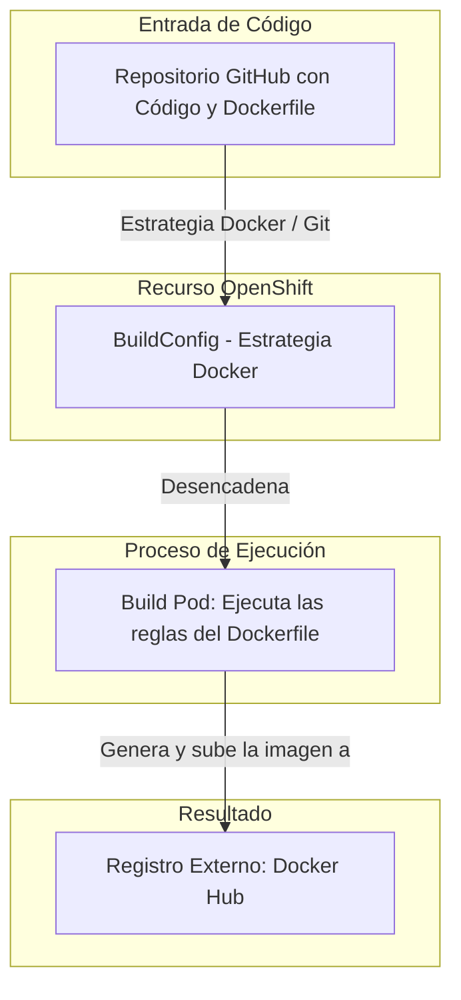
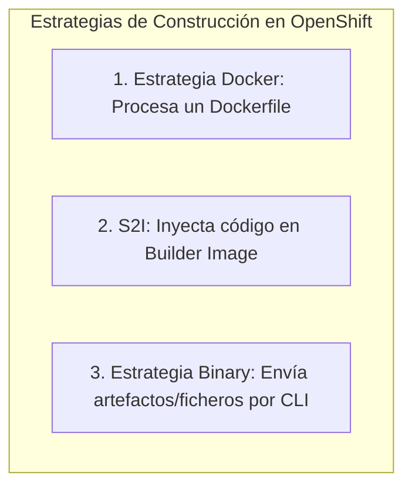
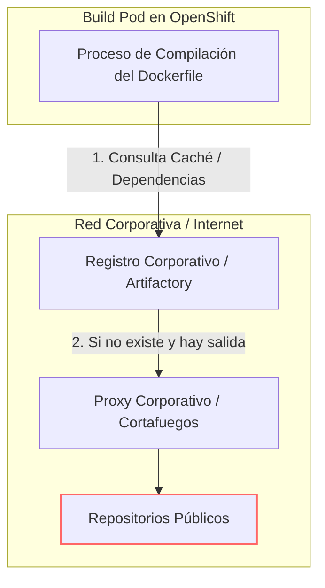
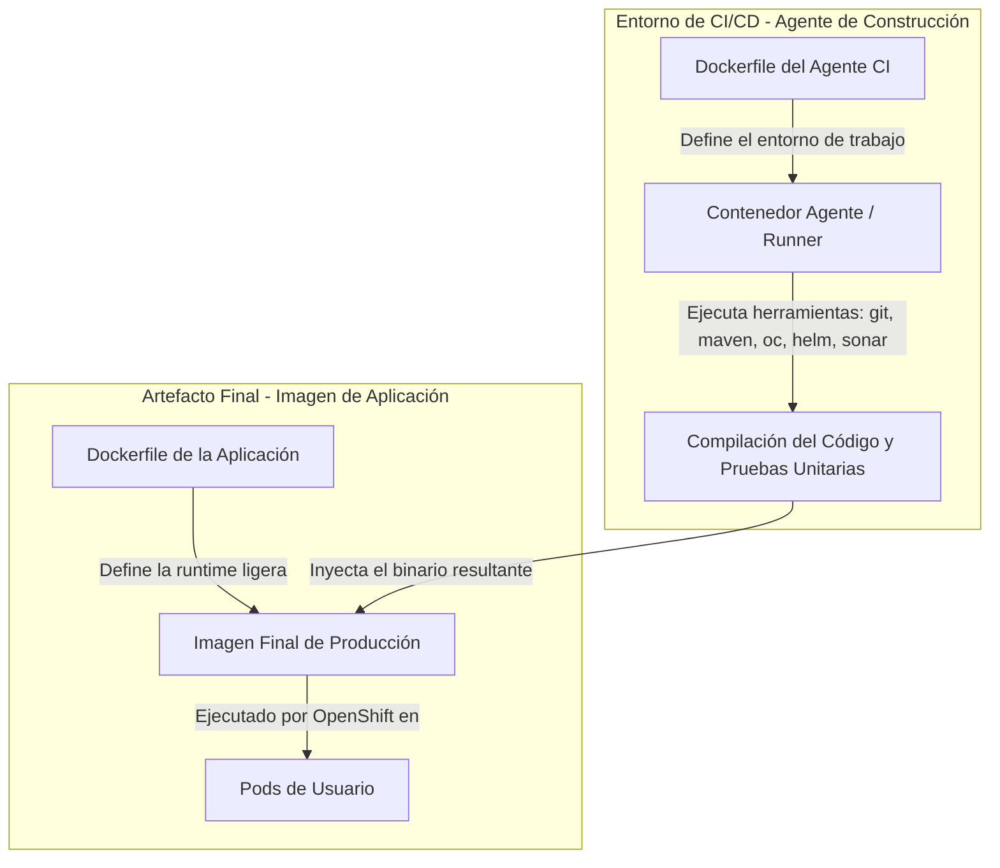
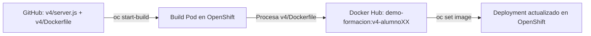

```mermaid
flowchart TD
    subgraph Sesion1 ["Sesión 1.8: Construcción Manual en el Puesto del Desarrollador"]
        A1[Código Fuente + Dockerfile Local] -->|1. podman build| A2[Imagen Local en Estación de Trabajo]
        A2 -->|2. podman push| A3[Registro Público Externo: Docker Hub]
        A3 -->|3. oc new-app| A4[Despliegue en OpenShift]
    end

    subgraph Sesion4 ["Sesión 4.5: Construcción Delegada en la Plataforma (Estrategia Docker)"]
        B1[Repositorio GitHub con Código + Dockerfile] -->|1. Webhook / oc start-build| B2[Build Pod Efímero en OpenShift]
        B2 -->|2. Compila el Dockerfile dentro| B3[Registro Externo: Docker Hub]
        B3 -->|3. Despliegue automatizado| B4[Despliegue en OpenShift]
    end
```

## 4.5 Construir en la plataforma: estrategias de BuildConfig

### Objetivos de aprendizaje

Al finalizar este apartado serás capaz de:

- Comprender el propósito del recurso nativo BuildConfig (BC) en OpenShift como abstracción para la automatización de construcciones de imágenes.
- Analizar y diferenciar las tres estrategias de construcción de OpenShift (Docker, S2I y Binary), comprendiendo las razones técnicas para adoptar la **Estrategia Docker**.
- Comprender el flujo de resolución y descarga de dependencias durante la fase de compilación en el clúster.
- Distinguir claramente la responsabilidad y arquitectura de los **dos Dockerfile**: el entorno del agente de construcción CI frente al Dockerfile de la aplicación final.
- Ejecutar una práctica guiada basada en nuestra aplicación de la Sesión 1.8, utilizando un BuildConfig con **Estrategia Docker** conectado a un repositorio de GitHub (especificando `contextDir`) para automatizar la construcción, publicar en **Docker Hub** y actualizar el despliegue existente mediante `oc set image`.

### Evolución de nuestra perspectiva: De la construcción artesanal en local a la automatización en el clúster

Para comprender el verdadero salto cualitativo que supone BuildConfig, debemos conectar este apartado con el flujo de trabajo que realizamos en la **Sesión 1.8**:



#### Comparativa de flujos de trabajo

- **El enfoque de la Sesión 1.8 (Construcción Manual en Local):** En la primera sesión aprendimos a leer un Dockerfile y construimos una imagen ejecutando comandos manuales en nuestra máquina cliente con Podman (`podman build`), le asignamos una etiqueta y la subimos nosotros mismos a un registro externo (`podman push docker.io/...`) antes de decirle a OpenShift que la desplegara.  
  _Limitaciones de este modelo:_ Depende de que el desarrollador tenga Podman/Docker instalado en su equipo, requiere ancho de banda local para subir imágenes pesadas a Internet, no escala en equipo y dificulta auditar exactamente qué código generó esa imagen.
- **El enfoque de la Sesión 4.5 (Construcción Automatizada en la Plataforma):** En este apartado **delegamos la responsabilidad de la construcción a OpenShift manteniendo nuestro Dockerfile**. El desarrollador ya no compila ni empaqueta la imagen en su portátil; simplemente conecta su repositorio de código a la plataforma, y el propio clúster ejecuta las instrucciones del Dockerfile en un **Build Pod**, deposita la imagen resultante en el **registro de Docker Hub** e inicia el despliegue de forma trazable.

### La abstracción de construcción en OpenShift: BuildConfig

En la Sesión 1.7 mostramos el efecto visual de desplegar código fuente directamente en la plataforma. En este apartado explicamos el mecanismo técnico que lo hace posible.

OpenShift extiende las capacidades nativas de Kubernetes introduciendo el objeto **BuildConfig** (`bc`). Un BuildConfig es la definición declarativa del proceso mediante el cual el código fuente, artefactos binarios o un contexto de compilación con su Dockerfile se transforman en una imagen de contenedor lista para ejecutarse en el clúster.



Cuando un BuildConfig se ejecuta (de forma manual, mediante un _webhook_ de Git o mediante comandos de CLI), OpenShift no compila el código dentro de los nodos del control plane. En su lugar, el sistema crea un **Build Pod** efímero dedicado exclusivamente a ejecutar la tarea de compilación y empaquetado del Dockerfile, aislando el consumo de recursos.

### Estrategias de construcción en OpenShift

OpenShift soporta distintas estrategias para transformar código en imágenes de contenedor. Aunque existen alternativas orientadas a abstraer la creación de contenedores, la **Estrategia Docker** representa el estándar de la industria en entornos corporativos.



#### Contexto sobre las estrategias de OpenShift

Para entender el panorama completo de la plataforma, conviene distinguir las tres estrategias principales disponibles en OpenShift:

- **Estrategia Docker:** OpenShift procesa directamente un archivo Dockerfile presente en el repositorio de código fuente.
- **Source-to-Image (S2I):** Un mecanismo nativo de OpenShift donde el clúster toma código fuente sin Dockerfile (Node.js, Java, Python, etc.) y lo combina con una imagen constructora (_Builder Image_) oficial para generar la imagen final.
- **Estrategia Binary:** Una variante donde la compilación o preparación del código se realiza fuera del clúster y el resultado bruto (ficheros comprimidos o binarios) se envía mediante la CLI (`oc start-build --from-file=...`).

#### Justificación técnica de la Estrategia Docker

- **Control total y explícito:** El desarrollador y el equipo de arquitectura definen con precisión la imagen base (`FROM`), la versión del runtime, las dependencias del sistema y las directivas de seguridad (como los permisos de usuario), evitando comportamientos opacos.
- **Portabilidad universal:** Un Dockerfile es un estándar abierto e independiente de la plataforma. La misma definición se puede construir en OpenShift, en un motor local (Podman/Docker), en cualquier otro clúster de Kubernetes o en cualquier herramienta de CI/CD (GitHub Actions, GitLab CI, Jenkins).

#### Cuadro comparativo de estrategias

| Criterio | Estrategia Docker (estándar recomendado) | Source-to-Image (S2I) | Estrategia Binary con Dockerfile |
|---|---|---|---|
| **Origen del código** | Repositorio Git remoto | Repositorio Git remoto | Puesto local / Pipeline de CI/CD |
| **Requiere Dockerfile** | **Sí (obligatorio)** | No | **Sí (para empaquetado)** |
| **Lugar de compilación** | Dentro del clúster (Build Pod) | Dentro del clúster (Build Pod) | Mixto (compilación fuera, empaquetado en clúster) |
| **Control sobre el SO base** | **Total (definido en el `FROM`)** | Bajo (definido por la Builder Image) | **Total (definido en el `FROM`)** |
| **Uso en CI/CD industrial** | **Muy alto (estándar corporativo)** | Fase inicial / prototipado | **Muy alto en integraciones con artefactos** |

### De dónde salen y cómo se resuelven las dependencias

Un punto crítico en la arquitectura de construcción dentro de OpenShift es entender cómo las instrucciones de nuestro Dockerfile descargan y gestionan las librerías externas durante la ejecución del BuildConfig.



#### 1. El reto del acceso a Internet en clústeres corporativos

En entornos de producción o redes restringidas (DMZ), los nodos del clúster de OpenShift **pueden no tener acceso directo a Internet público**. Si las instrucciones de un Dockerfile intentan conectar directamente a los repositorios públicos y la red no permite esa salida, la compilación fallará normalmente por un error de conexión o de tiempo de espera (_timeout_).

#### 2. Puntos de resolución de dependencias

Para resolver esta limitación en entornos empresariales, la infraestructura ofrece dos soluciones:

- **Gestores de Artefactos Corporativos (Nexus / Artifactory):** Las instrucciones dentro del Dockerfile o sus archivos asociados deben apuntar explícitamente a las URLs del registro interno corporativo. Este servidor actúa como caché de dependencias aprobadas y autorizadas por la organización.
- **Configuración de proxy para las construcciones:** La plataforma puede proporcionar variables como `HTTP_PROXY`, `HTTPS_PROXY` y `NO_PROXY` a los procesos de construcción cuando la arquitectura de red lo requiera. De este modo, el _Build Pod_ dirige el tráfico de descarga a través del proxy corporativo permitido.

### Los dos Dockerfile: Agente de construcción CI frente al Dockerfile de aplicación

Conectando de nuevo con la Sesión 1, es fundamental entender que en un ciclo de vida profesional conviven dos tipos de Dockerfile con propósitos completamente distintos.



#### 1. El Dockerfile del Agente de Construcción (CI Runner)

- **Propósito:** Definir el entorno del sistema operativo donde se ejecutan los scripts del pipeline de integración continua (Jenkins Agent, GitLab Runner, GitHub Actions Runner).
- **Contenido:** Incluye utilidades del sistema, compiladores, clientes de CLI (`oc`, `kubectl`), herramientas de análisis estático de código y motores de ejecución.
- **Vida útil:** Se utiliza **únicamente durante la ejecución del job de CI/CD**. Nunca se despliega en los proyectos de producción de OpenShift.

#### 2. El Dockerfile de la Aplicación (Runtime)

- **Propósito:** Definir el paquete inmutable que albergará exclusivamente el código ejecutable de la aplicación de negocio y sus dependencias de tiempo de ejecución.
- **Contenido:** Utiliza imágenes base minimalistas y endurecidas (por ejemplo, Red Hat Universal Base Image, UBI Minimal o UBI Node.js), incorpora los binarios necesarios y expone los puertos de servicio.
- **Vida útil:** Es la imagen que se cataloga en el registro externo o corporativo de imágenes y se despliega como Pod en el clúster de OpenShift.

### Práctica guiada: Llevando nuestra app de la Sesión 1.8 a un BuildConfig con GitHub y Docker Hub

En esta práctica vamos a reutilizar la aplicación Node.js de la **Sesión 1.8** (`server.js`, `demo-formacion.html` y su Dockerfile) organizada por versiones dentro de un repositorio de **GitHub**, automatizaremos su construcción con un BuildConfig usando **Estrategia Docker** e indicando la subcarpeta `v4` (`contextDir`), publicaremos el resultado en **Docker Hub** y actualizaremos nuestro despliegue existente usando `oc set image`.

Todos utilizaremos el mismo repositorio de GitHub y el mismo repositorio de Docker Hub preparados para la formación. Para evitar que las construcciones se sobrescriban entre sí, cada alumno publicará la imagen con una etiqueta diferente, por ejemplo `v4-alumno01`, `v4-alumno02`, etc.



#### Paso 1: Estructura del código en GitHub

El repositorio público de **GitHub** utilizado en la práctica es:

```text
https://github.com/ieftraininig/curso-openshift-app.git
```

La versión `v4` está organizada en su propia subcarpeta:

```text
curso-openshift-app/
├── v1/
├── v2/
├── v3/
└── v4/
    ├── Dockerfile
    ├── demo-formacion.html
    └── server.js
```

El fichero `v4/Dockerfile` contiene:

```dockerfile
FROM registry.access.redhat.com/ubi9/nodejs-20
WORKDIR /opt/app-root/src
COPY server.js .
COPY demo-formacion.html index.html
EXPOSE 8080
CMD ["node", "server.js"]
```

#### Paso 2: Crear un Secret de autenticación para Docker Hub en OpenShift

Para que OpenShift pueda publicar la imagen construida en Docker Hub, el BuildConfig necesita autenticarse con una cuenta que tenga permisos de escritura sobre el repositorio `ieftraininig/demo-formacion`.

Durante la formación, el profesor proporcionará un **token temporal específico para esta práctica**. No se utilizará la contraseña personal de la cuenta. Cada alumno creará el Secret en su propio proyecto de OpenShift:

```bash
oc create secret docker-registry dockerhub-secret \
  --docker-server=docker.io \
  --docker-username=ieftraininig \
  --docker-password=<TOKEN_FORMACION> \
  --docker-email=<CORREO_FORMACION>
```

El comando no incluye `--namespace`: el Secret se crea en el proyecto que esté activo en ese momento. Antes de ejecutarlo, comprueba que estás trabajando en tu proyecto:

```bash
oc project
```

El Secret almacena la credencial que utilizará OpenShift para realizar el `push`. El BuildConfig lo referenciará mediante el campo `pushSecret`. Al finalizar la formación, el token temporal deberá revocarse.

#### Paso 3: Crear el objeto BuildConfig conectado a GitHub y Docker Hub

Cada alumno debe elegir el identificador que le haya asignado el profesor, por ejemplo `alumno01`, y utilizarlo en la etiqueta de la imagen. Así, aunque todos publiquen en el mismo repositorio, cada construcción tendrá un destino diferente:

```text
docker.io/ieftraininig/demo-formacion:v4-alumno01
```

Creamos un fichero de manifiesto llamado `buildconfig-github.yaml`. En el siguiente ejemplo se utiliza `alumno01`; sustituye ese valor por tu identificador:

```yaml
apiVersion: build.openshift.io/v1
kind: BuildConfig
metadata:
  name: demo-formacion-bc
spec:
  # Origen: repositorio Git apuntando al directorio de contexto de la versión v4
  source:
    type: Git
    git:
      uri: "https://github.com/ieftraininig/curso-openshift-app.git"
      ref: "main"
    contextDir: "v4"

  # Estrategia: procesar el Dockerfile localizado en v4/
  strategy:
    type: Docker
    dockerStrategy:
      dockerfilePath: Dockerfile

  # Salida: registro externo de Docker Hub con una etiqueta distinta para cada alumno
  output:
    to:
      kind: DockerImage
      name: "docker.io/ieftraininig/demo-formacion:v4-alumno01"
    pushSecret:
      name: dockerhub-secret

  successfulBuildsHistoryLimit: 3
  failedBuildsHistoryLimit: 3
```

##### Explicación del manifiesto BuildConfig

- **`spec.source`:** Declara la fuente del código. Usamos `type: Git` indicando la URI del repositorio y, mediante **`contextDir: "v4"`**, instruimos a OpenShift para que acceda exclusivamente a la subcarpeta `v4` en busca del código y del Dockerfile.
- **`spec.strategy`:** Define la estrategia de construcción. En este caso `type: Docker`, por lo que OpenShift usará el motor de construcción leyendo las instrucciones de `dockerfilePath`.
- **`spec.output`:** Especifica el destino de la imagen generada por el _Build Pod_. La etiqueta individual, como `v4-alumno01`, evita que las construcciones de los alumnos se sobrescriban entre sí.
- **`pushSecret`:** Indica el Secret que contiene la credencial temporal necesaria para autenticarse en Docker Hub y publicar la imagen.
- **`historyLimit`:** Limita la cantidad de historiales de construcciones pasadas que se conservan en el clúster para optimizar el almacenamiento.

Aplicamos el manifiesto en el proyecto activo:

```bash
oc apply -f buildconfig-github.yaml
```

#### Paso 4: Disparar y monitorizar la construcción en el clúster

Disparamos la construcción manualmente mediante la CLI:

```bash
oc start-build demo-formacion-bc --follow
```

El parámetro `--follow` nos mostrará en tiempo real los logs del _Build Pod_, el cual clonará el repositorio, entrará en la subcarpeta `v4`, ejecutará el Dockerfile de Node.js y subirá la imagen resultante a Docker Hub con la etiqueta individual indicada en el BuildConfig.

Podemos consultar las construcciones realizadas con:

```bash
oc get builds
```

#### Paso 5: Actualizar el despliegue existente mediante `oc set image` y registrar la causa del cambio

En lugar de crear un recurso nuevo con `oc new-app`, actualizamos nuestro Deployment existente (desplegado previamente con la `v3`) para que pase a utilizar la imagen construida por la plataforma.

Utiliza la misma etiqueta individual que configuraste en el BuildConfig. Por ejemplo, para `alumno01`:

```bash
oc set image deployment/demo-formacion \
  *=docker.io/ieftraininig/demo-formacion:v4-alumno01
```

A continuación, anotamos en Kubernetes la causa del cambio para mantener la trazabilidad y el historial de revisiones del despliegue:

```bash
oc annotate deployment/demo-formacion \
  kubernetes.io/change-cause="Actualización a v4. Construcción automatizada en clúster mediante BuildConfig con Estrategia Docker." \
  --overwrite
```

Comprobamos que el despliegue está realizando el _rolling update_ y verificamos la ruta existente:

```bash
oc rollout status deployment/demo-formacion
oc get route
```

### Ideas clave para recordar

!!! tip "Resumen"
    - **Evolución natural frente a la Sesión 1.8:** Pasamos de la construcción manual con Podman a la automatización delegada en la plataforma mediante un BuildConfig.
    - **Estrategia Docker:** Permite seguir utilizando nuestro Dockerfile clásico basado en UBI (`ubi9/nodejs-20`), reutilizando los conocimientos adquiridos en la Sesión 1.
    - **Soporte para estructuras con `contextDir`:** Mediante este campo, OpenShift puede localizar el Dockerfile y el código fuente aunque se encuentren dentro de una subcarpeta como `v4/`.
    - **Publicación autenticada:** El `pushSecret` permite que el BuildConfig se autentique en Docker Hub y publique la imagen sin incluir la credencial en el manifiesto.
    - **Etiquetas individuales:** Cada alumno utiliza una etiqueta diferente (`v4-alumno01`, `v4-alumno02`, etc.) para evitar que las construcciones se sobrescriban entre sí.
    - **Actualización trazable:** Con `oc set image` y `oc annotate` actualizamos la aplicación y dejamos constancia de la causa del cambio.
