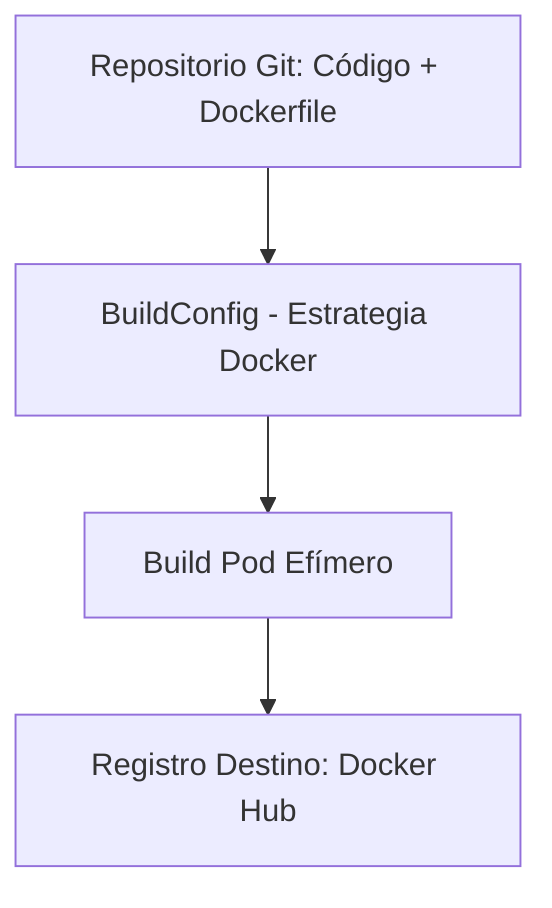
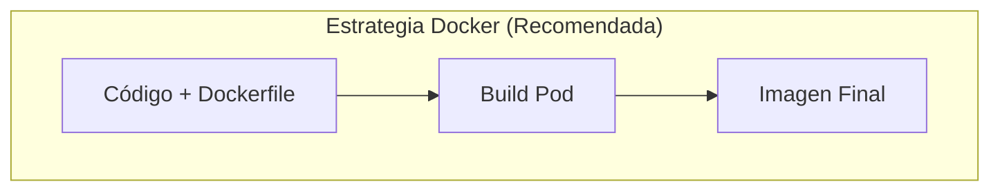
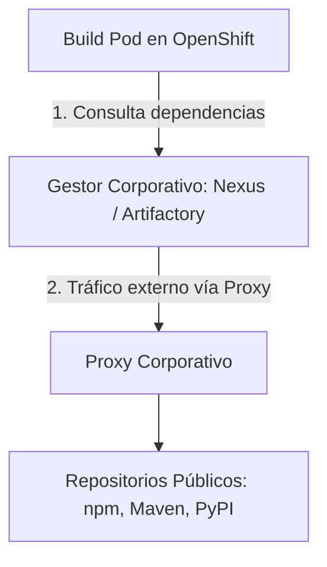
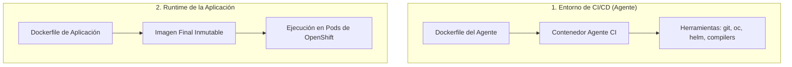
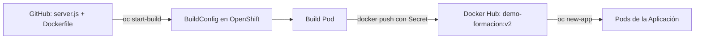

# 4.5 Construir en la plataforma: estrategias de BuildConfig

## Objetivos de aprendizaje

Al finalizar este apartado serás capaz de:

- Comprender el propósito del recurso nativo `BuildConfig` (BC) en OpenShift como abstracción para la automatización de construcciones de imágenes.
- Analizar y diferenciar las distintas estrategias de construcción (`Docker`, `S2I` y `Binary`), identificando por qué la **Estrategia Docker** es el estándar recomendado en entornos empresariales.
- Comprender la arquitectura de resolución y descarga de dependencias externas en clústeres corporativos (proxies y gestores de artefactos).
- Distinguir claramente la responsabilidad y ámbito de los **dos Dockerfile**: el entorno del agente de CI/CD frente al Dockerfile del runtime de la aplicación.
- Configurar y ejecutar un `BuildConfig` con **Estrategia Docker** conectado a un repositorio público de **GitHub** y publicar automáticamente la imagen hacia **Docker Hub** mediante credenciales en el clúster.

---

## Evolución de nuestra perspectiva: De la construcción artesanal en local a la automatización en el clúster

Para comprender el salto cualitativo que supone el uso de `BuildConfig`, es útil comparar el flujo de trabajo manual realizado en la **Sesión 1.8** con el modelo automatizado de la plataforma:

```mermaid
flowchart TD
    subgraph Sesion1 ["Sesión 1.8: Construcción Manual en Local"]
        A1[Código Fuente + Dockerfile Local] -->|1. podman build| A2[Imagen Local en Estación de Trabajo]
        A2 -->|2. podman push| A3[Registro Público: Docker Hub]
        A3 -->|3. oc new-app| A4[Despliegue en OpenShift]
    end

    subgraph Sesion4 ["Sesión 4.5: Construcción Delegada en OpenShift"]
        B1[Repositorio GitHub con Código + Dockerfile] -->|1. oc start-build / Webhook| B2[Build Pod Efímero en OpenShift]
        B2 -->|2. Compila el Dockerfile| B3[Registro Externo: Docker Hub]
        B3 -->|3. Despliegue| B4[Pods en Ejecución]
    end
```



### Comparativa de flujos de trabajo

- **Construcción Manual en Local (Sesión 1.8):** 
  El desarrollador compila la imagen localmente en su puesto de trabajo con Podman (`podman build`) y la sube manualmente a un registro externo (`podman push`).
  
  *Inconvenientes:* Depende de que el equipo local disponga de motores de contenedores instalados, consume ancho de banda del puesto cliente para subir capas pesadas y dificulta la trazabilidad y auditoría en entornos de equipo.

- **Construcción Delegada en la Plataforma (Sesión 4.5):**
  El desarrollador publica su código y su `Dockerfile` en un repositorio centralizado (GitHub). OpenShift asume el proceso de compilación ejecutando un **Build Pod** efímero dentro del clúster, publica el resultado en el registro correspondiente (Docker Hub) y deja la aplicación lista para su despliegue.

---

## La abstracción de construcción en OpenShift: `BuildConfig`

OpenShift extiende las capacidades nativas de Kubernetes mediante el recurso **BuildConfig** (`bc`). Un `BuildConfig` es una definición declarativa que describe cómo transformar código fuente, artefactos binarios o un contexto de compilación con su `Dockerfile` en una imagen de contenedor.



Cuando se activa un `BuildConfig` (de forma manual desde la CLI, mediante webhooks de Git o a través de pipelines de CI/CD), OpenShift crea un **Build Pod** efímero dedicado exclusivamente a ejecutar las tareas de compilación y empaquetado, asegurando el aislamiento de recursos respecto al resto de aplicaciones en ejecución.

---

## Estrategias de construcción: Por qué la Estrategia Docker es nuestro estándar

OpenShift soporta distintas estrategias para transformar código en imágenes de contenedor. Aunque existen alternativas orientadas a abstraer la creación de contenedores, la **Estrategia Docker** representa el estándar de la industria en entornos corporativos.



### Contexto sobre las estrategias de OpenShift

Para entender el panorama completo de la plataforma, conviene distinguir las tres estrategias principales disponibles en OpenShift:

1. **Estrategia Docker:** OpenShift procesa directamente un archivo `Dockerfile` presente en el repositorio de código fuente.
2. **Source-to-Image (S2I):** Un mecanismo nativo de OpenShift donde el clúster toma código fuente sin `Dockerfile` (Node.js, Java, Python, etc.) y lo combina con una imagen constructora (*Builder Image*) oficial para generar la imagen final.
3. **Estrategia Binary:** Una variante donde la compilación o preparación del código se realiza fuera del clúster y el resultado bruto (ficheros comprimidos o binarios) se envía mediante la CLI (`oc start-build --from-file=...`).

### Justificación técnica de la Estrategia Docker

- **Control total y explícito:** El desarrollador y el equipo de arquitectura definen con precisión la imagen base (`FROM`), la versión del runtime, las dependencias del sistema y las directivas de seguridad (como los permisos de usuario), evitando comportamientos opacos.
- **Portabilidad universal:** Un `Dockerfile` es un estándar abierto e independiente de la plataforma. La misma definición se puede construir en OpenShift, en un motor local (Podman/Docker) o en cualquier herramienta de CI/CD (GitHub Actions, GitLab CI, Jenkins).

### Cuadro comparativo de estrategias

| Criterio | Estrategia Docker (Estándar recomendado) | Source-to-Image (S2I) | Estrategia Binary con Dockerfile |
| :--- | :--- | :--- | :--- |
| **Origen del código** | Repositorio Git remoto | Repositorio Git remoto | Puesto local / Pipeline de CI/CD |
| **Requiere Dockerfile** | **Sí (obligatorio)** | No | **Sí (para empaquetado)** |
| **Lugar de compilación** | Dentro del clúster (Build Pod) | Dentro del clúster (Build Pod) | Mixto (Compilación fuera, empaquetado en clúster) |
| **Control sobre el SO base** | **Total (definido en el `FROM`)** | Bajo (definido por la Builder Image) | **Total (definido en el `FROM`)** |
| **Uso en CI/CD Industrial** | **Muy alto (Estándar corporativo)** | Prototipado / Desarrollo rápido | **Muy alto en integraciones con artefactos** |

---

## De dónde salen y cómo se resuelven las dependencias

Un aspecto fundamental durante la ejecución de un `BuildConfig` es comprender cómo se gestionan y descargan las librerías necesarias durante la fase de compilación en la plataforma.



### Acceso a red y repositorios de dependencias

En infraestructuras empresariales y entornos de producción, los nodos de OpenShift habitualmente **no disponen de acceso directo a Internet**. Para que el proceso de compilación dentro del *Build Pod* sea exitoso, la plataforma se integra con la red corporativa mediante:

1. **Gestores de Artefactos Internos (Nexus / Artifactory):** Las instrucciones de instalación de dependencias (por ejemplo, `npm install`) o la configuración del proyecto apuntan a registros internos que actúan como caché y filtro de seguridad.
2. **Proxies de Salida de Plataforma:** OpenShift permite inyectar variables de entorno (`HTTP_PROXY`, `HTTPS_PROXY`, `NO_PROXY`) en la definición del `BuildConfig` para que el *Build Pod* canalice las peticiones externas a través del proxy autorizado de la organización.

---

## Los dos Dockerfile: Agente de construcción CI frente al Dockerfile de aplicación

En el ciclo de vida de desarrollo continuo conviven habitualmente dos tipos de `Dockerfile` que cumplen funciones claramente diferenciadas:



1. **Dockerfile del Agente de CI (Runner):**
   - **Objetivo:** Definir el entorno de ejecución del sistema de integración continua (Jenkins Agent, GitLab Runner, GitHub Actions Runner).
   - **Contenido:** Contiene herramientas de construcción, compiladores, clientes de línea de comandos (`oc`, `helm`) y utilidades de análisis de código.
   - **Ámbito:** Se utiliza únicamente en la fase de pipeline de integración continua.

2. **Dockerfile de la Aplicación (Runtime):**
   - **Objetivo:** Definir el paquete final inmutable que ejecutará la lógica de negocio en el clúster.
   - **Contenido:** Basado en imágenes ligeras y endurecidas (como Red Hat Universal Base Image - UBI), incluye únicamente el código compilado, las dependencias de tiempo de ejecución y la instrucción de arranque (`CMD`).
   - **Ámbito:** Es la imagen distribuida a los registros de contenedores y ejecutada por los Pods de producción en OpenShift.

---

## Práctica guiada: Llevando nuestra app de la Sesión 1.8 a un BuildConfig con GitHub y Docker Hub

En esta práctica utilizaremos la aplicación Node.js de la **Sesión 1.8** (`server.js`, `demo-formacion.html` y su `Dockerfile`) alojada en un repositorio público de **GitHub**, configurando un `BuildConfig` en OpenShift con **Estrategia Docker** que enviará la imagen compilada hacia **Docker Hub**.



### Paso 1: Verificar el código en GitHub

Asegúrate de tener en la rama principal (`main`) de tu repositorio público de **GitHub** los archivos de la aplicación:

- `server.js`
- `demo-formacion.html` (renombrado como `index.html` en el servidor)
- `Dockerfile` basado en UBI:

```dockerfile
FROM registry.access.redhat.com/ubi9/nodejs-20

WORKDIR /opt/app-root/src

COPY server.js .
COPY demo-formacion.html index.html

EXPOSE 8080

CMD ["node", "server.js"]
```

### Paso 2: Crear el Secret para autenticación en Docker Hub

Para permitir que el *Build Pod* de OpenShift publique la imagen en vuestra cuenta de Docker Hub, creamos un secreto de tipo `docker-registry` en el proyecto:

```bash
oc create secret docker-registry dockerhub-secret \
  --docker-server=docker.io \
  --docker-username=tu-usuario-dockerhub \
  --docker-password=tu-token-o-password \
  --docker-email=tu-correo@dominio.com \
  --namespace=angel-cuaresma-alons-dev
```

### Paso 3: Crear el manifiesto del BuildConfig

Creamos el archivo `buildconfig-github.yaml` definiendo el origen en GitHub, la estrategia Docker y la salida en Docker Hub utilizando el secreto creado:

```yaml
apiVersion: build.openshift.io/v1
kind: BuildConfig
metadata:
  name: demo-formacion-bc
  namespace: angel-cuaresma-alons-dev
spec:
  source:
    type: Git
    git:
      uri: "https://github.com/tu-usuario/curso-openshift-app.git"
      ref: "main"
  strategy:
    type: Docker
    dockerStrategy:
      dockerfilePath: Dockerfile
  output:
    to:
      kind: DockerImage
      name: "docker.io/tu-usuario-dockerhub/demo-formacion:v2"
    pushSecret:
      name: dockerhub-secret
  successfulBuildsHistoryLimit: 3
  failedBuildsHistoryLimit: 3
```

Aplicamos el recurso en el clúster:

```bash
oc apply -f buildconfig-github.yaml
```

### Paso 4: Disparar la construcción y seguir los registros

Ejecutamos la construcción desde la CLI y monitorizamos la salida del *Build Pod* en tiempo real:

```bash
oc start-build demo-formacion-bc --follow
```

Durante este proceso, OpenShift clonará el repositorio desde GitHub, procesará las instrucciones del `Dockerfile` y publicará la imagen resultante en Docker Hub.

### Paso 5: Desplegar la aplicación en OpenShift

Una vez completada la construcción y generada la imagen en Docker Hub, procedemos a desplegar la nueva versión de la aplicación:

```bash
oc new-app docker.io/tu-usuario-dockerhub/demo-formacion:v2 --name=demo-formacion
```

Exponemos el servicio para generar una ruta de acceso externa:

```bash
oc expose service demo-formacion
```

Verificamos la URL y el estado del despliegue:

```bash
oc get route
```

---

## Ideas clave para recordar

!!! tip "Resumen"
    - **Automatización centralizada:** `BuildConfig` permite delegar la construcción de imágenes en el clúster, eliminando la necesidad de empaquetar software en las estaciones de trabajo locales.
    - **Estrategia Docker:** Es la opción estándar en entornos corporativos gracias al control total sobre la definición del contenedor y su portabilidad multiplataforma.
    - **Integración fluida:** Combina repositorios de código externos (**GitHub**) con registros de imágenes de destino (**Docker Hub**) utilizando credenciales de autenticación seguras (`Secret`).
    - **Gestión empresarial:** En clústeres restringidos, la resolución de librerías y dependencias se canaliza mediante proxies y gestores de artefactos corporativos.