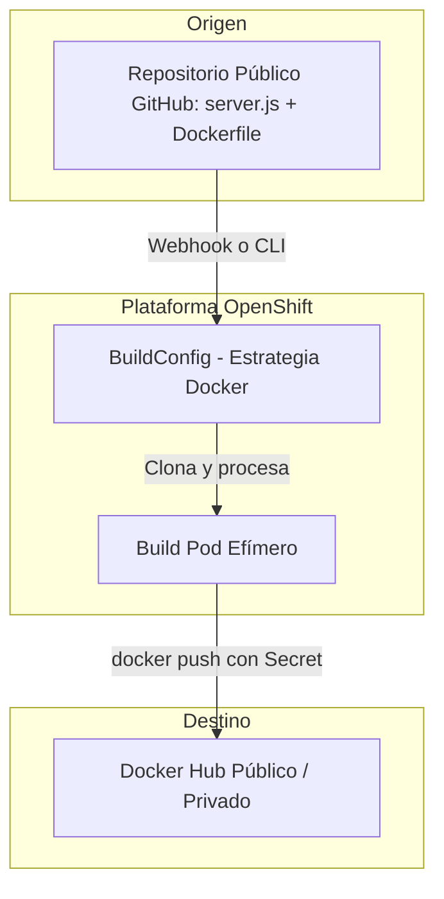

# 4.5 Construir en la plataforma: automatización con BuildConfig y Estrategia Docker

## Objetivos de aprendizaje

Al finalizar este apartado serás capaz de:

- Comprender el propósito del recurso nativo `BuildConfig` (BC) en OpenShift como evolución natural de la construcción manual realizada en la Sesión 1.8.
- Configurar un `BuildConfig` utilizando la **Estrategia Docker**, conectando OpenShift directamente a un repositorio público de **GitHub**.
- Automatizar la publicación de la imagen resultante en un registro externo como **Docker Hub** utilizando credenciales seguras de OpenShift.
- Reutilizar la misma aplicación Node.js de la Sesión 1 (`server.js`, `demo-formacion.html` y su `Dockerfile`) para construirla de forma delegada y centralizada en el clúster.

---

## Evolución de nuestra perspectiva: De Podman en local a BuildConfig en el clúster

Para entender el verdadero salto cualitativo de este apartado, vamos a contraponer nuestro flujo de trabajo actual con el que ejecutamos en la **Sesión 1.8**:

```mermaid
flowchart TD
    subgraph Sesion1 ["Sesión 1.8: Construcción Manual en el Portátil"]
        A1[Código + Dockerfile en local] -->|1. podman build| A2[Imagen Local]
        A2 -->|2. podman push| A3[Docker Hub]
        A3 -->|3. oc new-app| A4[Despliegue en OpenShift]
    end

    subgraph Sesion4 ["Sesión 4.5: Construcción Automatizada con BuildConfig"]
        B1[Repositorio GitHub con Código + Dockerfile] -->|1. Webhook / oc start-build| B2[Build Pod Efímero en OpenShift]
        B2 -->|2. Ejecuta Dockerfile dentro| B3[Registro Externo: Docker Hub]
        B3 -->|3. Despliegue en OpenShift| B4[Pods en Ejecución]
    end
```



### Comparativa de flujos

- **Enfoque de la Sesión 1.8:** Compilábamos y empaquetábamos la aplicación de forma manual en nuestra estación de trabajo usando Podman (`podman build`), y éramos nosotros quienes subíamos la imagen a Docker Hub (`podman push`) antes de desplegarla en OpenShift. Esto depende de los recursos de nuestro equipo y no escala en entornos corporativos.
- **Enfoque de la Sesión 4.5:** Mantenemos exactamente la misma aplicación y el mismo `Dockerfile` basados en UBI (`ubi9/nodejs-20`), pero **delegamos la construcción en OpenShift**. El clúster clona nuestro repositorio de GitHub, procesa el `Dockerfile` dentro de un *Build Pod* seguro y publica la imagen automáticamente en nuestro repositorio de Docker Hub.

---

## La abstracción de construcción: `BuildConfig` con Estrategia Docker

OpenShift extiende Kubernetes mediante el recurso **BuildConfig** (`bc`). Un `BuildConfig` define de manera declarativa cómo transformar el código fuente de un repositorio en una imagen de contenedor ejecutable.

Al configurar la **Estrategia Docker**, OpenShift lee el fichero `Dockerfile` presente en nuestro repositorio de GitHub y ejecuta sus instrucciones paso a paso dentro de un contenedor de construcción efímero (*Build Pod*).



---

## Práctica guiada: Llevando nuestra app de la Sesión 1.8 a un BuildConfig con GitHub y Docker Hub

En esta práctica vamos a reutilizar la aplicación Node.js de la Sesión 1.8 y automatizar su ciclo de vida mediante un `BuildConfig` en OpenShift que apunte a nuestro repositorio de **GitHub** y construya la imagen hacia **Docker Hub**.

### Paso 1: Preparar el código en GitHub

Asegúrate de tener subidos a un repositorio público de **GitHub** (por ejemplo, `[https://github.com/tu-usuario/curso-openshift-app](https://github.com/tu-usuario/curso-openshift-app)`) los tres ficheros clásicos de nuestra Sesiones anteriores:

1. `server.js`
2. `demo-formacion.html` (renombrado como `index.html` en el flujo)
3. El `Dockerfile` basado en UBI:

```dockerfile
FROM registry.access.redhat.com/ubi9/nodejs-20

WORKDIR /opt/app-root/src

COPY server.js .
COPY demo-formacion.html index.html

EXPOSE 8080

CMD ["node", "server.js"]
```

### Paso 2: Crear un Secret de autenticación para Docker Hub en OpenShift

Para que OpenShift pueda subir la imagen resultante (`docker push`) a vuestro repositorio de Docker Hub, necesitamos crear un secreto con vuestras credenciales en el clúster:

```bash
oc create secret docker-registry dockerhub-secret \
  --docker-server=docker.io \
  --docker-username=tu-usuario-dockerhub \
  --docker-password=tu-token-o-password \
  --docker-email=tu-correo@dominio.com \
  --namespace=angel-cuaresma-alons-dev
```

### Paso 3: Crear el objeto BuildConfig conectado a GitHub y Docker Hub

Creamos un fichero de manifiesto llamado `buildconfig-github.yaml` que relacione nuestro repositorio de GitHub con la estrategia Docker y el destino en Docker Hub:

```yaml
apiVersion: build.openshift.io/v1
kind: BuildConfig
metadata:
  name: demo-formacion-bc
  namespace: angel-cuaresma-alons-dev
spec:
  # Origen: Repositorio Git público
  source:
    type: Git
    git:
      uri: "https://github.com/tu-usuario/curso-openshift-app.git"
      ref: "main"
  # Estrategia: Dockerfile directo
  strategy:
    type: Docker
    dockerStrategy:
      dockerfilePath: Dockerfile
  # Salida: Registro externo de Docker Hub utilizando el secret creado
  output:
    to:
      kind: DockerImage
      name: "docker.io/tu-usuario-dockerhub/demo-formacion:v2"
    pushSecret:
      name: dockerhub-secret
  successfulBuildsHistoryLimit: 3
  failedBuildsHistoryLimit: 3
```

Aplicamos el manifiesto en nuestro espacio de nombres:

```bash
oc apply -f buildconfig-github.yaml
```

### Paso 4: Disparar y monitorizar la construcción en el clúster

Una vez creado el recurso, lanzamos la construcción manualmente mediante la CLI para comprobar que OpenShift clona de GitHub y compila nuestro `Dockerfile`:

```bash
oc start-build demo-formacion-bc --follow
```

El parámetro `--follow` nos mostrará en tiempo real cómo el *Build Pod* descarga el código de GitHub, interpreta el `Dockerfile` de Node.js, compila las capas y realiza el `push` final hacia vuestro Docker Hub público.

### Paso 5: Desplegar la aplicación en OpenShift desde Docker Hub

Ahora que la imagen está alojada y catalogada en vuestro Docker Hub gracias a la automatización del clúster, podéis desplegarla en OpenShift exactamente igual que hicimos en la Sesión 1.8:

```bash
oc new-app docker.io/tu-usuario-dockerhub/demo-formacion:v2 --name=demo-formacion
```

Exponemos el servicio para generar la ruta web de acceso:

```bash
oc expose service demo-formacion
```

Verificamos el estado del despliegue y obtenemos la URL pública:

```bash
oc get route
```

---

## Ideas clave para recordar

!!! tip "Resumen"
    - **Evolución natural:** Pasamos de la construcción manual con Podman (Sesión 1.8) a la automatización delegada en la plataforma mediante `BuildConfig`.
    - **Estrategia Docker:** Permite seguir utilizando nuestro `Dockerfile` clásico basado en UBI (`ubi9/nodejs-20`) sin necesidad de aprender abstracciones complejas.
    - **Integración con GitHub:** El clúster se encarga de clonar el código fuente directamente desde el repositorio remoto ante cada nuevo cambio.
    - **Publicación externa:** Mediante un `pushSecret`, OpenShift puede autenticarse y depositar el resultado final directamente en un registro público como **Docker Hub**, manteniendo la misma filosofía de imagen inmutable en todos los entornos.
````