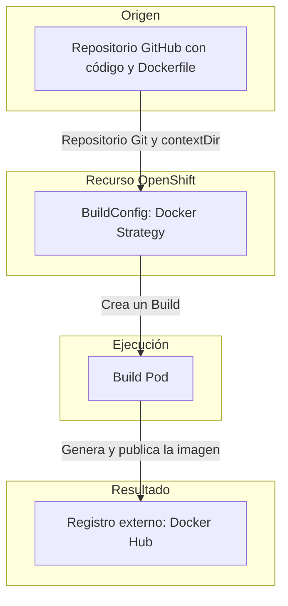
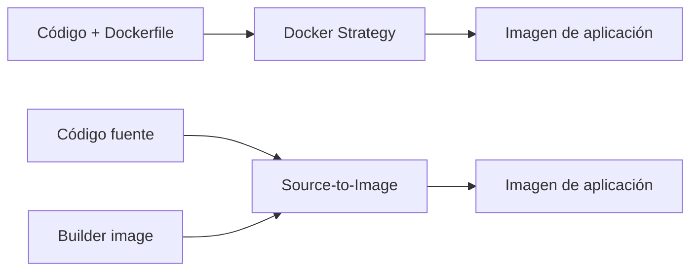
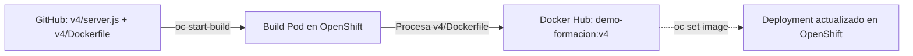

## 4.5 Construir en la plataforma: estrategias de BuildConfig

### Objetivos de aprendizaje

Al finalizar este apartado serás capaz de:

- Comprender el propósito del recurso nativo `BuildConfig` (`bc`) en OpenShift como abstracción para la automatización de construcciones de imágenes.
- Conocer las principales estrategias de construcción de OpenShift y comprender por qué utilizaremos **Docker Strategy** en esta práctica.
- Comprender, a un nivel introductorio, cómo se accede a las imágenes base y a las dependencias durante una construcción ejecutada en el clúster.
- Ejecutar una práctica guiada basada en nuestra aplicación de la Sesión 1.8, utilizando un `BuildConfig` con **Docker Strategy** conectado a un repositorio de GitHub mediante `contextDir`, para construir la imagen, publicarla en **Docker Hub** y actualizar posteriormente el despliegue existente mediante `oc set image`.

### Del gobierno de las imágenes a la construcción en la plataforma

En los apartados anteriores hemos visto cómo OpenShift permite gobernar los recursos, las comunicaciones y las imágenes utilizadas por las aplicaciones. Sin embargo, hasta ahora la imagen se construía fuera de la plataforma y llegaba al clúster como un artefacto ya preparado.

El siguiente paso consiste en trasladar también la construcción a OpenShift mediante un `BuildConfig`. Este cambio mantiene la lógica de gobierno de la sesión y, al mismo tiempo, supone una primera aproximación a la industrialización: el proceso deja de depender de comandos ejecutados manualmente en el equipo del desarrollador y pasa a definirse y ejecutarse de forma repetible en la plataforma.

En este apartado no construiremos todavía un pipeline de integración continua. Nos centraremos exclusivamente en comprender cómo OpenShift puede obtener el código y su Dockerfile, construir una imagen en un **Build Pod** y publicarla en el registro configurado.

### Evolución de nuestra perspectiva: de la construcción artesanal en local a la automatización en el clúster

Para comprender el salto cualitativo que supone `BuildConfig`, debemos conectar este apartado con el flujo de trabajo que realizamos en la **Sesión 1.8**:

```mermaid
flowchart TD
    subgraph Sesion1 ["Sesión 1.8: construcción manual en el puesto del desarrollador"]
        A1[Código fuente + Dockerfile local] -->|1. podman build| A2[Imagen local en la estación de trabajo]
        A2 -->|2. podman push| A3[Registro público externo: Docker Hub]
        A3 -->|3. oc new-app| A4[Despliegue en OpenShift]
    end

    subgraph Sesion4 ["Sesión 4.5: construcción delegada en la plataforma"]
        B1[Repositorio GitHub con código + Dockerfile] -->|1. oc start-build| B2[Build Pod efímero en OpenShift]
        B2 -->|2. Construye la imagen| B3[Registro externo: Docker Hub]
        B3 -.->|3. Actualización manual con oc set image| B4[Deployment en OpenShift]
    end
```



#### Comparativa de flujos de trabajo

- **El enfoque de la Sesión 1.8, construcción manual en local:** en la primera sesión aprendimos a leer un Dockerfile y construimos una imagen ejecutando comandos manuales en nuestra máquina cliente con Podman (`podman build`). Después, le asignamos una etiqueta, la subimos a un registro externo (`podman push`) y le indicamos a OpenShift que la desplegara. Este modelo depende de que el desarrollador disponga de las herramientas necesarias en su equipo y dificulta reproducir y auditar de manera homogénea cómo se generó cada imagen.
- **El enfoque de la Sesión 4.5, construcción automatizada en la plataforma:** en este apartado delegamos la responsabilidad de la construcción en OpenShift manteniendo nuestro Dockerfile. El desarrollador ya no construye la imagen en su equipo: conecta el repositorio de código con la plataforma y el clúster procesa el Dockerfile en un **Build Pod** y deposita la imagen resultante en **Docker Hub**.

La construcción y el despliegue son procesos relacionados, pero distintos. En esta práctica actualizaremos posteriormente el `Deployment` de forma manual para utilizar la nueva imagen.

### La abstracción de construcción en OpenShift: BuildConfig

En la Sesión 1.7 mostramos el efecto visual de desplegar código fuente directamente en la plataforma. En este apartado explicamos el mecanismo técnico que permite definir una construcción dentro de OpenShift.

OpenShift amplía las capacidades de Kubernetes con el objeto **BuildConfig** (`bc`). Un `BuildConfig` es la definición declarativa del proceso mediante el cual un origen, una estrategia de construcción y un destino se combinan para generar una imagen de contenedor.



Cuando se inicia un `BuildConfig`, ya sea manualmente, mediante un webhook de Git o por otros mecanismos de activación, OpenShift crea un **Build Pod** efímero dedicado a ejecutar la construcción. De esta manera, la tarea se realiza dentro de la plataforma y su ejecución, sus logs y su resultado pueden consultarse como parte de la operación del clúster.

### Estrategias de construcción en OpenShift

OpenShift ofrece distintas estrategias para transformar código fuente y otros contenidos en imágenes de contenedor. En este curso nos centraremos en las dos alternativas más relevantes para comprender el modelo:

- **Docker Strategy:** OpenShift procesa un Dockerfile presente en el origen de la construcción. El equipo mantiene de forma explícita las instrucciones necesarias para generar la imagen.
- **Source-to-Image (S2I):** OpenShift combina el código fuente de la aplicación con una imagen constructora o *builder image*, preparada para un lenguaje o entorno de ejecución determinado.



Ninguna de las dos estrategias es universalmente superior. La elección depende del modelo de trabajo, de las imágenes proporcionadas por la organización y del grado de control que se quiera mantener sobre la construcción.

| Aspecto | Docker Strategy | Source-to-Image |
|---|---|---|
| Definición de la construcción | Dockerfile | Builder image y scripts S2I |
| Control directo sobre las instrucciones | Alto | Condicionado por la builder image |
| Requisitos para el desarrollador | Mantener un Dockerfile | Proporcionar código compatible con la builder image |
| Adecuado cuando | Ya existe un Dockerfile conocido | La organización proporciona builder images estandarizadas |

#### Por qué utilizaremos Docker Strategy en esta práctica

En esta práctica utilizaremos **Docker Strategy** porque ya disponemos del Dockerfile empleado en la Sesión 1.8. Esto nos permite conservar la definición de la imagen y concentrarnos en la novedad del apartado: delegar la construcción en OpenShift mediante un `BuildConfig`.

Esta elección aporta continuidad pedagógica:

- reutilizamos un Dockerfile que el alumno ya conoce;
- comparamos directamente la construcción local con la construcción dentro del clúster;
- mantenemos explícitas la imagen base, las dependencias y las instrucciones de construcción;
- evitamos introducir al mismo tiempo el funcionamiento interno de las builder images y de S2I.

El formato Dockerfile está ampliamente adoptado y puede ser procesado por distintas herramientas compatibles. No obstante, en este apartado no necesitamos estudiar las herramientas internas utilizadas por OpenShift: para realizar la práctica basta con comprender que Docker Strategy toma el Dockerfile y ejecuta la construcción dentro de un Build Pod.

### Acceso a imágenes base y dependencias durante la construcción

Al trasladar la construcción al clúster, las imágenes base y las dependencias dejan de descargarse desde el equipo del alumno. Ahora es el **Build Pod** el que debe poder acceder a todos los recursos indicados por el Dockerfile.

Durante la construcción pueden intervenir principalmente:

- **Registros de imágenes**, desde los que se obtiene la imagen base indicada mediante `FROM`.
- **Repositorios de paquetes**, cuando el Dockerfile ejecuta herramientas como npm, Maven, pip u otros gestores de dependencias.

En entornos corporativos o con acceso restringido, la organización puede proporcionar registros internos, gestores de artefactos como Nexus o Artifactory y proxies corporativos. La configuración concreta dependerá de la arquitectura y de las políticas del clúster. Para esta práctica utilizaremos los recursos públicos accesibles desde el entorno de formación.

### Práctica guiada: llevando nuestra app de la Sesión 1.8 a un BuildConfig con GitHub y Docker Hub

En esta práctica vamos a reutilizar la aplicación Node.js de la **Sesión 1.8** (`server.js`, `demo-formacion.html` y su Dockerfile), organizada por versiones dentro de un repositorio de **GitHub**. Automatizaremos su construcción con un `BuildConfig` que utiliza **Docker Strategy** e indica la subcarpeta `v4` mediante `contextDir`. Publicaremos el resultado en **Docker Hub** y, como paso posterior e independiente de la construcción, actualizaremos el despliegue existente con `oc set image`.



#### Paso 1: Estructura del código en GitHub

Asegúrate de que en tu repositorio público de **GitHub**, por ejemplo `https://github.com/tu-usuario/curso-openshift-app`, tienes organizada la versión `v4` en su respectiva subcarpeta:

```text
demo-formacion/
├── v1/
├── v2/
├── v3/
└── v4/
    ├── Dockerfile
    ├── demo-formacion.html
    └── server.js
```

El fichero `v4/Dockerfile` contiene:

```dockerfile
FROM registry.access.redhat.com/ubi9/nodejs-20
WORKDIR /opt/app-root/src
COPY server.js .
COPY demo-formacion.html index.html
EXPOSE 8080
CMD ["node", "server.js"]
```

#### Paso 2: Crear un Secret de autenticación para Docker Hub en OpenShift

Para que OpenShift pueda realizar el *push* de la nueva imagen hacia tu espacio de nombres en Docker Hub, creamos el secreto con tus credenciales:

```bash
oc create secret docker-registry dockerhub-secret \
  --docker-server=docker.io \
  --docker-username=tu-usuario-dockerhub \
  --docker-password=tu-token-o-password \
  --docker-email=tu-correo@dominio.com \
  --namespace=angel-cuaresma-alons-dev
```

#### Paso 3: Crear el objeto BuildConfig conectado a GitHub y Docker Hub

Creamos un fichero de manifiesto llamado `buildconfig-github.yaml`:

```yaml
apiVersion: build.openshift.io/v1
kind: BuildConfig
metadata:
  name: demo-formacion-bc
  namespace: angel-cuaresma-alons-dev
spec:
  # Origen: repositorio Git apuntando al directorio de contexto de la versión v4
  source:
    type: Git
    git:
      uri: "https://github.com/tu-usuario/curso-openshift-app.git"
      ref: "main"
    contextDir: "v4"

  # Estrategia: procesar el Dockerfile localizado en v4/
  strategy:
    type: Docker
    dockerStrategy:
      dockerfilePath: Dockerfile

  # Salida: registro externo de Docker Hub con etiqueta v4
  output:
    to:
      kind: DockerImage
      name: "docker.io/tu-usuario-dockerhub/demo-formacion:v4"
    pushSecret:
      name: dockerhub-secret

  successfulBuildsHistoryLimit: 3
  failedBuildsHistoryLimit: 3
```

##### Explicación del manifiesto BuildConfig

- **`spec.source`:** declara la fuente del código. Usamos `type: Git`, indicamos la URI del repositorio y, mediante `contextDir: "v4"`, instruimos a OpenShift para que utilice la subcarpeta `v4` como contexto de la construcción.
- **`spec.strategy`:** define la estrategia de construcción. En este caso, `type: Docker`, por lo que OpenShift procesa el Dockerfile indicado mediante `dockerfilePath`.
- **`spec.output`:** especifica el destino de la imagen generada por el Build Pod. Apunta a `demo-formacion:v4` en Docker Hub y utiliza `pushSecret` para autenticarse.
- **`successfulBuildsHistoryLimit` y `failedBuildsHistoryLimit`:** limitan el número de construcciones finalizadas correctamente y fallidas que se conservan en el clúster.

Aplicamos el manifiesto en nuestro espacio de nombres:

```bash
oc apply -f buildconfig-github.yaml
```

#### Paso 4: Disparar y monitorizar la construcción en el clúster

Disparamos la construcción manualmente mediante la CLI:

```bash
oc start-build demo-formacion-bc --follow
```

El parámetro `--follow` muestra en tiempo real los logs del Build Pod. Durante la ejecución, OpenShift clonará el repositorio, utilizará la subcarpeta `v4` como contexto, procesará el Dockerfile de Node.js y publicará la imagen resultante en Docker Hub.

#### Paso 5: Actualizar el despliegue existente mediante oc set image y registrar la causa del cambio

La construcción ha finalizado con la publicación de la imagen. A continuación realizamos una operación separada: actualizamos el `Deployment` existente, desplegado previamente con la versión `v3`, para que pase a utilizar la imagen `v4` construida por la plataforma.

```bash
oc set image deployment/demo-formacion \
  *=docker.io/tu-usuario-dockerhub/demo-formacion:v4
```

Después añadimos una anotación descriptiva que facilita identificar el motivo de la actualización en el historial del recurso:

```bash
oc annotate deployment/demo-formacion \
  kubernetes.io/change-cause="Actualización a v4. Construcción automatizada en el clúster mediante BuildConfig con Docker Strategy." \
  --overwrite
```

Comprobamos que el despliegue está realizando el *rolling update* y verificamos la ruta existente:

```bash
oc rollout status deployment/demo-formacion
oc get route
```

### Ideas clave para recordar

!!! tip "Resumen"
    - **Continuidad con el gobierno de la plataforma:** OpenShift no solo controla qué imágenes se ejecutan, sino que también puede asumir de forma declarativa y visible su proceso de construcción.
    - **Primer paso hacia la industrialización:** el proceso deja de depender de `podman build` en el equipo del desarrollador y pasa a ejecutarse de forma repetible dentro del clúster, sin introducir todavía pipelines de integración continua.
    - **Evolución respecto a la Sesión 1.8:** pasamos de la construcción manual con Podman a la construcción delegada en la plataforma mediante un `BuildConfig`.
    - **Docker Strategy:** permite reutilizar el Dockerfile basado en UBI que ya conocemos y concentrarnos en el funcionamiento del `BuildConfig`.
    - **Soporte para estructuras con `contextDir`:** OpenShift puede localizar el Dockerfile y el código fuente aunque se encuentren dentro de una subcarpeta, como `v4/`.
    - **Construcción y despliegue son responsabilidades distintas:** el `BuildConfig` construye y publica la imagen; en la práctica, el `Deployment` se actualiza posteriormente y de forma manual mediante `oc set image`.
