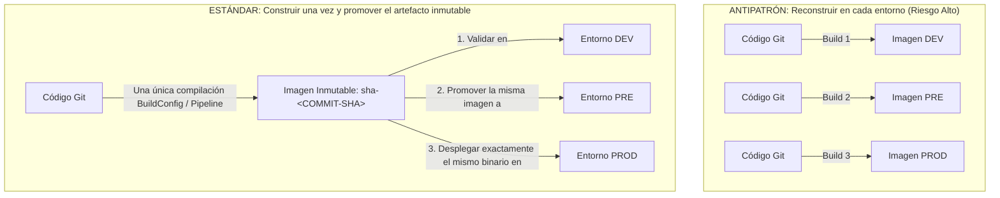
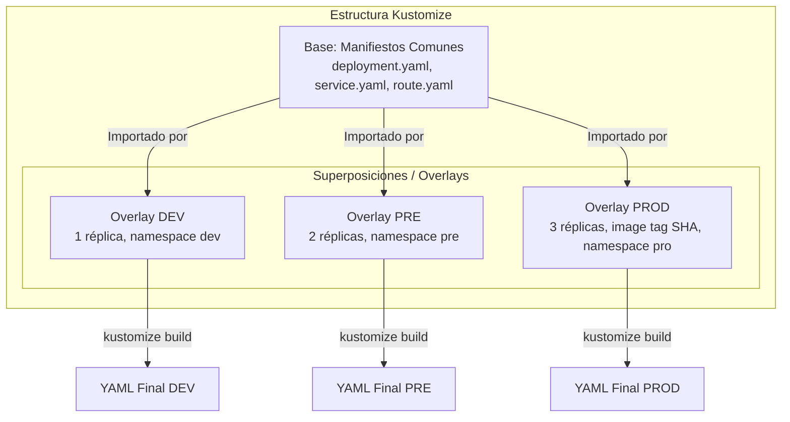
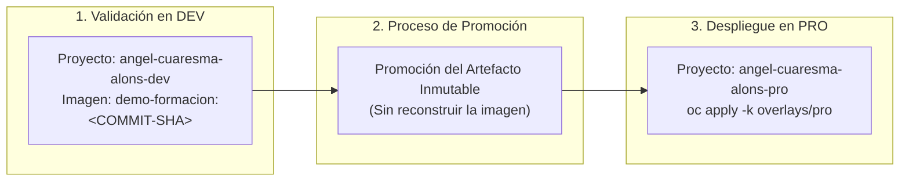

# 4.6 Promoción entre entornos: principio de construir una vez y promover el artefacto inmutable. Gestión de configuración por entorno con Kustomize (base y superposiciones) ★

## Objetivos de aprendizaje

Al finalizar este apartado serás capaz de:

- Comprender el principio fundamental de la **inmutabilidad del artefacto**: construir la imagen una sola vez y promover exactamente el mismo binario validado entre entornos.
- Justificar técnicamente por qué reconstruir código en cada entorno invalida las pruebas de calidad y vulnera los principios de entrega continua en entornos corporativos.
- Comprender qué es **Kustomize** y cómo funciona su arquitectura de **Base y Superposiciones (*Overlays*)**.
- Diseñar manifiestos declarativos sencillos para adaptar variables de entorno, réplicas, espacios de nombres e imágenes por cada etapa del ciclo de vida (`dev`, `pre`, `pro`) sin duplicar código YAML.
- Ejecutar una práctica de promoción promoviendo exactamente la misma imagen validada por su tag inmutable de Git Commit SHA al entorno de producción utilizando Kustomize.

---

## El principio fundamental: Construir una vez, promover el artefacto inmutable

En la gestión de aplicaciones tradicional era habitual compilar el código fuente en cada entorno: una compilación para el servidor de desarrollo, otra para preproducción y una última compilación ejecutable en los servidores de producción.

En la arquitectura de contenedores y plataformas como OpenShift, este comportamiento representa un antipatrón grave conocido como **reconstrucción por entorno**.



### ¿Por qué NUNCA se debe reconstruir una imagen para producción?

1. **Falta de determinismo:** Aunque utilices el mismo commit de Git, si la compilación ocurre en momentos diferentes, las dependencias de terceros (librerías npm, paquetes de lenguaje, imágenes base del sistema) pueden haber actualizado una versión menor o parche.
2. **Invalidación de pruebas:** La imagen que superó el control de calidad (*QA*) y las pruebas de rendimiento en preproducción **no es técnicamente la misma** que se ejecuta en producción si se ha vuelto a compilar.
3. **Pérdida de trazabilidad y auditoría:** Si surge un fallo crítico en el entorno productivo, no existe garantía absoluta de que el binario ejecutado corresponda exactamente con la versión homologada durante la fase de validación.

!!! tip "Inmutabilidad del artefacto"
    Un contenedor se empaqueta **una sola vez**. El artefacto binario resultante (la imagen identificada por su tag de **Commit SHA**) es **inmutable**. Lo que cambia de un entorno a otro no es la aplicación ni la imagen, sino la **configuración externa** que la acompaña (variables de entorno, bases de datos a las que se conecta, dominios y cuotas).

---

## Gestión de configuración por entorno con Kustomize

Si la imagen del contenedor es inmutable y no debe ser reconstruida para cada entorno, nos enfrentamos a un reto operativo: *¿Cómo adaptamos los puertos, el número de réplicas, las variables de entorno, las rutas DNS o las URLs de la base de datos para Desarrollo, Preproducción y Producción sin modificar la base común?*

La respuesta nativa en Kubernetes y OpenShift es **Kustomize**.



### ¿Qué es Kustomize?

Kustomize es una herramienta de gestión de configuración declarativa integrada directamente en el cliente nativo `kubectl` y `oc` (a través del comando `oc apply -k`).

A diferencia de otros gestores basados en plantillas con motores de sustitución de texto, Kustomize **no utiliza plantillas ni marcadores de posición (*placeholders*)**. En su lugar, utiliza el concepto de **Base y Superposiciones (*Overlays*)**:

1. **Base:** Contiene la definición pura y neutra de los recursos YAML de la aplicación (Deployment, Service, Route, ConfigMap), definidos una sola vez.
2. **Superposiciones (*Overlays*):** Contienen pequeñas reglas de modificación (parches) específicas para cada entorno (`dev`, `pre`, `pro`). Heredan el contenido de la `Base` y aplican únicamente las variaciones necesarias.

---

## Estructura de directorios de Kustomize

Un proyecto organizado con Kustomize utiliza una estructura de carpetas muy limpia donde se separan los recursos base de los overlays por entorno:

```text
kustomize/
├── base/
│   ├── deployment.yaml
│   ├── service.yaml
│   ├── route.yaml
│   └── kustomization.yaml
└── overlays/
    ├── dev/
    │   └── kustomization.yaml
    ├── pre/
    │   └── kustomization.yaml
    └── pro/
        └── kustomization.yaml
```

---

## Desglose técnico de componentes: Base y Overlays

### 1. El directorio `base/` (La definición común)

La carpeta `base/` contiene los manifiestos YAML estándar de la aplicación escritos en su forma más limpia. No incluyen valores específicos de ningún entorno (sin `namespace` acoplado ni réplicas fijas de producción).

#### `base/kustomization.yaml`:
```yaml
apiVersion: kustomize.config.k8s.io/v1beta1
kind: Kustomization

resources:
  - deployment.yaml
  - service.yaml
  - route.yaml
```

---

### 2. El directorio `overlays/` (Ejemplo simple: cambiar réplicas y etiquetas por entorno)

Cada subdirectorio dentro de `overlays/` importa la carpeta `base/` mediante una ruta relativa (`../../base`) y aplica únicamente las variaciones necesarias mediante parches declarativos sencillos.

#### Ejemplo 1: Entorno de Desarrollo (`overlays/dev/kustomization.yaml`)
En desarrollo fijamos el espacio de nombres de pruebas y establecemos **1 réplica**:

```yaml
apiVersion: kustomize.config.k8s.io/v1beta1
kind: Kustomization

# Asigna el namespace de desarrollo
namespace: angel-cuaresma-alons-dev

# Importa los archivos comunes de la base
resources:
  - ../../base

commonLabels:
  environment: development

# Parche sencillo: ajusta las réplicas a 1
patches:
  - target:
      kind: Deployment
      name: demo-formacion
    patch: |-
      - op: replace
        path: /spec/replicas
        value: 1
```

#### Ejemplo 2: Entorno de Producción (`overlays/pro/kustomization.yaml`)
En producción asignamos el espacio de nombres de producción, subimos la disponibilidad a **3 réplicas** y sustituimos la imagen por el **Git Commit SHA homologado** (`<COMMIT-SHA>`):

```yaml
apiVersion: kustomize.config.k8s.io/v1beta1
kind: Kustomization

# Asigna el namespace de producción
namespace: angel-cuaresma-alons-pro

# Importa los archivos comunes de la base
resources:
  - ../../base

commonLabels:
  environment: production

# Reemplaza la etiqueta de la imagen por el commit SHA inmutable correspondiente
images:
  - name: docker.io/ieftraining/demo-formacion
    newTag: "<COMMIT-SHA>"

# Parche sencillo: ajusta las réplicas a 3
patches:
  - target:
      kind: Deployment
      name: demo-formacion
    patch: |-
      - op: replace
        path: /spec/replicas
        value: 3
```

---

## Práctica N2: Promoción de una imagen validada a producción utilizando el Tag Commit SHA

En esta práctica vamos a simular el flujo completo de promoción corporativa. Tomaremos la imagen de nuestra aplicación validada en el entorno de desarrollo, identificada por su hash inmutable de Git Commit SHA (`<COMMIT-SHA>`), y la promocionaremos al proyecto de producción `angel-cuaresma-alons-pro` **sin volver a compilar el código fuente** mediante Kustomize.



---

### Paso 1: Preparar la estructura de Kustomize en local

Crea una carpeta de trabajo local en tu terminal con la siguiente estructura de archivos:

```bash
mkdir -p promocion-app/base promocion-app/overlays/pro
cd promocion-app
```

#### 1. Crear el manifiesto base `base/deployment.yaml`:
```yaml
apiVersion: apps/v1
kind: Deployment
metadata:
  name: demo-formacion
spec:
  replicas: 1
  selector:
    matchLabels:
      app: demo-formacion
  template:
    metadata:
      labels:
        app: demo-formacion
    spec:
      containers:
        - name: demo-formacion
          image: docker.io/ieftraining/demo-formacion:latest
          ports:
            - containerPort: 8080
```

#### 2. Crear el servicio base `base/service.yaml`:
```yaml
apiVersion: v1
kind: Service
metadata:
  name: demo-formacion
spec:
  selector:
    app: demo-formacion
  ports:
    - port: 8080
      targetPort: 8080
```

#### 3. Crear la configuración base `base/kustomization.yaml`:
```yaml
apiVersion: kustomize.config.k8s.io/v1beta1
kind: Kustomization

resources:
  - deployment.yaml
  - service.yaml
```

---

### Paso 2: Definir el Overlay de Producción con la imagen inmutable

Configuraremos el overlay de producción para que reemplace la etiqueta genérica por la etiqueta de commit SHA validada (`<COMMIT-SHA>`) y aumente el número de réplicas a 2.

Crea el archivo `overlays/pro/kustomization.yaml`:

```yaml
apiVersion: kustomize.config.k8s.io/v1beta1
kind: Kustomization

namespace: angel-cuaresma-alons-pro

resources:
  - ../../base

# Reemplaza dinámicamente la imagen base por la versión homologada por commit
images:
  - name: docker.io/ieftraining/demo-formacion
    newTag: "<COMMIT-SHA>"

# Inyecta parches para adaptar la disponibilidad en Producción
patches:
  - target:
      kind: Deployment
      name: demo-formacion
    patch: |-
      - op: replace
        path: /spec/replicas
        value: 2
```

---

### Paso 3: Inspeccionar la transformación con `oc kustomize`

Antes de aplicar los cambios en el clúster, podemos previsualizar el manifiesto YAML completo que generará Kustomize mediante el comando de inspección:

```bash
oc kustomize overlays/pro
```

*Verificación de la salida:* Comprueba que el YAML resultante asigna el namespace `angel-cuaresma-alons-pro`, define `replicas: 2` y la imagen apunta exactamente a `docker.io/ieftraining/demo-formacion:<COMMIT-SHA>`.

---

### Paso 4: Desplegar en el proyecto de Producción (`oc apply -k`)

Despliega la aplicación configurada en el namespace productivo ejecutando el comando declarativo:

```bash
oc apply -k overlays/pro
```

Salida esperada de la CLI:
```text
namespace/angel-cuaresma-alons-pro configured
service/demo-formacion created
deployment.apps/demo-formacion created
```

Verificamos el progreso del despliegue en el entorno de producción:

```bash
oc rollout status deployment/demo-formacion --namespace=angel-cuaresma-alons-pro
```

Comprobamos los Pods en ejecución para validar que las réplicas están utilizando el tag SHA promovido:

```bash
oc get pods -n angel-cuaresma-alons-pro -l app=demo-formacion -o wide
```

---

## Ideas clave para recordar

!!! tip "Resumen"
    - **Inmutabilidad del artefacto:** La imagen del contenedor se construye una sola vez y se promueve entre entornos sin volver a compilar el código.
    - **Prohibido reconstruir para producción:** Reconstruir la imagen invalida las pruebas de calidad previas y rompe el determinismo del binario.
    - Usa siempre el **Git Commit SHA** (`<COMMIT-SHA>`) como etiqueta inmutable para identificar las versiones homologadas que se promocionan a producción.
    - **Kustomize** gestiona las diferencias entre entornos separando los recursos comunes en una **Base** y aplicando modificaciones mediante **Superposiciones (*Overlays*)**, evitando la duplicación de código YAML.
    - Los **overlays** (`dev`, `pre`, `pro`) heredan de la base e introducen parches específicos de configuración, namespace, réplicas y etiquetas.
    - La directiva **`images`** dentro del `kustomization.yaml` de un overlay permite actualizar la versión del contenedor de forma declarativa sin alterar los manifiestos base.
    - La ejecución de **`oc apply -k`** procesa la carpeta de Kustomize y aplica las transformaciones de forma atómica y declarativa sobre la API de OpenShift.