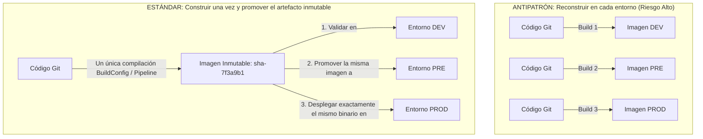
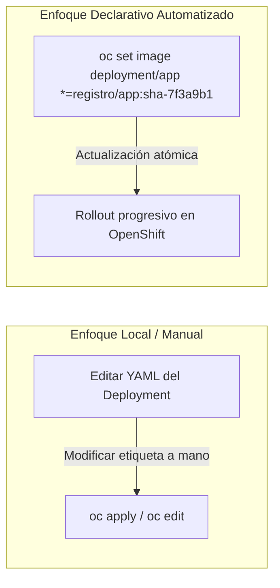
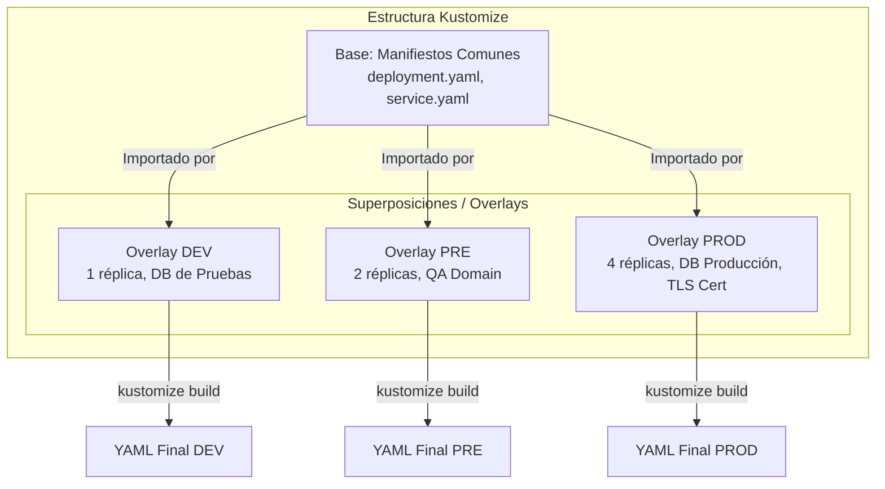
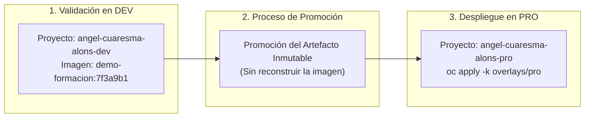

# 4.6 Promoción entre entornos: construir una vez y gestionar la configuración

## Objetivos de aprendizaje

Al finalizar este apartado serás capaz de:

- Comprender el principio fundamental de la **inmutabilidad del artefacto**: construir la imagen una sola vez y promover exactamente el mismo binario validado entre entornos.
- Justificar técnicamente por qué reconstruir código en cada entorno invalida las pruebas de calidad y vulnera los principios de entrega continua en entornos corporativos.
- Diferenciar el uso de `oc set image` como mecanismo de actualización explícita frente a modificaciones locales en el código fuente o en la plantilla del despliegue.
- Diseñar y estructurar la gestión de configuración multinavegador (*Multi-tenancy*) utilizando **Kustomize** mediante el patrón de **Base y Superposiciones (*Overlays*)**.
- Aplicar parches declarativos para adaptar recursos (variables de entorno, réplicas, cuotas y nombres de dominio) a cada etapa del ciclo de vida (`dev`, `pre`, `pro`) sin duplicar manifiestos YAML.
- Ejecutar una práctica de promoción promoviendo exactamente la misma imagen validada por su tag inmutable de Git Commit SHA al entorno de producción.

---

## El principio fundamental: Construir una vez, promover el artefacto inmutable

En el desarrollo de software tradicional era habitual compilar el código fuente en cada entorno: una compilación para el servidor de desarrollo, otra para preproducción y una última compilación ejecutable en los servidores de producción.

En la arquitectura de contenedores y plataformas como OpenShift, este comportamiento representa un antipatrón grave conocido como **reconstrucción por entorno**.



### ¿Por qué NUNCA se debe reconstruir una imagen para producción?

1. **Falta de determinismo:** Aunque utilices el mismo commit de Git, si la compilación ocurre en momentos diferentes, las dependencias de terceros (librerías npm, paquetes de lenguaje, imágenes base del sistema) pueden haber actualizado una versión menor o parche.
2. **Invalidación de pruebas:** La imagen que superó el control de calidad (*QA*) y las pruebas de rendimiento en preproducción **no es técnicamente la misma** que se ejecuta en producción si se ha vuelto a compilar.
3. **Pérdida de trazabilidad y auditoría:** Si surge un fallo crítico en el entorno productivo, no existe garantía absoluta de que el binario ejecutado corresponda exactamente con la versión homologada durante la fase de validación.

!!! tip "Inmutabilidad del artefacto"
    Un contenedor se empaqueta **una sola vez**. El artefacto binario resultante (la imagen identificada por su tag de **Commit SHA**) es **inmutable**. Lo que cambia de un entorno a otro no es la aplicación ni la imagen, sino la **configuración externa** que la acompaña (variables de entorno, bases de datos a las que se conecta, dominios y cuotas).

---

## Mecanismos de actualización: `oc set image` frente al cambio técnico local

Cuando una nueva versión de la aplicación ha sido empaquetada e inspeccionada en el registro corporativo (como vimos en los apartados 4.4 y 4.5), es necesario actualizar las cargas de trabajo en OpenShift para que utilicen el nuevo artefacto.

Existen dos enfoques claramente diferenciados para realizar este cambio:



### 1. El cambio técnico local (Edición directa de manifiestos)

Consiste en modificar manualmente el campo `spec.template.spec.containers[].image` en el fichero YAML local o mediante `oc edit deployment`.

- **Inconvenientes:** Es propenso a errores humanos, no deja un registro claro de la causa del cambio en los eventos del clúster y dificulta la automatización dentro de pipelines de CI/CD.

### 2. Actualización imperativa declarativa con `oc set image`

El comando `oc set image` permite actualizar de manera atómica y transparente el puntero de la imagen en un `Deployment` o `DeploymentConfig` sin necesidad de redefinir o tocar el resto de la estructura del manifiesto.

```bash
oc set image deployment/demo-formacion *=docker.io/ieftraining/demo-formacion:7f3a9b1 \
  --namespace=angel-cuaresma-alons-pro
```

- **Uso del comodín (`*=`):** El operador `*=` indica a OpenShift que actualice la imagen de todos los contenedores definidos dentro del `Deployment`, garantizando que la nueva referencia de imagen identificada por su SHA se aplique de inmediato.
- **Transición sin interrupción:** OpenShift inicia automáticamente un proceso de despliegue progresivo (*RollingUpdate*), creando los nuevos Pods con la nueva imagen y deteniendo los antiguos solo cuando los nuevos han superado las sondas de salud (*readiness probes*).

---

## Gestión de configuración por entorno con Kustomize

Si la imagen del contenedor es inmutable y no debe ser reconstruida para cada entorno, nos enfrentamos a un reto operativo: *¿Cómo adaptamos los puertos, el número de réplicas, las variables de entorno, las rutas DNS o las URLs de la base de datos para Desarrollo, Preproducción y Producción?*

La respuesta nativa en Kubernetes y OpenShift es **Kustomize**.



### ¿Qué es Kustomize y qué resuelve?

Kustomize es una herramienta de gestión de configuración declarativa integrada directamente en el cliente nativo `kubectl` y `oc` (a través del comando `oc apply -k`).

A diferencia de otros gestores basados en plantillas con motores de sustitución de texto (como Helm), Kustomize **no utiliza plantillas ni marcadores de posición (*placeholders*)**. En su lugar, utiliza el concepto de **Base y Superposiciones (*Overlays*)**:

1. **Base:** Contiene la definición pura y neutra de los recursos YAML de la aplicación (Deployment, Service, Route, ConfigMap), definidos una sola vez.
2. **Superposiciones (*Overlays*):** Contiene pequeñas reglas de modificación (parches) específicas para cada entorno (`dev`, `pre`, `pro`). Heredan el contenido de la `Base` y aplican únicamente las variaciones necesarias.

---

## Anatomía de un proyecto estructurado con Kustomize

Para organizar un proyecto de forma limpia y escalable, se aplica la siguiente jerarquía de archivos y directorios en el repositorio de código de la aplicación:

```text
kustomize/
├── base/
│   ├── deployment.yaml
│   ├── service.yaml
│   ├── route.yaml
│   └── kustomization.yaml
└── overlays/
    ├── dev/
    │   ├── kustomization.yaml
    │   └── configmap-dev.yaml
    ├── pre/
    │   ├── kustomization.yaml
    │   └── patch-replicas.yaml
    └── pro/
        ├── kustomization.yaml
        ├── patch-pro.yaml
        └── route-pro.yaml
```

---

## Desglose de componentes: Base y Overlays

### 1. El directorio `base/`

Contiene los manifiestos YAML estándar sin valores acoplados a ningún entorno específico, acompañados de un fichero central `kustomization.yaml`:

#### `base/kustomization.yaml`:
```yaml
apiVersion: kustomize.config.k8s.io/v1beta1
kind: Kustomization

resources:
  - deployment.yaml
  - service.yaml
  - route.yaml
```

---

### 2. El directorio `overlays/dev/`

En el entorno de Desarrollo priman la agilidad y el ahorro de recursos. Se configura una única réplica y un espacio de nombres local.

#### `overlays/dev/kustomization.yaml`:
```yaml
apiVersion: kustomize.config.k8s.io/v1beta1
kind: Kustomization

# Define el espacio de nombres de destino
namespace: angel-cuaresma-alons-dev

# Apunta a la definición común neutra
resources:
  - ../../base

# Inyecta un sufijo o prefijo a los nombres para evitar colisiones
namePrefix: dev-

# Aplica etiquetas comunes a todos los objetos creados
commonLabels:
  environment: development

# Parches rápidos sobre los recursos base
patches:
  - target:
      kind: Deployment
      name: demo-formacion
    patch: |-
      - op: replace
        path: /spec/replicas
        value: 1
```

---

### 3. El directorio `overlays/pro/`

En el entorno de Producción se aplican configuraciones de alta disponibilidad: múltiples réplicas, certificados corporativos, variables de conexión seguras y etiquetas de entorno productivo.

#### `overlays/pro/kustomization.yaml`:
```yaml
apiVersion: kustomize.config.k8s.io/v1beta1
kind: Kustomization

namespace: angel-cuaresma-alons-pro

resources:
  - ../../base

commonLabels:
  environment: production
  tier: frontend

# Sobrescribe la imagen base utilizando la etiqueta inmutable de commit SHA
images:
  - name: docker.io/ieftraining/demo-formacion
    newTag: 7f3a9b1

# Aplica parches detallados declarados en archivos independientes
patches:
  - path: patch-pro.yaml
```

#### Fichero de parche específico `overlays/pro/patch-pro.yaml`:
```yaml
apiVersion: apps/v1
kind: Deployment
metadata:
  name: demo-formacion
spec:
  replicas: 3
  template:
    spec:
      containers:
        - name: demo-formacion
          resources:
            requests:
              cpu: "200m"
              memory: "256Mi"
            limits:
              cpu: "1"
              memory: "512Mi"
```

---

## Comparativa: Gestión de configuración con Kustomize frente a Helm

En el ecosistema de Kubernetes/OpenShift existen dos herramientas predominantes para empaquetar y gestionar configuraciones. Comprender sus diferencias ayuda a seleccionar la solución adecuada según el caso de uso:

| Criterio | Kustomize (Mecanismo recomendado para apps propias) | Helm (Gestor de paquetes de terceros) |
| :--- | :--- | :--- |
| **Enfoque principal** | **Parches declarativos sobre YAMLs puros.** | Motor de plantillas (*Templating*) con lenguaje Go. |
| **Transformación de archivos** | No altera los ficheros base; aplica superposiciones (*overlays*). | Sustituye variables (`{{ .Values.var }}`) en archivos `.tpl`. |
| **Complejidad de lectura** | **Baja:** Los archivos YAML son válidos por sí mismos. | Media-Alta: El exceso de lógica condicional complica la lectura. |
| **Integración con `oc` / `kubectl`** | **Nativa:** Incluido de serie mediante `oc apply -k`. | Requiere instalar el binario de CLI `helm` cliente. |
| **Caso de uso ideal** | **Promoción entre entornos de aplicaciones propias.** | Despliegue de software comercial o COTS de terceros (ej. bases de datos, operadores). |

---

## Práctica N2: Promoción de una imagen validada a producción utilizando el Tag Commit SHA

En esta práctica vamos a simular el flujo completo de promoción corporativa. Tomaremos la imagen de nuestra aplicación validada en el entorno de desarrollo, identificada por su hash inmutable de Git Commit SHA (`7f3a9b1`), y la promocionaremos al proyecto de producción `angel-cuaresma-alons-pro` **sin volver a compilar el código fuente**.



---

### Paso 1: Preparar la estructura de Kustomize en local

Crea una carpeta de trabajo local en tu terminal con la siguiente estructura de archivos:

```bash
mkdir -p promocion-app/base promocion-app/overlays/pro
cd promocion-app
```

#### 1. Crear el manifiesto base `base/deployment.yaml`:
```yaml
apiVersion: apps/v1
kind: Deployment
metadata:
  name: demo-formacion
spec:
  replicas: 1
  selector:
    matchLabels:
      app: demo-formacion
  template:
    metadata:
      labels:
        app: demo-formacion
    spec:
      containers:
        - name: demo-formacion
          image: docker.io/ieftraining/demo-formacion:latest
          ports:
            - containerPort: 8080
```

#### 2. Crear el servicio base `base/service.yaml`:
```yaml
apiVersion: v1
kind: Service
metadata:
  name: demo-formacion
spec:
  selector:
    app: demo-formacion
  ports:
    - port: 8080
      targetPort: 8080
```

#### 3. Crear la configuración base `base/kustomization.yaml`:
```yaml
apiVersion: kustomize.config.k8s.io/v1beta1
kind: Kustomization

resources:
  - deployment.yaml
  - service.yaml
```

---

### Paso 2: Definir el Overlay de Producción con la imagen inmutable

Configuraremos el overlay de producción para que reemplace la etiqueta genérica por la etiqueta de commit SHA validada (`7f3a9b1`) y aumente el número de réplicas a 2.

Crea el archivo `overlays/pro/kustomization.yaml`:

```yaml
apiVersion: kustomize.config.k8s.io/v1beta1
kind: Kustomization

namespace: angel-cuaresma-alons-pro

resources:
  - ../../base

# Reemplaza dinámicamente la imagen base por la versión homologada por commit
images:
  - name: docker.io/ieftraining/demo-formacion
    newTag: "7f3a9b1"

# Inyecta parches para adaptar la disponibilidad en Producción
patches:
  - target:
      kind: Deployment
      name: demo-formacion
    patch: |-
      - op: replace
        path: /spec/replicas
        value: 2
```

---

### Paso 3: Inspeccionar la transformación con `oc kustomize`

Antes de aplicar los cambios en el clúster, podemos previsualizar el manifiesto YAML completo que generará Kustomize mediante el comando de inspección:

```bash
oc kustomize overlays/pro
```

*Verificación de la salida:* Comprueba que el YAML resultante asigna el namespace `angel-cuaresma-alons-pro`, define `replicas: 2` y la imagen apunta exactamente a `docker.io/ieftraining/demo-formacion:7f3a9b1`.

---

### Paso 4: Desplegar en el proyecto de Producción (`oc apply -k`)

Despliega la aplicación configurada en el namespace productivo ejecutando el comando declarativo:

```bash
oc apply -k overlays/pro
```

Salida esperada de la CLI:
```text
namespace/angel-cuaresma-alons-pro configured
service/demo-formacion created
deployment.apps/demo-formacion created
```

---

### Paso 5: Promoción caliente alternativa mediante `oc set image`

Si el Deployment ya existe en producción y la plataforma requiere promover una nueva revisión de forma inmediata desde la CLI sin modificar los ficheros locales de Kustomize, se ejecuta la orden imperativa de promoción:

```bash
oc set image deployment/demo-formacion *=docker.io/ieftraining/demo-formacion:7f3a9b1 \
  --namespace=angel-cuaresma-alons-pro
```

Verificamos el progreso del despliegue en el entorno de producción:

```bash
oc rollout status deployment/demo-formacion --namespace=angel-cuaresma-alons-pro
```

Comprobamos los Pods en ejecución para validar que ambas réplicas están utilizando el tag SHA promovido:

```bash
oc get pods -n angel-cuaresma-alons-pro -l app=demo-formacion -o wide
```

---

## Ideas clave para recordar

!!! tip "Resumen"
    - **Inmutabilidad del artefacto:** La imagen del contenedor se construye una sola vez y se promueve entre entornos sin volver a compilar el código.
    - **Prohibido reconstruir para producción:** Reconstruir la imagen invalida las pruebas de calidad previas y rompe el determinismo del binario.
    - Usa siempre el **Git Commit SHA** como etiqueta inmutable para identificar las versiones homologadas que se promocionan a producción.
    - **`oc set image`** permite actualizar la referencia de la imagen en un `Deployment` de forma atómica y transparente, desencadenando un despliegue progresivo (*RollingUpdate*).
    - **Kustomize** gestiona las diferencias entre entornos mediante el patrón **Base y Superposiciones (*Overlays*)**, evitando la duplicación de manifiestos YAML.
    - La carpeta **`base/`** declara los recursos neutros comunes; los subdirectorios **`overlays/`** aplican parches específicos para `dev`, `pre` y `pro`.
    - La directiva **`images`** dentro del `kustomization.yaml` de un overlay permite actualizar la versión del contenedor de forma declarativa sin alterar los manifiestos base.
    - La ejecución de **`oc apply -k`** procesa la carpeta de Kustomize y aplica las transformaciones directamente sobre la API de OpenShift.