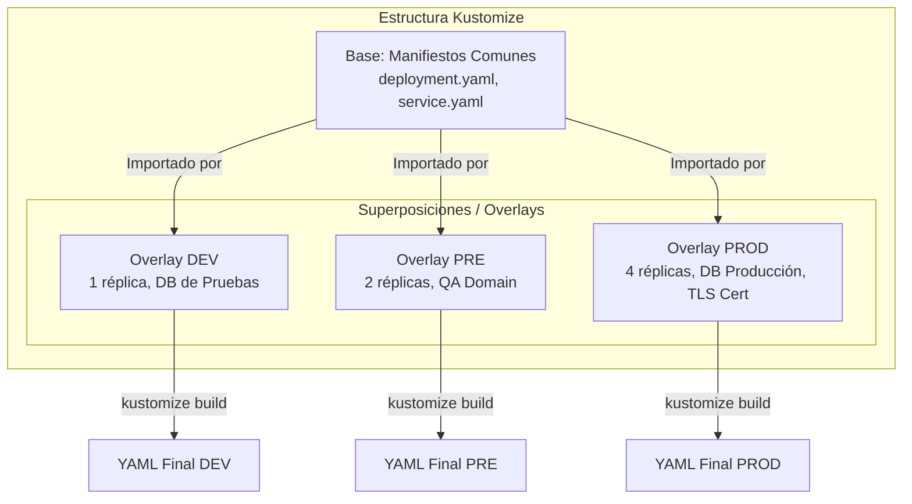
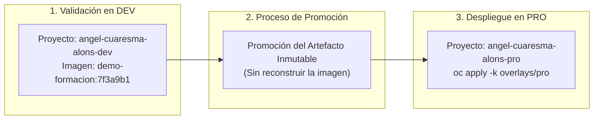

# 4.6 Promoción entre entornos: principio de construir una vez y promover el artefacto inmutable. Diferenciación de oc set image como mecanismo de promoción frente al cambio técnico local; gestión de configuración por entorno con Kustomize (base y superposiciones) ★

## Objetivos de aprendizaje

Al finalizar este apartado serás capaz de:

- Comprender el principio fundamental de la **inmutabilidad del artefacto**: construir la imagen una sola vez y promover exactamente el mismo binario validado entre entornos.
- Justificar técnicamente por qué reconstruir código en cada entorno invalida las pruebas de calidad y vulnera los principios de entrega continua en entornos corporativos.
- Diferenciar el uso imperativo de `oc set image` como mecanismo puntual de actualización frente a la gestión declarativa y trazable con **Kustomize**.
- Diseñar y estructurar la gestión de configuración multi-entorno utilizando **Kustomize** mediante el patrón de **Base y Superposiciones (*Overlays*)**.
- Aplicar parches declarativos para adaptar recursos (variables de entorno, réplicas, cuotas y nombres de dominio) a cada etapa del ciclo de vida (`dev`, `pre`, `pro`) sin duplicar manifiestos YAML.
- Ejecutar una práctica de promoción promoviendo exactamente la misma imagen validada por su tag inmutable de Git Commit SHA al entorno de producción utilizando Kustomize.

---

## El principio fundamental: Construir una vez, promover el artefacto inmutable

En la gestión de aplicaciones tradicional era habitual compilar el código fuente en cada entorno: una compilación para el servidor de desarrollo, otra para preproducción y una última compilación ejecutable en los servidores de producción.

En la arquitectura de contenedores y plataformas como OpenShift, este comportamiento representa un antipatrón grave conocido como **reconstrucción por entorno**.


### ¿Por qué NUNCA se debe reconstruir una imagen para producción?

1. **Falta de determinismo:** Aunque utilices el mismo commit de Git, si la compilación ocurre en momentos diferentes, las dependencias de terceros (librerías npm, paquetes de lenguaje, imágenes base del sistema) pueden haber actualizado una versión menor o parche.
2. **Invalidación de pruebas:** La imagen que superó el control de calidad (*QA*) y las pruebas de rendimiento en preproducción **no es técnicamente la misma** que se ejecuta en producción si se ha vuelto a compilar.
3. **Pérdida de trazabilidad y auditoría:** Si surge un fallo crítico en el entorno productivo, no existe garantía absoluta de que el binario ejecutado corresponda exactamente con la versión homologada durante la fase de validación.

!!! tip "Inmutabilidad del artefacto"
    Un contenedor se empaqueta **una sola vez**. El artefacto binario resultante (la imagen identificada por su tag de **Commit SHA**) es **inmutable**. Lo que cambia de un entorno a otro no es la aplicación ni la imagen, sino la **configuración externa** que la acompaña (variables de entorno, bases de datos a las que se conecta, dominios y cuotas).

---

## Estrategias de actualización: `oc set image` vs. Kustomize (Declarativo)

A la hora de actualizar la versión de una imagen en un entorno, existen dos enfoques técnicos con propósitos muy distintos:

| Criterio | `oc set image` (Imperativo / Imperfecto) | Kustomize / GitOps (Declarativo / Recomendado) |
| :--- | :--- | :--- |
| **Enfoque** | Imperativo (orden directa a la API de OpenShift) | Declarativo (definición del estado deseado en Git) |
| **Persistencia** | Se aplica solo en el clúster vivo; no queda reflejado en el repositorio Git | Queda registrado en el archivo `kustomization.yaml` mediante un commit |
| **Uso principal** | Pruebas rápidas, parches de emergencia o llamadas desde pipelines scripts | Gestión de la configuración corporativa multi-entorno |
| **Trazabilidad** | Baja (requiere auditar eventos del clúster) | Alta (historial de commits en Git) |
| **Recuperación (Rollback)** | Manual mediante `oc rollout undo` | Revertir el commit en Git y reaplicar con `oc apply -k` |

```bash
# Ejemplo de actualización imperativa puntual (no declarativa):
oc set image deployment/demo-formacion demo-formacion=docker.io/ieftraining/demo-formacion:7f3a9b1 -n angel-cuaresma-alons-pro
```

!!! warning "Cuándo evitar `oc set image` en producción"
    Aunque `oc set image` es muy útil para automatizar cambios rápidos dentro de una Pipeline CI/CD, si el clúster se recrea o si se vuelve a aplicar el YAML original, la actualización imperativa se perderá ("deriva de configuración" o *configuration drift*). Por eso, la promoción corporativa se gestiona versionando la etiqueta en manifiestos declarativos mediante **Kustomize**.

---

## Gestión de configuración por entorno con Kustomize

Kustomize resuelve la gestión multi-entorno separando los recursos en dos bloques lógicos: la **Base** (lo común y compartido) y las **Superposiciones u Overlays** (lo específico de cada entorno).



### ¿Qué es Kustomize y qué resuelve?

Kustomize es una herramienta de gestión de configuración declarativa integrada directamente en el cliente nativo `kubectl` y `oc` (a través del comando `oc apply -k`).

A diferencia de otros gestores basados en plantillas con motores de sustitución de texto, Kustomize **no utiliza plantillas ni marcadores de posición (*placeholders*)**. En su lugar, utiliza el concepto de **Base y Superposiciones (*Overlays*)**:

1. **Base:** Contiene la definición pura y neutra de los recursos YAML de la aplicación (Deployment, Service, Route, ConfigMap), definidos una sola vez.
2. **Superposiciones (*Overlays*):** Contienen pequeñas reglas de modificación (parches) específicas para cada entorno (`dev`, `pre`, `pro`). Heredan el contenido de la `Base` y aplican únicamente las variaciones necesarias.

---

## Anatomía de un proyecto estructurado con Kustomize

Para organizar un proyecto de forma limpia y escalable, se aplica la siguiente jerarquía de archivos y directorios en el repositorio de código de la aplicación:

```text
kustomize/
├── base/
│   ├── deployment.yaml
│   ├── service.yaml
│   ├── route.yaml
│   └── kustomization.yaml
└── overlays/
    ├── dev/
    │   ├── kustomization.yaml
    │   └── configmap-dev.yaml
    ├── pre/
    │   ├── kustomization.yaml
    │   └── patch-replicas.yaml
    └── pro/
        ├── kustomization.yaml
        ├── patch-pro.yaml
        └── route-pro.yaml
```

---

## Desglose técnico de componentes: Base y Overlays

### 1. El directorio `base/` (La definición común)
La base contiene los manifiestos estándar de la aplicación (como `deployment.yaml`, `service.yaml`, etc.) escritos en su forma más pura y neutra.
- **Características técnicas:** 
  - No incluyen valores acoplados a ningún entorno (no especifican un `namespace` concreto, ni nombres con sufijos de entorno, ni recursos específicos de producción).
  - Actúan como el modelo estándar que cualquier entorno utilizará como punto de partida.
- **El archivo `kustomization.yaml` de la base:** Funciona como un índice que simplemente lista qué ficheros componen esa base para que Kustomize sepa qué recursos debe leer.

#### `base/kustomization.yaml`:
```yaml
apiVersion: kustomize.config.k8s.io/v1beta1
kind: Kustomization

resources:
  - deployment.yaml
  - service.yaml
  - route.yaml
```

---

### 2. El directorio `overlays/` (Las adaptaciones por entorno)
Los *overlays* son subdirectorios creados específicamente para cada etapa del ciclo de vida (`dev`, `pre`, `pro`). En lugar de duplicar todo el código, cada overlay contiene únicamente las diferencias o **parches** que aplican a ese entorno en particular.

* **Overlay de Desarrollo (`overlays/dev/`):**
  - Define el espacio de nombres de pruebas (`namespace: angel-cuaresma-alons-dev`).
  - Añade prefijos a los nombres de los recursos (ej. `namePrefix: dev-`) para evitar colisiones si conviven varias versiones en el mismo clúster.
  - Modifica propiedades puntuales mediante parches directos, como reducir las réplicas del Deployment a `1` para ahorrar recursos de cómputo.

#### `overlays/dev/kustomization.yaml`:
```yaml
apiVersion: kustomize.config.k8s.io/v1beta1
kind: Kustomization

# Define el espacio de nombres de destino
namespace: angel-cuaresma-alons-dev

# Apunta a la definición común neutra
resources:
  - ../../base

# Inyecta un sufijo o prefijo a los nombres para evitar colisiones
namePrefix: dev-

# Aplica etiquetas comunes a todos los objetos creados
commonLabels:
  environment: development

# Parches rápidos sobre los recursos base
patches:
  - target:
      kind: Deployment
      name: demo-formacion
    patch: |-
      - op: replace
        path: /spec/replicas
        value: 1
```

* **Overlay de Producción (`overlays/pro/`):**
  - Define el espacio de nombres productivo (`namespace: angel-cuaresma-alons-pro`).
  - Sobrescribe de forma declarativa la imagen del contenedor utilizando la etiqueta inmutable de commit SHA (mediante la directiva `images:`).
  - Aplica parches estructurados (en ficheros independientes como `patch-pro.yaml`) para escalar las réplicas a un número mayor (ej. `replicas: 3`) y ajustar los recursos de CPU y memoria requeridos por la aplicación.

#### `overlays/pro/kustomization.yaml`:
```yaml
apiVersion: kustomize.config.k8s.io/v1beta1
kind: Kustomization

namespace: angel-cuaresma-alons-pro

resources:
  - ../../base

commonLabels:
  environment: production
  tier: frontend

# Sobrescribe la imagen base utilizando la etiqueta inmutable de commit SHA
images:
  - name: docker.io/ieftraining/demo-formacion
    newTag: 7f3a9b1

# Aplica parches detallados declarados en archivos independientes
patches:
  - path: patch-pro.yaml
```

#### Fichero de parche específico `overlays/pro/patch-pro.yaml`:
```yaml
apiVersion: apps/v1
kind: Deployment
metadata:
  name: demo-formacion
spec:
  replicas: 3
  template:
    spec:
      containers:
        - name: demo-formacion
          resources:
            requests:
              cpu: "200m"
              memory: "256Mi"
            limits:
              cpu: "1"
              memory: "512Mi"
```

---

## Práctica N2: Promoción de una imagen validada a producción utilizando el Tag Commit SHA

En esta práctica vamos a simular el flujo completo de promoción corporativa. Tomaremos la imagen de nuestra aplicación validada en el entorno de desarrollo, identificada por su hash inmutable de Git Commit SHA (`7f3a9b1`), y la promocionaremos al proyecto de producción `angel-cuaresma-alons-pro` **sin volver a compilar el código fuente** mediante Kustomize.



---

### Paso 1: Preparar la estructura de Kustomize en local

Crea una carpeta de trabajo local en tu terminal con la siguiente estructura de archivos:

```bash
mkdir -p promocion-app/base promocion-app/overlays/pro
cd promocion-app
```

#### 1. Crear el manifiesto base `base/deployment.yaml`:
```yaml
apiVersion: apps/v1
kind: Deployment
metadata:
  name: demo-formacion
spec:
  replicas: 1
  selector:
    matchLabels:
      app: demo-formacion
  template:
    metadata:
      labels:
        app: demo-formacion
    spec:
      containers:
        - name: demo-formacion
          image: docker.io/ieftraining/demo-formacion:latest
          ports:
            - containerPort: 8080
```

#### 2. Crear el servicio base `base/service.yaml`:
```yaml
apiVersion: v1
kind: Service
metadata:
  name: demo-formacion
spec:
  selector:
    app: demo-formacion
  ports:
    - port: 8080
      targetPort: 8080
```

#### 3. Crear la configuración base `base/kustomization.yaml`:
```yaml
apiVersion: kustomize.config.k8s.io/v1beta1
kind: Kustomization

resources:
  - deployment.yaml
  - service.yaml
```

---

### Paso 2: Definir el Overlay de Producción con la imagen inmutable

Configuraremos el overlay de producción para que reemplace la etiqueta genérica por la etiqueta de commit SHA validada (`7f3a9b1`) y aumente el número de réplicas a 2.

Crea el archivo `overlays/pro/kustomization.yaml`:

```yaml
apiVersion: kustomize.config.k8s.io/v1beta1
kind: Kustomization

namespace: angel-cuaresma-alons-pro

resources:
  - ../../base

# Reemplaza dinámicamente la imagen base por la versión homologada por commit
images:
  - name: docker.io/ieftraining/demo-formacion
    newTag: "7f3a9b1"

# Inyecta parches para adaptar la disponibilidad en Producción
patches:
  - target:
      kind: Deployment
      name: demo-formacion
    patch: |-
      - op: replace
        path: /spec/replicas
        value: 2
```

---

### Paso 3: Inspeccionar la transformación con `oc kustomize`

Antes de aplicar los cambios en el clúster, podemos previsualizar el manifiesto YAML completo que generará Kustomize mediante el comando de inspección:

```bash
oc kustomize overlays/pro
```

*Verificación de la salida:* Comprueba que el YAML resultante asigna el namespace `angel-cuaresma-alons-pro`, define `replicas: 2` y la imagen apunta exactamente a `docker.io/ieftraining/demo-formacion:7f3a9b1`.

---

### Paso 4: Desplegar en el proyecto de Producción (`oc apply -k`)

Despliega la aplicación configurada en el namespace productivo ejecutando el comando declarativo:

```bash
oc apply -k overlays/pro
```

Salida esperada de la CLI:
```text
namespace/angel-cuaresma-alons-pro configured
service/demo-formacion created
deployment.apps/demo-formacion created
```

Verificamos el progreso del despliegue en el entorno de producción:

```bash
oc rollout status deployment/demo-formacion --namespace=angel-cuaresma-alons-pro
```

Comprobamos los Pods en ejecución para validar que las réplicas están utilizando el tag SHA promovido:

```bash
oc get pods -n angel-cuaresma-alons-pro -l app=demo-formacion -o wide
```

---

## Ideas clave para recordar

!!! tip "Resumen"
    - **Inmutabilidad del artefacto:** La imagen del contenedor se construye una sola vez y se promueve entre entornos sin volver a compilar el código.
    - **Prohibido reconstruir para producción:** Reconstruir la imagen invalida las pruebas de calidad previas y rompe el determinismo del binario.
    - **Diferencia técnica:** `oc set image` realiza un cambio imperativo e inmediato en el clúster, mientras que **Kustomize** ofrece un control declarativo, versionado y trazable en Git.
    - Usa siempre el **Git Commit SHA** como etiqueta inmutable para identificar las versiones homologadas que se promocionan a producción.
    - **Kustomize** gestiona las diferencias entre entornos separando los recursos comunes en una **Base** y aplicando modificaciones mediante **Superposiciones (*Overlays*)**, evitando la duplicación de código YAML.
    - Los **overlays** (`dev`, `pre`, `pro`) heredan de la base e introducen parches específicos de configuración, namespace, réplicas y etiquetas.
    - La directiva **`images`** dentro del `kustomization.yaml` de un overlay permite actualizar la versión del contenedor de forma declarativa sin alterar los manifiestos base.
    - La ejecución de **`oc apply -k`** procesa la carpeta de Kustomize y aplica las transformaciones de forma atómica y declarativa sobre la API de OpenShift.