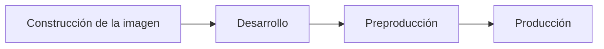
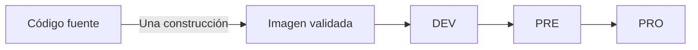
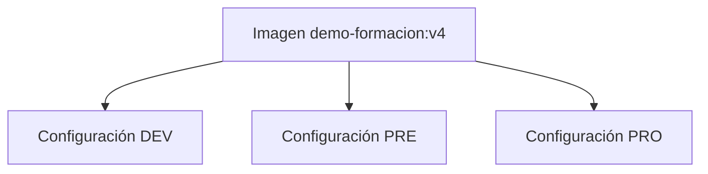
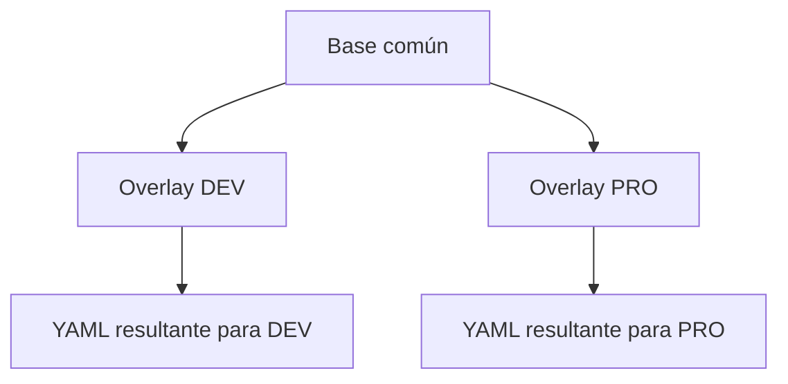

### 4.6 Promoción entre entornos: construir una vez y promover el mismo artefacto ★

#### Objetivos de aprendizaje

Al finalizar este apartado serás capaz de:

- Comprender el principio de **construir una vez y promover el mismo artefacto** entre los distintos entornos.
- Distinguir entre la **imagen de la aplicación**, que debe mantenerse, y la **configuración**, que puede variar entre desarrollo, preproducción y producción.
- Entender la promoción entre entornos como parte de la **industrialización del ciclo de vida de las aplicaciones**.
- Comprender, a un nivel introductorio, cómo Kustomize permite mantener una configuración común y expresar únicamente las diferencias de cada entorno.
- Simular en el entorno de laboratorio las configuraciones de desarrollo y producción sin necesitar proyectos independientes.

#### De la construcción a la promoción

En los apartados anteriores hemos ido construyendo y evolucionando la aplicación desplegada mediante el Deployment `demo-formacion-yaml`. Una vez disponible la imagen, aparece la siguiente pregunta:

¿Cómo hacemos que esa misma versión avance por los distintos entornos sin volver a construirla?

En una organización es habitual que una aplicación pase por varias etapas antes de llegar a producción:



Cada entorno tiene una finalidad diferente. En desarrollo se realizan las primeras comprobaciones; en preproducción se valida el comportamiento en condiciones próximas a las reales; y en producción se presta el servicio a los usuarios.

La práctica recomendada consiste en **construir la imagen una sola vez** y promover exactamente ese mismo artefacto entre los entornos.



La promoción no implica volver a compilar el código. Implica desplegar en el siguiente entorno la misma imagen que ya ha sido probada.

#### ¿Por qué mantener el mismo artefacto?

Si se construye una imagen diferente para cada entorno, aunque se utilice el mismo código fuente, el resultado podría no ser exactamente el mismo. Entre dos construcciones pueden cambiar una dependencia, una imagen base o algún elemento del proceso de construcción.

Esto introduce varios riesgos:

- **Las pruebas pierden valor:** la imagen desplegada en producción no sería exactamente la que se validó anteriormente.
- **Se reduce la trazabilidad:** resulta más difícil determinar qué artefacto concreto fue probado y posteriormente desplegado.
- **Aumenta la posibilidad de diferencias inesperadas:** dos construcciones realizadas en momentos distintos pueden producir resultados diferentes.

!!! tip "Construir una vez y promover"
    La práctica recomendada es construir una imagen, identificarla de forma inequívoca, validarla y promover ese mismo artefacto entre los distintos entornos.

    En entornos corporativos, la imagen puede identificarse mediante una versión, el identificador de una compilación, un commit del repositorio u otro mecanismo trazable. Lo importante no es utilizar obligatoriamente un tipo concreto de etiqueta, sino poder asegurar qué imagen fue validada y cuál se desplegó.

    En nuestro ejemplo continuaremos utilizando la imagen conocida durante el curso: `docker.io/ieftraining/demo-formacion:v4`.

!!! note "Sobre la imagen utilizada en esta práctica"
    En el apartado anterior cada alumno publicó su propia variante de la imagen utilizando etiquetas como `v4-alumno01`, `v4-alumno02`, etc. En este apartado utilizaremos `demo-formacion:v4` como referencia común para simplificar los ejemplos. En un escenario real, la promoción se realizaría sobre la imagen concreta que hubiera sido construida y validada, manteniendo exactamente esa misma imagen al pasar de un entorno a otro.

#### La imagen se mantiene; la configuración puede cambiar

Promover la misma imagen no significa que todos los entornos deban ser idénticos.

La aplicación puede necesitar una configuración diferente en cada uno de ellos:

| Elemento | Desarrollo | Producción |
|---|---|---|
| Imagen | `demo-formacion:v4` | `demo-formacion:v4` |
| Réplicas | 1 | 2 o más, según necesidades |
| Variables de entorno | Valores de prueba | Valores de producción |
| Servicios externos | Sistemas de prueba | Sistemas corporativos |
| Recursos | Ajustados al desarrollo | Ajustados a la carga prevista |

La imagen permanece igual. Lo que cambia es la **configuración externa asociada al entorno**.



!!! warning "No incluir configuración sensible en la imagen"
    Las contraseñas, credenciales y demás valores sensibles no deben incorporarse a la imagen. Como vimos anteriormente, deben gestionarse mediante mecanismos de configuración externos, como Secret, y aplicando los controles de acceso adecuados.

#### Industrialización del ciclo de vida

A medida que una organización madura en el uso de OpenShift, el paso entre entornos deja de depender de despliegues manuales independientes y comienza a realizarse de forma controlada, repetible y trazable.

Este proceso forma parte de la **industrialización del ciclo de vida de las aplicaciones**:

- se identifica el artefacto que se ha construido;
- se valida en un entorno;
- se promueve el mismo artefacto al entorno siguiente;
- se aplica la configuración que corresponde a cada etapa;
- se mantiene la trazabilidad de la versión desplegada.

En este apartado nos centraremos únicamente en el principio de promoción y en la gestión declarativa de las diferencias entre entornos. La automatización completa de este proceso puede realizarse mediante herramientas adicionales, pero no es necesaria para comprender el concepto.

#### Introducción a Kustomize

Si una parte importante de los manifiestos es común a todos los entornos, copiar todos los YAML para desarrollo, preproducción y producción provocaría duplicidades y dificultaría su mantenimiento.

**Kustomize** permite partir de una definición común y añadir únicamente las diferencias necesarias para cada entorno.

Su organización básica utiliza dos conceptos:

- **Base:** contiene la definición común del recurso que queremos gestionar. En esta práctica será el Deployment existente.
- **Superposiciones u overlays:** contienen las diferencias de cada entorno, como el número de réplicas o determinadas etiquetas.

```text
promocion-app/
├── base/
│   ├── deployment.yaml
│   └── kustomization.yaml
└── overlays/
    ├── dev/
    │   └── kustomization.yaml
    └── pro/
        └── kustomization.yaml
```



Kustomize está integrado en las herramientas de línea de comandos de Kubernetes y OpenShift. En la práctica utilizaremos `oc kustomize` sobre las configuraciones de DEV y PRO para generar e inspeccionar el YAML resultante antes de aplicarlo al clúster.

!!! note "Nivel de profundidad"
    El objetivo no es dominar todas las posibilidades de Kustomize, sino comprender cómo una base común puede combinarse con configuraciones diferentes para representar varios entornos.

### Práctica: simular la promoción en el entorno de laboratorio

#### Alcance de la práctica

En una plataforma corporativa, DEV, PRE y PRO suelen estar separados mediante distintos proyectos, clústeres o controles de acceso.

**En esta práctica trabajaremos dentro del proyecto asignado a cada alumno.** Para centrarnos en el concepto de promoción sin añadir complejidad innecesaria, representaremos las configuraciones de desarrollo y producción dentro del mismo entorno de laboratorio.

La práctica permitirá:

- definir una base común;
- representar las diferencias entre DEV y PRO mediante overlays;
- comprobar que ambos utilizan la misma imagen;
- inspeccionar el YAML resultante;
- aplicar una de las configuraciones en el proyecto del alumno.

!!! warning "Simulación formativa"
    Los nombres dev y pro representan configuraciones de distintos entornos. En una plataforma corporativa, estos entornos pueden estar separados mediante distintos proyectos, clústeres y controles de acceso. En esta práctica simplificaremos el escenario para centrarnos en el mecanismo de promoción.

#### Paso 1. Comprobar el proyecto activo

Antes de comenzar, comprueba en qué proyecto estás trabajando:

```bash
oc project
```

Todos los recursos de la práctica se crearán en ese proyecto. No utilizaremos nombres de namespace dentro de los manifiestos, ya que cada alumno trabajará en el proyecto que tenga asignado.

#### Paso 2. Crear la estructura de directorios

En la terminal, crea la estructura de trabajo:

```bash
mkdir -p promocion-app/base
mkdir -p promocion-app/overlays/dev
mkdir -p promocion-app/overlays/pro
cd promocion-app
```

#### Paso 3. Crear los manifiestos comunes de la aplicación existente

A lo largo del curso hemos trabajado con el Deployment, el Service y la Route denominados `demo-formacion-yaml`. En esta práctica no crearemos una aplicación diferente. Kustomize gestionará únicamente distintas configuraciones del Deployment existente. El Service y la Route seguirán funcionando sin cambios y no formarán parte de la base de Kustomize.

Copia y ejecuta el siguiente bloque completo para crear `base/deployment.yaml`:

```bash
cat > base/deployment.yaml <<'EOF'
apiVersion: apps/v1
kind: Deployment
metadata:
  name: demo-formacion-yaml
spec:
  replicas: 1
  selector:
    matchLabels:
      app: demo-formacion-yaml
  template:
    metadata:
      labels:
        app: demo-formacion-yaml
    spec:
      containers:
        - name: demo-formacion
          image: docker.io/ieftraining/demo-formacion:v4
          ports:
            - name: http
              containerPort: 8080
EOF
```

Por último, copia y ejecuta este bloque para crear `base/kustomization.yaml`:

```bash
cat > base/kustomization.yaml <<'EOF'
apiVersion: kustomize.config.k8s.io/v1beta1
kind: Kustomization
resources:
  - deployment.yaml
EOF
```

Comprueba que se han creado los dos archivos:

```bash
ls -l base/
```

La salida debe mostrar `deployment.yaml` y `kustomization.yaml`.

La base contiene únicamente la definición común del Deployment. Observa que la imagen utilizada es `demo-formacion:v4` y que no hay ninguna referencia a un proyecto concreto. El Service y la Route existentes no se incluyen porque no necesitan cambiar entre las configuraciones representadas en esta práctica.

#### Paso 4. Definir el overlay de desarrollo

Copia y ejecuta este bloque para crear `overlays/dev/kustomization.yaml`:

```bash
cat > overlays/dev/kustomization.yaml <<'EOF'
apiVersion: kustomize.config.k8s.io/v1beta1
kind: Kustomization
resources:
  - ../../base
labels:
  - pairs:
      environment: development
replicas:
  - name: demo-formacion-yaml
    count: 1
EOF
```

El overlay de desarrollo mantiene una única réplica y añade la etiqueta `environment: development`.

#### Paso 5. Definir el overlay de producción

Copia y ejecuta este bloque para crear `overlays/pro/kustomization.yaml`:

```bash
cat > overlays/pro/kustomization.yaml <<'EOF'
apiVersion: kustomize.config.k8s.io/v1beta1
kind: Kustomization
resources:
  - ../../base
labels:
  - pairs:
      environment: production
replicas:
  - name: demo-formacion-yaml
    count: 2
EOF
```

El overlay de producción representa una configuración diferente: añade la etiqueta `environment: production` y solicita dos réplicas.

La imagen no cambia. Ambos overlays utilizan:

```text
docker.io/ieftraining/demo-formacion:v4
```

#### Paso 6. Inspeccionar las dos configuraciones

Antes de desplegar nada, vamos a comprobar qué configuración genera Kustomize para desarrollo. Ejecuta:

```bash
oc kustomize overlays/dev
```

Kustomize toma los manifiestos comunes de `base`, aplica las diferencias definidas en `overlays/dev` y muestra en la terminal el YAML resultante. **Este comando no crea ni modifica recursos en OpenShift.**

En la salida, comprueba que:

- el Deployment utiliza una réplica;
- aparece la etiqueta `environment: development`;
- la imagen es `docker.io/ieftraining/demo-formacion:v4`.

A continuación, comprueba qué configuración generaría Kustomize para producción:

```bash
oc kustomize overlays/pro
```

De nuevo, el comando solo combina la base con el overlay y muestra el resultado en la terminal. Todavía no aplica ningún cambio al clúster.

En la salida, comprueba que:

- el Deployment utiliza dos réplicas;
- aparece la etiqueta `environment: production`;
- la imagen continúa siendo `docker.io/ieftraining/demo-formacion:v4`.

Puedes centrar la comprobación en las líneas más importantes:

```bash
oc kustomize overlays/dev | grep -E "environment:|replicas:|image:"
oc kustomize overlays/pro | grep -E "environment:|replicas:|image:"
```

La comparación muestra el principio de la promoción: **la configuración cambia, pero el artefacto permanece**.

#### Paso 7. Comprobar el punto de partida

La aplicación ya se encuentra desplegada en el entorno de laboratorio. Antes de simular la promoción, comprueba el estado actual del Deployment y de sus Pods:

```bash
oc get deployment demo-formacion-yaml
oc get pods -l app=demo-formacion-yaml
```

Comprueba también la imagen desplegada:

```bash
oc get deployment demo-formacion-yaml \
  -o jsonpath='{.spec.template.spec.containers[0].image}{"\n"}'
```

La salida debe ser:

```text
docker.io/ieftraining/demo-formacion:v4
```

En este momento, el Deployment tiene una réplica. Esta configuración representa nuestro punto de partida en desarrollo. No es necesario aplicar el overlay dev, ya que el clúster se encuentra en un estado equivalente.

El Service y la Route creados en apartados anteriores continuarán sin cambios. Puedes comprobarlos con:

```bash
oc get service,route demo-formacion-yaml
```

#### Paso 8. Simular la promoción a producción

Hasta ahora hemos utilizado `oc kustomize` para comparar las configuraciones sin modificar el clúster. Para simular la promoción, aplica únicamente el overlay de producción:

```bash
oc apply -k overlays/pro
```

A diferencia de `oc kustomize`, que solo muestra el resultado, `oc apply -k` aplica declarativamente la configuración generada sobre el Deployment `demo-formacion-yaml` existente.

Comprueba el resultado:

```bash
oc get deployment demo-formacion-yaml
oc get pods -l app=demo-formacion-yaml
```

Ahora deben aparecer dos Pods en ejecución. OpenShift conserva el Pod que ya existía y crea una segunda réplica para alcanzar el estado declarado por el overlay pro.

Verifica que la imagen desplegada no ha cambiado:

```bash
oc get deployment demo-formacion-yaml \
  -o jsonpath='{.spec.template.spec.containers[0].image}{"\n"}'
```

La salida debe seguir siendo:

```text
docker.io/ieftraining/demo-formacion:v4
```

El resultado puede resumirse así:

| Antes de la promoción | Después de aplicar `overlays/pro` |
|---|---|
| 1 réplica | 2 réplicas |
| Imagen `demo-formacion:v4` | Imagen `demo-formacion:v4` |
| Configuración de partida | Configuración representativa de producción |

La configuración ha cambiado, pero el artefacto promovido continúa siendo exactamente el mismo.

!!! note "Limitaciones de recursos del entorno de laboratorio"
    Si las cuotas disponibles no permiten ejecutar dos réplicas, modifica temporalmente `count: 2` por `count: 1`. En ese caso podrás seguir comparando los YAML generados, aunque no se visualizará el escalado a una segunda réplica.

!!! note "Qué estamos simulando"
    Al aplicar el overlay pro sobre el Deployment existente no estamos realizando una promoción real entre proyectos. Estamos representando, dentro de las limitaciones del laboratorio, qué configuración se aplicaría al mismo artefacto en un entorno de producción.

#### Paso 9. Comprobar la aplicación

El Service y la Route no se han modificado. Como los Pods mantienen la etiqueta `app: demo-formacion-yaml`, el Service existente continúa seleccionándolos y la aplicación sigue accesible mediante la misma Route.

Obtén la URL de la ruta:

```bash
oc get route demo-formacion-yaml -o jsonpath='https://{.spec.host}{"\n"}'
```

Accede a la aplicación y comprueba que continúa funcionando con la versión conocida.

#### Paso 10. Limpieza opcional

Si deseas eliminar los recursos creados por esta práctica, ejecuta:

```bash
oc delete -k overlays/pro
```

La eliminación es opcional si la aplicación va a seguir utilizándose en los apartados posteriores.

#### Qué hemos aprendido con la práctica

La práctica no ha reproducido una plataforma corporativa con varios entornos aislados. Sin embargo, sí ha permitido comprobar los principios esenciales:

- La imagen se construye una sola vez.
- La misma imagen se mantiene al aplicar la configuración representativa de producción.
- Las diferencias del Deployment entre entornos se expresan de forma declarativa.
- Kustomize evita duplicar el manifiesto completo del Deployment.
- El Service y la Route permanecen sin cambios porque no forman parte de las diferencias que queremos representar.
- La promoción puede realizarse de forma controlada y trazable.

#### Ideas clave para recordar

!!! tip "Resumen"
    - **Construir una vez y promover:** la práctica recomendada es validar una imagen y promover ese mismo artefacto sin reconstruirlo para cada entorno.
    - **Artefacto y configuración son elementos diferentes:** la imagen se mantiene, mientras que las réplicas, variables y demás parámetros pueden variar.
    - **Trazabilidad:** la imagen debe identificarse de forma inequívoca. Puede utilizarse una versión, un identificador de compilación o un commit, según el proceso adoptado por la organización.
    - **Industrialización:** la promoción convierte el paso entre entornos en un proceso controlado y repetible, en lugar de una sucesión de despliegues manuales independientes.
    - **Kustomize:** la base contiene el Deployment común y los overlays expresan las diferencias de cada entorno. El Service y la Route existentes no se modifican.
    - **Entorno de laboratorio:** la práctica representa DEV y PRO dentro de un único proyecto; no sustituye la separación real entre entornos de una plataforma corporativa.
    - **Inspección previa:** `oc kustomize` permite revisar el YAML resultante antes de aplicarlo.
    - **Aplicación declarativa:** en la práctica, `oc apply -k overlays/pro` aplica sobre el Deployment existente la configuración representativa de producción.
