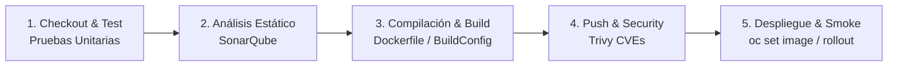
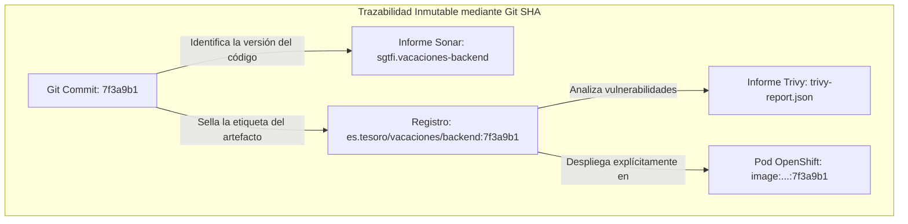
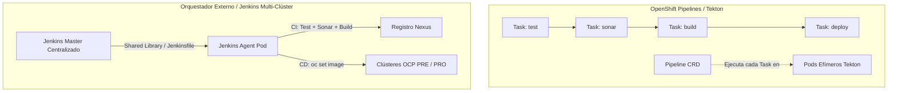
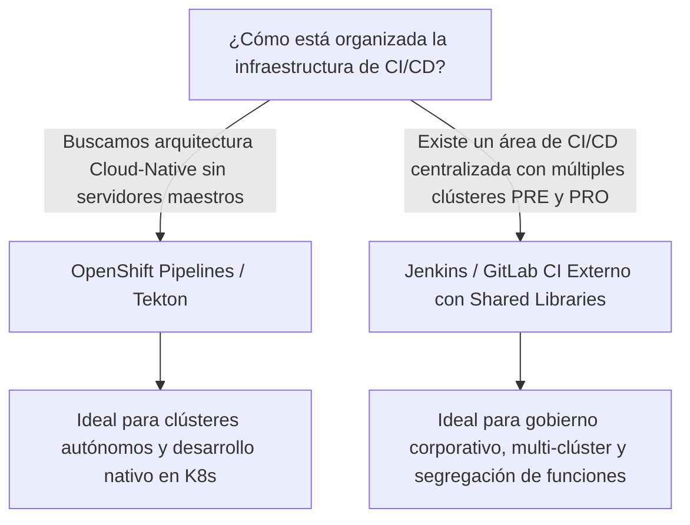
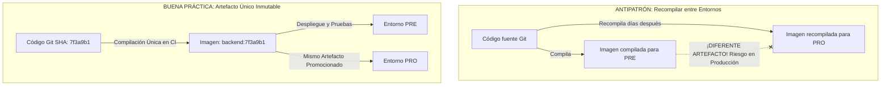

# 4.7 Opciones de automatización: OpenShift Pipelines (Tekton) y herramientas externas de integración continua (Jenkins). Criterios para elegir ★

## Objetivos de aprendizaje

Al finalizar este apartado serás capaz de:

- Comprender el ciclo de vida de un pipeline de entrega continua industrializado y el propósito operativo de sus etapas fundamentales (*stages*): pruebas unitarias, análisis estático de código (SonarQube), compilación/empaquetado, escaneo de vulnerabilidades en imágenes (Trivy) y despliegue/verificación en el clúster.
- Justificar técnicamente el uso del identificador del commit de Git (Git SHA) como hilo conductor inmutable para garantizar la trazabilidad completa desde el código fuente hasta las cargas de trabajo en ejecución.
- Analizar los dos modelos de orquestación en la industria: **Pipeline Unificado** (ejecución continua end-to-end) y **Pipeline Desacoplado** (separación estricta entre CI y CD con gobierno de la promoción).
- Evaluar y comparar los dos grandes enfoques de orquestación de CI/CD en entornos OpenShift: **OpenShift Pipelines (Tekton)** como solución nativa *Cloud-Native* basada en recursos del clúster y **Orquestadores Externos (Jenkins / GitLab CI)** como solución corporativa centralizada.
- Aplicar criterios técnicos y organizativos estructurados para seleccionar la herramienta de CI/CD adecuada en función de la madurez tecnológica, la gobernanza multi-clúster y los requisitos de infraestructura.

---

## El ciclo de vida de entrega continua: Anatomía de un pipeline industrial

En los apartados previos de la sesión hemos estudiado los bloques individuales que componen el ecosistema de aplicaciones: los entornos de ejecución y `Dockerfile` (apartado 1.2), las imágenes y registros corporativos (apartado 4.4), el empaquetado en el clúster (apartado 4.5) y las políticas de red y seguridad (apartados 4.2 y 4.3).

En un entorno profesional, estos elementos no se gestionan mediante comandos manuales ejecutados desde la terminal del desarrollador. Se ensamblan y orquestan de forma automática a través de un **pipeline de Integración y Despliegue Continuo (CI/CD)**.

Un pipeline industrializado se estructura en cinco etapas (*stages*) secuenciales:

### 1. Etapa de Checkout y Pruebas Unitarias (*Test Stage*)
El orquestador de CI/CD detecta un evento en el repositorio de Git (por ejemplo, una petición de cambio o *merge*) y descarga la revisión exacta del código fuente. A continuación, ejecuta las baterías de pruebas unitarias y de integración dentro de un entorno aislado. Si algún test falla, el pipeline se aborta inmediatamente evitando propagar código defectuoso.

### 2. Etapa de Análisis Estático de Código (*Quality Gate / SonarQube*)
Antes de empaquetar la aplicación, el código fuente se somete a una inspección de calidad estática mediante herramientas corporativas como **SonarQube**.
- **Métricas analizadas:** Detección de fallos de programación (*bugs*), olores de código (*code smells*), vulnerabilidades de seguridad y porcentaje de cobertura de pruebas unitarias.
- **Criterio de parada (*Quality Gate*):** Si el código no alcanza los umbrales mínimos de calidad exigidos por la organización (por ejemplo, presencia de vulnerabilidades de severidad alta o cobertura de tests inferior al 80%), la etapa falla y se frena la construcción de la imagen.

### 3. Etapa de Compilación y Construcción de la Imagen (*Build Stage*)
Una vez superada la fase de calidad de código, se procede al empaquetado inmutable del software. El orquestador procesa el `Dockerfile` de la aplicación (estudiado en el apartado 4.5). En función de la arquitectura de la organización, esta etapa puede ejecutarse directamente en el agente del pipeline o delegarse al clúster de OpenShift invocando un `BuildConfig` de fuente binaria (`oc start-build`), aprovechando la plataforma para generar la imagen sin requerir privilegios de Docker en el agente.

### 4. Etapa de Publicación y Escaneo de Vulnerabilidades (*Push & Security Scan / Trivy*)
La imagen de contenedor generada se deposita en el registro corporativo (Nexus, Quay o Harbor) y se somete inmediatamente a un análisis de seguridad post-push mediante herramientas como **Trivy**.
- **Qué analiza:** Inspecciona el sistema operativo base (UBI) y las librerías de lenguajes (npm, maven, pip) comparándolos con las bases de datos públicas de vulnerabilidades conocidas (*Common Vulnerabilities and Exposures* - CVE).
- **Gestión de hallazgos:** Se emite un informe detallado (`trivy-report.json`). Los hallazgos con severidad *Critical* o *High* se evalúan según la política de seguridad corporativa: pueden frenar la promoción del artefacto o requerir una excepción formal del equipo de arquitectura, tal y como vimos en el apartado 4.4.

### 5. Etapa de Despliegue y Verificación (*Deploy & Smoke Test*)
El orquestador interactúa con la API de OpenShift para actualizar la aplicación existente. Aplica la nueva versión modificando el parámetro `image` del `Deployment` (`oc set image deployment/...`), monitoriza la transición ordenada de las réplicas (`oc rollout status`) y finaliza ejecutando un **Smoke Test** automático (por ejemplo, lanzando un Pod efímero ligero con `curl` hacia el endpoint de salud `/health/ready` del servicio) para validar que el Pod está operativo.

---

## El identificador por Commit (Git SHA) como hilo conductor inmutable

En una arquitectura de CI/CD corporativa, la trazabilidad entre lo que está escrito en el repositorio de código y lo que está ejecutándose en los nodos de Producción debe ser absoluta.

!!! note "El principio de inmutabilidad"
    El hash único generado por Git en cada *commit* (por ejemplo, `7f3a9b1`) actúa como el **hilo conductor** de todo el proceso. 
    
    Prohibir el uso de etiquetas dinámicas como `latest` (apartado 4.4) y sellar la imagen con el Git SHA garantiza que el informe de SonarQube, el escaneo de Trivy, el artefacto del registro y el Pod que ejecuta OpenShift correspondan exactamente a las mismas líneas de código fuente.

---

## Modelos de orquestación: Pipeline Unificado frente a Pipeline Desacoplado

A la hora de diseñar la automatización, existen dos enfoques arquitectónicos principales según el grado de agilidad y las políticas de gobierno de la organización:

```mermaid
flowchart TD
    subgraph subA ["Modelo A: Pipeline Unificado (CI/CD Continuo)"]
        Git1[Git Push] --> CI_CD["Pipeline Único: Test -> Sonar -> Build -> Trivy -> Deploy"]
        CI_CD -->|Despliegue Automático| OCP_DEV[Entornos DEV / Test]
    end

    subgraph subB ["Modelo B: Pipeline Desacoplado (Separación CI vs CD)"]
        Git2[Git Push] --> CI_Only["Pipeline CI (tesoroBuild): Test -> Sonar -> Build -> Trivy -> Push"]
        CI_Only -->|Publica Artefacto Inmutable| Reg[Registro Corporativo Nexus]
        
        Reg -.->|Promoción Manual / Aprobación| CD_Only["Pipeline CD (tesoroDeploy): oc set image IMAGE_TAG"]
        CD_Only -->|Actualización Declarativa| OCP_PROD[Entornos PRE / PROD]
    end
```

### 1. Modelo A: Pipeline Unificado (CI/CD End-to-End)
- **Concepto:** Una única ejecución automatizada abarca desde la descarga del código hasta la actualización del entorno de destino.
- **Ámbito de aplicación ideal:** Entornos de desarrollo (`DEV`), ramas de características (*feature branches*) o plataformas con alta madurez de automatización donde todo commit verificado se despliega automáticamente en entornos de integración.

### 2. Modelo B: Pipeline Desacoplado (Separación estricta entre CI y CD)
- **Concepto:** Se dividen las responsabilidades en dos pipelines independientes:
  - **Pipeline de CI (*Build & Test*):** Compila el código, ejecuta SonarQube, genera la imagen, pasa Trivy y publica el artefacto etiquetado con el Git SHA en el registro. **El pipeline de CI nunca despliega en Producción.**
  - **Pipeline de CD (*Deploy*):** Es un proceso independiente (de ejecución manual o parametrizada por `IMAGE_TAG`) que se encarga exclusivamente de tomar el artefacto inmutable previamente validado y ordenar la actualización en el clúster.
- **Ámbito de aplicación ideal:** Entornos corporativos de **Preproducción y Producción**, donde se exige segregación de funciones, ventanas de mantenimiento, auditoría estricta y control humano sobre el momento exacto del despliegue.

---

## Comparativa de orquestadores: OpenShift Pipelines (Tekton) frente a Herramientas Externas (Jenkins)

Para llevar a cabo la orquestación de los pipelines, las organizaciones eligen principalmente entre dos grandes pilares tecnológicos: una solución nativa basada en recursos de Kubernetes (**OpenShift Pipelines / Tekton**) o una infraestructura de integración continua centralizada basada en orquestadores corporativos (**Jenkins** / GitLab CI).

---

### 1. OpenShift Pipelines (Tekton): La alternativa nativa *Cloud-Native*

**Tekton** es un proyecto de la *Continuous Delivery Foundation* (CDF) integrado en OpenShift mediante el operador **OpenShift Pipelines**.

- **Arquitectura declarativa por CRDs:** Los pipelines no se definen en consolas propietarias, sino mediante archivos YAML nativos de Kubernetes:
  - **`Task`:** La unidad mínima que define los pasos (*steps*) a ejecutar dentro de un contenedor.
  - **`Pipeline`:** La estructura gráfica que conecta múltiples `Tasks` (en serie o en paralelo).
  - **`PipelineRun`:** La instanciación de un pipeline en tiempo de ejecución.
- **Modelo Serverless:** Cada `Task` se ejecuta dentro de su propio Pod efímero dedicado. Si no hay pipelines en ejecución, **el consumo de recursos de cómputo en el clúster es cero**, eliminando la necesidad de mantener servidores maestros encendidos permanentemente.
- **Integración con la consola:** Los pipelines, sus estados y los logs de cada paso se visualizan directamente dentro de la perspectiva de Desarrollo de la consola web de OpenShift.

---

### 2. Herramientas externas corporativas (Jenkins / GitLab CI): La alternativa multi-clúster desacoplada

En infraestructuras empresariales consolidadas con múltiples clústeres de OpenShift (por ejemplo, un clúster exclusivo de Preproducción y otro de Producción aislados de red), se adopta habitualmente un orquestador corporativo externo como **Jenkins** o GitLab CI.

- **Centralización y reutilización (*Shared Libraries*):** Permite abstraer la complejidad de los pipelines mediante librerías compartidas centralizadas (por ejemplo, `tesoro-cicd`). Los proyectos individuales no escriben scripts complejos; simplemente invocan funciones estándar (`tesoroBuild`, `tesoroDeploy`) desde un `Jenkinsfile` minimalista de dos líneas.
- **Agentes efímeros en el clúster (`Pod Templates`):** El maestro de CI no ejecuta los trabajos de compilación en su propia máquina. Levanta Pods efímeros agentes (`jenkins-agent`) dentro del clúster de OpenShift que se destruyen al concluir la tarea.
- **Gobernanza multi-entorno:** Un servidor Jenkins centralizado puede orquestar con seguridad la promoción de un artefacto hacia múltiples clústeres independientes, manteniendo controles de acceso por carpetas (*Folders*) y roles centralizados (Role Strategy Plugin).
- **El rol de `BuildConfig` en esta arquitectura:** En este modelo, el orquestador externo (Jenkins) se encarga de las etapas de calidad y gobierno (SonarQube, Trivy, notificaciones), mientras que para la etapa de empaquetado puede delegar el procesamiento del `Dockerfile` al clúster de OpenShift lanzando un `BuildConfig` binario mediante la CLI (`oc start-build`), evitando la necesidad de disponer de privilegios de Docker en el Pod agente.

---

## Criterios de decisión para elegir el orquestador adecuado ★

La selección entre OpenShift Pipelines (Tekton) y un orquestador externo como Jenkins no debe realizarse por modas tecnológicas, sino analizando la realidad operativa de la organización:

| Criterio de evaluación | OpenShift Pipelines (Tekton) | Orquestador Externo (Jenkins / GitLab CI) |
| :--- | :--- | :--- |
| **Modelo de infraestructura** | Nativo de Kubernetes / Serverless (sin servidor maestro). | Servidor centralizado (Master) + Agentes efímeros en clúster. |
| **Gestión del pipeline** | Manifiestos YAML (`Task`, `Pipeline`) en el repositorio. | `Jenkinsfile` / `gitlab-ci.yml` + Librerías Compartidas (*Shared Libraries*). |
| **Consumo de recursos** | **Óptimo.** Cero recursos si no hay ejecuciones. | Requiere mantener la instancia del maestro de CI encendida. |
| **Gobierno Multi-Clúster** | Complejo si se requiere orquestar despliegues entre clústeres aislados. | **Excelente.** Diseñado para orquestar despliegues en múltiples clústeres (PRE/PRO). |
| **Curva de aprendizaje** | Alta (requiere dominar conceptos YAML nativos de K8s). | Baja/Media (tecnología ampliamente conocida en el mercado). |
| **Integración con la consola** | Total (integrado en la interfaz de OpenShift). | Externa (acceso mediante enlaces o webhooks). |

---

## Regla de oro corporativa: Construir una sola vez y promover el artefacto inmutable

Independientemente de si se selecciona Tekton o Jenkins como orquestador, existe una regla infranqueable en la ingeniería de software moderna:

!!! warning "Prohibido recompilar para Producción"
    **La imagen de contenedor debe construirse UNA SOLA VEZ durante la fase de CI.**

    Recompilar el código fuente al pasar a Producción rompe el determinismo: las dependencias descargadas de Internet o las actualizaciones de parches base pueden haber variado. 
    
    Lo que se despliega en Producción debe ser **exactamente el mismo artefacto inmutable** (identificado por su Git SHA) que superó con éxito las pruebas unitarias, el análisis de SonarQube, el escaneo de Trivy y la validación funcional en Preproducción.

---

## Ideas clave para recordar

!!! tip "Resumen"
    - Un pipeline industrial orquesta ordenadamente las etapas de **Pruebas Unitarias**, **Calidad (SonarQube)**, **Construcción (Dockerfile/BuildConfig)**, **Escaneo de Vulnerabilidades (Trivy)** y **Despliegue/Verificación**.
    - El **Git SHA** es el hilo conductor inmutable que enlaza el código fuente con los informes de calidad, las vulnerabilidades de la imagen y los Pods en ejecución.
    - El **Pipeline Unificado** ejecuta todas las etapas de forma continua (ideal para `DEV`), mientras que el **Pipeline Desacoplado** separa la CI (construcción y validación) del CD (despliegue mediante `oc set image`), modelo preferido para `PRE` y `PRO`.
    - **`BuildConfig` no es un orquestador de CI/CD**; es un mecanismo de empaquetado nativo que los orquestadores (Jenkins o Tekton) pueden invocar para construir imágenes dentro del clúster sin daemon de Docker.
    - **OpenShift Pipelines (Tekton)** ofrece una solución CI/CD *Cloud-Native* y *Serverless* basada en CRDs nativos de Kubernetes (`Task`, `Pipeline`).
    - **Jenkins / GitLab CI** ofrece una solución corporativa centralizada, ideal para la gobernanza multi-clúster y la estandarización mediante librerías compartidas (*Shared Libraries*).
    - **Construye una sola vez y promociona el artefacto inmutable:** Nunca recompiles una imagen para pasar a Producción.