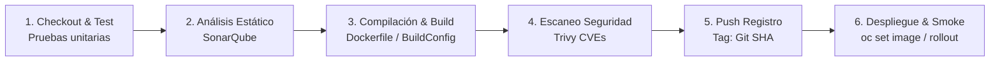
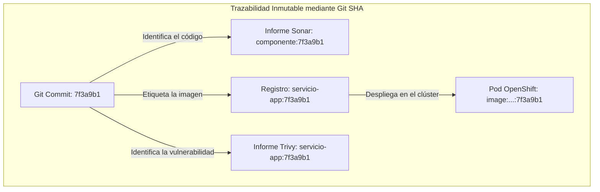
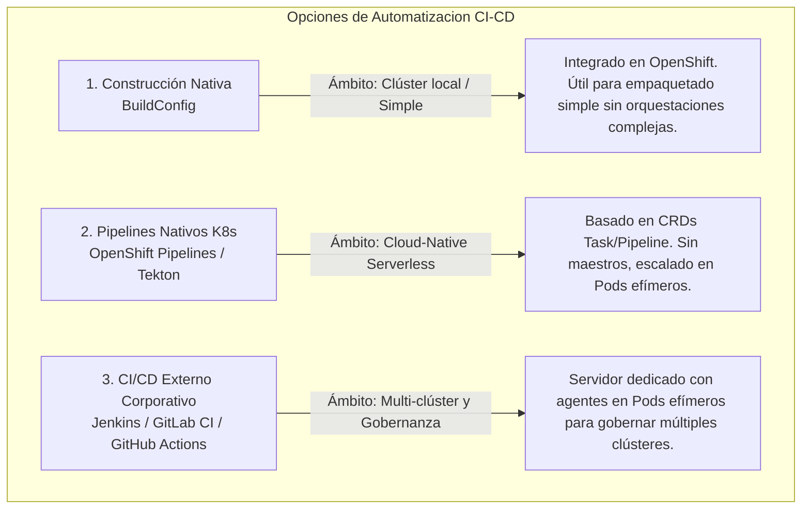
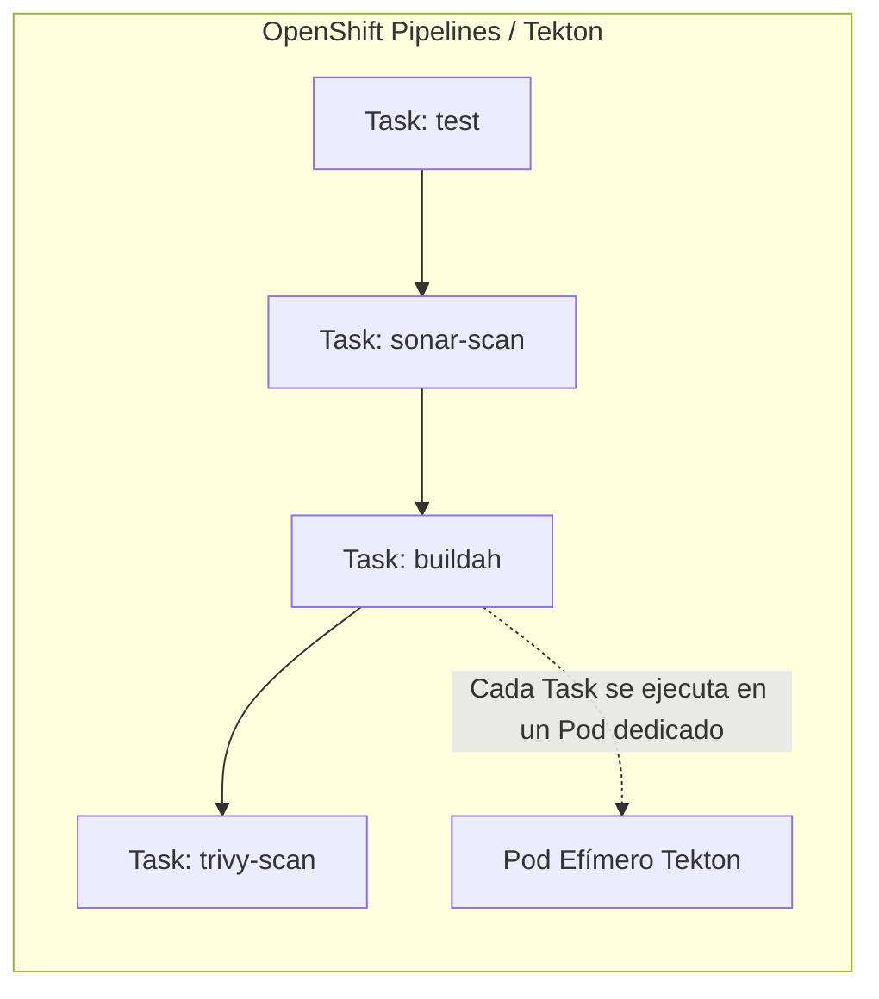
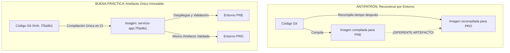
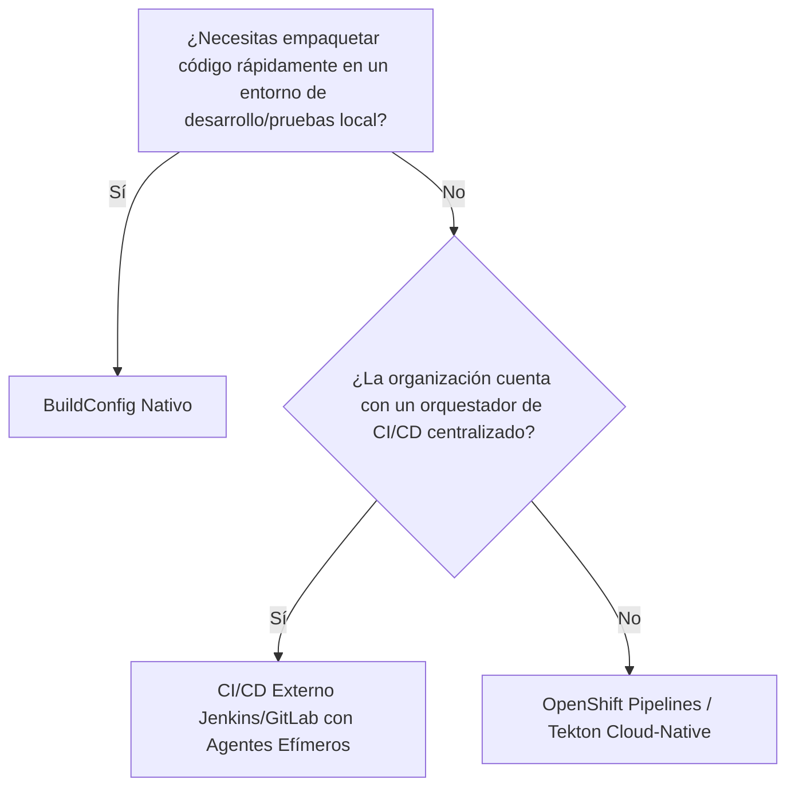

# 4.7 Opciones de automatización: construcción nativa, OpenShift Pipelines (Tekton) y herramientas externas de integración continua. Criterios para elegir ★

## Objetivos de aprendizaje

Al finalizar este apartado serás capaz de:

- Comprender los tres grandes enfoques de automatización de CI/CD en OpenShift: construcción nativa (`BuildConfig`), integración continua nativa basada en Kubernetes (**OpenShift Pipelines / Tekton**) y orquestadores externos (**Jenkins**, GitLab CI, GitHub Actions).
- Analizar en detalle las etapas estándar (*stages*) de un pipeline industrial de entrega continua, conectando directamente con los conocimientos previos de empaquetado, escaneo estático de código (**SonarQube**), inspección de vulnerabilidades en imágenes (**Trivy**) y despliegue automatizado.
- Justificar técnicamente el uso del identificador del commit de Git (Git SHA) como hilo conductor inmutable para garantizar la trazabilidad completa desde el código fuente hasta los Pods en ejecución.
- Diferenciar y contrastar las estrategias de despliegue mediante **Pipelines Unificados (CI/CD continuos)** frente a **Pipelines Desacoplados (CI y CD independientes)** para el gobierno de entornos productivos y no productivos.
- Comprender el principio de gobernanza corporativa de **"construir una sola vez y promover el artefacto inmutable"** entre los entornos de Preproducción y Producción.
- Evaluar los criterios de decisión clave para elegir la herramienta de automatización adecuada en función de la complejidad organizativa, el gobierno multi-equipo y los requisitos de infraestructura.

---

## El ciclo de vida de entrega continua: Las etapas (*stages*) de un pipeline industrial

En los apartados previos hemos estudiado de forma individualizada los componentes fundamentales para empaquetar y poner en marcha una aplicación: los entornos de ejecución y `Dockerfile` (Sesión 1.2), los mecanismos de construcción en el clúster con `BuildConfig` (apartado 4.5), la inmutabilidad y seguridad de las imágenes (apartado 4.4) y los objetos de despliegue y red (apartados 4.2 y 4.3).

En un entorno corporativo e industrializado, estos elementos no se ejecutan de forma aislada mediante comandos manuales en la terminal. Se orquestan secuencialmente a través de un **pipeline de Integración y Despliegue Continuo (CI/CD)**.



Un pipeline completo se compone de las siguientes etapas secuenciales:

### 1. Etapa de Checkout y Pruebas Unitarias (*Test Stage*)
El servidor de integración continua detecta una modificación en el repositorio de código fuente (mediante un *webhook* o sondeo), descarga la versión exacta del código correspondiente al commit y ejecuta la batería de pruebas unitarias e integración local. Si algún test falla, la ejecución se interrumpe inmediatamente impidiendo avanzar a la compilación.

### 2. Etapa de Análisis Estático de Código (*Quality Gate / SonarQube*)
Antes de empaquetar el código, se somete a una inspección de calidad estática analizando el código fuente sin ejecutarlo mediante herramientas como **SonarQube**.
- **Qué analiza:** Presencia de *bugs*, vulnerabilidades de programación, olores de código (*code smells*), duplicaciones y porcentaje de cobertura de pruebas unitarias.
- **Mecanismo de control (*Quality Gate*):** Si el código no alcanza los umbrales requeridos por la organización (por ejemplo, detección de fallos de seguridad graves o cobertura de tests inferior al 80%), la etapa falla y se bloquea el progreso del pipeline.

### 3. Etapa de Compilación y Construcción de la Imagen (*Build Stage*)
Una vez validada la calidad del código, se procede a su compilación y al empaquetado de la imagen de contenedor. Esta etapa utiliza las definiciones de empaquetado (`Dockerfile`) estudiadas en el apartado 4.5. Puede ejecutarse dentro del propio agente del pipeline mediante herramientas como Buildah/Docker o delegarse al clúster de OpenShift activando la ejecución de un objeto `BuildConfig`.

### 4. Etapa de Escaneo de Vulnerabilidades de Imagen (*Security Scan / Trivy*)
Con la imagen de contenedor generada y disponible en el registro, entra en juego un escáner de seguridad especializado como **Trivy** o Clair (enlazando con los conceptos de seguridad del apartado 4.4).
- **Qué analiza:** Inspecciona el sistema operativo base (UBI) y las librerías de tiempo de ejecución (npm, Maven, PyPI, etc.) en busca de vulnerabilidades conocidas (CVEs).
- **Control de promoción:** Si se detectan vulnerabilidades clasificadas como *Critical* o *High* para las cuales existe solución, el pipeline detiene el proceso y genera un informe de auditoría (`trivy-report.json`), impidiendo que una imagen vulnerable se despliegue en la plataforma.

### 5. Etapa de Registro e Hilo Conductor por Commit (*Push & Tagging*)
El artefacto validado se etiqueta y publica en el registro corporativo de imágenes (Nexus, Quay u OpenShift Registry).



!!! note "El Git SHA como hilo conductor"
    El uso del identificador único del commit de Git (**Git SHA**) como etiqueta (`tag`) de la imagen es el eje fundamental de la trazabilidad. Permite conectar sin ambigüedad las líneas exactas de código fuente guardadas en Git con el informe de SonarQube, el análisis de seguridad de Trivy y los Pods en ejecución en OpenShift.

### 6. Etapa de Despliegue y Verificación (*Deploy & Smoke Test*)
La etapa final contacta con la API de OpenShift para actualizar los manifiestos de la aplicación.
- **Actualización:** Sustituye la etiqueta de la imagen en el `Deployment` por el nuevo Git SHA (`oc set image deployment/...`).
- **Verificación de Rollout:** Supervisa el progreso del despliegue (`oc rollout status`).
- **Prueba de Humo (*Smoke Test*):** Ejecuta una petición de verificación automática contra el endpoint de salud de la aplicación (`/health/ready`) para confirmar la correcta operatividad antes de dar por finalizado el pipeline.

---

## Modelos de orquestación: Pipeline Unificado vs. Pipeline Desacoplado

Existen dos estrategias principales para organizar estas etapas dentro del ciclo de vida del software, según los requisitos de agilidad y las políticas de gobierno de la organización.

```mermaid
flowchart TD
    subgraph Modelo A: Pipeline Unificado (CI/CD Continuo)
        Git1[Git Push] --> CI_CD[Pipeline Único: Test -> Sonar -> Build -> Trivy -> Deploy]
        CI_CD -->|Despliegue Automático| OCP_DEV[Entorno DEV / PRE]
    end

    subgraph Modelo B: Pipeline Desacoplado (Separación de Gobierno)
        Git2[Git Push] --> CI_Only[Pipeline CI: Test -> Sonar -> Build -> Trivy -> Push]
        CI_Only -->|Publica Artefacto Inmutable| Reg[Registro Corporativo]
        
        Reg -.->|Promoción Aprobada| CD_Only[Pipeline CD: Despliegue por Tag / Git SHA]
        CD_Only -->|Actualización Declarativa| OCP_PROD[Entorno PROD]
    end
```

### 1. Pipeline Unificado (CI/CD continuo en un único flujo)
En este modelo, el pipeline ejecuta todas las etapas de forma consecutiva e ininterrumpida: desde el *checkout* del código hasta la actualización del despliegue en el clúster.

- **Uso ideal:** Entornos de Desarrollo, Integración (*DEV/INT*) y proyectos donde se aplique *Continuous Deployment* real.
- **Ventajas:** Máxima velocidad de entrega, respuesta inmediata ante cambios y nula intervención manual.

### 2. Pipeline Desacoplado (Separación estricta entre CI y CD)
En arquitecturas corporativas y entornos de Producción con regulación estricta, el flujo se divide en dos ejecuciones independientes:

- **Pipeline de CI (Integración Continua):** Se encarga de descargar el código, ejecutar las pruebas, auditar con SonarQube, construir la imagen, escanearla con Trivy y publicarla en el registro con el Git SHA. **Este pipeline finaliza en el registro y nunca aplica cambios directos en los entornos productivos.**
- **Pipeline de CD (Despliegue Continuo):** Es un proceso independiente que se dispara bajo demanda, por eventos de *GitOps* o mediante aprobaciones manuales. Su única responsabilidad es tomar la versión exacta de la imagen ya validada e instruir a OpenShift para que realice la actualización.

---

## Las tres opciones de automatización en OpenShift

Para implementar estas etapas y modelos, OpenShift permite elegir entre tres enfoques arquitectónicos principales.



---

### 1. Construcción Nativa (`BuildConfig`)

Es la funcionalidad propia de la plataforma que se estudió en detalle en el apartado 4.5.

- **Enfoque:** Permite construir imágenes dentro del clúster procesando manifiestos `BuildConfig` mediante disparadores (*webhooks*) o invocaciones directas por CLI (`oc start-build`).
- **Encaje en CI/CD:** No constituye un orquestador de CI/CD completo, ya que no incluye de forma nativa gestores de etapas complejas, análisis estático de código tipo SonarQube o portales de aprobación manual. Se utiliza como un mecanismo de empaquetado interno que puede ser invocado por otros sistemas.

---

### 2. Integración continua nativa en Kubernetes: OpenShift Pipelines (Tekton)

**OpenShift Pipelines** es la solución de CI/CD orientada al modelo *Cloud-Native*, basada en el proyecto de código abierto **Tekton**.



- **Arquitectura basada en Recursos Personalizados (CRDs):** Extiende la API de Kubernetes para definir componentes de CI/CD como objetos declarativos YAML:
  - **`Task`:** Define un bloque de trabajo individual (por ejemplo: ejecutar pruebas unitarias, lanzar análisis de SonarQube o construir con Buildah).
  - **`Pipeline`:** Estructura la secuencia y las dependencias entre diferentes `Tasks`.
  - **`PipelineRun` / `TaskRun`:** Representan las instanciaciones o ejecuciones reales del pipeline en el tiempo.
- **Naturaleza Serverless:** No requiere mantener un servidor maestro encendido permanentemente. Cada `Task` se ejecuta en un Pod efímero que consume recursos solo durante la compilación o prueba, reduciendo la carga del clúster a cero cuando no hay ejecuciones.
- **Ventajas:** Integración nativa en la interfaz gráfica de OpenShift, gestión completa mediante Git y alta escalabilidad horizontal.

---

### 3. Herramientas externas de integración continua (Jenkins / GitLab CI / GitHub Actions)

En organizaciones con infraestructuras heterogéneas y múltiples entornos, es común utilizar un orquestador externo centralizado.

- **Funcionamiento con OpenShift:** El orquestador externo maneja la lógica de las etapas (SonarQube, aprobación, promociones) y utiliza **agentes efímeros** ejecutados como Pods dentro de OpenShift para procesar las tareas.
- **Despliegue multi-clúster:** El servidor centralizado conecta con los endpoints de API de los clústeres de Preproducción y Producción mediante cuentas de servicio (*ServiceAccounts*) y tokens RBAC restringidos.

---

## Principio de gobernanza: Construir una sola vez y promover el artefacto inmutable

En arquitecturas corporativas es crítico evitar la reconstrucción de las imágenes de contenedor al promocionar una aplicación entre diferentes entornos.



### Justificación técnica:
- **Determinismo:** Si se vuelve a compilar el código fuente para Producción, las dependencias de paquetes del sistema base o las librerías externas descargadas pueden haber cambiado, generando un artefacto diferente al auditado en Preproducción.
- **Garantía de Calidad:** La imagen etiquetada con el Git SHA (`servicio-app:7f3a9b1`) que supera el análisis de SonarQube, el escaneo de Trivy y las pruebas en Preproducción es **exactamente la misma** que debe desplegarse en Producción, garantizando la inmutabilidad del software validado.

---

## Criterios para elegir la herramienta de automatización ★

La selección de la solución de automatización debe responder a la madurez de la infraestructura, los requisitos de gobierno y la arquitectura organizativa:

| Criterio de evaluación | Construcción Nativa (`BuildConfig`) | OpenShift Pipelines (Tekton) | CI/CD Externo (Jenkins / GitLab CI) |
| :--- | :--- | :--- | :--- |
| **Complejidad de instalación** | **Ninguna.** Incluido por defecto en OpenShift. | **Baja-Media.** Requiere instalar el Operador. | **Alta.** Requiere despliegue y mantenimiento de infraestructura externa. |
| **Gestión de recursos** | Consume recursos durante el build en el Pod de construcción. | **Serverless.** Cero uso de memoria/CPU en reposo. | Requiere dimensionar la infraestructura para el maestro y sus agentes. |
| **Orquestación de etapas** | Limitada a compilación y empaquetado. | **Alta.** Permite diseñar pipelines complejos mediante YAML. | **Muy Alta.** Extenso ecosistema de plugins e integraciones legacy. |
| **Gobierno Multi-Clúster** | Diseñado para el ámbito local del clúster. | Requiere coordinación mediante eventos (GitOps/Webhooks). | **Excelente.** Un único punto de control gestiona múltiples clústeres. |
| **Portabilidad** | Específico de OpenShift. | **Alta.** Estándar sobre Kubernetes. | **Alta.** Independiente de la plataforma subyacente. |



### Guía rápida de selección:

1. **Utiliza `BuildConfig`:** Cuando requieras una solución de empaquetado rápida sin dependencias externas para entornos de prueba o desarrollo dentro de un mismo clúster.
2. **Utiliza `OpenShift Pipelines` (Tekton):** Cuando busques una arquitectura nativa en Kubernetes, declarativa en YAML, sin costes de mantenimiento de servidores maestros (*Serverless*) y alineada con flujos de trabajo modernos sobre el clúster.
3. **Utiliza un Orquestador Externo (Jenkins / GitLab CI):** Cuando exista una infraestructura de CI/CD corporativa madura, se requiera gobernar despliegues en múltiples clústeres independientes o se necesiten controles de segregación de accesos estrictos entre los procesos de compilación y los de despliegue en Producción.

---

## Ideas clave para recordar

!!! tip "Resumen"
    - Un pipeline industrial de CI/CD orquesta de forma secuencial las etapas de **Pruebas Unitarias**, **Calidad de Código (SonarQube)**, **Compilación/Build**, **Escaneo de Vulnerabilidades (Trivy)**, **Registro** y **Despliegue**.
    - El **Git SHA** actúa como el **hilo conductor inmutable** que vincula el commit del código fuente con los informes de análisis estático, la revisión de seguridad de la imagen y los Pods en ejecución.
    - Los **Pipelines Unificados** ejecutan todo el flujo de forma continua (ideal para desarrollo), mientras que los **Pipelines Desacoplados** separan la fase de CI (construcción y validación) de la de CD (despliegue bajo demanda o aprobación).
    - **OpenShift Pipelines (Tekton)** ofrece un modelo nativo para Kubernetes basado en CRDs (`Task`, `Pipeline`), con arquitectura *Serverless* y ejecución de tareas en Pods efímeros.
    - **Principio de gobernanza:** La imagen de contenedor debe **construirse una sola vez** en la etapa de CI y promocionarse de forma inmutable entre los entornos de Preproducción y Producción sin volver a compilar.
    - La elección entre `BuildConfig`, Tekton o un CI/CD externo se fundamenta en la complejidad organizativa, los requisitos de gobernanza multi-clúster y el nivel de integración con la infraestructura existente.