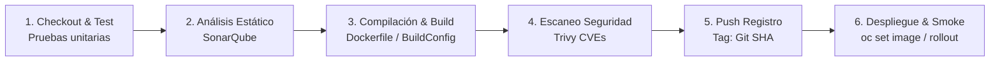
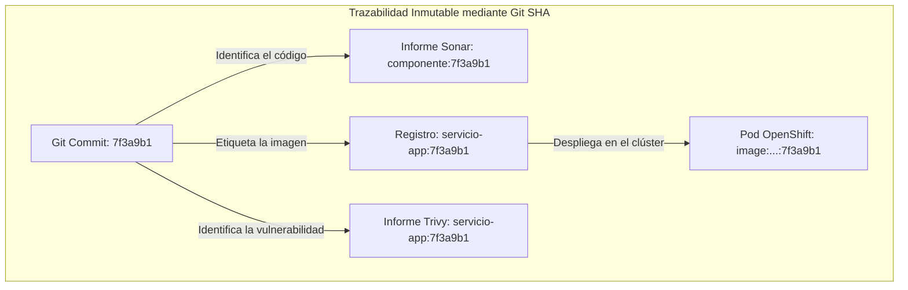
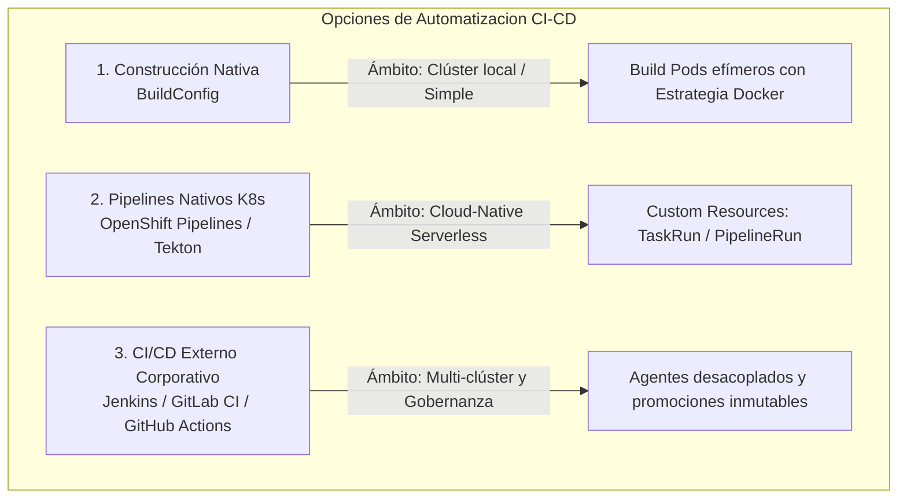
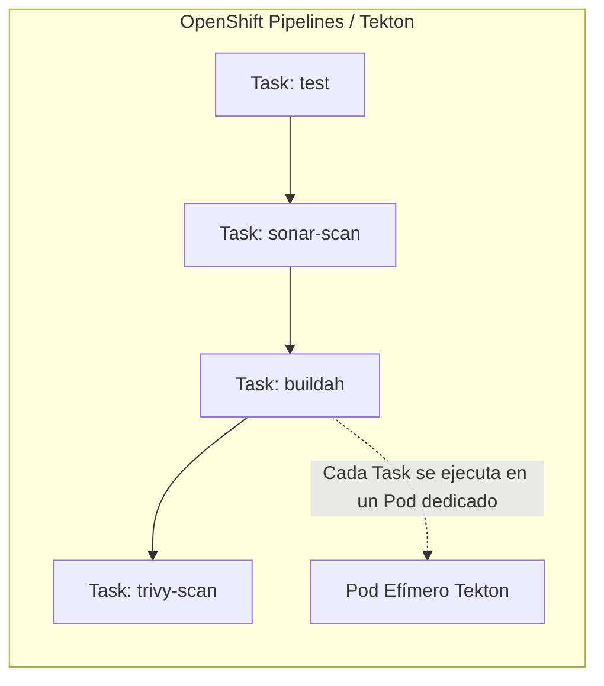
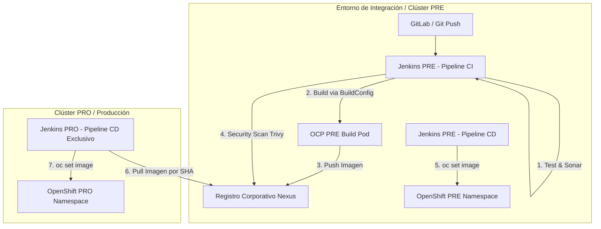
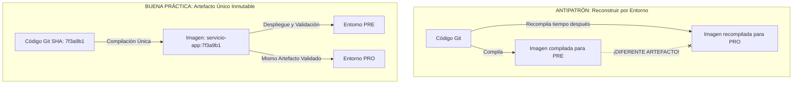
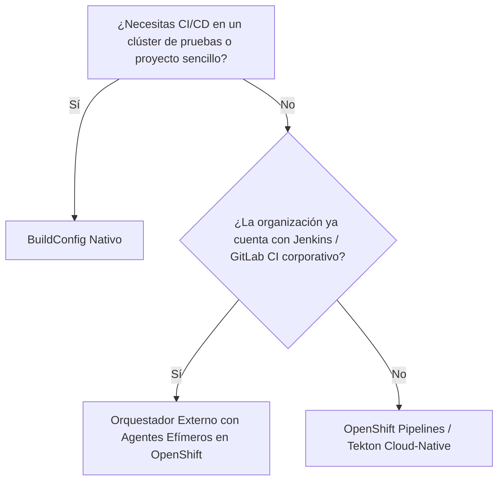

# 4.7 Opciones de automatización: construcción nativa, OpenShift Pipelines (Tekton) y herramientas externas de integración continua. Criterios para elegir ★

## Objetivos de aprendizaje

Al finalizar este apartado serás capaz de:

- Comprender los tres grandes enfoques de automatización de CI/CD en OpenShift: construcción nativa (`BuildConfig`), integración continua nativa basada en Kubernetes (**OpenShift Pipelines / Tekton**) y orquestadores externos (**Jenkins**, GitLab CI, GitHub Actions).
- Analizar las etapas estándar (*stages*) de un pipeline industrial de entrega continua, conectando directamente con los conocimientos previos de empaquetado, escaneo estático del código (SonarQube), inspección de vulnerabilidades en imágenes (Trivy) y despliegue en el clúster.
- Justificar técnicamente el uso del identificador del commit de Git (Git SHA) como hilo conductor inmutable para garantizar la trazabilidad completa desde el código fuente hasta los Pods en ejecución.
- Analizar la arquitectura de un sistema de CI/CD externo desacoplado del clúster (despliegue en dos fases: CI que empaqueta y promociona vs. CD que actualiza los entornos).
- Comprender el principio de gobernanza corporativa de **"construir una sola vez y promover el artefacto inmutable"** entre los entornos de Preproducción y Producción.
- Evaluar los criterios de decisión clave para elegir la herramienta de automatización adecuada en función de la complejidad organizativa, el gobierno multi-equipo y los requisitos de infraestructura.

---

## El ciclo de vida de entrega continua: Las etapas (*stages*) de un pipeline industrial

En los apartados previos hemos estudiado de forma individualizada los componentes clave para poner una aplicación en marcha: los entornos de ejecución y `Dockerfile` (Sesión 1.2), la construcción en el clúster con `BuildConfig` (apartado 4.5), la seguridad e inmutabilidad de las imágenes (apartado 4.4) y los mecanismos de despliegue y control de red (apartados 4.2 y 4.3).

En un entorno corporativo, estos elementos no se manejan mediante comandos sueltos en la terminal. Se orquestan de forma automática a través de un **pipeline de Integración y Despliegue Continuo (CI/CD)**.

Un pipeline industrializado se compone de las siguientes etapas secuenciales:

### 1. Etapa de Checkout y Pruebas Unitarias (*Test Stage*)
El servidor de integración continua descarga la versión exacta del código fuente desencadenada por una acción en el repositorio de Git y ejecuta las baterías de pruebas unitarias y de integración locales. Si algún test falla, el pipeline se detiene inmediatamente.

### 2. Etapa de Análisis Estático de Código (*Quality Gate / SonarQube*)
Antes de empaquetar la aplicación, el código fuente se somete a una inspección de calidad estática mediante herramientas como **SonarQube**. 
- **Qué analiza:** *Bugs*, olores de código (*code smells*), vulnerabilidades de programación y porcentaje de cobertura de pruebas.
- **Resultado (*Quality Gate*):** Si el código no alcanza los umbrales mínimos requeridos por la organización (por ejemplo, presencia de fallos de seguridad graves o cobertura inferior al 80%), el build se frena impidiendo que el código defectuoso llegue a empaquetarse.

### 3. Etapa de Compilación y Construcción de la Imagen (*Build Stage*)
Una vez superadas las pruebas y la calidad de código, se procesa la compilación del software y el empaquetado de la imagen de contenedor basada en el `Dockerfile` de la aplicación (visto en el apartado 4.5). Esta fase puede ejecutarse directamente en el agente del pipeline o delegarse al clúster de OpenShift mediante un objeto `BuildConfig` (procesado dinámicamente o por CLI).

### 4. Etapa de Escaneo de Vulnerabilidades de Imagen (*Security Scan / Trivy*)
Con la imagen de contenedor generada y publicada en el registro corporativo, un escáner de seguridad (como **Trivy** o Clair) inspecciona todas sus capas post-push.
- **Qué analiza:** Detecta vulnerabilidades conocidas (CVEs) en los paquetes del sistema operativo base (UBI) y en las librerías de tiempo de ejecución (npm, maven, pip).
- **Gestión de hallazgos:** Se clasifican los hallazgos por severidad (*Low*, *Medium*, *High*, *Critical*). Como vimos en el apartado 4.4, la detección de CVEs críticos sin parche autorizable puede bloquear automáticamente la promoción del artefacto a entornos superiores o generar informes de auditoría (como `trivy-report.json`).

### 5. Etapa de Registro e Hilo Conductor por Commit (*Push & Tagging*)
El artefacto resultante se etiqueta con el **SHA del commit de Git** (`:7f3a9b1`) y se custodia en el registro corporativo de imágenes (por ejemplo, Nexus u OpenShift Registry).

!!! note "El Git SHA como hilo conductor"
    El uso del hash del commit de Git como etiqueta de la imagen es el pilar central de la trazabilidad en CI/CD. Permite conectar de forma inequívoca qué líneas exactas de código fuente generaron la imagen que está ejecutándose en un Pod de Producción, qué informe de SonarQube le corresponde y qué análisis de seguridad de Trivy la aprobó.

### 6. Etapa de Despliegue y Verificación (*Deploy & Smoke Test*)
La etapa final interactúa con la API de OpenShift para actualizar la carga de trabajo. Modifica el parámetro `image` del `Deployment` existente (`oc set image deployment/...`), monitoriza la transición progresiva de los Pods (`oc rollout status`) y ejecuta una prueba de humo (*smoke test*) automática contra el punto de entrada de salud (por ejemplo, invocando `curl` a `/health/ready` mediante un contenedor efímero `ubi-minimal`) para confirmar que la aplicación está lista para recibir tráfico.

---

## Las tres opciones de automatización en OpenShift

Para ejecutar las etapas descritas, OpenShift permite elegir entre tres enfoques arquitectónicos bien diferenciados.

---

### 1. Construcción Nativa (`BuildConfig`)

Es el mecanismo integrado de serie en la plataforma que estudiamos en el apartado 4.5.

- **Cómo funciona:** Define objetos `BuildConfig` en OpenShift que crean *Build Pods* efímeros encargados de procesar un `Dockerfile` (Estrategia Docker), código fuente (S2I) o entradas binarias enviadas desde la CLI (`oc start-build`).
- **Ventajas:** No requiere instalar herramientas adicionales ni mantener servidores de CI/CD independientes. Está disponible desde el primer minuto en cualquier clúster.
- **Inconvenientes:** Está orientado al empaquetado de la imagen, pero carece de un orquestador visual avanzado para gestionar flujos complejos con múltiples etapas de calidad, aprobación humana, notificaciones por correo o promociones entre clústeres distintos.

---

### 2. Integración continua nativa en Kubernetes: OpenShift Pipelines (Tekton)

**OpenShift Pipelines** es la solución de CI/CD orientada al modelo *Cloud-Native*, basada en el proyecto de código abierto **Tekton**.

- **Arquitectura basada en Custom Resource Definitions (CRDs):** En lugar de depender de un servidor centralizado (como Jenkins), Tekton añade recursos nativos al clúster:
  - **`Task`:** Define los pasos individuales (*steps*) a ejecutar (por ejemplo: pasar un test, lanzar SonarQube o compilar con Buildah).
  - **`Pipeline`:** Orquesta una secuencia de `Tasks`.
  - **`PipelineRun` / `TaskRun`:** Representan las ejecuciones reales en tiempo de ejecución.
- **Naturaleza Serverless y aislamiento:** Cada paso o *Task* se ejecuta en su propio Pod efímero dedicado. Si no hay ejecuciones activas, el consumo de recursos de cómputo en el clúster es exactamente **cero**.
- **Ventajas:** Integración nativa con la consola web de OpenShift, escalabilidad ilimitada sin servidores maestros y definición declarativa de pipelines en archivos YAML dentro del propio repositorio Git.
- **Inconvenientes:** Requiere instalar el operador de OpenShift Pipelines y presenta una curva de aprendizaje más elevada al tener que definir múltiples manifiestos YAML para estructurar las tareas.

---

### 3. Herramientas externas de integración continua (Modelo desacoplado con Jenkins / GitLab CI)

En la gran mayoría de infraestructuras corporativas con múltiples clústeres y aplicaciones organizadas por equipos, la automatización se apoya en orquestadores externos dedicados (como Jenkins, GitLab CI o GitHub Actions).

Para evitar acoplamientos rígidos y garantizar la seguridad, estas herramientas se estructuran mediante un **modelo de arquitectura desacoplada multi-entorno**.

#### Principios de diseño de una pila desacoplada:

1. **Separación estricta entre CI y CD:**
   - **Pipeline de CI (*Build*):** Realiza los tests, pasa SonarQube, genera la imagen mediante el `BuildConfig` o el agente, ejecuta Trivy y sube el artefacto etiquetado con el Git SHA al registro corporativo (Nexus/Quay). **La CI nunca despliega directamente en Producción.**
   - **Pipeline de CD (*Deploy*):** Es un proceso independiente (habitualmente de disparo manual o condicionado a aprobación) que recibe como parámetro el `IMAGE_TAG` (Git SHA) y ejecuta la actualización en la plataforma.
2. **Jenkins PRO no compila:** El servidor de despliegue en Producción no dispone de compiladores, no ejecuta pruebas ni construye imágenes. Únicamente lee el artefacto ya auditado y aprobado en el registro corporativo y ordena la actualización en el clúster de Producción.
3. **Agentes en Pods efímeros:** Los trabajos de construcción no corren en el nodo maestro de CI, sino en Pods efímeros creados dinámicamente dentro de OpenShift (`jenkins-agent`), que se destruyen al finalizar la tarea.

---

## Principio de gobernanza: Construir una sola vez y promover el artefacto inmutable

Uno de los errores más costosos en la automatización de despliegues es volver a compilar el código fuente cuando se desea pasar una aplicación desde Preproducción hacia Producción.

### Por qué NUNCA se debe reconstruir una imagen entre entornos:

- **Falta de determinismo:** Si el pipeline vuelve a compilar el código para Producción, las dependencias de librerías descargadas o parches del sistema operativo pueden haber cambiado respecto a lo que se probó en Preproducción horas o días antes.
- **Riesgo de producción:** Se estaría desplegando en Producción un binario distinto al que fue validado por el equipo de calidad (QA).
- **El patrón correcto:** La imagen etiquetada con el Git SHA (`servicio-app:7f3a9b1`) se construye en la fase de CI. Tras superar las validaciones funcionales en Preproducción, el despliegue en Producción reusa **exactamente el mismo identificador de imagen**, garantizando que lo que se aprobó en pruebas es lo que se ejecuta ante los usuarios reales.

---

## Criterios para elegir la herramienta de automatización ★

No existe una única herramienta universalmente correcta para todos los casos de uso. La elección depende de la madurez tecnológica, la infraestructura existente y el modelo de gobierno de la organización:

| Criterio de evaluación | Construcción Nativa (`BuildConfig`) | OpenShift Pipelines (Tekton) | CI/CD Externo (Jenkins / GitLab CI) |
| :--- | :--- | :--- | :--- |
| **Complejidad de implantación** | **Muy baja.** Incluido de serie en la plataforma. | **Media.** Requiere instalar el operador Tekton. | **Alta.** Requiere mantener infraestructura de CI externa. |
| **Consumo de recursos** | Consumo por build (Build Pod). | **Serverless.** Cero consumo si no hay ejecuciones. | Agentes efímeros en clúster o nodos dedicados. |
| **Orquestación de etapas complejo** | Muy limitado. No es un orquestador completo. | **Muy alto.** Flujos complejos definidos en YAML. | **Muy alto.** Sólido ecosistema de plugins y librerías. |
| **Gobierno Multi-Clúster** | Orientado a la compilación local del clúster. | Requiere coordinar eventos mediante webhooks/gitops. | **Excelente.** Un único máster gobierna PRE y PRO. |
| **Portabilidad fuera de OpenShift** | Baja (objeto específico de OpenShift). | **Alta.** Basado en el estándar Tekton / Kubernetes. | **Alta.** Independiente de la plataforma de contenedores. |

### Matriz de decisión rápida:

1. **Elige `BuildConfig` si:** Quieres empaquetar de forma rápida un `Dockerfile` directamente en el clúster en entornos de desarrollo o prototipado sin desplegar servidores adicionales.
2. **Elige `OpenShift Pipelines` (Tekton) si:** Construyes una arquitectura 100% nativa de Kubernetes, buscas un modelo *Serverless* sin costes de mantenimiento de servidores maestros y prefieres gestionar los pipelines como código YAML dentro de tus repositorios Git.
3. **Elige `Jenkins` / `GitLab CI` si:** Trabajas en una organización con pipelines corporativos centralizados, necesitas gobernar promociones entre múltiples clústeres (PRE/PRO) con aprobaciones manuales y requieres una separación estricta entre los procesos de compilación y los de despliegue.

---

## Ideas clave para recordar

!!! tip "Resumen"
    - Un pipeline industrial de CI/CD orquesta ordenadamente las fases de **Pruebas Unitarias**, **Calidad de Código (SonarQube)**, **Compilación (BuildConfig/Dockerfile)**, **Escaneo de Vulnerabilidades (Trivy)**, **Registro** y **Despliegue en el clúster**.
    - El **Git SHA** actúa como el **hilo conductor inmutable** que conecta el código fuente con el informe de SonarQube, el escaneo de Trivy y la imagen en ejecución en el Pod.
    - **OpenShift Pipelines (Tekton)** ofrece una solución CI/CD nativa para Kubernetes basada en CRDs (`Task`, `Pipeline`), con arquitectura *Serverless* y ejecución de pasos en Pods efímeros.
    - En arquitecturas desacopladas con herramientas externas (Jenkins/GitLab CI), **la CI empaqueta y prueba, mientras que la CD despliega**. El entorno de Producción no compila imágenes.
    - **Regla de oro corporativa:** Construye la imagen una sola vez en la fase de CI y **promociona el artefacto inmutable** (etiquetado por Git SHA) entre los entornos de Preproducción y Producción sin volver a compilar.
    - La elección entre `BuildConfig`, Tekton o CI/CD externo debe basarse en la complejidad de la infraestructura, la gobernanza multi-clúster y los estándares de la organización.