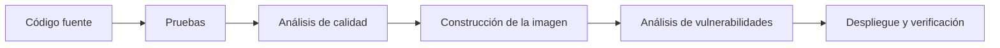
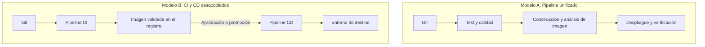
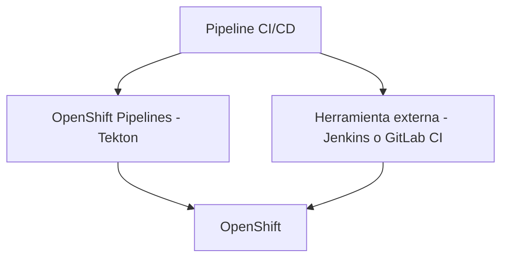
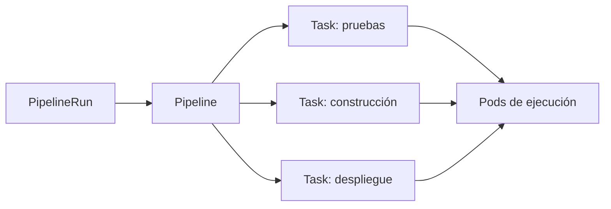
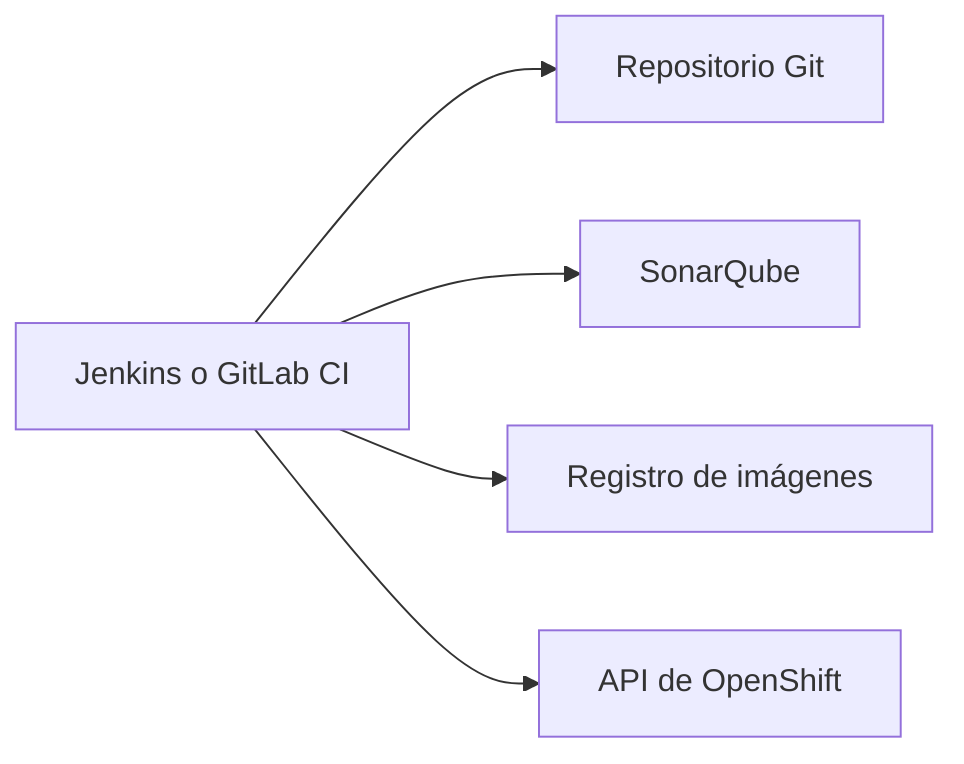

# 4.7 Opciones de automatización: OpenShift Pipelines (Tekton) y herramientas externas de integración continua (Jenkins)

## Objetivos de aprendizaje

Al finalizar este apartado serás capaz de:

- Comprender el ciclo de vida de un pipeline de integración y despliegue continuo y el propósito de sus etapas fundamentales: pruebas, análisis de calidad, construcción de la imagen, análisis de vulnerabilidades y despliegue.
- Diferenciar entre un **pipeline unificado**, que integra CI y CD en un único flujo, y un **pipeline desacoplado**, que separa la construcción y validación del artefacto de su despliegue.
- Identificar **OpenShift Pipelines (Tekton)** como una opción de automatización integrada con OpenShift.
- Reconocer que herramientas externas como **Jenkins** o **GitLab CI** también pueden automatizar procesos de construcción y despliegue sobre OpenShift.

---

## De la operación manual a la automatización

En los apartados anteriores hemos realizado de forma manual varias operaciones que forman parte del ciclo de vida de una aplicación:

- hemos trabajado con imágenes y registros de contenedores;
- hemos construido una nueva versión de la aplicación;
- hemos desplegado y actualizado cargas de trabajo;
- hemos comprobado el estado del despliegue;
- y hemos promovido una misma imagen entre entornos aplicando configuraciones diferentes.

En un entorno profesional, estas operaciones no suelen depender únicamente de comandos ejecutados manualmente desde una terminal. Se organizan y automatizan mediante un **pipeline de integración y despliegue continuo**, habitualmente denominado **pipeline de CI/CD**.



Un pipeline define una secuencia repetible de etapas. Si una etapa falla, el proceso puede detenerse antes de que el error avance hacia los entornos posteriores.

!!! note "Automatizar no significa eliminar todos los controles"
    Algunas etapas pueden ejecutarse automáticamente, mientras que otras pueden requerir una aprobación manual. Esto es especialmente habitual antes de desplegar en entornos de preproducción o producción.

---

## Etapas habituales de un pipeline

La composición exacta depende de cada organización, pero un pipeline corporativo suele incluir las siguientes etapas.

### 1. Obtención del código y ejecución de pruebas

El pipeline se inicia normalmente a partir de un cambio en el repositorio Git, por ejemplo, al enviar nuevos cambios o aceptar una solicitud de integración.

El sistema obtiene la versión concreta del código y ejecuta las pruebas automatizadas definidas por el equipo. Si una prueba falla, el pipeline se detiene y evita continuar con una versión que no ha superado las validaciones iniciales.

### 2. Análisis estático de código con SonarQube

Antes de construir la imagen, el código puede analizarse mediante una herramienta como **SonarQube**.

SonarQube permite detectar, entre otros aspectos:

- posibles errores de programación;
- vulnerabilidades y problemas de seguridad en el código;
- duplicidades y problemas de mantenibilidad;
- cobertura proporcionada por las pruebas automatizadas.

La organización puede definir un **Quality Gate** o umbral mínimo de calidad. Si el resultado no cumple las condiciones establecidas, el pipeline se detiene antes de generar el artefacto.

!!! example "Ejemplo de control de calidad"
    Una organización puede impedir que el pipeline continúe cuando SonarQube detecta una vulnerabilidad grave o cuando la cobertura de pruebas queda por debajo del mínimo definido para el proyecto.

### 3. Construcción y publicación de la imagen

Una vez superadas las comprobaciones de código, el pipeline construye la imagen de contenedor utilizando el mecanismo elegido por la organización.

La construcción de la imagen puede realizarse de distintas formas. Por ejemplo, la herramienta de CI puede construir directamente la imagen o puede apoyarse en mecanismos de construcción proporcionados por la plataforma.

En OpenShift ya vimos este segundo enfoque cuando utilizamos un **`BuildConfig`** para construir una imagen a partir del código fuente. En un proceso automatizado, un pipeline podría iniciar esa construcción y esperar a que finalizase antes de continuar con las siguientes etapas.

La imagen resultante se publica en el registro corporativo correspondiente, como **Red Hat Quay**, **Harbor**, **Nexus Repository** o el registro integrado de OpenShift, según la arquitectura utilizada.

Para conservar la trazabilidad, la imagen se identifica mediante una etiqueta inmutable, como el **Git Commit SHA** utilizado en el apartado anterior. No es necesario volver a desarrollar aquí este principio: el pipeline simplemente automatiza su aplicación.

### 4. Análisis de vulnerabilidades con Trivy

La imagen puede analizarse mediante herramientas como **Trivy** antes de autorizar su despliegue.

Trivy puede detectar vulnerabilidades conocidas en:

- los paquetes del sistema operativo incluidos en la imagen;
- las dependencias utilizadas por la aplicación;
- determinados archivos de configuración y manifiestos.

Los resultados se comparan con la política de seguridad de la organización. Según su severidad, un hallazgo puede:

- quedar registrado para su corrección posterior;
- requerir una revisión o excepción justificada;
- o impedir que la imagen continúe hacia los siguientes entornos.

!!! warning "El resultado depende de la política de seguridad"
    La presencia de una vulnerabilidad no produce necesariamente la misma respuesta en todas las organizaciones. Los umbrales de bloqueo, las excepciones y los plazos de corrección deben estar definidos por la política de seguridad aplicable.

### 5. Despliegue y verificación

Cuando la imagen ha superado las validaciones, el pipeline puede interactuar con la API de OpenShift para actualizar la aplicación.

El proceso puede automatizar operaciones que ya conocemos, como:

```bash
oc set image deployment/demo-formacion \
  demo-formacion=docker.io/ieftraining/demo-formacion:<COMMIT-SHA>

oc rollout status deployment/demo-formacion
```

Después del despliegue, el pipeline puede comprobar automáticamente que la aplicación responde correctamente. Esta verificación básica se denomina habitualmente **smoke test** y puede consistir, por ejemplo, en consultar el endpoint de disponibilidad que utilizamos anteriormente.

---

## Modelos de orquestación: pipeline unificado y pipeline desacoplado

Las etapas anteriores pueden organizarse de distintas formas. Dos modelos habituales son el **pipeline unificado** y la separación entre un pipeline de **CI** y otro de **CD**.



### Pipeline unificado

En un pipeline unificado, una misma ejecución recorre todas las etapas, desde la obtención del código hasta el despliegue en el entorno de destino.

Este modelo puede resultar adecuado para:

- entornos de desarrollo o integración;
- despliegues frecuentes con un riesgo limitado;
- procesos en los que no se requieren aprobaciones entre la construcción y el despliegue.

Su principal ventaja es la simplicidad del flujo: un cambio validado puede llegar automáticamente al entorno previsto.

### Pipeline desacoplado

En un modelo desacoplado se separan las responsabilidades:

- el **pipeline de CI** prueba el código, aplica los controles de calidad, construye la imagen, analiza sus vulnerabilidades y la publica en el registro;
- el **pipeline de CD** toma una imagen ya validada y la despliega en el entorno autorizado.

Este modelo facilita la incorporación de:

- aprobaciones antes de desplegar;
- segregación de funciones;
- ventanas de mantenimiento;
- controles diferentes según el entorno;
- trazabilidad de las promociones a preproducción y producción.

!!! tip "Relación con el apartado anterior"
    El pipeline de CD puede automatizar el proceso de promoción estudiado en el apartado 4.6: seleccionar una imagen inmutable ya validada y aplicar la configuración correspondiente al entorno de destino.

No existe un único modelo válido para todos los casos. Una organización puede utilizar un pipeline unificado para desarrollo y separar CI y CD para los entornos que requieren mayor control.

---

## ¿Quién ejecuta el pipeline?

Hasta ahora hemos hablado del pipeline desde el punto de vista del **proceso**: qué etapas contiene y cómo pueden organizarse.

Pero esas etapas necesitan una herramienta que las orqueste: iniciar una construcción, ejecutar pruebas, invocar SonarQube o Trivy, publicar una imagen, solicitar un despliegue y comprobar su resultado.

OpenShift puede participar en este proceso de dos formas generales:

- utilizando **OpenShift Pipelines**, basado en Tekton, como solución de automatización integrada con la plataforma;
- utilizando una **herramienta de CI/CD externa**, como Jenkins o GitLab CI, que se comunica con OpenShift para ejecutar las operaciones necesarias.

En ambos casos, el objetivo es el mismo: **automatizar de manera controlada y repetible las operaciones que hasta ahora hemos realizado manualmente**.



---

## OpenShift Pipelines (Tekton)

**OpenShift Pipelines** es la solución de automatización de pipelines integrada con OpenShift y basada en el proyecto **Tekton**.

Tekton representa los pipelines mediante recursos declarativos de Kubernetes. Entre los conceptos principales se encuentran:

- **Task:** define una tarea concreta compuesta por uno o varios pasos, como ejecutar pruebas o construir una imagen.
- **Pipeline:** organiza y relaciona varias tareas.
- **PipelineRun:** representa una ejecución concreta de un pipeline.



Las tareas se ejecutan mediante Pods creados en el clúster para la ejecución correspondiente. Esto permite aprovechar mecanismos propios de Kubernetes y OpenShift, como namespaces, ServiceAccounts, Secrets, volúmenes y controles de acceso.

Cuando el operador de OpenShift Pipelines está instalado y configurado, los pipelines y sus ejecuciones pueden gestionarse desde la consola web y mediante recursos YAML.

!!! note "Disponibilidad en el clúster"
    OpenShift Pipelines no debe darse por instalado en todos los entornos. Su disponibilidad depende de que el operador correspondiente haya sido instalado y configurado por el equipo administrador de la plataforma.

En este curso no vamos a construir un pipeline completo con Tekton. El objetivo es reconocer su función y comprender cómo podría automatizar las operaciones que hemos realizado manualmente.

---

## Herramientas externas de CI/CD

OpenShift también puede integrarse con herramientas de CI/CD que se ejecutan fuera del clúster, como **Jenkins** o **GitLab CI**.

En este modelo, la herramienta externa coordina el pipeline y utiliza credenciales autorizadas para interactuar con:

- el repositorio de código;
- las herramientas de calidad y seguridad;
- el registro de imágenes;
- y la API de OpenShift.



Este enfoque puede utilizarse cuando la organización ya dispone de una plataforma corporativa de automatización o cuando un mismo sistema de CI/CD debe trabajar con diferentes tecnologías y entornos.

Lo importante es distinguir entre la herramienta que **orquesta el proceso** y OpenShift como plataforma en la que se construye o despliega la aplicación. OpenShift Pipelines, Jenkins y GitLab CI pueden organizar el flujo completo; un recurso de construcción de OpenShift, por sí solo, no sustituye a un orquestador de CI/CD.

---

## Ideas clave para recordar

!!! tip "Resumen"
    - Un pipeline de CI/CD automatiza una secuencia repetible de pruebas, controles de calidad, construcción, análisis de seguridad, despliegue y verificación.
    - **SonarQube** puede aplicar controles de calidad sobre el código antes de construir la imagen.
    - **Trivy** puede analizar la imagen y sus dependencias para detectar vulnerabilidades conocidas.
    - En un **pipeline unificado**, CI y CD forman parte de una misma ejecución; en un modelo **desacoplado**, la construcción y validación se separan del despliegue.
    - **OpenShift Pipelines**, basado en **Tekton**, permite definir pipelines mediante recursos declarativos como `Task`, `Pipeline` y `PipelineRun`.
    - Herramientas externas como **Jenkins** o **GitLab CI** también pueden automatizar despliegues sobre OpenShift.
    - La automatización debe respetar los controles, permisos y aprobaciones establecidos por cada organización.
