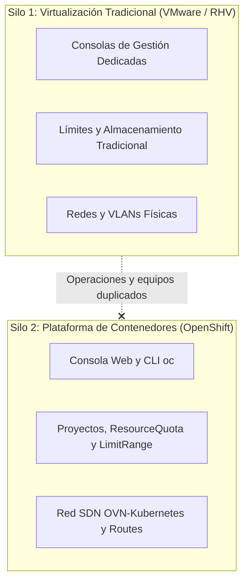
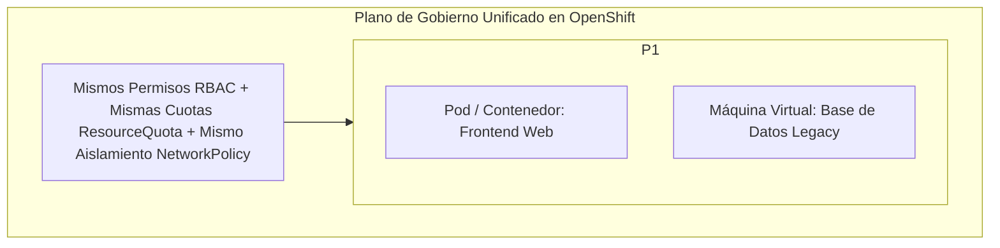
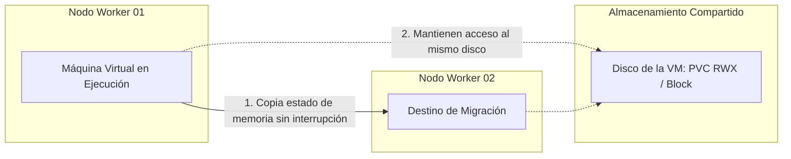
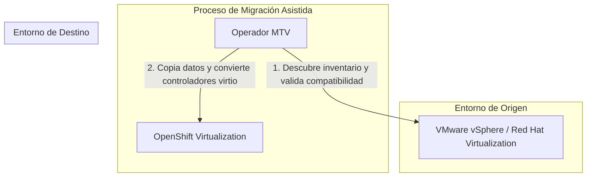

# 4.8 Introducción a OpenShift Virtualization: gestión unificada de máquinas virtuales y contenedores bajo el mismo clúster de Kubernetes

## Objetivos de aprendizaje

Al finalizar este apartado serás capaz de:

- Comprender el concepto de **OpenShift Virtualization** (basado en KubeVirt) y la razón de ser de la convergencia de cargas de trabajo (máquinas virtuales y contenedores) en una única plataforma.
- Analizar el impacto operativo de eliminar el doble silo de infraestructura (hipervisor tradicional frente a plataforma de contenedores).
- Entender cómo las máquinas virtuales heredan las capacidades nativas de gobierno, seguridad y gestión de proyectos de OpenShift.
- Conocer los casos de uso principales, la funcionalidad de **migración en caliente** (*Live Migration*) y la estrategia de importación masiva desde entornos legacy mediante **Migration Toolkit for Virtualization (MTV)**.

---

## El reto de la convivencia: El problema de los dos silos

En la evolución tecnológica de las organizaciones es habitual encontrar aplicaciones modernas diseñadas en microservicios sobre contenedores conviviendo con sistemas tradicionales (bases de datos legacy, monolitos o software de terceros) que no pueden ser empaquetados en contenedores a corto plazo.

Tradicionalmente, esto obligaba a mantener **dos infraestructuras paralelas e independientes**:

Esta duplicidad de entornos genera ineficiencias operativas claras:

- **Complejidad de gestión:** Mantenimiento de múltiples consolas, licencias y modelos de permisos.
- **Silos de conocimiento:** Equipos humanos diferenciados para operar las máquinas virtuales y la plataforma de contenedores.
- **Incapacidad de aplicar políticas unificadas:** Dificultad para aplicar los mismos criterios de seguridad, cuotas de recursos o auditoría sobre todas las aplicaciones de la organización.

---

## ¿Qué es OpenShift Virtualization?

**OpenShift Virtualization** es una característica nativa de la plataforma (basada en el proyecto de código abierto *KubeVirt*) que permite ejecutar y gestionar **máquinas virtuales junto a los contenedores** dentro del mismo clúster de OpenShift.

Al integrar las máquinas virtuales en el modelo de objetos de OpenShift, la VM deja de ser un elemento ajeno a la plataforma y pasa a ser un recurso gestionado mediante las mismas primitivas que hemos estudiado a lo largo de la sesión:

- **Mismo control de acceso (RBAC):** Los usuarios acceden a sus máquinas virtuales utilizando sus mismos permisos (`admin`, `edit`, `view`)[cite: 1] y grupos corporativos[cite: 1].
- **Misma gobernanza de recursos:** La memoria y CPU de las máquinas virtuales suman dentro del `ResourceQuota` del proyecto y se adaptan a los límites del `LimitRange`[cite: 2].
- **Mismo aislamiento de red:** Se pueden aplicar `NetworkPolicies` para filtrar el tráfico entre contenedores y máquinas virtuales con las mismas reglas de seguridad[cite: 2].

---

## Cuadro de convenio: Virtualización Tradicional frente a OpenShift Virtualization

La siguiente tabla resume los aspectos diferenciadores clave que aporta la convergencia de infraestructuras en OpenShift:

| Criterio | Virtualización Tradicional (vSphere / RHV) | OpenShift Virtualization |
| :--- | :--- | :--- |
| **Plano de control** | Consola de hipervisor independiente (*vCenter*, *Manager*). | **Consola web unificada de OpenShift.** |
| **Definición de recursos** | Formularios en consola o plantillas propietarias. | **Declarativo en YAML / GitOps.** Mismo flujo de despliegue que un contenedor. |
| **Aislamiento de red** | VLANs físicas y cortafuegos de red tradicionales. | **NetworkPolicies por software** e integración nativa con OVN-Kubernetes[cite: 2]. |
| **Gobernanza y Cuotas** | Asignación fija por servidor o *cluster* de virtualización. | **ResourceQuota por Proyecto** compartido con contenedores[cite: 2]. |
| **Licenciamiento** | Costes de suscripción/licencia por socket o núcleo de hipervisor. | **Incluido en la propia suscripción de OpenShift.** |

---

## Operativa del ciclo de vida y Migración en Caliente (*Live Migration*)

Desde el punto de vista operativo, las máquinas virtuales en OpenShift soportan las mismas operaciones cotidianas que cualquier entorno de virtualización corporativo (arrancar, pausar, reiniciar, apagar o tomar capturas de estado).

### Migración en Caliente (*Live Migration*)

Una de las capacidades más importantes en entornos de producción es la **Live Migration**:

- Permite trasladar una máquina virtual en ejecución desde un nodo físico a otro **sin corte de servicio ni pérdida de conectividad** para los usuarios.
- **Caso de uso principal:** Mantenimientos programados de la infraestructura. Cuando un nodo físico requiere una actualización del kernel o la sustitución de hardware, el clúster migra automáticamente las máquinas virtuales a otros nodos sin impactar a las aplicaciones.

---

## La estrategia de adopción: Migration Toolkit for Virtualization (MTV)

Para las organizaciones que deciden consolidar sus centros de datos y traer sus máquinas virtuales desde hipervisores externos hacia OpenShift, se utiliza el operador **Migration Toolkit for Virtualization (MTV)**.

### Principales ventajas del operador MTV:
- **Automatización del proceso:** Descubre las VMs del entorno de origen (vCenter), analiza su compatibilidad y ejecuta la copia de datos.
- **Reducción de la ventana de parada (*Warm Migration*):** Copia los datos en segundo plano mientras la máquina de origen sigue dando servicio y realiza una sincronización final muy rápida en el momento del corte.
- **Inyección de controladores:** Sustituye automáticamente los controladores del sistema operativo por los controladores optimizados (*virtio*) necesarios para ejecutarse eficientemente en OpenShift.

---

## Ideas clave para recordar

!!! tip "Resumen"
    - **OpenShift Virtualization** elimina el problema del doble silo al permitir gestionar máquinas virtuales y contenedores bajo el mismo plano de control.
    - Las máquinas virtuales en OpenShift **heredan las mismas primitivas de la plataforma**: proyectos, permisos RBAC, cuotas de recursos (`ResourceQuota`)[cite: 2] y reglas de red (`NetworkPolicy`)[cite: 2].
    - Permite la **Live Migration** (migración en caliente) para mover VMs entre nodos sin interrupción de servicio durante las tareas de mantenimiento de la infraestructura.
    - El operador **Migration Toolkit for Virtualization (MTV)** facilita la importación masiva de VMs desde plataformas como VMware vSphere o RHV reduciendo las ventanas de parada.