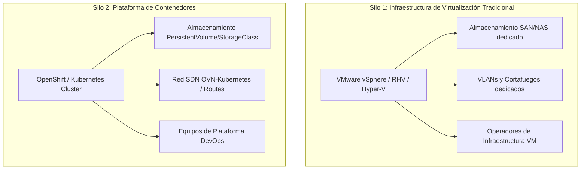
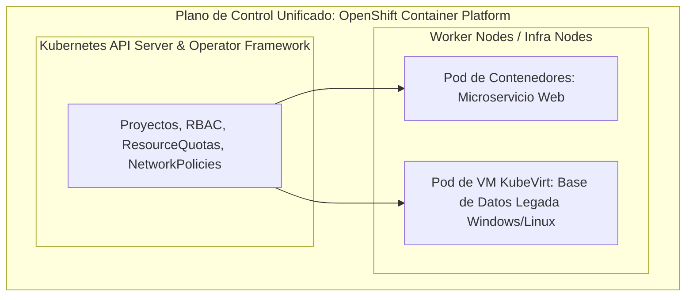
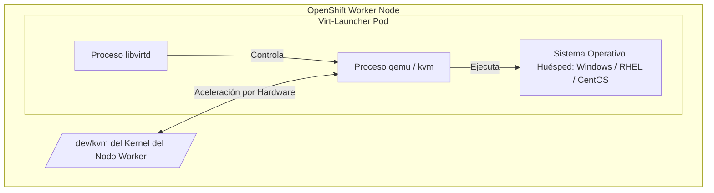
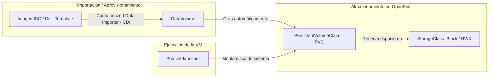
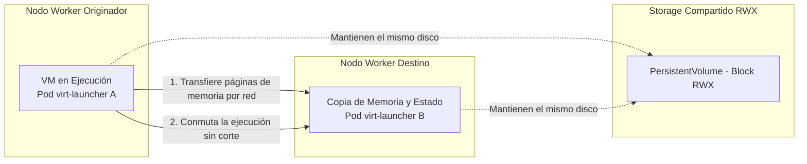
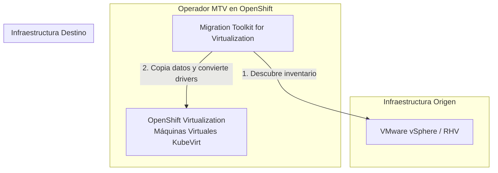

# 4.8 Introducción a OpenShift Virtualization: gestión unificada de máquinas virtuales y contenedores bajo el mismo clúster de Kubernetes

## Objetivos de aprendizaje

Al finalizar este apartado serás capaz de:

- Comprender qué es **OpenShift Virtualization** (KubeVirt) y cómo permite la coexistencia y gestión unificada de cargas de trabajo tradicionalmente aisladas (máquinas virtuales y contenedores) bajo el mismo plano de control.
- Evaluar los beneficios operativos y estratégicos de modernización, analizando el ahorro de licenciamiento, la convergencia de infraestructuras de red/almacenamiento y la simplicidad en la gobernanza.
- Comprender la arquitectura interna y los componentes clave que hacen posible la ejecución de VMs en Kubernetes (`Virt-Launcher`, KVM, libvirt y Custom Resource Definitions).
- Analizar las opciones de almacenamiento (`DataVolume`, `persistentVolumeClaim`, Containerized Data Importer) y red (*Pod Network* frente a red secundaria con Multus y SR-IOV) para máquinas virtuales.
- Comprender el ciclo de vida, la operativa diaria y la alta disponibilidad de VMs en la plataforma, incluyendo el proceso de **migración en caliente** (*Live Migration*) entre nodos.
- Conocer los mecanismos de migración masiva mediante el operador **Migration Toolkit for Virtualization (MTV)** para importar cargas de trabajo desde hipervisores tradicionales (VMware vSphere, Red Hat Virtualization) hacia OpenShift.

---

## La convergencia de dos mundos: Contenedores y Máquinas Virtuales

A lo largo de este curso hemos estudiado cómo OpenShift orquesta aplicaciones empaquetadas en contenedores. Sin embargo, en la realidad de las organizaciones existen sistemas legados, bases de datos complejas, aplicaciones monolíticas o software de terceros que no pueden ser fácilmente "contenedorizados" en el corto plazo debido a dependencias del sistema operativo, requisitos de kernel o restricciones de arquitectura.

Tradicionalmente, las organizaciones mantenían dos infraestructuras completamente separadas y duplicadas:



Esta duplicidad genera **ineficiencias operativas significativas**: dos cuadros de mando, dobles costes de almacenamiento y red, licencias de hipervisor adicionales y equipos humanos trabajando en silos aislados.

**OpenShift Virtualization** (tecnología basada en el proyecto de código abierto **KubeVirt**) resuelve este reto permitiendo ejecutar máquinas virtuales directamente sobre el clúster de OpenShift, tratando a las VMs como recursos nativos de Kubernetes junto a los Pods y contenedores.



---

## Beneficios estratégicos y operacionales

Integrar máquinas virtuales en OpenShift no significa simplemente "ejecutar VMs en otro sitio", sino dotar a la infraestructura de virtualización de todas las ventajas nativas del modelo *Cloud-Native*:

| Dimensión | Virtualización Tradicional | OpenShift Virtualization |
| :--- | :--- | :--- |
| **Gobernanza y Permisos** | Consolas y modelos RBAC propietarios. | **RBAC unificado de OpenShift.** Mismos `Projects`, `Roles` y `RoleBindings` para VMs y contenedores. |
| **Control de Recursos** | Cuotas físicas por hipervisor o *vCenter*. | **ResourceQuota y LimitRange.** Cómputo y memoria gobernados por los mismos límites del proyecto. |
| **Aislamiento de Red** | Configuración manual de VLANs/Trunks por conmutador. | **NetworkPolicy.** Mismo cortafuegos definido por software para filtrar tráfico entre Pods y VMs. |
| **Automatización y CI/CD** | Flujos basados en scripts de hipervisor. | **Declarativo via YAML / GitOps.** Las VMs se definen, versionan y despliegan exactamente igual que un `Deployment`. |
| **Costes de Licencia** | Licenciamiento por socket/núcleo en hipervisores externos. | **Incluido de serie en la suscripción.** Sin coste adicional por VM ejecutada dentro del clúster. |

---

## Arquitectura interna: ¿Cómo funciona una Máquina Virtual en OpenShift?

Para que Kubernetes pueda gestionar una máquina virtual sin modificar el servidor API (*API Server*), OpenShift Virtualization utiliza el patrón de diseño de **Custom Resource Definitions (CRDs)** y **Operadores**.

El secreto técnico de KubeVirt radica en que **cada máquina virtual se ejecuta encapsulada dentro de un Pod estándar de Kubernetes**.



### Componentes clave de la arquitectura:

1. **`VirtualMachine` (VM) y `VirtualMachineInstance` (VMI):** Son los objetos declarativos YAML en Kubernetes que representan la configuración deseada y el estado en tiempo real de la máquina virtual.
2. **`virt-operator`:** El operador principal que supervisa la salud de la plataforma de virtualización y despliega los componentes necesarios en el clúster.
3. **`virt-controller`:** El controlador del control plane que observa las peticiones de creación de VMs y programa su puesta en marcha.
4. **`virt-handler`:** Un agente en forma de `DaemonSet` que se ejecuta en cada nodo *worker*. Se comunica con la virtualización del kernel Linux del host (**KVM** - *Kernel-based Virtual Machine*).
5. **`virt-launcher` (El Pod contenedor):** Para cada máquina virtual encendida, OpenShift arranca un Pod especial de soporte denominado `virt-launcher`. Dentro de este Pod se ejecutan las herramientas estándar de virtualización de Linux (`qemu-kvm` y `libvirtd`), proporcionando aislamiento y límites de recursos al proceso de la VM.

!!! note "Aceleración por Hardware"
    Para lograr un rendimiento idéntico al de un hipervisor tradicional, los nodos de OpenShift deben tener habilitada la virtualización por hardware (**Intel VT-x** o **AMD-V**) en su BIOS/firmware. KubeVirt redirige el dispositivo `/dev/kvm` del nodo directamente al Pod `virt-launcher`.

---

## Almacenamiento para Máquinas Virtuales

A diferencia de los contenedores efímeros cuya capa de escritura se destruye al reiniciar, una máquina virtual requiere **almacenamiento persistente persistente de alto rendimiento** para albergar su disco de sistema operativo (archivos `.qcow2` o imágenes crudas).

OpenShift Virtualization aprovecha la infraestructura de almacenamiento basada en **CSI** (*Container Storage Interface*) y **StorageClasses** estudiada en el apartado 2.5.



### Conceptos clave de almacenamiento para VMs:

- **DataVolume (DV):** Una abstracción de Kubernetes sobre los `PersistentVolumeClaims` que automatiza la importación de imágenes de disco. Permite descargar imágenes de SO directamente desde registros HTTP, S3 o registros de contenedores hacia el volumen de la VM.
- **Modo de Volumen Bloque (*Block Volume Mode*):** Aunque las VMs pueden ejecutarse sobre volúmenes con sistema de archivos (`Filesystem`), la buena práctica en producción es aprovisionar el PVC en modo **Block** (`volumeMode: Block`). Esto entrega el volumen crudo directamente a QEMU, eliminando capas intermedias de sistema de archivos y maximizando el rendimiento I/O.
- **Acceso RWX (*ReadWriteMany*):** Para poder realizar **migraciones en caliente** entre nodos, el almacenamiento subyacente donde reside el disco de la VM debe soportar el modo de acceso `ReadWriteMany` (por ejemplo, mediante Ceph RBD / OpenShift Data Foundation o almacenamiento SAN/NFS corporativo).

---

## Redes en OpenShift Virtualization: Dos enfoques

Las máquinas virtuales en OpenShift pueden conectarse a la red mediante dos modelos principales según el caso de uso:


### 1. Conexión a la Red Nativa (*Pod Network*)
- La VM recibe una dirección IP administrada por la red definida por software (**OVN-Kubernetes**) de la misma forma que un Pod estándar.
- **Ventajas:** Permite exponer la VM hacia fuera mediante objetos `Service` y `Route`, aplicar `NetworkPolicies` para filtrar su tráfico y comunicarse directamente con los microservicios del clúster sin salir de la red interna.

### 2. Conexión a Redes Secundarias (*Multus CNI*)
- Muchos sistemas legados requieren conservar una dirección IP fija dentro de una **VLAN física existente** en la empresa (fuera del rango de IPs del clúster de OpenShift).
- Mediante el plugin de red **Multus CNI** y controladores de puente de red (*Bridge CNI*), OpenShift Virtualization permite añadir interfaces de red adicionales a la VM. De este modo, la máquina virtual se conecta directamente a la red física externa como si estuviera enchufe a un conmutador de la red corporativa.

---

## Operativa del ciclo de vida y Migración en Caliente (*Live Migration*)

Una máquina virtual gestionada por OpenShift Virtualization soporta todas las operaciones habituales del ciclo de vida (arrancar, pausar, reiniciar, apagar, clonar y tomar capturas de estado / *snapshots*), tanto desde la consola web interactiva como mediante herramientas de línea de comandos (`oc` o la CLI dedicada `virtctl`).

```bash
# Comandos de gestión básica mediante virtctl
virtctl start mi-vm-linux -n angel-cuaresma-alons-dev
virtctl stop mi-vm-linux -n angel-cuaresma-alons-dev
virtctl console mi-vm-linux -n angel-cuaresma-alons-dev
```

### La Migración en Caliente (*Live Migration*)

Una de las funcionalidades más críticas para garantizar la alta disponibilidad de servicios en la virtualización es la **Live Migration**. La migración en caliente permite mover una máquina virtual en ejecución desde un nodo *worker* físico a otro sin interrupción del servicio ni pérdida de conectividad para las aplicaciones.



### Casos de uso de la Live Migration:
- **Mantenimiento programado de nodos:** Cuando un administrador necesita reiniciar un nodo físico para actualizar el sistema operativo o aplicar parches de seguridad, el clúster vacía (*drain*) el nodo aplicando migración en caliente sobre todas las VMs sin afectar a los usuarios.
- **Equilibrio de carga automático:** El sistema de balanceo de la plataforma puede reubicar máquinas virtuales si detecta que un nodo presenta saturación de memoria o CPU.

!!! warning "Requisitos para Live Migration"
    Para que una máquina virtual pueda realizar *Live Migration*, es imprescindible que:
    1. El volumen de almacenamiento donde reside el disco sea accesible por ambos nodos (**modo de acceso RWX**).
    2. La red de la VM sea accesible desde ambos nodos.
    3. Exista capacidad suficiente de memoria y CPU en el nodo de destino.

---

## Migración masiva desde hipervisores externos: Migration Toolkit for Virtualization (MTV)

Para aquellas organizaciones que deciden consolidar sus centros de datos y migrar cientos de máquinas virtuales existentes en entornos tradicionales como **VMware vSphere** o **Red Hat Virtualization (RHV)** hacia OpenShift, Red Hat proporciona el operador **Migration Toolkit for Virtualization (MTV)**.



### Capacidades clave del operador MTV:

- **Descubrimiento y evaluación automática:** Conecta con las APIs del entorno de origen (vCenter) para inventariar las VMs, analizando compatibilidades, interfaces de red y discos.
- **Migración en frío (*Cold Migration*) o en caliente (*Warm Migration*):**
  - *Cold Migration:* Apaga la VM de origen, copia los datos y la arranca en OpenShift.
  - *Warm Migration:* Copia la mayor parte del volumen en segundo plano mientras la VM sigue dando servicio en origen. En la ventana de corte final, realiza una pequeña sincronización diferencial de datos apagando la máquina de origen, reduciendo la parada a pocos minutos.
- **Conversión de controladores (Drivers):** Reemplaza automáticamente los controladores de disco y red del sistema operativo huésped (por ejemplo, herramientas de VMware) por los controladores abiertos optimizados **virtio** requeridos por KubeVirt.

---

## Ejemplo conceptual de un manifiesto de Máquina Virtual

A continuación se muestra un manifiesto simplificado de un recurso `VirtualMachine` para ilustrar cómo su sintaxis y estructura siguen de forma exacta el estándar declarativo de Kubernetes/OpenShift:

```yaml
apiVersion: kubevirt.io/v1
kind: VirtualMachine
metadata:
  name: servidor-legado-db
  namespace: angel-cuaresma-alons-dev
spec:
  running: true
  template:
    metadata:
      labels:
        app: servidor-legado-db
    spec:
      domain:
        devices:
          disks:
            - name: datavolumedisk1
              disk:
                bus: virtio
          interfaces:
            - name: default
              masquerade: {}
        resources:
          requests:
            memory: 4Gi
            cpu: "2"
      networks:
        - name: default
          pod: {}
      volumes:
        - name: datavolumedisk1
          dataVolume:
            name: disco-rhel9-db
---
apiVersion: cdi.kubevirt.io/v1beta1
kind: DataVolume
metadata:
  name: disco-rhel9-db
  namespace: angel-cuaresma-alons-dev
spec:
  source:
    http:
      url: "[https://imagenes.corp.internal/images/rhel9-template.qcow2](https://imagenes.corp.internal/images/rhel9-template.qcow2)"
  pvc:
    accessModes:
      - ReadWriteOnce
    resources:
      requests:
        storage: 30Gi
    storageClassName: ocs-storagecluster-ceph-rbd
```

---

## Ideas clave para recordar

!!! tip "Resumen"
    - **OpenShift Virtualization (KubeVirt)** permite ejecutar máquinas virtuales y contenedores en el mismo clúster, unificando la gobernanza, la red, el almacenamiento y las operaciones.
    - Cada máquina virtual se ejecuta dentro de un Pod contenedor de soporte llamado **`virt-launcher`**, aprovechando la tecnología del kernel de Linux **KVM**.
    - Las máquinas virtuales utilizan los recursos nativos de OpenShift: **`Projects`**, **`ResourceQuota`**, **`LimitRange`** y **`NetworkPolicies`**.
    - El almacenamiento se gestiona mediante **DataVolumes** y **PVCs**, siendo la buena práctica el uso de almacenamiento en modo **Block** para un rendimiento óptimo de I/O.
    - Soporta la conexión a la red plana de Kubernetes (*Pod Network*) o a redes físicas de la organización mediante **Multus CNI** (VLANs dedicadas).
    - Permite la **Migración en Caliente (*Live Migration*)** entre nodos sin interrupción del servicio, exigiendo volúmenes de almacenamiento compartidos (**RWX**).
    - El operador **Migration Toolkit for Virtualization (MTV)** automatiza la importación masiva y la conversión de VMs procedentes de entornos VMware vSphere o RHV.