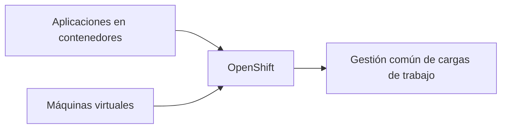
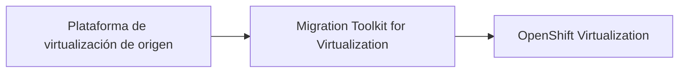

## 4.8 Introducción a OpenShift Virtualization

### Objetivos de aprendizaje

Al finalizar este apartado serás capaz de:

- Comprender qué es **OpenShift Virtualization** y por qué permite gestionar máquinas virtuales y aplicaciones containerizadas desde una misma plataforma.
- Identificar situaciones en las que una organización necesita mantener máquinas virtuales junto a aplicaciones desplegadas en contenedores.
- Conocer, de forma introductoria, algunas capacidades asociadas a la gestión y migración de máquinas virtuales.

### Máquinas virtuales y contenedores en una misma organización

A lo largo del curso hemos utilizado OpenShift como una plataforma para desplegar y operar aplicaciones containerizadas. Sin embargo, muchas organizaciones mantienen también aplicaciones tradicionales que, por diversos motivos, continúan ejecutándose en **máquinas virtuales**.

No todas las aplicaciones pueden o deben transformarse inmediatamente en contenedores. Algunos sistemas dependen de software específico, tienen ciclos de vida largos o requieren una modernización progresiva. Por ello, es habitual que durante años convivan:

- aplicaciones modernas desplegadas en contenedores;
- aplicaciones tradicionales ejecutadas en máquinas virtuales.

Cuando ambos tipos de cargas se gestionan mediante plataformas completamente separadas, es necesario mantener herramientas, procedimientos y modelos de operación diferentes. OpenShift Virtualization ofrece una alternativa para integrar estas cargas dentro de una misma plataforma.

### ¿Qué es OpenShift Virtualization?

**OpenShift Virtualization** es una capacidad de OpenShift que permite ejecutar y gestionar **máquinas virtuales junto con aplicaciones containerizadas** dentro del mismo clúster.

Se basa en el proyecto de código abierto **KubeVirt**, que incorpora las máquinas virtuales al modelo de gestión de Kubernetes. Para el usuario, esto significa que una máquina virtual puede administrarse como otro recurso de la plataforma, sin necesidad de conocer en este curso los componentes internos que lo hacen posible.

La finalidad no es convertir automáticamente una aplicación tradicional en una aplicación containerizada. La máquina virtual sigue siendo una máquina virtual, con su propio sistema operativo y sus aplicaciones, pero pasa a gestionarse desde OpenShift.

### Una plataforma común de gestión

La integración de máquinas virtuales en OpenShift permite aplicarles conceptos que ya hemos utilizado a lo largo del curso:

- **Proyectos:** las máquinas virtuales pueden organizarse dentro de proyectos, junto con otros recursos de la aplicación.
- **Control de acceso:** los permisos de OpenShift determinan qué usuarios pueden consultar o gestionar las máquinas virtuales.
- **Recursos:** el consumo de CPU y memoria puede tenerse en cuenta dentro de la gestión de recursos del clúster.
- **Red:** las máquinas virtuales pueden integrarse con las capacidades de red de la plataforma.
- **Automatización:** su definición y ciclo de vida pueden incorporarse a procesos declarativos y automatizados.

Esto no significa que desaparezcan las necesidades propias de la virtualización. El dimensionamiento de los nodos, el almacenamiento, la red y la disponibilidad siguen siendo aspectos fundamentales. La principal diferencia es que contenedores y máquinas virtuales pueden administrarse bajo un modelo de plataforma común.

| Aspecto | Plataforma de virtualización independiente | OpenShift Virtualization |
|---|---|---|
| Cargas gestionadas | Principalmente máquinas virtuales | Máquinas virtuales y contenedores |
| Gestión | Herramientas propias de la plataforma de virtualización | Consola, API y herramientas de OpenShift |
| Organización | Estructuras propias del entorno de virtualización | Proyectos y recursos de OpenShift |
| Automatización | Herramientas y mecanismos del entorno de virtualización | Modelo declarativo y ecosistema de OpenShift |

!!! note "Un enfoque de convivencia"
    OpenShift Virtualization no obliga a sustituir inmediatamente las máquinas virtuales por contenedores. Permite que ambos tipos de carga convivan mientras la organización decide qué aplicaciones deben mantenerse, modernizarse o transformarse progresivamente.

### Ciclo de vida de las máquinas virtuales

Desde OpenShift pueden realizarse operaciones habituales sobre las máquinas virtuales, como crearlas, arrancarlas, detenerlas, reiniciarlas o consultar su estado.

Una capacidad relevante es la **migración en caliente** o *Live Migration*. Esta funcionalidad permite trasladar determinadas máquinas virtuales en ejecución de un nodo del clúster a otro, siempre que se cumplan los requisitos necesarios.

Esta capacidad puede facilitar, por ejemplo, el mantenimiento de un nodo físico, ya que determinadas cargas virtualizadas pueden trasladarse antes de intervenir sobre él. Su disponibilidad y funcionamiento dependen de la configuración del clúster, la red, el almacenamiento y las características de la propia máquina virtual.

En este curso es suficiente con conocer el concepto. La configuración y operación de la migración en caliente requieren una formación específica sobre OpenShift Virtualization.

### Migración de máquinas virtuales existentes

Una organización que adopta OpenShift Virtualization puede disponer ya de máquinas virtuales alojadas en otras plataformas. Para facilitar su traslado, Red Hat proporciona **Migration Toolkit for Virtualization (MTV)**.

MTV ayuda a planificar y ejecutar la migración de máquinas virtuales desde plataformas compatibles hacia OpenShift Virtualization. Antes de realizar una migración real es necesario analizar la compatibilidad, las redes, el almacenamiento, los sistemas operativos y la ventana de interrupción asumible.

El objetivo de esta herramienta es facilitar una transición controlada. No convierte las aplicaciones migradas en aplicaciones containerizadas: las cargas continúan ejecutándose como máquinas virtuales dentro de OpenShift.

### Ideas clave para recordar

!!! tip "Resumen"
    - **OpenShift Virtualization** permite gestionar máquinas virtuales y aplicaciones containerizadas desde una misma plataforma OpenShift.
    - Resulta útil cuando una organización necesita mantener aplicaciones tradicionales mientras avanza en la adopción de contenedores.
    - Las máquinas virtuales pueden integrarse con conceptos conocidos de OpenShift, como proyectos, permisos, recursos, red y automatización.
    - La **migración en caliente** permite trasladar determinadas máquinas virtuales entre nodos cuando se cumplen los requisitos necesarios.
    - **Migration Toolkit for Virtualization (MTV)** facilita la migración de máquinas virtuales desde plataformas compatibles hacia OpenShift Virtualization.
    - OpenShift Virtualization amplía los tipos de carga que puede gestionar la plataforma, pero su administración detallada requiere conocimientos específicos que quedan fuera del alcance de este curso introductorio.
