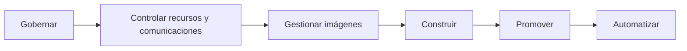
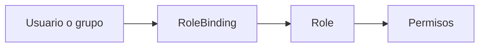
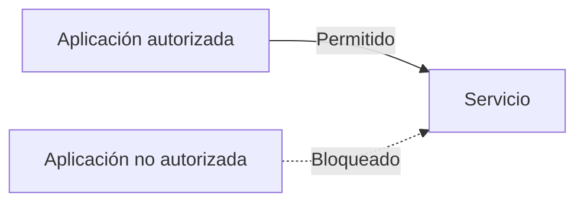
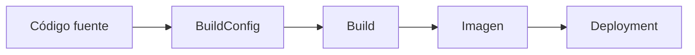
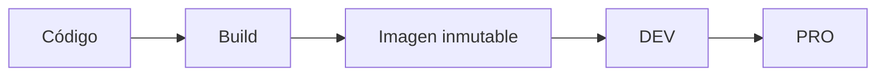
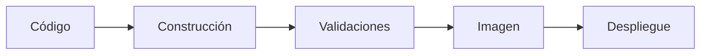
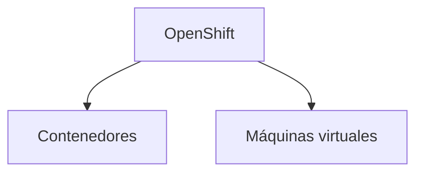

# 4.9 Cierre de la sesión 4

## Resumen de la sesión

A lo largo de esta sesión hemos ampliado la visión de OpenShift más allá del despliegue y la operación de una aplicación individual. El objetivo ha sido comprender cómo una plataforma compartida puede organizarse, gobernarse y utilizarse de forma repetible.

Durante la sesión hemos trabajado con:

- Usuarios, grupos, roles y permisos.
- ServiceAccounts para las identidades utilizadas por las aplicaciones.
- Cuotas, límites y criterios de ubicación de las cargas.
- NetworkPolicies para controlar las comunicaciones entre aplicaciones.
- Registros, etiquetas y seguridad de las imágenes.
- BuildConfig para construir imágenes dentro de OpenShift.
- Promoción de aplicaciones entre entornos mediante Kustomize.
- Automatización con pipelines y herramientas externas de integración continua.
- OpenShift Virtualization como capacidad para gestionar máquinas virtuales sobre la plataforma.

Cada uno de estos elementos resuelve una necesidad diferente, pero todos contribuyen a un mismo objetivo: utilizar OpenShift de forma controlada, reproducible y coherente.



## Qué debemos recordar

### Los permisos deben responder a responsabilidades

OpenShift utiliza RBAC para determinar quién puede realizar cada acción sobre los recursos de la plataforma.



Cuando varias personas necesitan los mismos permisos, resulta más sencillo asignarlos a un grupo que mantener autorizaciones individuales para cada usuario.

Las aplicaciones también pueden necesitar una identidad propia. Para ello utilizan ServiceAccounts, a las que se pueden asignar permisos específicos sin depender de una identidad personal.

!!! tip "Idea clave"
    Los permisos deben concederse de acuerdo con las funciones y responsabilidades reales, aplicando el principio de mínimo privilegio.

### Los recursos de la plataforma son compartidos

Las cargas de trabajo comparten la capacidad disponible del clúster. Por esta razón, la gobernanza también implica definir:

- Cuánto puede consumir un proyecto.
- Qué valores deben declarar sus aplicaciones.
- En qué nodos pueden ejecutarse determinadas cargas.

ResourceQuota y LimitRange permiten establecer límites y valores predeterminados, mientras que los mecanismos de planificación ayudan a decidir dónde se ejecutarán los Pods.

!!! note "Gobernar no significa únicamente restringir"
    Una definición adecuada de recursos ayuda a evitar consumos descontrolados, facilita la planificación y mejora la convivencia entre aplicaciones y equipos.

### La conectividad también forma parte del gobierno

Por defecto, las aplicaciones desplegadas en la plataforma pueden necesitar comunicarse con otros componentes. NetworkPolicy permite declarar qué comunicaciones están autorizadas y limitar aquellas que no son necesarias.



El objetivo no consiste en añadir reglas arbitrarias, sino en permitir únicamente los flujos de comunicación que la aplicación necesita.

### Las imágenes deben ser identificables y controladas

Una imagen es el artefacto que contiene la aplicación y sus dependencias. En un entorno controlado debemos poder responder, como mínimo, a estas preguntas:

- ¿De dónde procede la imagen?
- ¿Qué versión estamos desplegando?
- ¿Ha sido analizada antes de utilizarse?
- ¿Es exactamente la misma imagen que se validó en el entorno anterior?

Las etiquetas ayudan a identificar versiones, pero para garantizar que se utiliza exactamente el mismo contenido puede emplearse también el digest de la imagen.

!!! warning "Evitar referencias ambiguas"
    Etiquetas genéricas como `latest` dificultan saber qué versión se está ejecutando y reducen la trazabilidad del despliegue.

### Construir y desplegar son procesos diferentes

Durante la sesión hemos utilizado BuildConfig para transformar el código fuente en una imagen que posteriormente puede desplegarse.



La construcción genera el artefacto. El despliegue utiliza ese artefacto para ejecutar la aplicación. Separar ambos procesos permite identificar mejor cada versión y reutilizar la misma imagen en distintos entornos.

### Una imagen debe construirse una vez y promoverse entre entornos

La promoción no consiste en volver a construir la aplicación para cada entorno. El principio trabajado durante la sesión ha sido construir una imagen, validarla y promover ese mismo artefacto.



Las diferencias entre entornos deben mantenerse en la configuración, no incorporarse mediante reconstrucciones diferentes de la imagen.

Kustomize permite partir de una configuración común y aplicar únicamente las variaciones necesarias para cada entorno.

!!! tip "Construir una vez, promover muchas"
    Utilizar la misma imagen en todos los entornos reduce diferencias inesperadas y mejora la trazabilidad del proceso.

### La automatización aplica un proceso previamente definido

Una pipeline encadena y automatiza tareas como:

- Obtener el código.
- Construir la imagen.
- Ejecutar validaciones.
- Publicar el artefacto.
- Desplegar o promover una versión.



La automatización no sustituye la comprensión del proceso. Antes de automatizarlo debemos saber qué pasos lo componen, qué artefactos genera y qué condiciones deben cumplirse para continuar.

### Máquinas virtuales y contenedores pueden convivir

OpenShift Virtualization permite gestionar máquinas virtuales mediante los mecanismos de la plataforma y hacerlas convivir con las aplicaciones contenerizadas.

Esto no convierte una máquina virtual en un contenedor. Ambos modelos mantienen características diferentes, pero pueden administrarse desde una plataforma común cuando esta capacidad está instalada y habilitada.



## Visión global de la sesión

El recorrido seguido durante esta sesión puede resumirse en tres grandes ámbitos:

```mermaid
flowchart LR
    subgraph Gobierno
        A[Identidades y permisos]
        B[Recursos y planificación]
        C[Comunicaciones]
    end

    subgraph Industrialización
        D[Gestión de imágenes]
        E[Construcción]
        F[Promoción]
        G[Automatización]
    end

    subgraph Capacidades adicionales
        H[OpenShift Virtualization]
    end

    Gobierno --> Industrialización
    Industrialización --> Capacidades adicionales
```

Hemos pasado de administrar recursos de forma individual a comprender cómo establecer reglas comunes, construir artefactos trazables, mantener diferencias entre entornos y automatizar procesos repetibles.

## Resumen final

!!! tip "Mensajes clave de la sesión"
    - RBAC permite controlar quién puede hacer qué sobre los recursos de la plataforma.
    - Los grupos simplifican la asignación de permisos a varios usuarios.
    - Las ServiceAccounts proporcionan identidad a las aplicaciones y procesos automatizados.
    - ResourceQuota y LimitRange ayudan a gobernar el consumo de recursos.
    - NetworkPolicy permite controlar las comunicaciones entre cargas.
    - Las imágenes deben ser identificables, trazables y verificables.
    - BuildConfig permite construir imágenes dentro de OpenShift.
    - Construir y desplegar son procesos relacionados, pero diferentes.
    - La misma imagen debe promoverse entre entornos sin reconstruirse.
    - Kustomize permite mantener una base común y adaptar la configuración de cada entorno.
    - Las pipelines automatizan procesos que previamente deben estar bien definidos.
    - OpenShift Virtualization permite gestionar máquinas virtuales junto con cargas contenerizadas.

La sesión ha conectado el gobierno de la plataforma con la industrialización del ciclo de vida de las aplicaciones. El resultado es una forma de trabajo más controlada, reproducible y preparada para crecer sin depender de procedimientos manuales diferentes en cada entorno.
